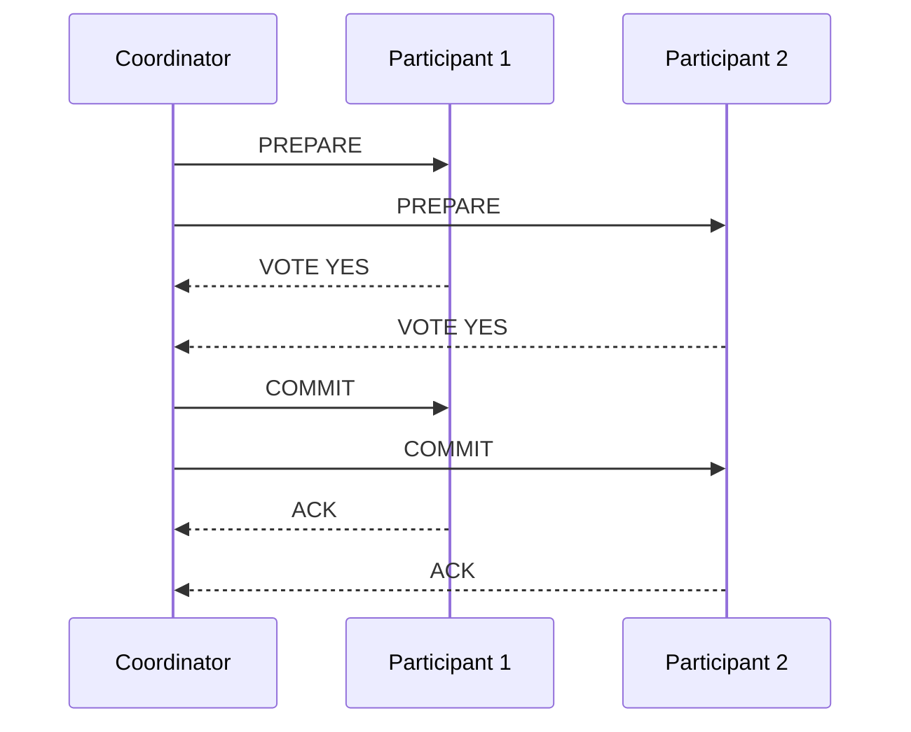
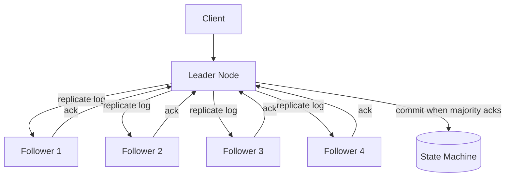
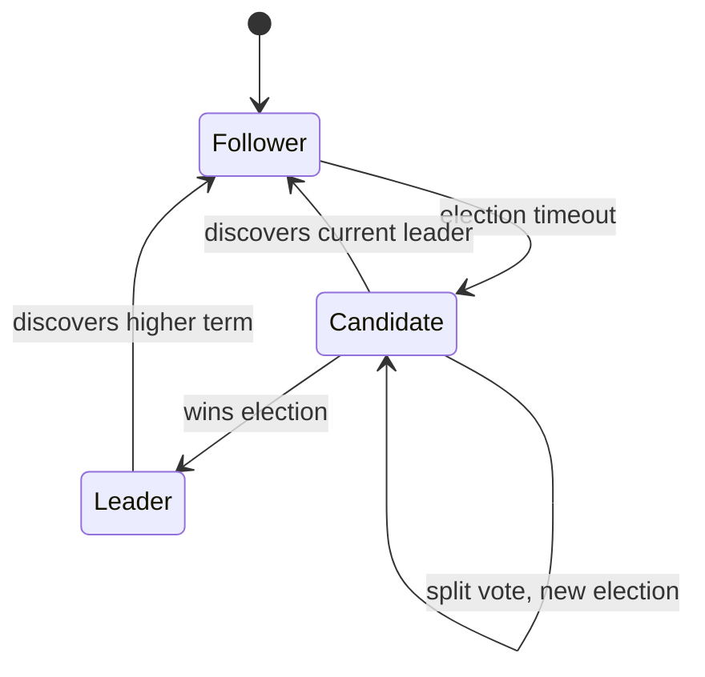

# Consensus Basics

## Overview

**Consensus** is the problem of getting multiple nodes in a distributed system to agree on a single value, despite failures. It sounds simple — "everyone pick the same thing" — but it is one of the hardest problems in computer science. The FLP impossibility result (1985) proved that no deterministic algorithm can guarantee consensus in an asynchronous system with even one faulty node. Every consensus protocol ever built (Paxos, Raft, Zab, PBFT) is a carefully-designed workaround for this impossibility — trading some combination of liveness, determinism, or timing assumptions to make progress possible.

Consensus is the mechanism underneath leader election, distributed transactions, replicated state machines, and configuration management. If you've used ZooKeeper, etcd, Consul, or any database with automatic failover, you've used consensus.

---

## Why It Exists

In a distributed system, multiple nodes must often agree: who is the leader? what is the committed value? did this transaction succeed? Without a consensus protocol, disagreement is possible — two nodes both think they're the leader (split brain), two replicas have different committed values, or a transaction is committed on one node and rolled back on another.

What was broken before consensus protocols: distributed systems used ad-hoc coordination — often a single coordinator node. If the coordinator failed, the system either stopped (unavailable) or split (inconsistent). Manual failover required human intervention, which meant minutes to hours of downtime. Automatic failover without a consensus protocol is unsafe — it can produce split brain, where two nodes both believe they are the primary.

Consensus protocols solve this by providing a *safe* mechanism for nodes to agree, even when some nodes fail or the network partitions. They guarantee that all non-faulty nodes eventually agree on the same value, and that no two nodes commit contradictory values.

---

## Historical Context

1. **Two-Phase Commit (1978).** Jim Gray's 2PC protocol achieves consensus between a coordinator and participants — but it blocks if the coordinator dies mid-protocol. It's consensus with a single point of failure.
2. **FLP impossibility (1985).** Fischer, Lynch, and Paterson proved that no deterministic consensus algorithm can guarantee both safety and liveness in an asynchronous system with even one crash-faulty process. This result didn't stop progress — it just meant every real protocol must make timing assumptions or sacrifice guaranteed liveness.
3. **Paxos (1989, published 1998).** Leslie Lamport's protocol for achieving consensus in the presence of crash failures. Correct, but famously difficult to understand and implement. The paper was published nine years after it was written because reviewers didn't understand it.
4. **Zab (2008).** Zookeeper Atomic Broadcast, designed for ZooKeeper. Simpler than Paxos for the specific use case of replicated state machines with a leader.
5. **Raft (2013).** Diego Ongaro and John Ousterhout designed Raft explicitly for understandability. Same guarantees as Paxos, but structured around leader election + log replication. Became the most widely-implemented consensus protocol in modern systems (etcd, CockroachDB, TiKV, Consul).
6. **PBFT and BFT (1999, ongoing).** Practical Byzantine Fault Tolerance handles *malicious* (not just crash-faulty) nodes. Used in blockchain and some critical infrastructure. Much more expensive than crash-fault consensus.

The arc: blocking coordination (2PC) → crash-fault consensus (Paxos, Raft) → Byzantine-fault consensus (PBFT). Each generation handles more failure modes at higher cost.

---

## First Principles

### The consensus problem

N nodes propose values. The protocol must satisfy three properties:

1. **Agreement.** All non-faulty nodes decide on the same value.
2. **Validity.** The decided value was proposed by some node (no "magic" values).
3. **Termination (liveness).** Every non-faulty node eventually decides.

FLP says you can't have all three in an asynchronous system with failures. In practice, protocols sacrifice *guaranteed* termination — they can stall temporarily (during a partition or leader election) but eventually make progress when the network stabilizes.

### Failure models

The protocol's strength depends on what kind of failures it tolerates:

- **Crash-fault.** A node stops and never recovers (or stops and recovers later). Paxos and Raft handle crash faults.
- **Crash-recovery.** A node crashes and restarts, potentially with durable state. Raft handles this.
- **Byzantine fault.** A node behaves arbitrarily — it can lie, send contradictory messages, or collude with other faulty nodes. PBFT handles this.

The tolerance formula for crash faults: a system with N nodes can tolerate F crash faults if N ≥ 2F + 1. A 3-node cluster tolerates 1 failure. A 5-node cluster tolerates 2.

For Byzantine faults: N ≥ 3F + 1. A 4-node cluster tolerates 1 Byzantine fault. A 7-node cluster tolerates 2.

### The role of the leader

Most practical consensus protocols use a leader:

1. **Leader election.** The nodes agree on who the leader is (itself a consensus problem, bootstrapped with timeouts).
2. **Log replication.** The leader proposes values; followers accept or reject. A value is *committed* when a majority of nodes have accepted it.
3. **Leader failure.** If the leader dies, a new leader is elected. The new leader must not contradict any previously committed values.

This leader-based approach converts the consensus problem into a log-replication problem, which is easier to implement and reason about.

---

## Mental Model

A jury deliberation.

Twelve jurors must reach a unanimous (or majority) verdict. One juror is the foreperson (the leader). The foreperson proposes a verdict; the jurors vote. If a majority agrees, the verdict is committed.

If the foreperson falls asleep (crashes), the remaining jurors pick a new foreperson and continue. The new foreperson can't overturn a verdict the previous foreperson already committed — that would be a safety violation.

If a juror lies about how they voted (Byzantine fault), the process is harder. You need more jurors and more rounds of voting to detect and outvote the liar.

The FLP result says: if there's no clock on the wall (asynchronous system), and at least one juror might fall asleep at any moment, it's possible that deliberation never terminates. In practice, there *is* a clock — timeouts ensure someone eventually calls for a new vote.

---

## Internal Mechanics

### Two-Phase Commit (2PC)

The simplest coordination protocol. Not crash-tolerant — included here because it's the baseline.



If the coordinator crashes after sending PREPARE but before sending COMMIT, the participants are stuck — they don't know whether to commit or abort. This is the *blocking* problem of 2PC.

### Raft (the understandable consensus protocol)

Raft structures consensus as three sub-problems:

**1. Leader election**

```kotlin
// Raft node states
enum class NodeState { FOLLOWER, CANDIDATE, LEADER }

class RaftNode(val id: String, val peers: List<String>) {
    var state = NodeState.FOLLOWER
    var currentTerm = 0
    var votedFor: String? = null
    var electionTimeout = randomTimeout(150, 300)  // ms

    fun onElectionTimeout() {
        // Haven't heard from leader — start election
        currentTerm++
        state = NodeState.CANDIDATE
        votedFor = id
        var votes = 1  // vote for self

        for (peer in peers) {
            val granted = requestVote(peer, currentTerm, lastLogIndex, lastLogTerm)
            if (granted) votes++
        }

        if (votes > (peers.size + 1) / 2) {
            state = NodeState.LEADER
            startHeartbeats()
        }
    }
}
```

A node that doesn't hear from a leader within its election timeout becomes a candidate, increments the term, and requests votes. A majority of votes wins the election. Randomized timeouts prevent split votes (two candidates splitting the vote).

**2. Log replication**

```kotlin
data class LogEntry(val term: Int, val command: Command)

class RaftLeader(private val node: RaftNode) {
    val log = mutableListOf<LogEntry>()
    var commitIndex = -1

    fun propose(command: Command) {
        val entry = LogEntry(node.currentTerm, command)
        log.add(entry)
        val index = log.lastIndex

        // Replicate to followers
        var acks = 1  // self
        for (peer in node.peers) {
            val success = appendEntries(peer, entry, index)
            if (success) acks++
        }

        // Commit when a majority has acked
        if (acks > (node.peers.size + 1) / 2) {
            commitIndex = index
            applyToStateMachine(entry.command)
        }
    }
}
```

The leader appends the command to its log, replicates to followers, and commits when a majority has acknowledged. Committed entries are guaranteed to be present in all future leaders' logs.

**3. Safety**

The key safety property: if a log entry is committed in a given term, that entry will be present in the logs of all leaders for all higher terms. Raft ensures this through the *election restriction*: a candidate can only win an election if its log is at least as up-to-date as a majority of the nodes. This prevents a stale node from becoming leader and overwriting committed entries.

### Paxos (the correct but difficult protocol)

Paxos uses a different structure: proposers, acceptors, and learners.

```text
Phase 1 (Prepare):
  Proposer → all Acceptors: PREPARE(n)
  Acceptor → Proposer: PROMISE(n, previously_accepted_value)
  
Phase 2 (Accept):
  Proposer → all Acceptors: ACCEPT(n, value)
  Acceptor → Proposer: ACCEPTED(n)
  
  If a majority of Acceptors accept, the value is chosen.
```

Paxos and Raft are equivalent in power — they solve the same problem with the same guarantees. Raft is easier to understand; Paxos is more flexible for multi-decree consensus (agreeing on a sequence of values).

---

## Architecture





A typical consensus-based system: clients talk to the leader, the leader replicates to followers, and commits after a majority acknowledges. If the leader fails, a new election produces a new leader within milliseconds to seconds.

---

## Production Example

- **etcd.** Raft-based key-value store. Used by Kubernetes for all cluster state (pod assignments, service discovery, config). Typically 3 or 5 nodes.
- **ZooKeeper.** Zab (ZooKeeper Atomic Broadcast) protocol. Used for leader election, distributed locks, and configuration in Hadoop, Kafka, and many other systems.
- **CockroachDB.** Uses Raft for replication of individual ranges (partitions of the key space). Each range has its own Raft group.
- **TiKV.** The storage layer of TiDB, uses Raft for replication. Multi-Raft: one Raft group per key range.
- **Consul.** Raft-based service discovery and configuration. HashiCorp's answer to ZooKeeper.
- **Google Chubby.** Paxos-based lock service. The internal predecessor to ZooKeeper. Described in a 2006 paper that motivated much of the industry's move to consensus-based coordination.
- **Google Spanner.** Uses Paxos for replication of individual splits. Combined with TrueTime for globally-consistent transactions.

---

## Android Example

Mobile apps rarely implement consensus directly, but they *depend* on consensus-based services and encounter the same problems at a different scale.

```kotlin
// Leader election for background work coordination
// When multiple instances of a service run, only one should execute the job
class WorkCoordinator(
    private val firestore: FirebaseFirestore,
    private val deviceId: String
) {
    // Firestore transactions provide atomicity — not full consensus,
    // but sufficient for single-document leader election
    suspend fun tryBecomeLeader(jobId: String): Boolean {
        return firestore.runTransaction { transaction ->
            val ref = firestore.collection("leaders").document(jobId)
            val doc = transaction.get(ref)

            val currentLeader = doc.getString("leaderId")
            val leaseExpiry = doc.getLong("leaseExpiry") ?: 0

            if (currentLeader == null || System.currentTimeMillis() > leaseExpiry) {
                // No leader or lease expired — claim leadership
                transaction.set(ref, mapOf(
                    "leaderId" to deviceId,
                    "leaseExpiry" to System.currentTimeMillis() + 30_000  // 30s lease
                ))
                true
            } else {
                currentLeader == deviceId  // already leader
            }
        }.await()
    }
}
```

More commonly, Android apps interact with consensus through:

- **Firebase Realtime Database / Firestore.** Transactions that provide atomicity — built on consensus internally.
- **Server-side leader election.** The backend uses ZooKeeper or etcd for leader election; the mobile app talks to whichever server is the current leader.
- **Conflict resolution.** When an offline-first mobile app syncs, the server (which uses consensus internally) arbitrates conflicts.

The key mobile insight: consensus is a *server-side* building block. Mobile apps benefit from it indirectly — through databases, configuration systems, and coordination services that use consensus under the hood.

---

## Tradeoffs

**Advantages**

- **Safety.** Committed values are never lost or contradicted, even under failures.
- **Automatic failover.** Leader death triggers election within seconds — no human intervention.
- **Linearizable reads and writes.** Consensus provides the strongest consistency guarantee.

**Disadvantages**

- **Latency.** Every write requires a round-trip to a majority of nodes. Cross-region consensus adds significant latency.
- **Availability.** A minority partition (fewer than a majority of nodes) cannot serve writes. A 3-node cluster with 2 nodes down is fully unavailable.
- **Complexity.** Correct implementation is extremely difficult. Paxos is notoriously hard to get right. Even Raft, designed for understandability, has subtle edge cases.
- **Throughput ceiling.** All writes go through a single leader. Throughput is bounded by the leader's capacity plus replication overhead.

**Hidden costs**

- **Leader hotspot.** The leader handles all writes and all replication. It's a bottleneck and a single point of load concentration.
- **Election storms.** Under unstable networks, frequent leader elections can reduce availability more than the failures they're trying to handle.
- **Log compaction.** The replicated log grows forever without compaction (snapshotting). Compaction is a significant implementation complexity.

**When not to use**

- Data that tolerates eventual consistency. Consensus is expensive; don't pay for it when you don't need it.
- High-throughput write workloads where a single leader is a bottleneck. Partition the data and run consensus per partition (Multi-Raft).
- Systems with only two nodes. Consensus requires a majority; with two nodes and one failure, the remaining node cannot form a majority. Use 3 or 5 nodes.

---

## Failure Modes

**Split brain.** Two nodes both think they're the leader. Raft prevents this with term numbers — a leader from an older term is superseded by a leader from a newer term. But bugs in implementation (incorrect term handling, network timing issues) can still cause split brain.

**Election livelock.** Multiple candidates repeatedly split the vote, and no leader is ever elected. Mitigation: randomized election timeouts (Raft's approach). Each candidate waits a random interval before starting an election, breaking the symmetry.

**Log divergence.** A failed leader had uncommitted entries that a new leader doesn't have. The new leader's log takes precedence; the failed leader's uncommitted entries are lost. This is *safe* (they were never committed) but can surprise engineers who assumed "written to leader" meant "committed."

**Slow followers.** A follower that's far behind in the log can slow down commits (if its ack is needed for majority). Mitigation: the leader can remove a slow follower from the quorum (cluster membership change) or use async replication for non-voting followers.

**Network partition with majority.** If the leader is on the minority side of a partition, the majority side elects a new leader. The old leader can still accept writes (briefly, before it discovers the new term), but those writes won't be committed. Clients talking to the old leader get timeouts. Mitigation: leader leases — the leader steps down if it hasn't heard from a majority within a timeout.

**Correlated failures.** All nodes in the same datacenter lose power. A 3-node cluster in one datacenter has zero fault tolerance against datacenter failure. Mitigation: spread nodes across failure domains (racks, availability zones, regions).

---

## Performance Considerations

- **Write latency.** Bounded by the round-trip to the slowest node in the majority quorum. For a 3-node cluster in one datacenter: ~1-5 ms. Cross-region: 50-200 ms.
- **Read latency.** Linearizable reads require a round-trip to the leader (or a quorum read). Stale reads from followers are cheaper but weaker.
- **Throughput.** Bounded by the leader. Typical: thousands to tens of thousands of writes per second per Raft group. For higher throughput, partition into multiple Raft groups (Multi-Raft).
- **CPU.** Log serialization, cryptographic verification (if signed), and state-machine application. Usually not the bottleneck.
- **Disk.** Every committed entry is written to disk on every node (for durability). Disk throughput can be the limiting factor for write-heavy workloads.

---

## Reliability Considerations

- Consensus protocols are the **foundation of reliable distributed systems**. Leader election, replicated state machines, distributed locks, and consistent configuration all depend on consensus.
- **Cluster size matters.** 3 nodes: tolerates 1 failure. 5 nodes: tolerates 2. 7 nodes: tolerates 3 but adds latency. Most production systems use 3 or 5.
- **Cross-region placement** is the expensive reliability step. It buys tolerance of regional outages but costs write latency.
- **Test failover regularly.** Kill the leader in a test environment and verify that a new leader is elected within the expected time and no committed data is lost.

---

## Security Considerations

- **Byzantine faults.** Standard crash-fault consensus (Paxos, Raft) does not protect against malicious nodes. If a node is compromised, it can disrupt the protocol. Use BFT protocols for adversarial environments.
- **Log confidentiality.** The replicated log contains all writes. If a node is compromised, the attacker has access to the entire write history. Mitigation: encrypt the log at rest; use TLS for replication traffic.
- **Election manipulation.** An attacker who can delay or reorder messages can influence which node becomes leader. Mitigation: authenticated RPCs; bounded election timeouts.

---

## Observability

- **Leader identity.** Which node is the current leader? How long has it been leader?
- **Term number.** Current Raft term. Rapid term increases indicate frequent elections (instability).
- **Commit latency.** Time from proposal to commit (includes replication). p50/p99.
- **Election frequency.** Number of elections per hour. Should be near zero in steady state.
- **Log length.** Uncommitted log entries. A growing uncommitted log means the leader can't get majority acks (network or follower problems).
- **Follower lag.** How far behind each follower is in the log. Alert on growing lag.
- **Quorum health.** How many nodes are healthy and reachable? Alert when fewer than majority.

Canonical: [`../observability/metrics.md`](../observability/metrics.md), [`../observability/slis.md`](../observability/slis.md).

---

## Staff Engineer Thinking

**Don't implement consensus — use it.** Implementing Paxos or Raft correctly is one of the hardest tasks in systems engineering. Use etcd, ZooKeeper, or Consul. If you must embed consensus, use a well-tested library (e.g., etcd's Raft implementation in Go, or Apache Ratis in Java).

**Know the consensus layer in your stack.** Most engineers use consensus without knowing it. Kubernetes uses etcd (Raft). Kafka uses ZooKeeper (Zab) or KRaft. Your database's replication protocol is likely consensus-based. Understanding this layer lets you diagnose failures that others can't.

**Size the cluster deliberately.** 3 nodes is the minimum for fault tolerance. 5 nodes buys an extra failure and enables rolling upgrades without losing quorum. 7+ nodes add latency without much additional benefit. The decision is a Staff-level trade-off between reliability and performance.

**Plan for leader transitions.** Leader elections cause brief unavailability (typically 1-5 seconds). Design clients to retry during elections. If your SLO can't tolerate 5-second blips, you need leader leases and client-side read caching.

**Use Multi-Raft for throughput.** A single Raft group has a single leader bottleneck. Partitioning data into many Raft groups (one per key range, one per partition) distributes the leader load. This is what CockroachDB, TiKV, and Spanner do.

---

## Common Misconceptions

**"Consensus means all nodes agree at all times."** Consensus means all *non-faulty* nodes *eventually* agree on committed values. During the protocol, nodes may temporarily disagree. After commit, they agree.

**"2PC is consensus."** 2PC is a coordination protocol, not a consensus protocol. It blocks on coordinator failure. True consensus protocols (Paxos, Raft) make progress despite node failures.

**"Raft is simpler than Paxos and therefore weaker."** Raft provides the same safety and liveness guarantees as Paxos. It's simpler to *understand and implement*, not weaker.

**"More nodes = more reliable."** More nodes tolerate more failures but add latency and operational complexity. The sweet spot is usually 3 or 5.

**"Consensus is slow."** Within a datacenter, Raft commits in 1-5 ms. Cross-region, yes, it's slower — but that's a physics problem (speed of light), not a protocol problem.

**"You need consensus for everything."** You need consensus for coordination — leader election, distributed locks, configuration. You don't need it for data that can tolerate eventual consistency. Using consensus where it's unnecessary is over-engineering.

---

## Probing Questions

1. Explain the FLP impossibility result in your own words. What does it mean for practical systems?
2. How does Raft prevent split brain? What role does the term number play?
3. A 5-node Raft cluster loses 2 nodes. Can it still serve writes? What about reads?
4. Compare 2PC and Raft. Why is 2PC not a true consensus protocol?
5. Why do Raft election timeouts need to be randomized? What happens without randomization?
6. Explain the difference between "written to the leader" and "committed" in Raft. Why does this distinction matter?
7. A leader fails after committing entry X but before replicating it to all followers. Is X lost? Why or why not?
8. When would you choose a 5-node cluster over a 3-node cluster? What's the trade-off?
9. How does Multi-Raft solve the single-leader throughput bottleneck?
10. Why is implementing consensus from scratch a bad idea? What are the alternatives?

---

## Further Reading

In this repository:

- [`cap-theorem.md`](cap-theorem.md) — consensus is the mechanism that CP systems use to maintain consistency during partitions.
- [`consistency-models.md`](consistency-models.md) — consensus provides linearizability, the strongest consistency model.
- [`delivery-semantics.md`](delivery-semantics.md) — consensus protocols provide at-least-once delivery of committed entries; handlers must be idempotent.
- [`idempotency.md`](idempotency.md) — state-machine replication requires idempotent state transitions.
- [`../engineering-fundamentals/state-machines.md`](../engineering-fundamentals/state-machines.md) — replicated state machines are the primary use case for consensus.
- [`../engineering-fundamentals/fault-tolerance.md`](../engineering-fundamentals/fault-tolerance.md) — consensus is a fault-tolerance mechanism for coordination.

External:

- Diego Ongaro and John Ousterhout, *In Search of an Understandable Consensus Algorithm* (2014). The Raft paper. Start here.
- Leslie Lamport, *Paxos Made Simple* (2001). Lamport's attempt to make Paxos understandable. Shorter and clearer than the original.
- Leslie Lamport, *The Part-Time Parliament* (1998). The original Paxos paper. Historic but notoriously difficult.
- Michael Fischer, Nancy Lynch, and Michael Paterson, *Impossibility of Distributed Consensus with One Faulty Process* (1985). The FLP paper.
- The etcd documentation on Raft. The most practical guide to understanding Raft in a production system.
- Martin Kleppmann, *Designing Data-Intensive Applications*, Chapter 9. Consensus and total order broadcast.
