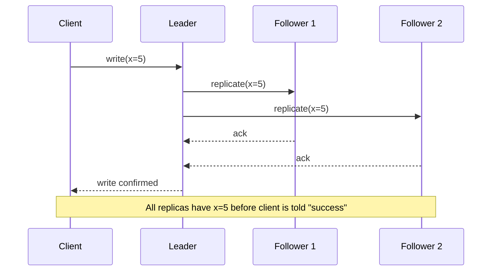
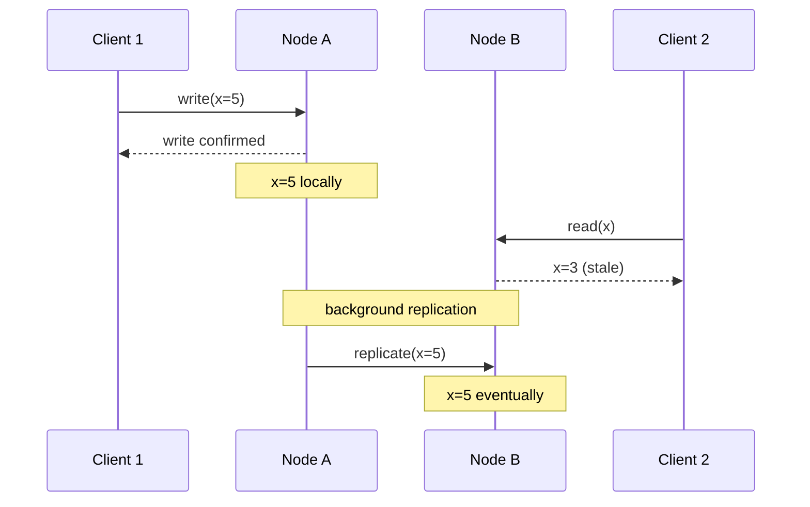
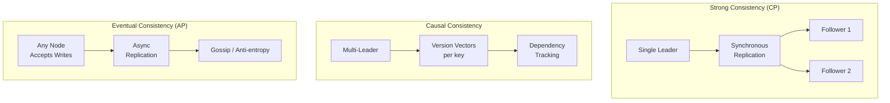

# Consistency Models

## Overview

A **consistency model** is a contract between a distributed data store and its clients about what values a read can return after a write. Strong consistency says "you always see the latest write." Eventual consistency says "you'll see the latest write *eventually*." Between these extremes lie a dozen precisely-defined models, each trading off performance, availability, and programmer sanity differently. Understanding the spectrum — not just the endpoints — is what separates engineers who *use* distributed systems from engineers who *debug* distributed systems at 3 AM.

---

## Why It Exists

When data is replicated across multiple nodes, a write to one node takes time to propagate to others. During that propagation window, different clients reading from different replicas can see different values. The consistency model defines what the system promises about this window.

What was broken before consistency models were formalized: engineers assumed that a distributed database behaved like a single-machine database — that a write was immediately visible to all readers. When it wasn't (because of replication lag, partitions, or caching), the resulting bugs were mystifying. A user would update their profile, refresh the page, and see the old profile. A payment would be recorded on one node but not visible on another. Inventory would be double-sold because two nodes both thought the item was available.

Consistency models give these behaviors names, make them predictable, and let engineers choose the right trade-off for each use case.

---

## Historical Context

1. **Sequential consistency (Lamport, 1979).** The first formal model. Operations from all processors appear in *some* sequential order consistent with each processor's program order. Stronger than eventual, weaker than linearizable.
2. **Linearizability (Herlihy & Wing, 1990).** The strongest useful model. Operations appear to take effect at a single instant between their invocation and response. The "gold standard" that CAP's "C" refers to.
3. **Release consistency, causal consistency (1990s).** Weaker models designed for shared-memory multiprocessors, later adopted by distributed systems. Allowed reordering of operations that didn't conflict.
4. **Eventual consistency (Bayou, 1995; Dynamo, 2007).** Formalized by Amazon's Dynamo paper. Replicas converge given sufficient time without new writes. The weakest useful guarantee.
5. **Tunable consistency (Cassandra, 2008; DynamoDB, 2012).** Per-operation consistency levels. The system doesn't have one model — each query chooses its own.
6. **Causal consistency at scale (COPS, 2011; MongoDB 3.6+, 2017).** Practical implementations of causal consistency in production databases. The sweet spot for many applications.

The arc: one model → a spectrum → per-operation choice. Modern practice recognizes that no single model is right for all data.

---

## First Principles

### The spectrum

From strongest to weakest, the models that matter in practice:

**1. Linearizability (strong consistency)**

Every operation appears to execute atomically at some point between its start and its completion. All clients see the same ordering. It's as if there's a single copy of the data.

- Guarantee: "After a write completes, every subsequent read sees that write."
- Cost: high latency (must coordinate across replicas), low availability during partitions.

**2. Sequential consistency**

Operations appear in *some* total order consistent with each client's program order. Different from linearizability because the total order doesn't have to respect real-time — operation A can appear to happen after operation B even if A completed before B started, as long as each client's operations are in the right order.

- Guarantee: "Every client sees operations in a consistent order, but not necessarily the real-time order."
- Cost: cheaper than linearizability; still requires coordination.

**3. Causal consistency**

Operations that are *causally related* (one depends on the other) are seen in the same order by all clients. Operations that are *concurrent* (independent) may be seen in different orders by different clients.

- Guarantee: "If I read your write and then write a response, everyone who sees my response also sees your original write."
- Cost: moderate coordination. No global ordering of concurrent writes.

**4. Read-your-writes consistency**

A client always sees its own writes. Other clients may not see them yet.

- Guarantee: "I will never see stale versions of data I myself wrote."
- Cost: typically requires session affinity (routing the client to the same replica) or client-side caching.

**5. Monotonic reads**

Once a client reads a value, subsequent reads never return an older value. Time doesn't go backward for any individual client.

- Guarantee: "I will never see data that is older than what I already saw."
- Cost: requires session tracking or version vectors.

**6. Eventual consistency**

If no new writes occur, all replicas will *eventually* converge to the same value. No guarantees about how long "eventually" takes, or what clients see in the interim.

- Guarantee: "Given enough time and no new writes, everyone agrees."
- Cost: minimal coordination. Maximum availability and performance.

### Relationships between models

```text
Linearizability
     │
     ▼
Sequential Consistency
     │
     ▼
Causal Consistency
     │
     ├──▶ Read-your-writes
     │
     ├──▶ Monotonic Reads
     │
     ▼
Eventual Consistency
```

Each model implies all models below it. Linearizability provides causal consistency, which provides read-your-writes, which provides eventual consistency. The converse is not true.

---

## Mental Model

A group chat.

**Linearizability:** Everyone sees every message in exactly the order it was sent, in real time. A message from Alice at 2:00 PM is always before a message from Bob at 2:01 PM, for everyone.

**Sequential consistency:** Everyone sees the same order of messages, but the order might differ from real-time wall clock. Alice sent at 2:00 and Bob at 2:01, but everyone might see Bob's message first — as long as everyone agrees on the same order.

**Causal consistency:** If Bob replies to Alice's message, everyone who sees Bob's reply also sees Alice's original message first. But independent messages from Carol and Dave (not replying to each other) can appear in any order on different phones.

**Read-your-writes:** You always see your own messages after you send them. Other people might not see them yet.

**Eventual consistency:** Everyone will *eventually* see all messages. But right now, different people's screens might show different messages in different orders. This is how some messaging apps behave under poor network conditions.

---

## Internal Mechanics

### How linearizability works

The simplest implementation: single leader, synchronous replication.



The write is not confirmed until all (or a quorum of) replicas have acknowledged. This guarantees any subsequent read from any replica returns the new value. Cost: the write's latency is the maximum of all replica latencies.

### How eventual consistency works

Asynchronous replication with anti-entropy:



The write is confirmed immediately on the local node. Replication happens in the background. There is a window where different nodes have different values.

### Causal consistency with version vectors

```kotlin
data class VersionVector(val versions: Map<String, Int>) {
    fun increment(nodeId: String): VersionVector =
        copy(versions = versions + (nodeId to (versions[nodeId] ?: 0) + 1))

    fun merge(other: VersionVector): VersionVector {
        val merged = (versions.keys + other.versions.keys).associateWith { key ->
            maxOf(versions[key] ?: 0, other.versions[key] ?: 0)
        }
        return VersionVector(merged)
    }

    fun dominates(other: VersionVector): Boolean =
        other.versions.all { (k, v) -> (versions[k] ?: 0) >= v } &&
        versions.any { (k, v) -> v > (other.versions[k] ?: 0) }

    fun concurrent(other: VersionVector): Boolean =
        !dominates(other) && !other.dominates(this)
}
```

Each write carries a version vector. On read, the system can determine if one version causally precedes another (one dominates), or if they're concurrent (neither dominates → conflict). This enables causal consistency without full linearizability.

### Session guarantees

Read-your-writes is often implemented by tracking the client's "session" — the set of writes the client has performed:

```kotlin
class SessionAwareClient(private val replicas: List<Replica>) {
    private var lastWriteVersion: Long = 0

    suspend fun write(key: String, value: String) {
        val version = primaryReplica().write(key, value)
        lastWriteVersion = version
    }

    suspend fun read(key: String): String {
        // Route to a replica that has seen at least lastWriteVersion
        val replica = replicas.first { it.currentVersion() >= lastWriteVersion }
        return replica.read(key)
    }
}
```

The client tracks its own write version and refuses to read from replicas that haven't caught up. This guarantees read-your-writes without requiring all replicas to be in sync.

---

## Architecture



Different consistency models require different architectural choices. Linearizability typically requires a single leader (or consensus protocol). Causal consistency requires dependency tracking. Eventual consistency can use any-node writes with background sync.

---

## Production Example

- **Google Spanner.** Linearizable. TrueTime enables globally-consistent reads. Every read sees the latest committed write. The most expensive option; justified by the need for globally-consistent financial transactions.
- **Amazon DynamoDB.** Tunable per read. `ConsistentRead=true` gives linearizable reads from the leader; `ConsistentRead=false` gives eventual consistency from any replica. The default is eventual.
- **Cassandra.** Tunable per query. `QUORUM` reads and writes give strong consistency if `W + R > N` (and linearizability if combined with read-repair); `ONE` gives eventual consistency.
- **MongoDB.** Causal consistency since 3.6. Reads within a causally-consistent session see all prior writes from that session. Independent sessions may see different orderings.
- **Redis.** Single-leader eventual consistency. Reads from the leader are consistent; reads from replicas may be stale.
- **Facebook/Meta TAO.** Read-your-writes consistency for social data. Users always see their own posts immediately; other users see them after replication lag (typically sub-second).

---

## Android Example

Mobile apps encounter consistency models at every layer:

```kotlin
// Layer 1: Local database — linearizable (single process, single writer)
@Dao
interface UserDao {
    @Query("SELECT * FROM users WHERE id = :id")
    fun getUser(id: String): Flow<User?>  // always reads latest local write

    @Insert(onConflict = OnConflictStrategy.REPLACE)
    suspend fun upsert(user: User)
}

// Layer 2: Network + local — eventually consistent
class UserRepository(
    private val dao: UserDao,
    private val api: UserApi
) {
    // Read-your-writes: local writes are visible immediately
    // Eventual consistency with server: server data arrives asynchronously
    fun observeUser(id: String): Flow<User?> = dao.getUser(id)
        .onStart {
            // Background refresh — eventual consistency with server
            try {
                val fresh = api.fetchUser(id)
                dao.upsert(fresh)
            } catch (e: IOException) {
                // Serve stale — AP behavior
            }
        }

    // Monotonic reads: Room's Flow ensures the client never sees
    // an older version after seeing a newer one (within the local DB)
    // Cross-device monotonic reads require version tracking
}
```

The consistency model changes at each boundary:
- **Local Room DB:** linearizable (single writer, immediate visibility).
- **Local + network:** eventually consistent. The local DB may be stale relative to the server.
- **Multiple devices:** eventually consistent. Two phones editing the same data see different versions until sync completes.

The most common mobile consistency bug: a user makes a change on one device, opens the app on another device, and doesn't see the change. This is eventual consistency working as designed — but the user perceives it as a bug. Mitigation: faster sync, push notifications on change, or per-user read-your-writes guarantees via server-side session tracking.

---

## Tradeoffs

| Model | Latency | Availability | Programmer Ease | Use Case |
|---|---|---|---|---|
| Linearizable | High | Low during partition | Easiest | Financial, config, locks |
| Sequential | Moderate | Moderate | Easy | Multi-player game state |
| Causal | Moderate | High | Moderate | Social feeds, collaboration |
| Read-your-writes | Low | High | Easy | User profiles, settings |
| Monotonic reads | Low | High | Easy | Dashboards, feeds |
| Eventual | Lowest | Highest | Hardest | CDN, DNS, caches |

**Hidden costs**

- Stronger consistency requires more coordination, which means higher latency *and* lower throughput.
- Weaker consistency pushes complexity to the application. "Eventually consistent" means the application must handle stale reads, conflicts, and out-of-order updates.
- Mixing models in one system (e.g., linearizable for writes, eventually consistent for reads) creates subtle bugs at the boundary.

**When not to use (strong consistency):**

- User-facing reads where latency matters more than freshness (feeds, recommendations).
- Data that changes infrequently and where brief staleness is tolerable (user profiles, product catalogs).

**When not to use (eventual consistency):**

- Financial balances, inventory counts, anything where "two clients see different values" leads to real-world harm.
- Coordination data (locks, leader election, configuration).

---

## Failure Modes

**Stale read accepted as current.** A client reads an old value from a lagging replica and makes a decision based on it. Mitigation: use a consistency level appropriate for the decision's stakes.

**Anomalous ordering.** Two causally-related operations are seen in the wrong order by some clients. Mitigation: use causal consistency (version vectors) instead of pure eventual.

**Session loss breaks read-your-writes.** If the client's session state is lost (app restart, load-balancer failover), the read-your-writes guarantee disappears. The client may see its own writes "disappear." Mitigation: persist session state; use version-based routing.

**Linearizable reads blocking on a partitioned leader.** During a partition, reads routed to the leader hang if the leader is on the minority side. Mitigation: leader leases; follower reads with bounded staleness.

**Write conflict in eventual systems.** Two clients write different values to the same key concurrently. The system must resolve — last-writer-wins (data loss), merge (application-specific), or flag (user intervention). Each strategy has failure modes of its own.

---

## Performance Considerations

- **Latency:** Linearizable reads require a round-trip to the leader (or quorum). Eventually consistent reads can be served from the nearest replica. The gap can be 10-100× in geo-distributed systems.
- **Throughput:** Linearizable writes serialize through a single leader, capping throughput. Eventually consistent writes can go to any node, scaling linearly with nodes.
- **Tail latency:** Quorum reads are bounded by the slowest responder in the quorum. Hedged requests help.
- **Cache friendliness:** Weaker consistency models are more cache-friendly — cached values are valid longer.

---

## Reliability Considerations

- Stronger consistency models trade availability for correctness. During a partition, a linearizable system becomes unavailable; an eventually consistent system remains available.
- **Read-your-writes as a minimum bar.** Most user-facing applications should guarantee at least read-your-writes consistency. Anything weaker creates user-visible bugs ("I posted a comment but it disappeared").
- **Bounded staleness as a pragmatic middle ground.** "Reads are at most 5 seconds stale" is often good enough and much cheaper than linearizability.

---

## Security Considerations

- **Authorization staleness.** If access control decisions read from an eventually consistent store, a revoked user may retain access until replication catches up. Use strong consistency for authorization data.
- **Audit log ordering.** Audit logs must reflect causal ordering at minimum. An audit trail that shows events out of order is misleading and potentially non-compliant.
- **Conflict resolution and security.** In AP systems, conflict resolution can silently overwrite security-relevant writes. Log and alert on conflicts involving permission data.

---

## Observability

- **Replication lag.** The primary metric for eventual consistency systems. Histogram of lag per replica, per table.
- **Staleness at read time.** For eventually consistent reads, how old is the returned value? Report as a histogram.
- **Consistency violations.** Periodically read the same key from all replicas and compare. Count divergences.
- **Linearizable read latency.** p50/p99 of reads that go through the leader or quorum path.
- **Conflict count.** For AP systems, count conflicts detected and resolved. A rising trend means contention is increasing.

Canonical: [`../observability/metrics.md`](../observability/metrics.md), [`../observability/slis.md`](../observability/slis.md).

---

## Staff Engineer Thinking

**Choose the consistency model per data, not per database.** User preferences can be eventually consistent. Account balances must be linearizable. Most systems have both kinds of data. The Staff move is to articulate the model per data type and enforce it architecturally.

**Make the model visible.** Every read path in the system should be tagged (in code comments, in API documentation, and in observability) with its consistency level. "This endpoint returns eventually consistent data with max staleness of 5 seconds" is a precise, reviewable statement.

**Push for read-your-writes as the minimum UX bar.** Users understand latency; they do not understand their own writes disappearing. Read-your-writes consistency is cheap to implement (session affinity, client-side caching) and eliminates the most common user-facing anomaly.

**Educate the team on the spectrum.** Most engineers know "strong" and "eventual." The models in between — causal, monotonic reads, read-your-writes — are where the practical sweet spots lie. A lunch talk or internal doc on the spectrum pays dividends for years.

**Linearizability is a luxury; know when you need it.** It's expensive (latency, availability). Many teams default to it out of caution. The Staff question: "what bad thing happens if this read returns a value that's 1 second stale?" If the answer is "nothing important," you don't need linearizability.

---

## Common Misconceptions

**"Strong consistency means slow."** Linearizable reads from a single leader on the same machine are nanoseconds. "Strong" adds latency only when replicas are involved and geographically separated.

**"Eventual consistency means inconsistent."** It means *temporarily* inconsistent. Given enough time, all replicas converge. The guarantee is about the end state, not the intermediate state.

**"Our database handles consistency for us."** The database provides a consistency model; the application must use it correctly. A linearizable database used with stale client-side caches is effectively eventually consistent.

**"Causal consistency is as strong as linearizable."** No. Causal consistency orders causally-related operations but says nothing about concurrent operations. Two independent writes can be seen in different orders by different clients.

**"Replication lag is a bug."** In an eventually consistent system, replication lag is the *design*. The lag is the consistency-availability trade-off made explicit.

---

## Probing Questions

1. Define linearizability in your own words. How does it differ from sequential consistency?
2. A user updates their profile and refreshes the page. They see the old profile. What consistency model is in play, and how would you fix it?
3. Explain causal consistency using a concrete example (e.g., a social media post and its comments).
4. Why is "read-your-writes" a particularly important guarantee for user-facing applications?
5. DynamoDB offers both eventually consistent and strongly consistent reads. When would you use each?
6. A system uses quorum reads (R=2) and quorum writes (W=2) with N=3 replicas. Is this strictly linearizable? Why or why not?
7. Two clients write different values to the same key concurrently in an eventually consistent system. What happens? Who "wins"?
8. What is bounded staleness, and why is it a useful middle ground?
9. How does replication lag become a user-visible bug? Give a mobile-app example.
10. Your team wants to use eventual consistency for a shopping cart. What failure modes should they prepare for?

---

## Further Reading

In this repository:

- [`cap-theorem.md`](cap-theorem.md) — CAP forces a choice between consistency and availability during partitions.
- [`vector-clocks.md`](vector-clocks.md) — the mechanism for detecting causal relationships and conflicts.
- [`crdts.md`](crdts.md) — data structures that provide strong eventual consistency without coordination.
- [`delivery-semantics.md`](delivery-semantics.md) — message delivery guarantees interact with consistency models.
- [`idempotency.md`](idempotency.md) — safe retries in eventually consistent systems.
- [`../engineering-fundamentals/time-and-clocks.md`](../engineering-fundamentals/time-and-clocks.md) — clock skew breaks timestamp-based ordering.
- [`../reference-architectures/offline-first-app.md`](../reference-architectures/offline-first-app.md) — a mobile architecture built on eventual consistency.

External:

- Leslie Lamport, *How to Make a Multiprocessor Computer That Correctly Executes Multiprocess Programs* (1979). The sequential consistency paper.
- Maurice Herlihy and Jeannette Wing, *Linearizability: A Correctness Condition for Concurrent Objects* (1990). The formal definition.
- Werner Vogels, *Eventually Consistent* (2008). Amazon's CTO on the practical spectrum.
- Martin Kleppmann, *Designing Data-Intensive Applications*, Chapter 9. The best modern treatment of the consistency spectrum.
- Peter Bailis et al., *Quantifying Eventual Consistency with PBS* (2012). Probabilistic bounded staleness — measuring how stale "eventual" actually is.
