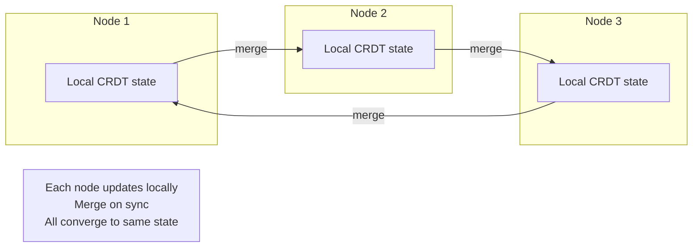
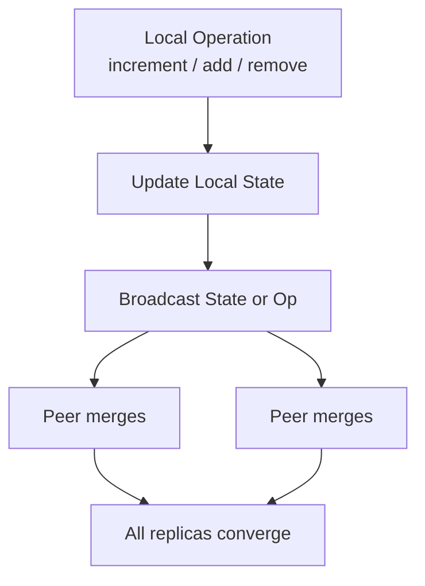

# CRDTs

## Overview

A **Conflict-free Replicated Data Type (CRDT)** is a data structure that can be replicated across multiple nodes, updated independently and concurrently on each node, and merged deterministically — with the guarantee that all replicas converge to the same state, without coordination. No consensus protocol, no locks, no conflict resolution callbacks. The math ensures convergence. CRDTs are the strongest answer to the question: "Can we have both availability and eventual consistency without losing data?"

---

## Why It Exists

In eventually consistent systems, concurrent writes to the same data create conflicts. Traditional approaches resolve conflicts after the fact: last-writer-wins (which loses data), application-specific merge functions (which are error-prone), or user intervention (which is slow). Each approach has failure modes that compound at scale.

What was broken before CRDTs: every eventually consistent system needed a bespoke conflict-resolution strategy for every data type. Shopping carts used set union. Counters used "just pick the bigger number" (which is wrong under concurrent increments). Text editors used operational transformation (OT), which is notoriously complex. Each strategy was hand-designed, hand-tested, and hand-debugged.

CRDTs eliminate the conflict entirely by designing the data structure so that all possible merge orderings produce the same result. Instead of detecting and resolving conflicts, you prevent them by construction. The trade-off: you can only represent data that has a commutative, associative, idempotent merge function — but a surprising number of useful data types fit this constraint.

---

## Historical Context

1. **Bayou (1995).** One of the first systems to explore conflict resolution in replicated data, using application-specific merge functions. Ahead of its time but manual.
2. **Operational Transformation (1989-2000s).** Used by Google Docs for collaborative text editing. Correct but complex — the number of edge cases grows combinatorially with the number of operation types.
3. **CRDTs formalized (2011).** Marc Shapiro, Nuno Preguiça, Carlos Baquero, and Marek Zawirski published *Conflict-free Replicated Data Types*, defining the two CRDT families (state-based and operation-based) and proving convergence.
4. **Riak (2012+).** One of the first production databases to offer CRDTs (counters, sets, maps, flags) as first-class data types.
5. **Redis CRDT module (2018).** Redis Enterprise added CRDT-based active-active geo-replication.
6. **Automerge, Yjs (2017 onward).** CRDT-based libraries for collaborative editing, making CRDTs practical for text, JSON, and rich documents.
7. **Apple's CloudKit, Figma.** Production systems using CRDT-inspired approaches for sync and collaboration.

The arc: manual conflict resolution → algorithmic conflict resolution (OT) → conflict-free by construction (CRDTs).

---

## First Principles

### Two families

**State-based CRDTs (CvRDTs — Convergent)**

Each replica holds the full state. To sync, replicas exchange their complete states and *merge* them. The merge function must be:

- **Commutative:** `merge(A, B) = merge(B, A)`
- **Associative:** `merge(merge(A, B), C) = merge(A, merge(B, C))`
- **Idempotent:** `merge(A, A) = A`

These three properties guarantee convergence regardless of message ordering, duplication, or delivery delays. The merge function defines a *join semilattice* — a mathematical structure where values can only move "up" toward a greatest element.

**Operation-based CRDTs (CmRDTs — Commutative)**

Instead of exchanging full states, replicas broadcast *operations*. The operations must commute: applying them in any order produces the same result. Requires a reliable broadcast channel (at-least-once, causal ordering).

In practice, state-based CRDTs are more common because they work with unreliable networks (you can re-send the state without harm — idempotent merge). Operation-based CRDTs are more efficient (smaller messages) but need stronger delivery guarantees.

### The lattice intuition

A CRDT's state lives on a *semilattice*: a partially ordered set where every pair of elements has a unique *least upper bound* (join). The merge function computes the join.

```text
         {a, b, c}        ← top (all elements present)
        /    |    \
   {a,b}  {a,c}  {b,c}    ← two elements
    / \    / \    / \
  {a}  {b}  {c}            ← one element
    \   |   /
       {}                  ← bottom (empty set)
```

Values can only move up the lattice (toward more information). This monotonicity is why CRDTs never lose data and always converge.

---

## Mental Model

A whiteboard in a meeting room, and everyone has a dry-erase marker.

**Traditional approach:** Everyone writes on the whiteboard simultaneously. When two people write in the same spot, someone has to decide whose text to keep (conflict resolution). This is error-prone and requires coordination.

**CRDT approach:** The whiteboard is append-only. Everyone adds sticky notes. A sticky note, once placed, is never removed (in the basic model). To "see the current state," you collect all the sticky notes. No matter what order you read them, the set of sticky notes is the same. Convergence is guaranteed because the operation (adding a sticky note) is commutative and idempotent.

For deletion: instead of removing a sticky note, you add a *new* sticky note that says "ignore note #7." This is a *tombstone*, and it's why CRDTs often use more space than traditional data structures.

---

## Internal Mechanics

### G-Counter (Grow-only Counter)

The simplest useful CRDT. Each node maintains its own increment count; the total is the sum.

```kotlin
data class GCounter(val counts: Map<String, Long> = emptyMap()) {
    fun increment(nodeId: String): GCounter {
        val current = counts[nodeId] ?: 0
        return GCounter(counts + (nodeId to current + 1))
    }

    fun value(): Long = counts.values.sum()

    fun merge(other: GCounter): GCounter {
        val allKeys = counts.keys + other.counts.keys
        val merged = allKeys.associateWith { key ->
            maxOf(counts[key] ?: 0, other.counts[key] ?: 0)
        }
        return GCounter(merged)
    }
}
```

Merge takes the element-wise max. This works because each node only increments its own entry, so the max of any entry is the correct count for that node.

### PN-Counter (Positive-Negative Counter)

Supports both increment and decrement by using two G-Counters: one for increments (P), one for decrements (N). The value is P - N.

```kotlin
data class PNCounter(
    val positive: GCounter = GCounter(),
    val negative: GCounter = GCounter()
) {
    fun increment(nodeId: String): PNCounter =
        copy(positive = positive.increment(nodeId))

    fun decrement(nodeId: String): PNCounter =
        copy(negative = negative.increment(nodeId))

    fun value(): Long = positive.value() - negative.value()

    fun merge(other: PNCounter): PNCounter =
        PNCounter(
            positive = positive.merge(other.positive),
            negative = negative.merge(other.negative)
        )
}
```

### G-Set (Grow-only Set)

Elements can be added, never removed. Merge is set union.

```kotlin
data class GSet<T>(val elements: Set<T> = emptySet()) {
    fun add(element: T): GSet<T> = GSet(elements + element)

    fun contains(element: T): Boolean = element in elements

    fun merge(other: GSet<T>): GSet<T> = GSet(elements + other.elements)
}
```

### OR-Set (Observed-Remove Set)

Supports both add and remove. Each addition generates a unique tag; a remove marks specific tags as removed. Concurrent add and remove of the same element: add wins (the new add has a fresh tag that wasn't in the remove's set).

```kotlin
data class ORSet<T>(
    private val adds: Map<T, Set<String>> = emptyMap(),    // element → {unique tags}
    private val removes: Map<T, Set<String>> = emptyMap()  // element → {removed tags}
) {
    fun add(element: T, nodeId: String): ORSet<T> {
        val tag = "$nodeId-${UUID.randomUUID()}"
        val existing = adds[element] ?: emptySet()
        return copy(adds = adds + (element to existing + tag))
    }

    fun remove(element: T): ORSet<T> {
        val currentTags = adds[element] ?: return this
        val removedTags = removes[element] ?: emptySet()
        return copy(removes = removes + (element to removedTags + currentTags))
    }

    fun elements(): Set<T> = adds.filter { (element, tags) ->
        val removedTags = removes[element] ?: emptySet()
        (tags - removedTags).isNotEmpty()
    }.keys

    fun merge(other: ORSet<T>): ORSet<T> {
        val mergedAdds = (adds.keys + other.adds.keys).associateWith { key ->
            (adds[key] ?: emptySet()) + (other.adds[key] ?: emptySet())
        }
        val mergedRemoves = (removes.keys + other.removes.keys).associateWith { key ->
            (removes[key] ?: emptySet()) + (other.removes[key] ?: emptySet())
        }
        return ORSet(mergedAdds, mergedRemoves)
    }
}
```

### LWW-Register (Last-Writer-Wins Register)

The simplest register CRDT. Each write carries a timestamp; the value with the highest timestamp wins. Requires loosely-synchronized clocks.

```kotlin
data class LWWRegister<T>(val value: T, val timestamp: Long) {
    fun set(newValue: T, newTimestamp: Long): LWWRegister<T> =
        if (newTimestamp > timestamp) LWWRegister(newValue, newTimestamp)
        else this

    fun merge(other: LWWRegister<T>): LWWRegister<T> =
        if (other.timestamp > timestamp) other
        else if (other.timestamp < timestamp) this
        else if (other.hashCode() > hashCode()) other  // tiebreaker
        else this
}
```

LWW-Register has the weakest semantics — it can lose concurrent writes. But it's the simplest and most widely used in practice (Cassandra columns are effectively LWW registers).

---

## Architecture





CRDTs require no coordination layer — no leader, no consensus, no lock server. Each node operates independently; merging happens opportunistically. This makes CRDTs ideal for AP systems where availability is paramount.

---

## Production Example

- **Riak.** Offers built-in CRDTs: counters (PN-Counter), sets (OR-Set), maps (nested CRDTs), flags (LWW boolean), registers (LWW). Used for shopping carts, view counts, feature flags.
- **Redis Enterprise.** CRDT-based active-active geo-replication. Counters and sets replicate across regions without conflicts.
- **Figma.** Uses CRDT-inspired data structures for real-time collaborative design. Each user edits independently; changes merge automatically.
- **Apple CloudKit.** Uses CRDTs internally for syncing data across devices (records, assets).
- **Automerge.** A CRDT library for JSON documents. Used by Ink & Switch (the research group) for local-first applications.
- **Yjs.** A high-performance CRDT library for collaborative text editing. Used by many collaborative editors (including some under the hood of Notion-like tools).
- **SoundCloud.** Used CRDTs for counting plays across a globally distributed system.

---

## Android Example

CRDTs are natural for mobile offline-first sync — the phone and server are two replicas that sync when the network is available.

```kotlin
// A CRDT-backed shopping cart that syncs across devices
class ShoppingCart(private val deviceId: String) {
    // OR-Set: supports add and remove, concurrent adds win
    private var items = ORSet<CartItem>()
    // PN-Counter per item for quantities
    private var quantities = mutableMapOf<String, PNCounter>()

    fun addItem(item: CartItem) {
        items = items.add(item, deviceId)
        quantities.getOrPut(item.id) { PNCounter() }
            .let { quantities[item.id] = it.increment(deviceId) }
    }

    fun removeItem(item: CartItem) {
        items = items.remove(item)
    }

    fun incrementQuantity(itemId: String) {
        quantities[itemId]?.let {
            quantities[itemId] = it.increment(deviceId)
        }
    }

    // Sync: merge with server's state — NO CONFLICTS POSSIBLE
    fun merge(serverCart: ShoppingCart): ShoppingCart {
        val merged = ShoppingCart(deviceId)
        merged.items = items.merge(serverCart.items)
        val allItemIds = quantities.keys + serverCart.quantities.keys
        for (id in allItemIds) {
            val local = quantities[id] ?: PNCounter()
            val remote = serverCart.quantities[id] ?: PNCounter()
            merged.quantities[id] = local.merge(remote)
        }
        return merged
    }
}

// In the repository layer:
class CartRepository(
    private val localDb: CartDao,
    private val api: CartApi,
    private val deviceId: String
) {
    suspend fun sync() {
        val localCart = localDb.getCart()
        try {
            val serverCart = api.getCart()
            val merged = localCart.merge(serverCart)
            localDb.saveCart(merged)
            api.putCart(merged)  // idempotent: state-based merge
        } catch (e: IOException) {
            // Offline — continue using local cart
            // It will merge correctly when network returns
        }
    }
}
```

The key mobile benefit: **no conflict resolution code**. The merge is mechanical and guaranteed correct. The app works offline, syncs when possible, and never loses data or shows conflicts to the user.

For collaborative features (shared notes, real-time co-editing), libraries like Automerge or Yjs can be used through their JavaScript bindings in a WebView or through native ports.

---

## Tradeoffs

**Advantages**

- **Guaranteed convergence.** No conflict resolution logic needed. Merge is automatic and deterministic.
- **High availability.** No coordination required. Every node can accept writes independently.
- **Partition tolerance.** Nodes can be offline for arbitrary periods and still merge correctly when reconnected.
- **Simplicity of reasoning.** Once the CRDT is correct, the sync layer is trivial — just merge.

**Disadvantages**

- **Limited expressiveness.** Not every data model fits a CRDT. Operations that require global coordination (e.g., "set the value to X only if the current value is Y") are fundamentally non-CRDT.
- **Space overhead.** CRDTs carry metadata (tombstones, unique tags, per-node counters). An OR-Set uses more memory than a plain set.
- **Tombstone accumulation.** Deleted elements are marked, not removed. Without garbage collection, tombstones grow forever.
- **Semantic limitations.** A PN-Counter can go negative. An OR-Set has add-wins semantics (which may not match business requirements). LWW-Register can lose concurrent writes.

**Hidden costs**

- **Garbage collection is hard.** Removing tombstones requires global knowledge (has every replica seen this tombstone?). This is itself a coordination problem — the thing CRDTs were designed to avoid.
- **CRDT choice is a schema decision.** Choosing the wrong CRDT for your data (LWW when you need OR-Set, G-Counter when you need PN-Counter) creates subtle bugs that only appear under concurrency.
- **Testing concurrent scenarios is hard.** Convergence is guaranteed by the math, but the *semantics* of the converged state may not match user expectations.

**When not to use**

- Data that requires strong consistency (bank balances, inventory with strict limits).
- Operations that need compare-and-swap semantics.
- Simple key-value data where LWW is acceptable and CRDT overhead is unwarranted.

---

## Failure Modes

**Tombstone bloat.** Deleted elements accumulate as tombstones. Over months of use, tombstones dominate the data structure's size. Mitigation: periodic garbage collection with a protocol that ensures all replicas have seen the tombstone before removing it.

**Semantic surprise.** A PN-Counter allows negative values (more decrements than increments on one node, before merge). Users don't expect "quantity: -3." Mitigation: bounded CRDTs (check at read time) or design the data model to avoid underflow.

**Clock-dependent CRDTs.** LWW-Register depends on timestamps. If clocks are skewed, the "wrong" writer wins. Mitigation: use Hybrid Logical Clocks ([`../engineering-fundamentals/time-and-clocks.md`](../engineering-fundamentals/time-and-clocks.md)), or avoid LWW for critical data.

**Merge explosion.** Merging large CRDT states (thousands of tombstones, many concurrent versions) can be slow. Mitigation: compact the state periodically; limit the number of concurrent writers.

**Incorrect merge implementation.** A merge function that violates commutativity, associativity, or idempotence breaks convergence. Mitigation: property-based testing (generate random operation sequences, verify convergence).

---

## Performance Considerations

- **CPU:** Merge is typically O(N) where N is the size of the CRDT state. For large states (big OR-Sets, many tombstones), merge can be the bottleneck.
- **Memory:** CRDTs use more memory than plain data structures due to metadata (tags, tombstones, per-node counters). A G-Counter for 100 nodes uses 100 entries; a plain counter uses 1.
- **Network:** State-based CRDTs exchange the full state on sync. For large states, delta-based CRDTs (sending only changes since the last sync) reduce bandwidth.
- **Storage:** Tombstones accumulate on disk. Without GC, storage grows monotonically.
- **Battery (mobile):** Syncing large CRDT states is expensive. Use delta CRDTs and sync only changed parts.

---

## Reliability Considerations

- CRDTs provide **strong eventual consistency:** if all replicas receive all updates, they converge to the same state. This is a *stronger* guarantee than eventual consistency — it guarantees convergence, not just eventual delivery.
- **No coordination point = no single point of failure.** CRDTs don't depend on a leader, a coordinator, or a consensus protocol. Every node is independently available.
- **Offline resilience.** CRDTs are inherently offline-tolerant. A mobile device offline for days can merge correctly when it reconnects.

---

## Security Considerations

- **Byzantine nodes.** CRDTs assume honest participants. A malicious node that sends invalid states (e.g., a G-Counter with decremented values) can corrupt the merged result. Mitigation: validate CRDT state on receive; reject invalid states.
- **PII in tombstones.** Deleted data persists as tombstones. If the data contains PII, tombstones must be encrypted or purged with the same rigor as live data.
- **Metadata leakage.** CRDT metadata (node IDs in counters, unique tags in OR-Sets) reveals information about which nodes performed which operations. Anonymize if needed.

---

## Observability

- **Convergence time.** How long after a write does every replica reflect it? Histogram per data type.
- **State size.** Total size of each CRDT instance (including metadata and tombstones). Alert on growth beyond expected bounds.
- **Tombstone count.** Number of tombstones per CRDT instance. Monitor for accumulation.
- **Merge latency.** Time spent in merge operations. Alert if merge becomes a bottleneck.
- **Delta size.** For delta CRDTs, the size of each delta sent. Should be small relative to total state.

Canonical: [`../observability/metrics.md`](../observability/metrics.md).

---

## Staff Engineer Thinking

**CRDTs are a design choice, not a library choice.** The decision to use a CRDT constrains your data model. Make this decision early, understand the semantic implications, and document them. "We use an OR-Set for the shopping cart, which means concurrent add-and-remove resolves in favor of add" is a design decision that product and engineering must agree on.

**Start with the simplest CRDT that fits.** G-Counter, PN-Counter, LWW-Register, and G-Set cover a surprising number of use cases. Reach for OR-Set or CRDT maps only when you genuinely need add/remove semantics.

**Plan for garbage collection from day one.** Tombstone GC is the hardest operational problem in CRDT systems. Design the protocol before you ship, not after tombstones fill your database.

**Use CRDTs for the data that benefits most.** Not every piece of data needs conflict-free replication. Use CRDTs for data that's written concurrently and must converge (counters, collaborative documents, offline sync). Use traditional approaches for data that's rarely concurrent or where LWW is fine.

**Property-based testing is non-negotiable.** CRDT correctness depends on mathematical properties (commutativity, associativity, idempotence). Property-based tests (generate random operation sequences, verify convergence) are the only reliable way to validate these.

---

## Common Misconceptions

**"CRDTs solve all consistency problems."** They solve *convergence*. They don't solve ordering, global constraints, or application-level invariants (e.g., "stock cannot go below zero").

**"CRDTs are too complex for mobile."** The simplest CRDTs (G-Counter, LWW-Register) are trivial to implement. Libraries like Automerge handle complex cases.

**"Last-writer-wins is a CRDT."** LWW-Register is technically a CRDT, but it achieves convergence by discarding concurrent writes — exactly the data loss CRDTs were designed to avoid. It's the degenerate case.

**"CRDTs don't need a network."** They work *without* a reliable network (no consensus needed), but they still need *some* communication to sync. Without sync, replicas diverge forever.

**"CRDTs are only for distributed databases."** They're equally useful for local-first mobile apps, collaborative editors, multiplayer games, and any system where multiple writers update shared state independently.

---

## Probing Questions

1. Explain the difference between a state-based CRDT and an operation-based CRDT. When would you choose each?
2. Why must a state-based CRDT's merge function be commutative, associative, and idempotent? What breaks if any property is violated?
3. Implement a G-Counter. Why can't a plain counter be a CRDT?
4. An OR-Set uses "add wins" semantics for concurrent add-and-remove. Why? What would happen with "remove wins"?
5. How do you garbage-collect tombstones in a CRDT? Why is this hard?
6. A PN-Counter shows a value of -2. Is this a bug? How would you prevent it from being user-visible?
7. Compare CRDTs and vector clocks as approaches to handling concurrent writes. How do they complement each other?
8. You're building an offline-first collaborative note-taking app. Which CRDTs would you use for the note content, the tag list, and the view count?
9. Explain delta CRDTs. Why are they more efficient than state-based CRDTs for network sync?
10. When would you choose a CRDT over a server-arbitrated conflict resolution strategy?

---

## Further Reading

In this repository:

- [`vector-clocks.md`](vector-clocks.md) — conflict *detection* (vector clocks) vs conflict *prevention* (CRDTs).
- [`consistency-models.md`](consistency-models.md) — CRDTs provide strong eventual consistency, a precise point on the consistency spectrum.
- [`cap-theorem.md`](cap-theorem.md) — CRDTs are AP-native: available during partitions, consistent after.
- [`delivery-semantics.md`](delivery-semantics.md) — state-based CRDTs work with at-most-once delivery; operation-based CRDTs need at-least-once with causal ordering.
- [`../engineering-fundamentals/time-and-clocks.md`](../engineering-fundamentals/time-and-clocks.md) — LWW-Register depends on clock quality.
- [`../reference-architectures/offline-first-app.md`](../reference-architectures/offline-first-app.md) — CRDTs as the foundation for offline-first sync.
- [`../mobile-system-design/collaborative-editing.md`](../mobile-system-design/collaborative-editing.md) — CRDTs vs OT for collaborative editing.

External:

- Marc Shapiro et al., *Conflict-free Replicated Data Types* (2011). The foundational paper.
- Martin Kleppmann and Alastair Beresford, *A Conflict-Free Replicated JSON Datatype* (2017). The Automerge paper.
- Nuno Preguiça et al., *CRDTs: Making δ-CRDTs Delta-Based* (2018). Delta CRDTs for efficient sync.
- Ink & Switch, *Local-First Software* (2019). The manifesto for CRDT-based local-first applications.
- The Automerge documentation (automerge.org). The most accessible practical introduction to CRDTs.
