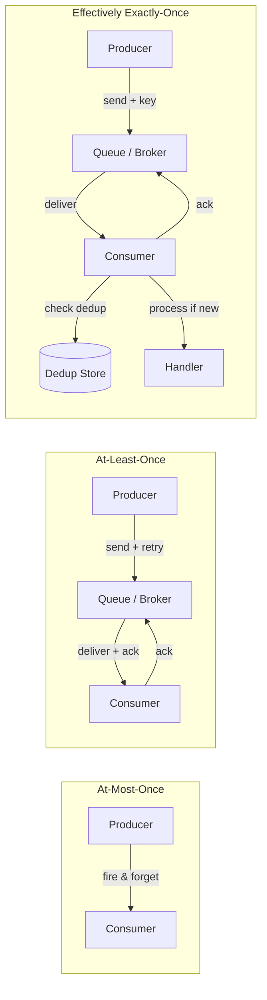

# Delivery Semantics

## Overview

**Delivery semantics** define how many times a message is delivered from a producer to a consumer in a distributed system. There are three models: **at-most-once** (the message may be lost but is never duplicated), **at-least-once** (the message is never lost but may be duplicated), and **exactly-once** (the message is delivered exactly one time). The first two are achievable with well-understood engineering. The third is, in the general case, impossible — and understanding *why* it's impossible, and what "effectively exactly-once" actually means, is one of the most important distributed-systems insights a Staff engineer can have.

---

## Why It Exists

Every distributed system sends messages — HTTP requests, RPC calls, event-bus messages, database replication commands, push notifications. The network between sender and receiver is unreliable: messages can be lost, duplicated, delayed, or reordered. The sender often cannot tell whether a message was received, because the *acknowledgment* can also be lost.

What was broken before delivery semantics were formalized: every system independently invented its own strategy for handling lost and duplicated messages. Some systems silently dropped messages. Others retried aggressively and caused duplicate side effects (double charges, double emails, duplicate database rows). Others tried to guarantee "exactly-once" at the transport layer and paid enormous complexity costs for a guarantee that was often unnecessary.

Delivery semantics, as a formal vocabulary, let engineers name their system's behavior, understand its consequences, and choose the right trade-off explicitly.

---

## Historical Context

1. **UDP vs TCP (1970s-80s).** UDP provides at-most-once delivery — the datagram is sent once and may be lost. TCP provides at-least-once delivery of byte streams — lost segments are retransmitted. Neither provides exactly-once at the transport layer.
2. **Message queues (1990s-2000s).** JMS, AMQP, and early message brokers distinguished between "persistent" and "non-persistent" messages. Persistent messages were at-least-once; non-persistent were at-most-once. "Exactly-once" was a frequent marketing claim that rarely held up under scrutiny.
3. **Kafka (2011 onward).** Kafka initially provided at-least-once delivery. In version 0.11 (2017), Kafka introduced "exactly-once semantics" (EOS) through idempotent producers and transactional writes — actually implementing at-least-once delivery with server-side deduplication.
4. **Stream processing (2010s).** Frameworks like Flink, Spark Streaming, and Kafka Streams made delivery semantics a first-class configuration. Each framework had to specify what "exactly-once" meant in its context.
5. **Modern consensus (2020s).** The industry largely settled on: at-least-once delivery + idempotent handlers = "effectively exactly-once" processing. The transport delivers at least once; the application deduplicates.

The arc: implicit and fragile → explicit but confusing ("exactly-once" marketing) → honest and practical (at-least-once + idempotency).

---

## First Principles

### The three semantics

**1. At-most-once**

The message is sent once. If it's lost, no retry occurs. The consumer sees the message zero or one times.

```text
Producer ──── message ────▶ [network] ────▶ Consumer
                              │
                         (may be lost)
                              │
                    Consumer sees: 0 or 1 times
```

Implementation: send and forget. No acknowledgment, no retry.

- Use when: losing a message is acceptable (telemetry, metrics, UI updates that will be superseded).
- Cost: zero retry infrastructure. Risk: data loss.

**2. At-least-once**

The producer retries until it receives an acknowledgment. The consumer sees the message one or more times.

```text
Producer ──── message ────▶ [network] ────▶ Consumer
    │                                          │
    │◀──────── ack ◀───── [network] ◀──────────│
    │            │
    │       (ack may be lost)
    │            │
    └── retry ───┘
                    Consumer sees: 1 or more times
```

Implementation: send, wait for ack, retry on timeout. The consumer may process the same message multiple times because the ack was lost (the producer doesn't know the first attempt succeeded).

- Use when: losing a message is unacceptable (payments, orders, critical events).
- Cost: retry infrastructure + idempotent handlers. Risk: duplicate processing if handlers are not idempotent.

**3. Exactly-once**

The consumer sees the message exactly one time. In the general case of an unreliable network with independent sender and receiver, this is *provably impossible* without additional mechanisms.

Why it's impossible: the producer sends a message and waits for an ack. If the ack is lost, the producer doesn't know whether the consumer received the message. It has two choices:

- Retry → possible duplicate (at-least-once).
- Don't retry → possible loss (at-most-once).

There is no third option without the consumer participating in deduplication.

### "Effectively exactly-once" = at-least-once + idempotency

The practical solution: deliver at least once, and make the consumer idempotent. The consumer deduplicates, ensuring each *logical* message is processed exactly once even if it's *delivered* multiple times.

```text
Producer ──── message + key ────▶ Consumer
    │                                │
    │                         check dedup store
    │                         ┌─ key seen? → return stored result
    │                         └─ key new? → process, store result + key
    │◀──────── ack ◀─────────────────│
```

This is what Kafka EOS, Stripe's idempotency keys, and every reliable payment system actually implement. See [`idempotency.md`](idempotency.md) for the full treatment.

---

## Mental Model

Sending a letter.

**At-most-once:** You drop the letter in a mailbox. If the postal service loses it, you never know and you don't send another. Fast, cheap, unreliable.

**At-least-once:** You send the letter with tracking. If you don't get a delivery confirmation within a week, you send another copy. The recipient might get two copies. You've avoided loss but introduced duplication.

**Exactly-once:** You send the letter with tracking, and the recipient has a rule: "If I receive a letter with the same tracking number as one I've already opened, I throw the duplicate away." The postal service delivers at-least-once; the recipient deduplicates. Together, they achieve effectively-exactly-once *processing*.

The key insight: the postal service (the network) cannot guarantee exactly-once delivery on its own. The recipient (the consumer) must participate.

---

## Internal Mechanics

### At-most-once: fire and forget

```kotlin
// UDP-style: send once, no retry
fun sendMetric(metric: Metric) {
    try {
        socket.send(metric.serialize())
    } catch (e: IOException) {
        // metric is lost — acceptable for telemetry
    }
}
```

No retry, no ack, no state. The simplest and fastest option. Appropriate when the cost of occasional loss is lower than the cost of deduplication infrastructure.

### At-least-once: retry until acknowledged

```kotlin
suspend fun sendWithRetry(
    message: Message,
    maxAttempts: Int = 5,
    initialDelay: Duration = 100.milliseconds
): AckResponse {
    var attempt = 0
    var delay = initialDelay
    while (true) {
        try {
            val response = client.send(message)
            return response  // ack received
        } catch (e: TimeoutException) {
            attempt++
            if (attempt >= maxAttempts) throw MaxRetriesExceededException(e)
            delay(delay + jitter(delay))
            delay *= 2
        }
    }
}
```

The producer retries on timeout. The consumer might process the message more than once — the timeout could fire because the ack was slow, not because the message was lost. The consumer *must* be idempotent for correctness.

### Effectively exactly-once: at-least-once + deduplication

```kotlin
// Consumer-side deduplication
class IdempotentConsumer(
    private val dedupStore: DedupStore,
    private val handler: MessageHandler
) {
    suspend fun consume(message: Message): Result {
        val key = message.idempotencyKey

        // Check if we've already processed this message
        dedupStore.get(key)?.let { return it }

        // Process and atomically store the result
        return dedupStore.transaction {
            // Double-check inside transaction (concurrent retries)
            get(key)?.let { return@transaction it }

            val result = handler.handle(message)
            put(key, result, ttl = 7.days)
            result
        }
    }
}
```

The consumer checks a deduplication store before processing. If the message's key has been seen, the stored result is returned without re-processing. The dedup-store write and the processing must be atomic — see [`idempotency.md`](idempotency.md) for the atomic-capture requirement.

### Kafka's "exactly-once semantics"

Kafka EOS combines three mechanisms:

1. **Idempotent producer.** Each producer has a unique ID and a sequence number per partition. The broker deduplicates by (producer_id, sequence_number). This eliminates *producer-side* duplicates from retries.

2. **Transactional writes.** A producer can atomically write to multiple partitions and commit consumer offsets in the same transaction. This ensures that "read from input topic, process, write to output topic, commit input offset" is all-or-nothing.

3. **Read-committed consumers.** Consumers configured with `isolation.level=read_committed` only see messages from committed transactions.

```text
Producer ──▶ Broker (dedup by producer_id + seq) ──▶ Consumer (read_committed)
    │                     │
    └── Transaction: write output + commit input offset ──┘
```

This is *not* exactly-once at the network layer. It's at-least-once delivery with server-side deduplication and transactional state management. But the *effect* is exactly-once processing — each input message produces exactly one output, even across failures and retries.

---

## Architecture



The complexity increases from left to right. At-most-once requires no infrastructure beyond the transport. At-least-once adds a retry loop and an ack mechanism. Effectively-exactly-once adds a deduplication store and atomic capture.

---

## Production Example

- **HTTP.** `GET` is at-most-once by convention (no side effects, safe to not retry). `POST` with retries is at-least-once; combined with `Idempotency-Key`, it's effectively exactly-once. See [`idempotency.md`](idempotency.md).
- **Kafka.** Pre-0.11: at-least-once. Post-0.11 with EOS enabled: effectively exactly-once. The transition was one of the most significant Kafka upgrades.
- **AWS SQS.** Standard queues: at-least-once. FIFO queues: exactly-once delivery (broker-side deduplication within a 5-minute window).
- **Google Pub/Sub.** At-least-once. Exactly-once delivery available via "exactly-once delivery" feature (server-side dedup with client ack).
- **Stripe webhooks.** At-least-once. Stripe retries failed webhook deliveries for up to 72 hours. Webhook handlers must be idempotent. Stripe's documentation explicitly says this.
- **Push notifications (FCM/APNs).** At-most-once for regular notifications (no delivery confirmation, no retry). At-least-once for high-priority data messages with server-side retry.

---

## Android Example

Android apps encounter all three semantics:

```kotlin
// At-most-once: analytics events
// Losing a few analytics events is acceptable
fun trackEvent(event: AnalyticsEvent) {
    try {
        analyticsClient.send(event)  // no retry
    } catch (e: IOException) {
        // swallow — data loss is acceptable
    }
}

// At-least-once: background sync with WorkManager
// WorkManager retries on failure; the handler must be idempotent
class SyncWorker(context: Context, params: WorkerParameters) : CoroutineWorker(context, params) {
    override suspend fun doWork(): Result {
        val pendingChanges = localDb.getPendingChanges()
        for (change in pendingChanges) {
            try {
                // Each change carries an idempotency key
                api.submitChange(change, idempotencyKey = change.localId)
                localDb.markSynced(change.localId)
            } catch (e: IOException) {
                return Result.retry()  // WorkManager will re-invoke doWork()
            }
        }
        return Result.success()
    }
}

// Effectively exactly-once: payment submission
// The payment must succeed exactly once, even across retries and process death
class PaymentRepository(
    private val api: PaymentApi,
    private val localDb: PaymentDao
) {
    suspend fun submitPayment(payment: Payment): PaymentResult {
        // Generate idempotency key ONCE and persist it
        val key = localDb.getOrCreateIdempotencyKey(payment.localId)

        return withRetry(maxAttempts = 3) {
            api.charge(
                amount = payment.amount,
                cardToken = payment.cardToken,
                idempotencyKey = key  // same key on every retry
            )
        }.also { result ->
            localDb.markCompleted(payment.localId, result.transactionId)
        }
    }
}
```

The key Android-specific concern: **process death between send and ack**. If the app sends a payment request, the process dies before the ack arrives, and the app restarts and retries, the retry must carry the same idempotency key. This means the key must be persisted *before* the first send — not generated in-memory.

See [`../android/concurrency/workmanager.md`](../android/concurrency/workmanager.md) for WorkManager's retry semantics.

---

## Tradeoffs

| Semantic | Data loss? | Duplicates? | Complexity | Latency |
|---|---|---|---|---|
| At-most-once | Yes | No | Minimal | Lowest |
| At-least-once | No | Yes | Moderate | Moderate |
| Effectively exactly-once | No | No (app-level) | High | Highest |

**Advantages of at-most-once:**
- Simplest to implement. No retry logic, no dedup store.
- Lowest latency (no ack wait).
- Appropriate for high-volume, low-value data (metrics, telemetry).

**Advantages of at-least-once:**
- No data loss. The retry ensures delivery.
- Moderate complexity — the consumer must be idempotent, but the transport is simple.
- The industry default for most non-trivial systems.

**Advantages of effectively exactly-once:**
- No data loss *and* no duplicates. The strongest guarantee.
- Required for financial operations, stateful stream processing.

**Hidden costs:**
- At-least-once without idempotent handlers is a bug factory, not a feature.
- "Exactly-once" at the transport layer (e.g., distributed two-phase commit) is enormously expensive and fragile. Almost always, at-least-once + idempotency is the right approach.
- Dedup store TTL must be tuned: too short and late retries cause duplicates; too long and the store grows unboundedly.

---

## Failure Modes

**Ack loss mistaken for message loss.** The consumer processed the message and sent an ack, but the ack was lost in the network. The producer retries, and the consumer processes the message again. This is the canonical at-least-once failure mode. Mitigation: idempotent handlers.

**Dedup store eviction before final retry.** The dedup store's TTL expires, and a very late retry arrives. The retry is treated as a new message. Mitigation: set TTL longer than the maximum possible retry window.

**Non-atomic dedup store update.** The message is processed, but the dedup key fails to persist. On retry, the message is processed again. Mitigation: atomic capture — the processing and the dedup-key write must be in the same transaction. See [`idempotency.md`](idempotency.md).

**Ordering violations.** At-least-once delivery with retries can reorder messages. Message 2 arrives, message 1 is retried and arrives later. Mitigation: sequence numbers in messages; consumer reorders before processing (or processes out of order if safe).

**Retry storms.** Under high load, many producers retry simultaneously, amplifying the load on the consumer. Mitigation: exponential backoff with jitter; circuit breakers; retry budgets.

**Poison messages.** A message that causes the consumer to crash is retried forever. Mitigation: dead-letter queue (DLQ) — after N failed attempts, move the message to a DLQ for manual inspection.

---

## Performance Considerations

- **At-most-once:** Fastest. No round-trip for ack, no retry delay.
- **At-least-once:** Each message requires at least one round-trip (message + ack). Retries add latency on the failure path. Under load, retry traffic adds to total throughput requirements.
- **Exactly-once:** Each message requires a dedup-store lookup on the consumer side. Transactional writes (Kafka EOS) add latency for the transaction commit.
- **CPU:** Dedup lookups are cheap (hash table). Idempotent processing is application-specific.
- **Memory/Disk:** The dedup store size is `message_rate × TTL`. For high-throughput systems, this can be substantial.
- **Battery (mobile):** At-least-once retries can wake the device repeatedly. Use WorkManager for batched, power-aware retries.

---

## Reliability Considerations

- **Delivery semantics are a reliability *building block*, not a complete reliability strategy.** At-least-once delivery ensures the message arrives; idempotent handling ensures it's processed correctly; state machines ([`../engineering-fundamentals/state-machines.md`](../engineering-fundamentals/state-machines.md)) ensure the system recovers to a consistent state.
- **Dead-letter queues** are essential for at-least-once systems. Without a DLQ, poison messages cause infinite retry loops.
- **Monitoring the retry rate** is a leading indicator of system health. A rising retry rate means either the network is degrading or the consumer is failing.

---

## Security Considerations

- **Replay attacks.** An attacker who can capture and resend messages can exploit at-least-once semantics if the consumer's dedup store has expired. Mitigation: time-bound dedup keys; authenticate messages.
- **DLQ exposure.** Dead-letter queues contain unprocessed messages, which may include PII or credentials. Secure the DLQ with the same access controls as the primary queue.
- **Retry amplification as DoS.** An attacker who can trigger retries (by dropping acks) can amplify load on the consumer. Mitigation: retry budgets; circuit breakers.

---

## Observability

- **Delivery rate:** messages sent per second vs messages acknowledged per second. The gap is the retry/loss rate.
- **Retry count:** histogram of retries per message. Most messages should require 0 retries; a tail of 1-2 is normal.
- **Dedup hit rate:** fraction of messages deduplicated (replay ratio). Should be near zero in steady state.
- **DLQ depth:** number of messages in the dead-letter queue. Should be zero; any non-zero value is an incident.
- **End-to-end latency:** time from message production to consumer processing. Retries inflate this.
- **Consumer lag (Kafka-specific):** the offset gap between the latest produced message and the latest consumed message.

Canonical: [`../observability/metrics.md`](../observability/metrics.md), [`../observability/slis.md`](../observability/slis.md).

---

## Staff Engineer Thinking

**Default to at-least-once + idempotent handlers.** This is the right answer for the vast majority of systems. At-most-once is for telemetry; exactly-once at the transport is for no one (except Kafka EOS, where the broker handles it). Everything else should be at-least-once with idempotent consumers.

**Reject "exactly-once" without scrutiny.** When someone says "we need exactly-once delivery," ask: "exactly-once *delivery* or exactly-once *processing*?" The former is generally impossible; the latter is at-least-once + idempotency. The distinction matters because the engineering effort is completely different.

**Push idempotency to the consumer, not the transport.** Making the transport guarantee exactly-once (distributed 2PC, transactional messaging) is expensive, fragile, and couples the transport to the application. Making the consumer idempotent is cheap, robust, and decouples the transport from the application.

**Design for the dedup store from day one.** Adding idempotency to an existing system is painful — it requires schema changes, key-generation conventions, and migration of in-flight operations. Designing it in from the start is much cheaper.

**Treat the DLQ as a first-class operational concern.** A dead-letter queue is where your system's edge cases collect. If nobody looks at it, bugs accumulate silently. Build dashboards, alerts, and runbooks for DLQ processing.

---

## Common Misconceptions

**"Exactly-once delivery is possible."** In the general case of an unreliable network with independent sender and receiver, no. What's achievable is "effectively exactly-once *processing*" through deduplication.

**"TCP is exactly-once."** TCP guarantees in-order delivery of a byte stream with no loss and no duplication *at the transport layer*. But a TCP connection can break, and the application must decide what to do — retry (at-least-once) or give up (at-most-once). TCP doesn't solve the application-layer problem.

**"At-least-once means every message is duplicated."** No. Most messages are delivered once. At-least-once means duplicates are *possible* — typically during network issues, timeouts, or failovers. The retry is the exception, not the rule.

**"If we use Kafka EOS, we don't need idempotent handlers."** Kafka EOS deduplicates within the Kafka ecosystem (producer to broker to consumer). If your consumer calls an external service (database, API), that call is *not* covered by Kafka's deduplication. The external call must be idempotent independently.

**"At-most-once is unreliable."** It's reliable for its intended use case. UDP-based metrics collection loses a fraction of a percent of data points under normal conditions — and that's completely acceptable. "Unreliable" is relative to the requirement.

---

## Probing Questions

1. Explain why exactly-once delivery is impossible in the general case. Where does the impossibility come from?
2. A producer sends a message and the ack is lost. What are the producer's options? What are the consequences of each?
3. How does Kafka achieve "exactly-once semantics"? Is it truly exactly-once at the network layer?
4. An Android app submits a payment, the process dies before the ack, and the app restarts. What must be true for the payment to be processed exactly once?
5. When is at-most-once delivery the right choice? Give two concrete examples.
6. What is a dead-letter queue, and why is it essential for at-least-once systems?
7. A consumer's dedup store has a 24-hour TTL. A retry arrives 25 hours later. What happens? How would you prevent this?
8. Compare the cost of exactly-once at the transport layer (distributed 2PC) vs at-least-once + idempotent handlers. Why is the latter almost always preferred?
9. How do delivery semantics interact with message ordering? Can at-least-once delivery reorder messages?
10. Your team is building a notification system. Which delivery semantic do you choose, and why?

---

## Further Reading

In this repository:

- [`idempotency.md`](idempotency.md) — the mechanism that makes at-least-once delivery safe. The most important cross-reference.
- [`consistency-models.md`](consistency-models.md) — delivery semantics and consistency models interact: at-least-once with eventual consistency is the common combination.
- [`cap-theorem.md`](cap-theorem.md) — partition tolerance forces the delivery semantic choice.
- [`../engineering-fundamentals/fault-tolerance.md`](../engineering-fundamentals/fault-tolerance.md) — retries as a fault-tolerance mechanism.
- [`../patterns/retry.md`](../patterns/retry.md) — the retry pattern, which implements at-least-once.
- [`../patterns/saga.md`](../patterns/saga.md) — sagas depend on at-least-once delivery of compensating actions.
- [`../engineering-fundamentals/backpressure.md`](../engineering-fundamentals/backpressure.md) — retry storms and backpressure.

External:

- Jay Kreps, *Exactly-once Semantics Are Possible: Here's How Kafka Does It* (2017). The Kafka EOS announcement.
- Tyler Treat, *You Cannot Have Exactly-Once Delivery* (2015). The clearest blog post on the impossibility result.
- Pat Helland, *Life Beyond Distributed Transactions* (2007). The paper that argues for idempotent operations as the practical foundation.
- Martin Kleppmann, *Designing Data-Intensive Applications*, Chapter 11. Stream processing and delivery guarantees.
