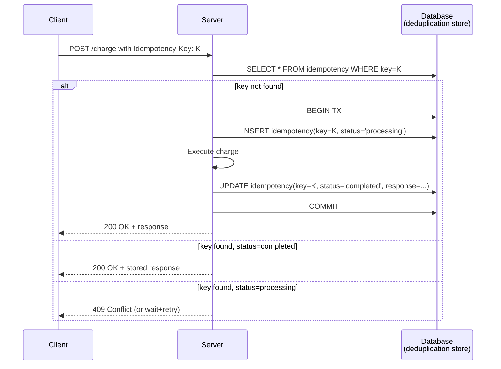
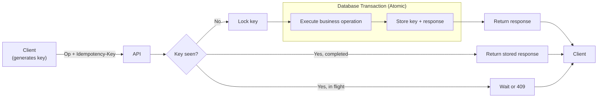

# Idempotency

## Overview

An operation is **idempotent** if applying it once produces the same result as applying it more than once. `f(x)` is idempotent if `f(f(x)) = f(x)` — and by extension, `f(f(f(x))) = f(x)`, and so on. In distributed systems, idempotency is the property that makes *safe retry* possible. Almost every reliable system you can name — payment processors, message brokers, file uploaders, schedulers — is built on the assumption that the same operation can be replayed without harm. When that assumption holds, networks can fail and processes can die and the system stays correct. When it doesn't hold, retries become bug factories.

---

## Why It Exists

Distributed systems lose messages. Networks partition. Processes die mid-operation. The receiving end might have processed your request; it might not have; you may never know. The only safe response to "I didn't hear back" is to try again. But retrying a non-idempotent operation — *charge this card*, *send this email*, *write this row* — can cause real-world damage: double charges, duplicate notifications, corrupt state.

What was broken before idempotency was treated as a first-class property: every "reliable" system smuggled in ad-hoc deduplication, often badly. Email systems sent the same message twice. Payment systems charged twice for the same purchase. Inventory systems decremented stock twice. Each of these was a custom workaround for the same underlying problem — and each workaround had its own bugs.

Idempotency, treated explicitly, turns retry from a dangerous workaround into a routine operation. It is the property that distinguishes "at-least-once delivery with retries" (cheap, useful, common) from "exactly-once delivery" (expensive, often impossible, usually unnecessary).

---

## Historical Context

The concept comes from mathematics — an idempotent function or operation satisfies `f(f(x)) = f(x)`. The word *idempotent* dates to 1870 (Benjamin Peirce, on matrix algebra).

In computing, idempotency surfaced in three waves:

1. **HTTP (1990s).** RFC 2616 (1999) formally defined HTTP method idempotency: `GET`, `PUT`, `DELETE` are idempotent; `POST` is not. This was the first time most working engineers encountered the term. The RFC was right about the shape (some methods are safe to retry, others aren't) but vague about *who* enforces it — the spec said the methods *should* be idempotent, not that the server *must* make them so.

2. **Message brokers (2000s).** Queues like RabbitMQ and AMQP exposed at-least-once delivery as the default, with at-most-once and exactly-once as expensive opt-ins. Engineers building consumers learned the hard way that the broker's "delivery guarantee" only mattered if the consumer's handler was idempotent. Otherwise, every retry was a bug.

3. **Cloud APIs (2010s).** Stripe popularized the `Idempotency-Key` request header in 2014. AWS APIs adopted similar patterns (`ClientToken` in EC2 RunInstances, etc.). The pattern: the *client* generates a unique key per logical operation, sends it on every retry, and the *server* deduplicates. Stripe's blog post on idempotency keys is the most-cited reference in modern API design.

The arc: implicit and accidental → method-level convention → application-level discipline → first-class API contract.

---

## First Principles

Idempotency is a property of an *operation*, not a system. An "idempotent system" is one whose operations are individually idempotent.

The minimum requirements:

**1. Identity.** Each logical operation must be uniquely identifiable. Two retries of the same logical operation must carry the same identifier; two distinct operations must carry distinct identifiers. This is usually a UUID generated client-side and carried in a request header (`Idempotency-Key: <uuid>`).

**2. Deduplication store.** The server must remember which identifiers it has seen, for at least long enough that no legitimate retry will arrive after the memory expires. The store can be a database table, a Redis key, or an in-memory cache — but it must persist across server restarts if the server's failure modes include restart.

**3. Outcome capture.** A naive deduplication just remembers "have we seen this key?" — but a retry usually wants the same response, not just a generic "already processed" message. The deduplication store must remember the *result* of the original operation, not just its existence. Otherwise the retry path looks identical to the original path from the caller's perspective, but downstream effects (a returned payment intent ID, a generated resource URL) are lost.

**4. Atomic capture.** The operation's effect and the deduplication-store update must commit atomically. If the effect runs and the key isn't stored, a retry will run the effect again. If the key is stored and the effect doesn't run, a retry will assume it was already done. Either way, you lose idempotency. Atomicity here usually means a transaction that wraps both, or a write-ahead log that records intent before doing the work.

That's the entire model. Most "idempotency bugs" trace back to violating one of these four — usually #4.

### Idempotent by construction vs. idempotent by deduplication

Two flavors. Both work; they pay different costs.

- **Idempotent by construction.** The operation itself, when re-executed, produces the same result. `SET x = 5` is idempotent by construction — running it twice leaves `x = 5`. So is `PUT /users/alice {email: "..."}` if the server's semantics are "replace the entire user record." This requires zero deduplication infrastructure.
- **Idempotent by deduplication.** The operation has side effects (charge a card, send an email) that *cannot* be made idempotent by construction. Idempotency comes from a deduplication layer that intercepts retries before the side effect runs. Stripe charges are the canonical example.

Idempotent-by-construction is always preferable when available. It costs nothing and cannot get out of sync. Idempotent-by-deduplication is necessary for everything else.

### Idempotency vs. exactly-once delivery

These are easily confused. Exactly-once delivery is a guarantee about *the network*: a message is delivered to its destination exactly once. In a network that can lose messages and processes that can die, exactly-once delivery is generally impossible — or, more accurately, indistinguishable in cost from at-least-once delivery plus idempotent handlers. Modern systems achieve "effectively exactly-once" semantics through at-least-once delivery + idempotent handlers + deduplication. There is no need for the network itself to deliver exactly once.

When someone says "we need exactly-once," they almost always mean "we need idempotent handlers." The phrasing matters because the engineering response is different. Exactly-once at the transport layer (Kafka transactions, distributed two-phase commit) is heavy and expensive. Idempotent handlers at the application layer are cheap.

---

## Mental Model

Imagine an elevator button.

You press it. The light turns on. The elevator is summoned.

You press it again. The light is already on. Nothing new happens. The elevator is still being summoned exactly once.

You press it ten more times in frustration. The system's state is identical to having pressed it once. The elevator arrives once, not eleven times.

That's idempotency. The first press is the operation; subsequent presses are retries. The system's response — *summon the elevator* — happens once regardless of how many times the operation is requested.

The light on the button is the deduplication signal. If you couldn't see whether the button was already pressed, you'd press it again to be sure — and the system would have to handle that gracefully without summoning a second elevator.

This is why idempotency and observability are linked: the elevator button visibly *shows you* that it has accepted your request. An invisible idempotent operation is harder to use safely.

---

## Internal Mechanics

The full mechanics of an idempotent server-side operation. The flow:



Three failure modes need explicit handling:

**1. Crash between row insert and transaction commit.** The `status='processing'` row was never written (transaction rolled back). On retry, the key is not found, and the operation runs normally. Safe.

**2. Crash between operation execution and `UPDATE`.** The transaction never commits, so the row was never written. The side effect did run, though. This is only safe if the side effect is itself idempotent — usually because the operation calls a *downstream* idempotent API with the same key. This is why idempotency tends to cascade: each layer must propagate the key down so the next layer can deduplicate too.

**3. Concurrent retries.** Two requests with the same key arrive at the same instant. One inserts the row first; the other gets a uniqueness violation. The losing request must either wait for the winner to finish (and then return the stored response) or return `409 Conflict` and let the client retry. Most production systems wait, because clients don't always handle 409 well.

### TTL on the deduplication store

The deduplication store cannot grow forever. Some retention policy is required.

Typical retention: hours to days. Long enough to cover any retry the client might reasonably send (network outages, mobile clients coming back from offline). Short enough that the store doesn't accumulate forever.

A TTL of 24 hours is a common default for HTTP APIs. Mobile-oriented systems (where offline-then-retry can span much longer) often extend this to 7+ days.

### Key generation

Client-generated, not server-generated. The whole point is that the *client* knows which operation it's retrying. If the server generates the key, the client can't carry it across retries.

UUIDv4 is standard. Some systems use a hash of (user_id, operation_type, timestamp_bucket) to make keys deterministic from intent — this trades off privacy (the key encodes information) for the ability to recover a lost key.

---

## Architecture



The deduplication store is a separate concern from the application's primary database, though they're often the same physical store for transactional safety. The key constraint: the deduplication update and the operation's side effect must commit atomically.

---

## Production Example

**Stripe payments.** `POST /v1/payment_intents` with `Idempotency-Key: <uuid>`. Stripe stores the key for 24 hours and returns the same response (including the payment intent ID) for any retry within that window. This is what makes "charge this card" safe to retry.

**AWS EC2 `RunInstances`.** A `ClientToken` parameter on the request. AWS uses it to deduplicate launch requests so that a retry under network failure doesn't launch two instances.

**Square, Adyen, PayPal.** All payment processors expose an idempotency key on their charge APIs. The pattern is so universal that it's effectively a standard in the payments industry.

**Kafka exactly-once semantics.** Kafka's "exactly-once" feature, since 0.11, is implemented as at-least-once delivery + idempotent producers + transactional commits. The idempotency comes from producer-generated sequence numbers; the transaction ensures atomic commit of message + offset.

**S3 PUTs.** S3's `PUT Object` is idempotent by construction — the object is fully replaced. A retried PUT cannot create two copies. This is one of the cleanest idempotent-by-construction APIs in production.

The shared thread: in every case, the user of the system gets to retry freely without fearing duplication, because the system has made the property explicit.

---

## Android Example

Most Android API libraries don't implement idempotency by default — that's the application's responsibility. The pattern looks like:

```kotlin
class ChargeRequest(val amountCents: Int, val cardId: String) {
    val idempotencyKey: String = UUID.randomUUID().toString()
}

suspend fun charge(request: ChargeRequest): ChargeResponse {
    return api.charge(
        body = request,
        idempotencyKey = request.idempotencyKey  // sent on retries too
    )
}
```

The idempotency key is generated *once* per logical operation and reused across retries. The retry loop (whether OkHttp's `retryOnConnectionFailure`, application-level retry policy, or post-process-death recovery) must propagate the original key. A common bug: regenerating the key on each retry attempt, which defeats the entire mechanism.

For operations that persist their state (background uploads, scheduled tasks), the idempotency key must persist with the operation. Otherwise, after a process death the key is lost and the retry is treated as a brand-new operation.

---

## Tradeoffs

**Advantages**

- Safe retry. The single biggest win — every other reliability strategy depends on this.
- Clear API contract. "This endpoint accepts an `Idempotency-Key` header" is a precise statement clients can build on.
- Recovery is mechanical, not heroic. Persistence + idempotency = recovery, with no human in the loop.
- Decouples the network's reliability from the system's correctness. The network can be lossy; the system can still be correct.

**Disadvantages**

- Storage cost. The deduplication store costs memory or disk proportional to the rate of unique operations × retention period.
- Latency cost. Every operation pays a deduplication lookup on the hot path.
- API complexity. Clients must generate, persist, and propagate keys. Many client bugs trace to mishandling keys.
- Schema invasion. The deduplication concern bleeds into the application's data model. You can hide it behind a middleware layer, but the layer still has to exist.

**Hidden costs**

- Race conditions during concurrent retries. The atomic-capture requirement is subtle and easy to miss in code review. Tests must exercise this case explicitly.
- Cross-layer key propagation. An idempotent API that internally calls another API must propagate the same key downward, or the second call won't be deduplicated. Easy to forget.
- Migrations. Changing the operation's behavior while old idempotent responses are still cached means new requests can get old responses. Either invalidate the cache or version the operation.

**When not to use**

- Reads. Idempotency is implicit for reads; you don't need a deduplication store for `GET`.
- Operations that are idempotent by construction (`PUT`, `SET`). The deduplication store would be redundant.
- Operations that *must* run on every invocation by design — incrementing a counter, appending to a log. These deliberately reject idempotency; the framing should be "we do not want safe retry here" and document why.

---

## Failure Modes

**Key reuse across logical operations.** Client reuses the same key for what it thinks is a fresh operation. Server returns the stored response from the previous operation; client gets confused. Mitigation: generate keys per logical operation, never per network attempt. Document this loudly.

**Key non-propagation.** Client retries with a different key. Server treats the retry as a new request and executes the side effect again. The most common cause: a retry loop wrapped around the request-building code instead of around the request itself. Mitigation: generate the key outside the retry loop; pass it in.

**Insufficient retention.** Client's network outage outlives the server's deduplication TTL. When the client finally retries, the key has been evicted; the server runs the operation again. Mitigation: set retention to the maximum plausible client outage. For mobile, this can mean days.

**Non-atomic capture.** Side effect ran, deduplication key wasn't stored — or vice versa. This is the canonical idempotency bug. Mitigation: hold the key insert and the side effect inside one transaction. If the side effect is external (e.g., calling another service), the external service must itself be idempotent on the same key.

**Cached response staleness.** Operation's behavior changes (price changes, business rule updates) while a previous idempotent response is still cached. Retry returns the old response. Mitigation: invalidate the cache on rule changes, or version the operation in the key.

**Concurrent retries with different keys.** Client doesn't realize its retry-on-timeout path generated a new key when the original was still in flight. Both arrive at the server; both execute. Mitigation: keys must be tied to logical operations, generated up front and persisted with the operation's state.

---

## Performance Considerations

- **CPU:** negligible. A lookup and a write per operation.
- **Memory:** the deduplication store. Sized as `op_rate × retention × avg_response_size`. For high-throughput systems, this can be substantial — Redis or a sharded SQL store, not in-process memory.
- **Disk:** if the store is persisted (it usually must be), each operation incurs a durable write.
- **Network:** the idempotency-key header adds a small overhead per request.
- **Latency:** one lookup + one write on the hot path. The lookup can be in-memory if the store is co-located; the write is more expensive.

For most systems, idempotency overhead is in the noise. Where it isn't, it usually means the deduplication store is mis-placed (e.g., a remote Redis that adds round-trip latency to every request).

---

## Reliability Considerations

Idempotency is a *prerequisite* for most other reliability strategies, not a strategy in itself.

- **Retries** ([`../patterns/retry.md`](../patterns/retry.md)) — only safe over idempotent operations. Without idempotency, retries are bug factories.
- **Circuit breakers** ([`../patterns/circuit-breaker.md`](../patterns/circuit-breaker.md)) — typically used to gate retry behavior, which assumes idempotency.
- **State machines** ([`../engineering-fundamentals/state-machines.md`](../engineering-fundamentals/state-machines.md)) — persisted state machines depend on idempotent effects for safe recovery.
- **Sagas** ([`../patterns/saga.md`](../patterns/saga.md)) — compensating actions in a saga must themselves be idempotent.

The mental model: idempotency is the substrate. Everything else sits on top.

---

## Security Considerations

- **Key as an opaque token.** Idempotency keys should be opaque from the server's perspective — never assume structure. A client that includes user IDs in keys leaks information.
- **Replay attacks.** A captured idempotency key is *not* a credential — it doesn't authorize the operation, only deduplicates it. But a key combined with a credential lets an attacker replay an exact previous operation. Mitigation: keys should be short-lived, and authorization must be checked on every request, not just the first.
- **Tenant isolation.** Keys must be scoped per tenant (or per user). Otherwise a malicious tenant could observe another tenant's responses by guessing keys. Mitigation: the deduplication store key is `(tenant_id, idempotency_key)`, not just `idempotency_key`.
- **Storage.** The deduplication store holds the responses of past operations — including PII in many cases. It must be subject to the same data-protection rules as the primary store.

---

## Observability

Idempotency is inherently observable — every deduplicated retry is a data point.

- **Logs.** Log every operation with `{idempotency_key, status, was_replay}`. `was_replay=true` means the deduplication store returned a stored response. The ratio of replays to fresh operations tells you how often retries are happening.
- **Metrics.**
  - `idempotency.replay_count` — counter of deduplicated retries.
  - `idempotency.replay_ratio` — replays / total operations.
  - `idempotency.in_flight_collision_count` — counter for the "concurrent retries" case.
  - `idempotency.store_size` — gauge for the deduplication store's current size.
- **Traces.** Tag the operation's trace span with `was_replay`. A trace with `was_replay=true` should be near-instant; if it isn't, the deduplication path itself is slow.
- **Dashboards.** A panel showing replay ratio over time. A sudden spike means clients are retrying more — usually a sign of upstream trouble.
- **Alerts.** Replay ratio above a baseline by 3σ — clients are retrying excessively, often because the system is degrading. Replay ratio of zero — either no clients are retrying (good) or the deduplication store is silently broken (bad). Both deserve attention.

Canonical observability concepts: [`../observability/metrics.md`](../observability/metrics.md), [`../observability/structured-logging.md`](../observability/structured-logging.md).

---

## Staff Engineer Thinking

**Treat idempotency as a contract, not an implementation detail.** An API endpoint either accepts an idempotency key or it doesn't. The presence of the key in the spec changes how clients use it, how SDKs are written, and how the operational story works. Decide explicitly, document explicitly. Do not bolt on idempotency later — at that point you have to invalidate caches, retrain client teams, and rewrite every retry path.

**Cascade idempotency downward.** A single idempotent API is useful. A *chain* of idempotent APIs is transformative. When your endpoint internally calls three other services, propagate the same key. The result: the whole chain has end-to-end at-least-once-with-deduplication semantics, and any node can crash and retry without breaking correctness.

**Make idempotency-by-construction the default when possible.** Designing `PUT /resource/{id}` (replace whole resource) over `POST /resource` (create new) for mutation APIs eliminates a whole class of idempotency-store complexity. Many teams default to POST because it's familiar; the choice to default to PUT instead is a small architectural decision with large reliability payoff.

**Push for an idempotency policy at the org level.** Without a policy, each team picks defaults independently — some use keys, some don't, some scope them differently. A platform-level policy ("all mutation endpoints accept `Idempotency-Key`; here's the shared library that implements it") amortizes the cost across teams and makes integration predictable.

**Reject "exactly-once" framing.** When stakeholders ask for "exactly-once delivery," redirect to "at-least-once delivery with idempotent handlers." It's almost always cheaper and almost always what they actually need. The "exactly-once" framing leads to expensive, fragile transport-layer solutions; the idempotency framing leads to robust, simple application-layer ones.

---

## Common Misconceptions

**"Idempotency means it only runs once."** No — it means it produces the same *result* whether it runs once or many times. The side effect may run zero or one time depending on the deduplication mechanism. The guarantee is about outcomes, not execution count.

**"HTTP idempotent methods are automatically idempotent."** RFC 2616 says they *should* be; it doesn't enforce that. A `PUT` endpoint that increments a counter is not idempotent, regardless of what the spec says about PUT. The method is a hint to caches and proxies; correctness depends on the implementation.

**"Idempotency gives you exactly-once."** It gives you "effectively exactly-once" *with retries* — which is what most callers want. True exactly-once at the transport layer is a different and much harder property.

**"GET is idempotent so I don't need to worry."** GETs have no side effects in their pure form. But many "GETs" in real systems aren't pure — they update last-access timestamps, log analytics events, etc. Those side effects, if they exist, must be idempotent or the GET isn't either.

**"My retry library handles idempotency."** Retry libraries handle *retrying*. They don't make the underlying operation idempotent. The library can safely retry an idempotent operation; it cannot make a non-idempotent operation safe.

---

## Probing Questions

Questions a Staff engineer should be able to answer cold:

1. What is the difference between idempotent-by-construction and idempotent-by-deduplication? Give an example of each.
2. Why is the atomic-capture requirement (side effect + deduplication-key write commit together) load-bearing? What breaks if it doesn't hold?
3. A client generates a fresh UUID for each retry attempt instead of reusing the same key. Why is this wrong, and what bug does it cause?
4. How would you design the deduplication store's TTL for an API used by mobile clients that may be offline for days?
5. Two retries with the same idempotency key arrive at the server at the same millisecond. What should happen?
6. Why is idempotency a prerequisite for state-machine-based recovery, rather than an orthogonal property?
7. Explain the relationship between idempotency and "exactly-once delivery." Why do most systems use the former instead of pursuing the latter?
8. When would you NOT want an operation to be idempotent? Give a concrete example.
9. An idempotent API internally calls three other services. What property must those three services have for end-to-end safety on retries?
10. The deduplication store and the primary database are separate physical stores. How do you maintain atomic capture?

---

## Further Reading

In this repository:

- [`delivery-semantics.md`](delivery-semantics.md) — at-least-once vs exactly-once vs at-most-once, and how idempotency relates.
- [`../patterns/retry.md`](../patterns/retry.md) — retries depend on idempotency.
- [`../patterns/saga.md`](../patterns/saga.md) — compensating actions are idempotent.
- [`../engineering-fundamentals/state-machines.md`](../engineering-fundamentals/state-machines.md) — persisted state machines rely on idempotent effects for recovery.
- [`../principles/determinism.md`](../principles/determinism.md) — determinism is the heuristic; idempotency is one of its mechanical consequences.
- [`../mobile-system-design/offline-sync.md`](../mobile-system-design/offline-sync.md) — sync depends on idempotent operations on both sides.
- [`../mobile-system-design/payment-flow.md`](../mobile-system-design/payment-flow.md) — payments are the canonical idempotent-API example.

External:

- Stripe's 2017 blog post *Designing robust and predictable APIs with idempotency*. The reference for the `Idempotency-Key` pattern.
- RFC 9110 §9.2.2 — the modern HTTP spec on idempotent methods. Cleaner than RFC 2616.
- Pat Helland, *Idempotence is Not a Medical Condition*. ACM Queue, 2012. A first-principles walk through the concept.
