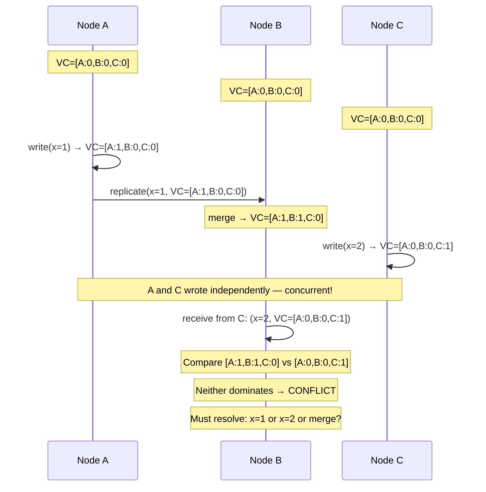
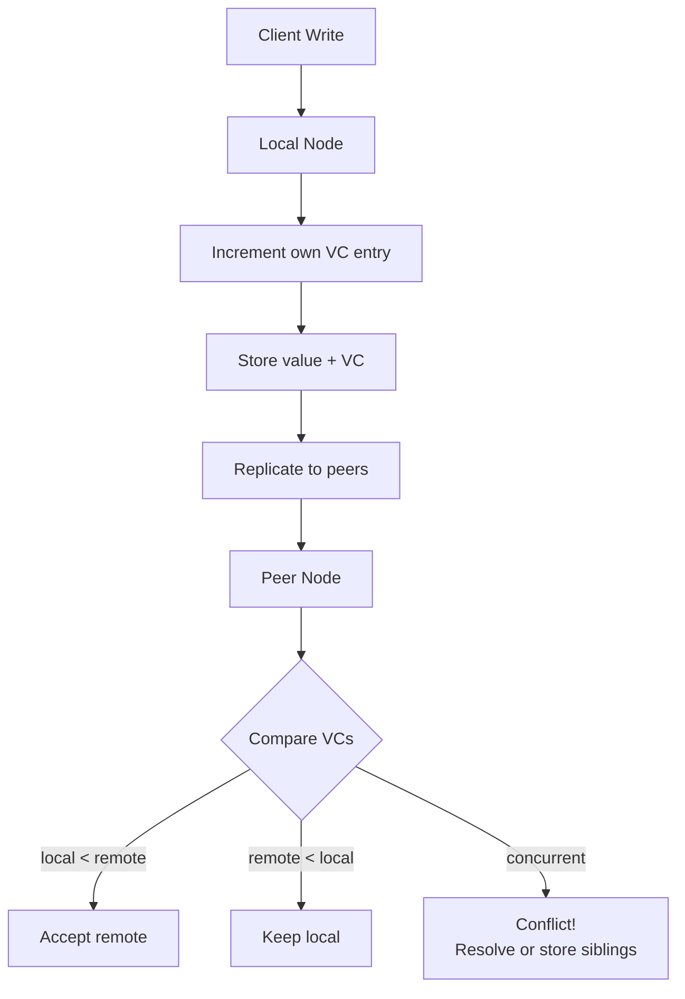

# Vector Clocks

## Overview

A **vector clock** is a data structure that tracks causality across nodes in a distributed system. Where a Lamport timestamp only provides a total order (if A causally precedes B, then `lamport(A) < lamport(B)`, but NOT the other way around), a vector clock captures true causality. It can tell you something more powerful: "A and B are *concurrent* — neither caused the other." This ability to detect concurrency is what makes conflict detection possible in multi-master replication, CRDTs, and eventually consistent databases. A vector clock is an array of counters, one per node, that collectively encode the causal history of an event.

---

## Why It Exists

In a distributed system, events happen on different nodes without a shared clock. The fundamental question is: given two events, did one *cause* the other, or did they happen independently?

Lamport timestamps answer a weaker question: "could A have caused B?" If `lamport(A) < lamport(B)`, it's *possible* that A caused B — but it's also possible they're concurrent. Lamport timestamps cannot distinguish the two cases.

What was broken before vector clocks: systems using Lamport timestamps (or wall clocks) for conflict detection either missed conflicts (treating concurrent writes as ordered) or flagged false conflicts (treating ordered writes as concurrent). Both are wrong. Missed conflicts cause silent data loss. False conflicts cause unnecessary user intervention.

Vector clocks solve this precisely: if event A's vector clock dominates B's (every component is ≥, at least one is >), then A happened after B. If neither dominates, the events are concurrent — a genuine conflict that the application must resolve.

---

## Historical Context

1. **Lamport timestamps (1978).** Leslie Lamport introduced logical clocks that capture partial ordering. Sufficient for many protocols but unable to detect concurrency.
2. **Vector clocks (1988).** Independently invented by Colin Fidge and Friedemann Mattern. Extended Lamport timestamps from a single counter to a vector of counters, one per process. This captured the full causal history and enabled concurrency detection.
3. **Amazon Dynamo (2007).** Used vector clocks for conflict detection in a multi-master replicated key-value store. The Dynamo paper brought vector clocks from academic literature into mainstream production engineering.
4. **Riak (2009-2017).** Used vector clocks (and later dotted version vectors) as its primary conflict-detection mechanism. Riak's experience revealed the practical scalability challenges of vector clocks.
5. **Dotted version vectors (2012).** An optimization that addresses vector-clock bloat in systems where many clients write to the same key. Used by Riak 2.0+.
6. **Modern practice.** Many production systems have moved from full vector clocks to simpler mechanisms (version numbers, hybrid logical clocks, last-writer-wins) for pragmatic reasons. Vector clocks remain the theoretically correct tool for conflict detection.

---

## First Principles

### The data structure

A vector clock for a system of N nodes is an array of N integers. Each entry tracks how many events that node has generated that are in the causal past of the current event.

```text
Node A's vector clock: [A:3, B:2, C:1]

Meaning: this event on Node A has seen
  - 3 events from Node A (including this one)
  - 2 events from Node B
  - 1 event from Node C
```

### The three rules

**Rule 1: Local event.** When a node performs a local event, it increments its own entry in the vector.

```text
Node A: [A:3, B:2, C:1] → local event → [A:4, B:2, C:1]
```

**Rule 2: Send.** When a node sends a message, it increments its own entry and attaches the vector clock to the message.

**Rule 3: Receive.** When a node receives a message with an attached vector clock, it takes the element-wise maximum of its own vector and the received vector, then increments its own entry.

```text
Node B has: [A:1, B:5, C:2]
Receives message with: [A:3, B:2, C:1]
After merge: [max(1,3), max(5,2), max(2,1)] + increment B
           = [A:3, B:6, C:2]
```

### The comparison rules

Given two vector clocks V1 and V2:

- **V1 < V2 (V1 happened before V2):** Every entry in V1 is ≤ the corresponding entry in V2, and at least one is strictly <.
- **V1 = V2:** Every entry is equal.
- **V1 ∥ V2 (V1 and V2 are concurrent):** Neither dominates. V1 has at least one entry greater than V2, and V2 has at least one entry greater than V1.

```text
[A:2, B:3] < [A:3, B:4]    → first happened before second
[A:3, B:2] ∥ [A:2, B:3]    → concurrent (conflict!)
[A:2, B:3] = [A:2, B:3]    → same event
```

Concurrency is the key: it means neither event could have caused the other. Both happened independently, possibly writing different values to the same key. This is a conflict that needs resolution.

---

## Mental Model

Imagine three friends — Alice, Bob, and Carol — each keeping a diary.

Each diary entry has a header: "I've seen Alice's entries 1-3, Bob's entries 1-2, Carol's entries 1-5." That header is the vector clock.

When Alice writes a new diary entry, she increments her own count. When Bob sends his diary to Alice, Alice reads Bob's entries and updates her header to include everything she's now seen. Alice's diary now reflects all of Bob's history *plus* all of her own.

Now: Alice and Carol both write new diary entries without seeing each other's recent work. Alice's header says [A:4, B:2, C:3] and Carol's says [A:2, B:2, C:6]. Neither dominates the other — Alice has seen more of her own work; Carol has seen more of hers. These entries are *concurrent*. If both modified the same shared document, there's a conflict.

A Lamport timestamp would have given each entry a single number, and you'd know one number is bigger — but you *wouldn't* know if the smaller-numbered entry had been seen by the larger-numbered one. The vector clock tells you precisely.

---

## Internal Mechanics

### Full implementation

```kotlin
data class VectorClock(val entries: Map<String, Int> = emptyMap()) {

    /** Increment this node's entry (local event or send). */
    fun increment(nodeId: String): VectorClock {
        val current = entries[nodeId] ?: 0
        return VectorClock(entries + (nodeId to current + 1))
    }

    /** Merge with a received vector clock, then increment own entry. */
    fun merge(other: VectorClock, nodeId: String): VectorClock {
        val allKeys = entries.keys + other.entries.keys
        val merged = allKeys.associateWith { key ->
            maxOf(entries[key] ?: 0, other.entries[key] ?: 0)
        }
        return VectorClock(merged).increment(nodeId)
    }

    /** True if this clock happened before other (this < other). */
    fun happenedBefore(other: VectorClock): Boolean {
        val allKeys = entries.keys + other.entries.keys
        var atLeastOneLess = false
        for (key in allKeys) {
            val mine = entries[key] ?: 0
            val theirs = other.entries[key] ?: 0
            if (mine > theirs) return false  // I have something they don't
            if (mine < theirs) atLeastOneLess = true
        }
        return atLeastOneLess
    }

    /** True if the two clocks are concurrent (conflict). */
    fun concurrent(other: VectorClock): Boolean =
        !happenedBefore(other) && !other.happenedBefore(this) && this != other
}
```

### Usage in a replicated key-value store

```kotlin
class ReplicatedStore(private val nodeId: String) {
    private val data = mutableMapOf<String, Pair<String, VectorClock>>()
    private var clock = VectorClock()

    fun put(key: String, value: String): VectorClock {
        clock = clock.increment(nodeId)
        data[key] = value to clock
        return clock
    }

    fun get(key: String): Pair<String, VectorClock>? = data[key]

    fun receiveReplica(key: String, value: String, remoteClock: VectorClock) {
        val local = data[key]
        if (local == null) {
            // No local version — accept remote
            clock = clock.merge(remoteClock, nodeId)
            data[key] = value to clock
        } else {
            val (localValue, localClock) = local
            when {
                localClock.happenedBefore(remoteClock) -> {
                    // Remote is newer — accept it
                    clock = clock.merge(remoteClock, nodeId)
                    data[key] = value to clock
                }
                remoteClock.happenedBefore(localClock) -> {
                    // Local is newer — ignore remote
                }
                localClock.concurrent(remoteClock) -> {
                    // CONFLICT: both values exist, neither caused the other
                    // Application must resolve: merge, pick one, or ask user
                    val resolved = resolveConflict(localValue, value)
                    clock = clock.merge(remoteClock, nodeId)
                    data[key] = resolved to clock
                }
            }
        }
    }
}
```

### The Dynamo approach to conflicts

Amazon Dynamo stored *all* concurrent versions (called "siblings") and returned them to the client on read. The client was responsible for merging:

```kotlin
// Dynamo-style: return all siblings to the client
data class DynamoValue(val siblings: List<Pair<String, VectorClock>>)

fun get(key: String): DynamoValue {
    val versions = replicas.map { it.get(key) }.filterNotNull()
    // Keep only versions that are not dominated by another
    val concurrent = versions.filter { v ->
        versions.none { other -> v.second.happenedBefore(other.second) && v != other }
    }
    return DynamoValue(concurrent)
}

// Client resolves:
fun resolve(siblings: DynamoValue): String {
    // Application-specific: merge shopping cart items, pick latest profile, etc.
    return siblings.siblings.map { it.first }.reduce { acc, s -> merge(acc, s) }
}
```

---

## Architecture





---

## Production Example

- **Amazon Dynamo (2007).** The paper that made vector clocks famous in practice. Used vector clocks to detect conflicting writes to the same key across replicas. Conflicts were returned to the client as siblings.
- **Riak.** Used vector clocks as its primary conflict-detection mechanism. Experienced vector-clock bloat (clocks growing very large with many writers) and introduced dotted version vectors as an optimization.
- **CouchDB.** Uses revision trees (conceptually similar to vector clocks) for conflict detection in multi-master replication.
- **Voldemort (LinkedIn).** Used vector clocks following the Dynamo model.
- **Git.** Git's merge model is conceptually a vector clock: each commit knows its parents (causal history). A merge conflict occurs when two branches have diverged (concurrent changes). Git doesn't use literal vector clocks, but the model is the same.

---

## Android Example

Mobile apps rarely use raw vector clocks, but the *concept* appears in offline-first sync:

```kotlin
// Simplified conflict detection for offline-first mobile sync
data class SyncVersion(
    val deviceVersions: Map<String, Long> = emptyMap()  // deviceId → version
) {
    fun increment(deviceId: String): SyncVersion {
        val current = deviceVersions[deviceId] ?: 0
        return SyncVersion(deviceVersions + (deviceId to current + 1))
    }

    fun merge(other: SyncVersion): SyncVersion {
        val allKeys = deviceVersions.keys + other.deviceVersions.keys
        val merged = allKeys.associateWith { key ->
            maxOf(deviceVersions[key] ?: 0, other.deviceVersions[key] ?: 0)
        }
        return SyncVersion(merged)
    }

    fun conflictsWith(other: SyncVersion): Boolean {
        val allKeys = deviceVersions.keys + other.deviceVersions.keys
        var iHaveMore = false
        var theyHaveMore = false
        for (key in allKeys) {
            val mine = deviceVersions[key] ?: 0
            val theirs = other.deviceVersions[key] ?: 0
            if (mine > theirs) iHaveMore = true
            if (theirs > mine) theyHaveMore = true
        }
        return iHaveMore && theyHaveMore
    }
}

// In the sync layer:
class NoteRepository(private val localDb: NoteDao, private val api: NoteSyncApi) {
    suspend fun sync(noteId: String) {
        val local = localDb.getNote(noteId) ?: return
        val remote = api.getNote(noteId) ?: return

        when {
            local.version.conflictsWith(remote.version) -> {
                // True conflict: user edited on two devices without syncing
                val resolved = presentConflictResolution(local, remote)
                val mergedVersion = local.version.merge(remote.version)
                    .increment(thisDeviceId)
                localDb.update(resolved.copy(version = mergedVersion))
                api.putNote(resolved.copy(version = mergedVersion))
            }
            remote.version.happenedAfter(local.version) -> {
                // Remote is newer: accept it
                localDb.update(remote)
            }
            // else: local is newer or equal; push on next sync
        }
    }
}
```

In practice, most mobile apps simplify this to last-writer-wins (using wall-clock timestamps) or server-arbitrated conflict resolution. Full vector clocks are used when data mergeability matters — collaborative editing, shared shopping lists, multi-device note-taking.

---

## Tradeoffs

**Advantages**

- Precise conflict detection. No false positives (treating ordered events as concurrent) and no false negatives (treating concurrent events as ordered).
- No dependency on physical clocks. Correctness doesn't require clock synchronization.
- Enables principled conflict resolution. The application knows *exactly* which operations conflict and can resolve appropriately.

**Disadvantages**

- **Size.** A vector clock has one entry per node. In a system with thousands of nodes, the clock is kilobytes per event — significant overhead.
- **Complexity.** Correct implementation is subtle. Comparison, merging, and pruning are error-prone.
- **Client burden.** Dynamo-style "return siblings to the client" pushes conflict resolution to the application, which many applications get wrong.

**Hidden costs**

- **Clock bloat.** In Dynamo, every client that writes to a key adds an entry to the vector clock. For popular keys, the clock grows without bound. Mitigation: pruning (remove entries from nodes that haven't written recently) — but pruning reintroduces false conflicts.
- **Sibling explosion.** Under high concurrency, a key can accumulate many concurrent versions (siblings). Without an application-level merge, the sibling list grows and reads become expensive.

**When not to use**

- Systems with a single writer per key (single-leader replication). No concurrency → no need for conflict detection.
- Systems where last-writer-wins is acceptable. LWW is simpler and cheaper; the data loss is tolerable.
- Systems with a very large number of nodes. Vector clocks at scale require pruning or alternatives (dotted version vectors, interval tree clocks).

---

## Failure Modes

**Clock bloat.** The vector clock grows unboundedly as new nodes write to the same key. Mitigation: prune entries from nodes that haven't written recently; accept the trade-off of occasional false conflicts from pruned entries.

**Sibling explosion.** Many concurrent writes to the same key create many siblings. If siblings are not resolved, subsequent writes create even more siblings (each new write is concurrent with all existing siblings). Mitigation: limit the maximum number of siblings; force resolution on read.

**Incorrect comparison.** A bug in the `happenedBefore` or `concurrent` logic causes missed conflicts or false conflicts. Mitigation: exhaustive property-based testing of the comparison function.

**Pruning-induced false conflicts.** When a vector-clock entry is pruned (to control size), the pruned node's history is lost. A subsequent write from that node appears concurrent with everything, creating a false conflict. Mitigation: prune conservatively; prefer dotted version vectors.

**Network partition with concurrent writes.** During a partition, both sides write independently. When the partition heals, all writes from both sides appear concurrent. If there are many, sibling explosion results. Mitigation: application-level merge strategies; CRDTs for auto-mergeable data types (see [`crdts.md`](crdts.md)).

---

## Performance Considerations

- **Space:** O(N) per event, where N is the number of nodes. For large clusters, this is the dominant concern.
- **Comparison:** O(N) per comparison. Fast for small N; potentially expensive for large N.
- **Network:** Each message carries a vector clock. Overhead is N integers per message.
- **Storage:** Each stored value includes its vector clock. For key-value stores, this adds N integers per key-version.
- **CPU:** Merge (element-wise max) is O(N). Negligible for small N.

For mobile apps, N is typically small (number of devices per user, often 2-5), making vector clocks practically free.

---

## Reliability Considerations

- Vector clocks make **conflict detection** reliable — you never miss a true conflict. This is the foundation for building reliable eventually consistent systems.
- **Resolution** is separate from detection. Reliable detection + bad resolution = data loss. The resolution strategy (merge, LWW, user choice) must be tested as carefully as the detection.
- Vector clocks are **partition-tolerant** by design. They continue to function correctly during and after network partitions. The concurrent writes created during a partition are detected and flagged when the partition heals.

---

## Security Considerations

- **Clock manipulation.** A malicious node can forge its vector-clock entry to make its writes appear to dominate others, suppressing legitimate writes. Mitigation: sign vector clocks with per-node keys; verify on receipt.
- **Sibling injection.** A malicious client can deliberately create many concurrent writes to cause sibling explosion (a denial-of-service attack on storage). Mitigation: limit siblings per key; rate-limit writes.

---

## Observability

- **Vector clock size.** Histogram of clock sizes (number of entries) per key. Growing sizes indicate potential bloat.
- **Conflict rate.** Count of concurrent (conflicting) writes detected per time window. Baseline and alert on spikes.
- **Sibling count.** Histogram of sibling counts per key. Any key with >5 siblings deserves investigation.
- **Pruning frequency.** How often vector clocks are pruned. Aggressive pruning = more false conflicts.
- **Conflict resolution outcomes.** How conflicts were resolved (auto-merge, LWW, user choice). Track for correctness auditing.

Canonical: [`../observability/metrics.md`](../observability/metrics.md).

---

## Staff Engineer Thinking

**Use vector clocks when conflict detection is load-bearing.** If your system's correctness depends on detecting concurrent writes (collaborative editing, multi-device sync, multi-master replication), vector clocks are the right tool. If last-writer-wins is acceptable, they're unnecessary complexity.

**Push conflict resolution policy to the application.** The infrastructure layer (database, sync engine) detects conflicts; the application layer resolves them. This separation is critical because resolution is domain-specific — merging shopping carts is different from merging documents is different from merging bank balances.

**Size the vector clock to the writer set, not the node set.** A common optimization: the vector clock tracks *writers to this key*, not *all nodes in the cluster*. This keeps clocks small for keys with few writers, even in large clusters. Dotted version vectors formalize this.

**Consider alternatives at scale.** For systems with hundreds or thousands of nodes, full vector clocks are impractical. Alternatives: Hybrid Logical Clocks (if causal ordering suffices without conflict detection), CRDTs (if the data structure can auto-merge), or server-arbitrated conflict resolution (if a single arbiter is acceptable).

**Treat sibling resolution as a required feature, not a nice-to-have.** If your system returns siblings to the client, the client *must* resolve them. "We'll handle conflicts later" means "we'll ship data loss now."

---

## Common Misconceptions

**"Vector clocks tell you the time."** They don't. Vector clocks track *causality*, not time. Entry [A:3] means "this event has seen 3 events from node A," not "3 seconds."

**"Vector clocks replace Lamport timestamps."** They extend them. A Lamport timestamp is a scalar projection of a vector clock (the max entry). Vector clocks add the ability to detect concurrency, which Lamport timestamps cannot.

**"Vector clocks solve conflicts."** They *detect* conflicts. Resolution is an application concern. Vector clocks tell you "these two writes are concurrent"; they don't tell you which one to keep.

**"Every distributed system needs vector clocks."** Most don't. Single-leader replication has no concurrent writes. Last-writer-wins systems don't need conflict detection. Vector clocks are for systems where concurrency detection is load-bearing.

**"Vector clocks are the same as version vectors."** Related but distinct. Version vectors track the version of a *data item* across replicas. Vector clocks track the causal history of *events*. In practice, the terms are often used interchangeably, but the semantics differ in edge cases.

---

## Probing Questions

1. Given two vector clocks [A:3, B:2, C:1] and [A:2, B:4, C:1], are these events concurrent? Explain your reasoning.
2. Why can't a Lamport timestamp detect concurrency? Give a concrete example.
3. How does the Dynamo paper use vector clocks for conflict detection? What does it return to the client when there's a conflict?
4. Vector clocks grow linearly with the number of nodes. At what scale does this become a problem, and what are the alternatives?
5. Explain vector-clock pruning. What does it gain, and what does it lose?
6. How is Git's merge model conceptually similar to vector clocks?
7. A mobile app syncs notes across 3 devices. Device A and C both edit the same note offline. Describe the conflict-detection process when they sync.
8. Compare vector clocks with CRDTs as conflict-resolution strategies. When would you choose each?
9. What is a "sibling explosion" in Riak, and how do you prevent it?
10. Why should conflict resolution be an application concern rather than an infrastructure concern?

---

## Answer Key

1. **Given two vector clocks [A:3, B:2, C:1] and [A:2, B:4, C:1], are these events concurrent? Explain your reasoning.**
   Yes, they are concurrent. The first clock has a larger value for A (3 > 2), while the second has a larger value for B (4 > 2). Since neither dominates the other across all dimensions, neither happened before the other.
2. **Why can't a Lamport timestamp detect concurrency? Give a concrete example.**
   A Lamport timestamp only provides a single scalar value. If event X has timestamp 3 and event Y has timestamp 4, X could have causally preceded Y, or they could have occurred concurrently on different nodes. The single number destroys the causal history.
3. **How does the Dynamo paper use vector clocks for conflict detection? What does it return to the client when there's a conflict?**
   Dynamo attaches vector clocks to each version of a key. When it detects concurrent writes (neither clock dominates), it stores both versions as "siblings" and returns all siblings to the client, forcing the client application to resolve the conflict.
4. **Vector clocks grow linearly with the number of nodes. At what scale does this become a problem, and what are the alternatives?**
   It becomes a problem when there are thousands of nodes (or clients) writing to the same key, as the clock metadata outgrows the payload. Alternatives include dotted version vectors, pruning, or shifting to last-writer-wins if concurrency detection isn't strictly necessary.
5. **Explain vector-clock pruning. What does it gain, and what does it lose?**
   Pruning removes entries from the vector clock for nodes that haven't written recently to cap the size of the clock. It gains space efficiency but loses precise causal history, introducing the risk of false conflicts when a pruned node writes again.
6. **How is Git's merge model conceptually similar to vector clocks?**
   Git tracks the exact causal history of commits via a directed acyclic graph (DAG) of parent pointers. A merge conflict occurs when two branches diverge from a common ancestor—the exact structural equivalent of two vector clocks showing concurrent writes.
7. **A mobile app syncs notes across 3 devices. Device A and C both edit the same note offline. Describe the conflict-detection process when they sync.**
   When Device A and C sync with the server, the server compares their vector clocks. Since both incremented their own entries based on an older shared state, neither clock will dominate. The server detects the concurrency and flags a conflict for resolution.
8. **Compare vector clocks with CRDTs as conflict-resolution strategies. When would you choose each?**
   Vector clocks only *detect* conflicts, requiring custom application logic to merge them. CRDTs use specific mathematical rules to automatically *resolve* conflicts. Use CRDTs for easily mergeable data (e.g., counters, sets), and vector clocks when merges require complex business logic or user intervention.
9. **What is a "sibling explosion" in Riak, and how do you prevent it?**
   Sibling explosion occurs when many concurrent writes create a rapidly growing list of unresolved conflicting versions (siblings) for a single key. Prevent it by forcing clients to resolve siblings on read or using CRDTs that auto-merge.
10. **Why should conflict resolution be an application concern rather than an infrastructure concern?**
    Because the correct way to merge data is domain-specific. Merging a shopping cart (union of items) is entirely different from merging a bank balance (addition/subtraction) or a text document. Infrastructure lacks this context.

---

## Further Reading

In this repository:

- [`../engineering-fundamentals/time-and-clocks.md`](../engineering-fundamentals/time-and-clocks.md) — the broader context of logical vs physical time.
- [`consistency-models.md`](consistency-models.md) — vector clocks enable causal consistency.
- [`crdts.md`](crdts.md) — data structures that auto-resolve conflicts, eliminating the need for application-level resolution.
- [`cap-theorem.md`](cap-theorem.md) — AP systems use vector clocks for conflict detection during partition healing.
- [`idempotency.md`](idempotency.md) — idempotent operations can serve as a conflict-resolution strategy.
- [`../reference-architectures/offline-first-app.md`](../reference-architectures/offline-first-app.md) — offline-first architectures depend on conflict detection and resolution.

External:

- Colin Fidge, *Timestamps in Message-Passing Systems That Preserve the Partial Ordering* (1988). One of the two independent inventions.
- Friedemann Mattern, *Virtual Time and Global States of Distributed Systems* (1988). The other independent invention.
- Giuseppe DeCandia et al., *Dynamo: Amazon's Highly Available Key-value Store* (2007). Vector clocks in production at Amazon scale.
- Nuno Preguiça et al., *Dotted Version Vectors: Logical Clocks for Optimistic Replication* (2012). The optimization that addresses vector-clock bloat.
- Martin Kleppmann, *Designing Data-Intensive Applications*, Chapter 5. Replication and conflict detection.
