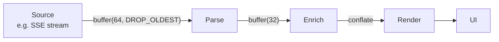

# Backpressure

## Overview

**Backpressure** is the mechanism by which a slow consumer can tell a fast producer to slow down. Without backpressure, a producer that outpaces its consumer fills queues, exhausts memory, and eventually crashes the system — often the consumer first, despite the consumer not being the cause. Backpressure is the difference between a system that degrades gracefully under load and a system that falls over.

The concept comes from fluid mechanics — pressure that pushes back upstream when a downstream pipe is too small. Software borrowed both the name and the metaphor.

---

## Why It Exists

In any pipeline of work — producer → queue → consumer — the producer's rate and the consumer's rate are not synchronized. The producer might be a network socket, a UI gesture, a sensor, another service. The consumer might be a database write, a render, an upload, a downstream API. When the consumer is faster, the queue stays empty and everything is fine. When the producer is faster, the queue grows.

What was broken before backpressure was treated as a first-class concept: every async system independently invented some hack to handle slow consumers — drop messages, fail closed, OOM and restart. The 2010-era reactive-streams literature (RxJava, Reactor) codified backpressure as a property of the *pipeline*, not the endpoints. After that, the question shifted from "what do we do when the queue is full?" to "what's our backpressure strategy?"

The fundamental insight: in any unbounded queue, the producer wins. An unbounded queue is a memory leak with extra steps. Bounded queues *force* a backpressure decision; the choice is between explicit policies (block, drop, buffer-then-fail) and a system that crashes when it could have degraded.

---

## Historical Context

1. **TCP flow control (1970s).** The first widely-deployed backpressure mechanism. The receiver advertises a window; the sender will not send more than that until the window opens.
2. **Pipe and queue limits in operating systems (1980s).** Bounded buffers between processes; a writer that fills the buffer blocks.
3. **Java BlockingQueue (1990s-2000s).** Application-level bounded queues with explicit overflow policies.
4. **Reactive Streams (2013-2015).** A vendor-neutral spec (Reactor, RxJava, Akka, the JVM) that made backpressure a property the pipeline can negotiate end-to-end.
5. **HTTP/2 flow control (2015).** Per-stream window-based backpressure brought to the application protocol layer.
6. **Kotlin Flow (2019 onward).** Backpressure-aware streams as a first-class language abstraction, replacing RxJava on Android.

The pattern across decades: backpressure starts as a hack at one layer, gets formalized into a protocol, then propagates upward through the stack.

---

## First Principles

A pipeline has three parts: a producer, a queue, and a consumer. Backpressure is the policy the queue applies when it fills up.

### 1. The queue is the negotiation point

If the queue is **unbounded**, the producer's rate dominates and the queue's size grows until memory is exhausted. This is rarely what you want, even when it appears to work.

If the queue is **bounded**, full-queue behavior must be specified. There are four possible policies. They are *all* legitimate; the choice depends on what kind of system you're building.

### 2. The four policies

1. **Block.** Producer is suspended (or blocked) until the queue has space. The producer's rate is implicitly slowed to match the consumer's rate. This is the "natural" form of backpressure — it propagates upstream automatically.
2. **Drop new.** New items are rejected when the queue is full. The producer continues at its own rate; some data is lost. Used when stale data is preferable to stale users (UI events, sensor readings, telemetry).
3. **Drop old.** New items replace the oldest queued items. The consumer always sees the most recent data. Used when only the latest value matters (mouse position, "current" telemetry value).
4. **Buffer to disk / spill.** When the in-memory queue fills, overflow goes to durable storage. Trades latency for capacity; defers — does not solve — the producer-faster-than-consumer problem.

A fifth policy — *fail fast / error* — is a variant of "drop new" where the producer is informed of the drop and can decide what to do.

### 3. End-to-end backpressure

If backpressure isn't end-to-end, it's not backpressure. A bounded queue between stages 3 and 4 of a pipeline only delays the problem — stages 1, 2, and 3 will fill their own intermediate buffers until *those* policies kick in. Real backpressure propagates from the slowest consumer all the way to the original producer.

```text
Source ─bp─▶ Stage1 ─bp─▶ Stage2 ─bp─▶ Stage3 ─bp─▶ Sink
                                                       ↑
                                            (slow; everyone slows)
```

The *whole pipeline* slows down. The producer's rate is, transitively, set by the slowest consumer.

---

## Mental Model

A factory assembly line.

Each station performs an operation and passes the work piece to the next station. If station 3 is slower than station 2, work piles up between them. The buffer between stations can hold some pieces — but it's a small buffer. When it fills, station 2 has nowhere to put the next piece.

What happens next is the policy:

- **Block:** station 2 stops. Station 1 will fill the buffer in front of station 2, then it stops too. The whole line slows to station 3's rate.
- **Drop new:** station 2 keeps producing but drops the piece into a bin. The line runs at station 2's rate; downstream gets only what station 3 can keep up with.
- **Drop old:** the buffer between stations 2 and 3 evicts old pieces in favor of new ones. Station 3 only ever works on the *latest* piece.
- **Spill:** completed pieces stack on the floor next to station 3 until someone moves them to a warehouse. Eventually the warehouse is full and you have the same problem.

The factory operator's job is to make this choice *explicitly*. The choice not to choose is also a choice: it usually means "block until things break," which is the worst of the four.

---

## Internal Mechanics

### Bounded queue with blocking

```kotlin
val queue = LinkedBlockingQueue<Event>(capacity = 100)

// Producer
fun produce(event: Event) {
    queue.put(event)  // blocks if queue is full
}

// Consumer
fun consume(): Event {
    return queue.take()  // blocks if queue is empty
}
```

Simplest case. Producer blocks when full, consumer blocks when empty. Backpressure is implicit in the blocking.

### Bounded queue with explicit policy

```kotlin
val queue = LinkedBlockingQueue<Event>(capacity = 100)

fun produce(event: Event) {
    val accepted = queue.offer(event, 100, TimeUnit.MILLISECONDS)
    if (!accepted) {
        metrics.increment("queue.dropped")
        // policy: drop new, or escalate, or buffer to disk
    }
}
```

`offer` with a timeout lets the producer make a choice rather than blocking indefinitely.

### Kotlin Flow with explicit backpressure

```kotlin
// Buffer: explicit bounded buffer with overflow policy
sensorEvents()
    .buffer(capacity = 64, onBufferOverflow = BufferOverflow.DROP_OLDEST)
    .collect { processSlowly(it) }

// Conflate: keep only the latest value
locationUpdates()
    .conflate()  // drop intermediate values; consumer always gets the latest
    .collect { renderOnMap(it) }

// CollectLatest: cancel the consumer when a new value arrives
searchQueries()
    .collectLatest { query ->
        delay(300)  // debounce
        showResults(search(query))
    }
```

`Flow` makes the backpressure decision *operator-explicit*. Every Flow has *some* policy; the question is whether you set it or take the default.

### TCP window as canonical backpressure

```text
Sender                    Receiver
  │                          │
  │ ──── data ────▶          │ window=8000
  │                          │
  │ ◀──── ACK + window=4000  │  (buffer half full)
  │                          │
  │ ──── data ────▶          │
  │                          │
  │ ◀──── ACK + window=0     │  (buffer full; STOP)
  │                          │
  │ [waits]                  │
  │                          │
  │ ◀──── ACK + window=2000  │  (buffer drained; resume)
  │                          │
```

The receiver tells the sender how much it can take. The sender respects that limit. End-to-end backpressure built into the transport.

---

## Architecture

A typical async pipeline with explicit backpressure at each stage:



Each arrow has a buffer size and a policy. The policies do not have to be the same — early stages (parsing) might block to preserve data; late stages (rendering) might conflate because only the latest value is interesting.

---

## Production Example

- **TCP itself.** The most-used backpressure mechanism in computing history. Every TCP connection in the world implements window-based flow control.
- **Kafka consumers.** Consumers control their own rate by committing offsets. The broker holds messages; the consumer pulls only as fast as it can process.
- **HTTP/2 flow control.** Per-stream and per-connection windows. Browsers, CDNs, and gRPC all rely on this.
- **gRPC streaming.** Built on HTTP/2 flow control; suspend/resume is implicit in the framework.
- **Akka Streams / Reactor.** JVM frameworks where every operator participates in backpressure negotiation.
- **Apache Flink, Kafka Streams.** Stream-processing systems where end-to-end backpressure propagates from sink to source across distributed operators.
- **YouTube buffer dynamics.** Adaptive bit-rate streaming includes implicit backpressure — the player's buffer fullness influences which quality tier to request next.

---

## Android Example

Android has many bursty event sources (gestures, sensors, location, SSE streams) and many slow consumers (network, disk, render). Without backpressure, these systems regularly OOM.

```kotlin
class LocationViewModel(private val locator: LocationRepository) : ViewModel() {
    val location: StateFlow<LatLng?> = locator.updates()
        .conflate()  // drop intermediate updates if consumer is slow
        .flowOn(Dispatchers.Default)
        .stateIn(viewModelScope, SharingStarted.WhileSubscribed(5000), null)
}
```

For touch / scroll events that drive UI:

```kotlin
val searchResults = searchInput
    .debounce(300)               // ignore typing bursts
    .distinctUntilChanged()      // ignore non-changes
    .mapLatest { query ->        // cancel previous if a new query arrives
        search(query)
    }
```

For pipelines that must not drop data:

```kotlin
val uploadQueue = MutableSharedFlow<UploadJob>(
    replay = 0,
    extraBufferCapacity = 100,
    onBufferOverflow = BufferOverflow.SUSPEND  // backpressure all the way up
)
```

The `SUSPEND` overflow strategy implements true backpressure — the caller of `emit()` is suspended until space is available. This is the right choice when *every* item must reach the consumer.

See [`../android/flow.md`](../android/flow.md), [`../android/shared-flow.md`](../android/shared-flow.md), [`../android/state-flow.md`](../android/state-flow.md).

---

## Tradeoffs

**Block (suspend)**

- Pro: no data loss; the slowest consumer sets the rate end-to-end.
- Con: producer is slowed down (sometimes blocked) — unacceptable for real-time UI threads.

**Drop new**

- Pro: producer is never slowed.
- Con: data loss; risk of correctness issues if every item matters.

**Drop old**

- Pro: consumer always sees the most recent value.
- Con: intermediate values lost; not suitable for event streams where order matters.

**Buffer to disk**

- Pro: durable; survives consumer outages.
- Con: latency hit; defers — does not solve — sustained throughput imbalance.

**Hidden costs across all policies**

- Backpressure that doesn't go end-to-end is theater. A bounded queue in the middle just shifts where buffering happens.
- Backpressure adds latency. The closer the system gets to capacity, the more latency the queue introduces.

**When not to use**

- Single-producer, fast-consumer pipelines where the queue never fills. The overhead is wasted.
- Unbounded sources where dropping is unacceptable and disk-spilling is infeasible (financial trades, audit logs). In those cases, the answer is more capacity, not better backpressure.

---

## Failure Modes

**Unbounded queue masquerading as backpressure.** A "Channel(UNLIMITED)" or "LinkedBlockingQueue()" looks like backpressure but is just a memory leak. Always set bounds.

**OOM from bounded buffers under burst.** Even bounded queues can OOM if individual items are large. Account for memory per item, not just count.

**Backpressure deadlock.** Producer is blocked on a full queue; consumer is blocked on something the producer holds. Mitigation: be very wary of producer ↔ consumer mutual dependencies; design so the consumer never needs the producer to do anything.

**Producer disconnected from backpressure.** A producer running on a separate dispatcher, or fed by a non-suspending source, doesn't see backpressure. Mitigation: end-to-end means *end-to-end* — every stage participates.

**Stale-by-design data.** "Drop old" or "conflate" policies hide that the system is overloaded. The user sees "the latest" values but never knows that earlier values were dropped. Mitigation: monitor drop rates; alert when they exceed threshold.

**Hidden disk-buffering bursts.** "Just spill to disk" eventually fills disk. Set disk-spill limits explicitly.

---

## Performance Considerations

- **CPU:** Backpressure mechanics are cheap; coordination cost is per-item lock or atomic.
- **Memory:** The dominant cost. A bounded queue's memory ceiling is `capacity × avg_item_size`. Size accordingly.
- **Throughput:** Backpressure reduces throughput to the slowest consumer's rate. This is the *point* — uncontrolled throughput crashes the system.
- **Latency:** A queue near capacity adds latency. The closer to capacity, the more. Operating below 50-70% utilization keeps latency predictable.
- **Battery (mobile):** Polling-based backpressure (busy-wait on the queue) burns battery; suspension-based backpressure (await on a semaphore) doesn't.

---

## Reliability Considerations

- **Load shedding** is a specialized backpressure policy. When the system is overloaded, explicitly reject some work to keep the rest flowing.
- **Bulkheads** isolate failures: each subsystem has its own bounded queue, so a slow consumer in one path can't starve the others.
- **Circuit breakers** prevent calling a saturated consumer at all; the breaker trips when downstream queues fill.
- **Graceful degradation** is what backpressure makes possible. Without it, systems go from "fine" to "crashed" instantly.

See [`fault-tolerance.md`](fault-tolerance.md), [`../patterns/circuit-breaker.md`](../patterns/circuit-breaker.md).

---

## Security Considerations

- **DoS by producer flood.** Without backpressure, an attacker can exhaust memory by flooding any input. Bounded queues + drop policies are a DoS mitigation.
- **Quota enforcement.** Per-tenant rate limits are an application-layer backpressure mechanism — explicitly slowing one consumer that's misbehaving.
- **Resource fairness.** Without per-source fairness, one noisy source can starve all others. Bounded per-source queues prevent this.

---

## Observability

- **Queue depth.** Gauge per queue. Sustained depth near capacity is the leading indicator of saturation.
- **Drop count.** Counter for items dropped by the overflow policy. Should be 0 in steady state.
- **Producer wait time / suspension time.** Histogram of how long producers spent blocked or suspended. Rising wait time = approaching saturation.
- **Consumer utilization.** What fraction of time the consumer is busy. Approaching 100% means no headroom for bursts.
- **Pipeline end-to-end latency.** From input to output. A backpressured pipeline operating below capacity has stable latency; near capacity, latency grows.

Canonical: [`../observability/metrics.md`](../observability/metrics.md), [`../observability/slis.md`](../observability/slis.md).

---

## Staff Engineer Thinking

**Make every queue bounded.** Unbounded queues are deferred crashes. A Staff engineer reviewing code should reject `Channel(UNLIMITED)` and `LinkedBlockingQueue()` with the same reflex they reject `catch (Exception ignored)`.

**Pick the policy per data, not per system.** Some data must not be dropped (financial transactions). Some must always be the latest (cursor position). Some is a mix (search queries: debounce, then drop intermediates). The right granularity is the data type, not the framework.

**Backpressure is a contract, not an implementation detail.** When designing a stream API, the backpressure semantics are part of the API. Document them. A consumer that doesn't know whether the upstream is suspending, dropping, or buffering will misuse the API.

**End-to-end or it's not real.** A Staff engineer pulls on the thread: where does backpressure stop? At the source? At the network boundary? If there's an intermediate unbounded buffer anywhere, the downstream policy is incomplete.

**Measure drop rate as an SLI.** Drops are a quiet failure. Telemetry pipelines that "scale by dropping events" can drop 30% of events without anyone noticing. Make drops loud.

---

## Common Misconceptions

**"Just use a queue."** A queue *is* the backpressure mechanism. Its bounds and overflow policy are the actual decision.

**"Async automatically handles backpressure."** Async makes backpressure *possible* but does not provide it. RxJava 1 famously did not — backpressure was added in RxJava 2 because the original assumption "the consumer can keep up" was wrong in practice.

**"Drop old is always fine for UI."** For position-like data (cursor, scroll, current location), yes. For event data (gestures, taps), no — dropping a tap is dropping a user action.

**"Bigger buffers solve backpressure."** They postpone backpressure. They don't solve the fundamental rate mismatch.

**"Backpressure means slowing the user down."** Sometimes. Often it means rate-limiting non-user-facing producers (background syncs, telemetry) to protect user-facing paths.

---

## Probing Questions

1. A `Channel(UNLIMITED)` in Kotlin. Why is this almost always wrong?
2. Compare `buffer(DROP_OLDEST)` and `conflate()` in Flow. When would you use each?
3. End-to-end backpressure means what, specifically? Why does middle-of-pipeline backpressure fail?
4. The producer is a hardware sensor at 100 Hz; the consumer is a network upload at 10 Hz. Which policy do you choose, and why?
5. A team adds a bounded queue and the system OOMs anyway. What are the possible causes?
6. How does TCP implement backpressure? How does HTTP/2 differ?
7. A pipeline drops 30% of events under load. How would you know that's happening?
8. When does "buffer to disk" stop being a backpressure strategy and start being a deferred bug?
9. You're designing a telemetry SDK. What backpressure policy do you choose, and how do you avoid silently dropping events?
10. The consumer is a UI render at 60 Hz; the producer is location updates at 200 Hz. Justify a backpressure choice.

---

## Further Reading

In this repository:

- [`sync-vs-async.md`](sync-vs-async.md) — async without backpressure is a memory leak.
- [`queues.md`](queues.md) — the substrate; this file describes what to do *with* queues.
- [`latency-vs-throughput.md`](latency-vs-throughput.md) — backpressure trades throughput for stability.
- [`fault-tolerance.md`](fault-tolerance.md) — backpressure is a fault-tolerance technique.
- [`../patterns/circuit-breaker.md`](../patterns/circuit-breaker.md) — the breaker is triggered by upstream backpressure signals.
- [`../android/flow.md`](../android/flow.md), [`../android/shared-flow.md`](../android/shared-flow.md), [`../android/state-flow.md`](../android/state-flow.md) — Android-specific Flow operators.
- [`../mobile-system-design/telemetry-sdk.md`](../mobile-system-design/telemetry-sdk.md) — designing a telemetry SDK around backpressure.

External:

- *Reactive Streams Specification* (reactive-streams.org). The vendor-neutral spec; defines the negotiation protocol.
- *Designing Data-Intensive Applications* by Martin Kleppmann, Chapter 11. Stream-processing backpressure.
- Roman Elizarov, *Backpressure and Cold Flows*. Kotlin-specific overview.
