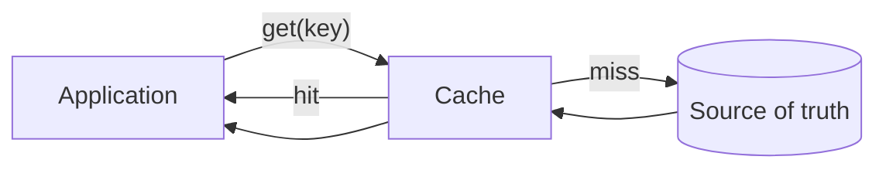
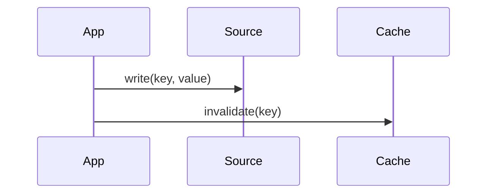
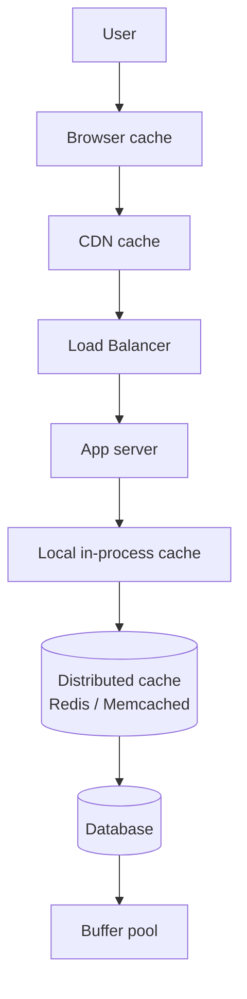

# Caching

## Overview

A **cache** is a fast, usually smaller store that holds a copy of data whose original is slower to access. The cache exchanges *space* (more memory or storage) and *complexity* (deciding what to keep, when to invalidate) for *time* (faster reads, fewer downstream calls). Almost every layer of every modern system uses caching — CPU caches, OS page caches, application caches, CDN caches, browser caches, mobile app caches. The cost of caching is rarely the cache itself; it's the *invalidation* — knowing when a cached copy is stale.

Phil Karlton's quote ("There are only two hard things in computer science: cache invalidation and naming things") is a joke that has been repeated for thirty years because it's accurate.

---

## Why It Exists

Modern systems have wide latency disparities between layers:

| Layer | Typical latency |
|---|---|
| L1 CPU cache | <1 ns |
| RAM | ~100 ns |
| SSD random read | ~100 µs |
| Same-datacenter network round-trip | ~500 µs |
| Cross-region network round-trip | 50-150 ms |
| Disk seek (spinning) | ~10 ms |

A 100 ns RAM read is 500,000× faster than a 50 ms cross-region call. If you can answer a request from RAM instead of crossing a region, you save five orders of magnitude of latency *and* the downstream system handles one fewer request.

What was broken before caching was treated as a first-class concern: every system independently re-invented its own ad-hoc memoization, with inconsistent invalidation, inconsistent eviction, and inconsistent monitoring. Production incidents were full of "we cached this but never invalidated it" stories.

Caching, treated explicitly, lets you spend memory to buy latency *and* throughput at the same time. (Most performance trade-offs improve one and hurt the other; caching improves both — for hits.)

---

## Historical Context

1. **Hardware caches (1960s onward).** CPUs grew much faster than memory. L1, L2, L3 caches emerged to hide the gap. The "cache-friendly access pattern" became a thing programmers cared about.
2. **OS page cache (1970s onward).** Operating systems started caching disk blocks in RAM. Reads of recently-touched files became free.
3. **Database buffer pools (1980s onward).** Databases moved hot pages into RAM. Most production databases are CPU-bound on cache misses, not disk-bound.
4. **HTTP and CDNs (1990s onward).** Web pages got cached in browsers and intermediate proxies. Akamai (1998) built a business out of distributed HTTP caching at the edge.
5. **In-memory data stores (2000s onward).** Memcached (2003) and Redis (2009) made application-tier caches a default rather than an exotic optimization.
6. **Client-side caching (2010s onward).** Mobile apps assumed offline-tolerant operation; SQLite, Room, browser local storage, service workers.

Each generation pushed the cache closer to the consumer of the data. The current trend: caching as close to the user as possible (client-side, edge), invalidated centrally.

---

## First Principles

A cache has four characteristics. Get any one of them wrong and the cache is worse than not having a cache.

### 1. Hit ratio

The fraction of lookups served from the cache. Hit ratio is bounded by *working set fit*: if the actively-used data is bigger than the cache, hit ratio is poor regardless of policy. The relationship is non-linear — increasing cache size has diminishing returns; doubling a cache rarely doubles the hit ratio.

### 2. Eviction policy

When the cache is full and a new entry arrives, what gets removed?

- **LRU** (Least Recently Used) — evict the entry untouched longest. The default for almost everything.
- **LFU** (Least Frequently Used) — evict the entry with the fewest hits. Better for stable access patterns with clear "hot" entries.
- **FIFO** — evict whatever entered first. Simple, sometimes worse than LRU.
- **TLRU / ARC** — adaptive policies that balance recency and frequency.
- **TTL-only** — entries expire after time T; eviction triggered by expiry, not size.

LRU is right almost always. The exceptions are worth knowing.

### 3. Invalidation policy

When the underlying data changes, how does the cache learn?

- **Time-based (TTL).** Entries expire after T seconds. Stale within that window; consistent eventually. Simplest; most common.
- **Write-through.** Writes go to the cache and the source-of-truth simultaneously. Cache is always fresh; writes are slower.
- **Write-behind.** Writes go to the cache; flushed to source later. Faster writes; risk of data loss.
- **Read-through.** On miss, the cache fetches from the source and stores. Always consistent on read.
- **Cache-aside.** Application explicitly writes to cache after reading from source. Most flexible; most prone to bugs.
- **Event-driven invalidation.** Cache subscribes to change events; invalidates affected entries. Strong consistency; harder to implement.

### 4. Coherence model

In a distributed cache (multiple nodes have cached copies), what consistency do you promise?

- **Strong:** all readers see the same value at all times. Expensive.
- **Eventual:** all readers eventually see the same value; brief windows of staleness allowed. Standard.
- **Bounded staleness:** readers never see data more than T seconds out of date. Useful middle ground.

These four together define the cache's behavior. A cache without an articulated answer for all four is a cache with bugs you haven't found yet.

---

## Mental Model

A cache is a *bet*. You bet that recent data will be requested again soon. If you win the bet (cache hit), the cost was nearly zero. If you lose (cache miss), you paid the cache lookup cost *plus* the original source cost — slightly slower than no cache at all.

The bet is worth it only when the hit ratio is high enough. A cache with a 10% hit ratio is usually a net loss: 90% of requests pay extra for the lookup, while only 10% benefit from the speed-up. The break-even hit ratio depends on how much faster the cache is than the source. For large speedups (1000×), even a 5% hit ratio is profitable. For small speedups (2×), you need a high hit ratio (~60%+) to come out ahead.

The mental shift: a cache is not a free speedup. It is an investment, with a return rate that depends on workload.

---

## Internal Mechanics

### Read path



The miss path is *additive*: the application pays the cache lookup cost first, then the source lookup. A cache that misses often is worse than no cache.

### Write path (cache-aside)



Application writes to the source, then invalidates the cache entry. The next read will miss, fetch from source, and re-populate.

This is the most common pattern. It has one subtle bug: if a concurrent reader fetches *between* the source write and the cache invalidate, they can populate the cache with stale data. Two solutions:

- **Invalidate before writing.** Make the cache miss explicit; the writer races against the source change rather than against itself.
- **Delete-then-write.** Delete the cache entry; do the source write; do not repopulate the cache. The next reader will populate cleanly.

### Sample implementation: a simple LRU cache

```kotlin
class LRUCache<K, V>(private val capacity: Int) {
    private val map = LinkedHashMap<K, V>(capacity, 0.75f, true)

    @Synchronized
    fun get(key: K): V? = map[key]  // accessOrder=true bumps to most-recent

    @Synchronized
    fun put(key: K, value: V) {
        map[key] = value
        if (map.size > capacity) {
            val eldest = map.entries.iterator().next()
            map.remove(eldest.key)
        }
    }
}
```

`LinkedHashMap` with `accessOrder=true` is the lazy person's LRU cache. For production use, prefer a battle-tested library (Caffeine on JVM; built-in Android `LruCache`).

### Cache stampede

When a hot key expires, many concurrent requests can simultaneously miss and hit the source. The source sees a thundering herd. Mitigations:

- **Per-key locking.** Only one request fetches from the source; others wait on its result.
- **Stale-while-revalidate.** Serve the expired value while a single background fetch refreshes.
- **Randomized TTLs.** Spread expiry over a window so all keys don't expire at once.

---

## Architecture

Caches stack at every layer:



Each layer hides latency from the layer above. A request that hits the browser cache never touches the network. A request that hits the CDN cache never reaches the origin. A request that hits the application's local cache never touches the distributed cache. And so on.

This stacking is the most powerful pattern in caching. A user-facing system with five layers of caching can serve 99%+ of traffic from caches and reserve the database for the truly novel requests.

---

## Production Example

- **CPU L1 cache.** Per-core, ~32-64 KB, <1 ns access. Tuned aggressively by hardware vendors.
- **Linux page cache.** Disk reads first check the page cache; over a long-running server, most disk reads are served from RAM.
- **Postgres shared_buffers.** Postgres caches table and index pages in RAM. Tuning shared_buffers is one of the highest-leverage Postgres optimizations.
- **Memcached at Facebook.** *Scaling Memcache at Facebook* (2013) — the canonical case study on operating a giant distributed cache, including the cache-stampede mitigations they had to invent.
- **CDN: Cloudflare, Akamai, Fastly.** Static assets cached at hundreds of edge locations worldwide. Cache hit ratios in the 95-99% range; most user requests never reach the origin.
- **Stripe API caching.** Per-merchant rate-limit counters, idempotency-key results, and stripe.js bundles are all cached at multiple layers. Stripe's blog post on building APIs at scale describes the layering.

---

## Android Example

Android apps cache aggressively because mobile networks are slow and intermittent.

```kotlin
// In-memory image cache for the current session
class ImageCache {
    private val memoryCache = LruCache<String, Bitmap>(maxSize = 50)
    private val diskCache: DiskLruCache = DiskLruCache.open(...)

    suspend fun load(url: String): Bitmap {
        memoryCache[url]?.let { return it }            // L1: in-memory
        diskCache.get(url)?.let {                       // L2: disk
            memoryCache.put(url, it)
            return it
        }
        val bitmap = network.fetch(url)                 // L3: network
        memoryCache.put(url, bitmap)
        diskCache.put(url, bitmap)
        return bitmap
    }
}
```

The same pattern at smaller scale: memory cache → disk cache → network. Coil, Glide, and Picasso all implement this internally.

For data, Room serves the same role — local SQLite-backed cache fronting the network. The offline-first architecture ([`../reference-architectures/offline-first-app.md`](../reference-architectures/offline-first-app.md)) is a caching architecture where the cache becomes the source of truth from the UI's perspective.

Other Android-specific caches:
- **HTTP cache.** OkHttp's `Cache` integrates with HTTP cache headers — respects `Cache-Control`, `ETag`, `Last-Modified`.
- **View binding cache.** Compose's snapshot system caches composable state across recompositions.
- **StateFlow as L1 Cache.** In modern Android architectures, a repository's `StateFlow` acts as an in-memory L1 cache, holding the latest data to immediately emit to collectors while async network or database fetches occur in the background.
- **R8/ProGuard build cache.** Compiled mappings cached between builds.

---

## Tradeoffs

**Advantages**

- Order-of-magnitude latency improvement on hits.
- Reduced load on downstream systems — often the throughput bottleneck.
- Better tail latency: cache hits short-circuit the slow path.
- Offline tolerance (for client-side caches).

**Disadvantages**

- **Stale data.** Every cache has a window during which it can serve stale data. Acceptability depends on the use case.
- **Memory cost.** A cache the size of your dataset is your dataset, twice.
- **Invalidation complexity.** The hard problem. Bugs here are subtle and persistent.
- **Cache stampedes.** Cache failures can cascade to source failures, often dramatically.

**Hidden costs**

- A cache hides slowdowns in the source. When the cache fails, the source's true performance is exposed — often after years of unwitnessed degradation.
- Cache servers themselves are dependencies. A Redis outage can take down systems that "use Redis as a cache" but were silently depending on it as a database.
- Distributed caches add network hops. A naive cache lookup might cost more than it saves.

**When not to use**

- Data that changes faster than the cache TTL would allow.
- Data unique to every request (no shared work to deduplicate).
- Cases where staleness has real consequences (financial balances, security tokens — though even these are often cached with very short TTLs).

---

## Failure Modes

**Cache stampede.** A hot key expires; thousands of concurrent requests miss; the source is overwhelmed. Mitigations above (per-key lock, stale-while-revalidate, jittered TTL).

**Invalidation miss.** Source data changes, but the cache is not invalidated. Stale data is served indefinitely. Common cause: a code path that writes to the database but bypasses the application's cache-management code. Mitigation: route all writes through one cache-aware layer; use event-driven invalidation where stakes are high.

**Cache poisoning.** An attacker injects values into the cache that other users will see. Mitigation: cache keys must include all variables that affect the response (auth context, locale, user role); never cache uninput-validated responses.

**Capacity miscalculation.** The working set is bigger than the cache; thrashing replaces useful entries with one-off entries. Mitigation: monitor hit ratio; size the cache to the working set, not to the total dataset.

**Cache as silent dependency.** A "cache" the system can't run without. Mitigation: be honest about this. If the cache is required for correctness, it's a primary store, not a cache, and needs the durability and reliability of one.

**Negative caching pitfalls.** Caching the *absence* of a value (404, miss) can perpetuate transient failures. Use short TTLs for negative caching, or none.

---

## Performance Considerations

- **CPU:** Cache lookups are cheap (in-memory hash). Cache *misses* incur the full source cost plus the cache lookup overhead. A consistently-missing cache is a slowdown.
- **False sharing.** When independent variables reside in the same CPU cache line, a write by one core invalidates the entire line for other cores, causing severe performance degradation for adjacent but logically unrelated variables.
- **Memory:** A cache occupies the size of its contents plus per-entry metadata (often 30-50% overhead in the JVM).
- **GC pressure (JVM).** Large heap-based caches can extend GC pauses. Off-heap caches (Caffeine's options, Chronicle Map) avoid this at the cost of serialization.
- **Network (distributed caches).** Each cache lookup is a network round-trip. Local in-process caches are 100× faster; use them for the hottest data.
- **Battery (mobile).** Disk and network reads are battery-hungry. Memory caches dramatically reduce both.

---

## Reliability Considerations

- **Don't make the cache a single point of failure.** If the cache being down takes the system down, the cache is a primary store, not a cache. Either treat it that way or design for cache outages explicitly (fall back to source, slow but functional).
- **Don't trust the cache for correctness-critical data.** Use it for performance, not for source-of-truth questions.
- **Limit blast radius.** A bad cache entry should affect one key, not the whole cache. Avoid full-cache invalidations as an operational tool.
- **Test the miss path.** The miss path is the slowest and least exercised; bugs hide there. Load-test against an empty cache.

---

## Security Considerations

- **Authorization in keys.** Cache keys must include the auth context. A cache keyed only by document ID will serve User A's document to User B.
- **TTL on auth-sensitive data.** User permissions, role assignments, and feature-flag values for a user should have short TTLs to limit the staleness of access control decisions.
- **Cache eviction as a side channel.** Whether a cache hit or miss took longer can leak whether other users have accessed the same data. For high-security systems, normalize response timing.
- **Encryption of cache contents.** Caches often hold sensitive data (PII, payment info). On-disk caches must be encrypted; in-memory caches inherit the host's protection.

---

## Observability

- **Hit ratio.** The headline metric. Track per-cache, per-cache-tier.
- **Latency.** p50/p99 of cache lookups, separately for hits and misses.
- **Eviction rate.** High eviction rate at low memory pressure means churn; either the cache is too small or the access pattern is non-cacheable.
- **Stampede indicators.** Concurrent miss count on the same key.
- **Staleness measurements.** Where possible, compare cache values to source values and report drift.

Canonical: [`../observability/metrics.md`](../observability/metrics.md).

---

## Staff Engineer Thinking

**Articulate the cache's purpose in one sentence.** "This cache trades 100 ms freshness for 50 ms latency on the home screen." If you cannot state the trade-off cleanly, you do not understand the cache, and the cache will eventually bite you.

**Treat cache misses as the design problem.** Hits are easy. Misses must be fast enough to be acceptable when they happen — under load, when many keys miss at once, or when the cache restarts cold. Capacity-plan against miss behavior.

**Layered caching is the high-leverage pattern.** The biggest performance wins in user-facing systems come from stacking caches — browser, CDN, app, database — each layer absorbing the requests the next layer can't.

**Push invalidation toward events.** TTL-based invalidation is fine for most things. For high-stakes data (permissions, prices, content moderation), event-driven invalidation prevents stale data from being a liability. The investment pays off when stale-data incidents stop happening.

**Make cache behavior testable.** A cache that's not testable is a cache that has bugs you haven't found. Tests should exercise miss paths, stampede behavior, invalidation, and capacity exhaustion.

---

## Common Misconceptions

**"Add a cache and it'll be faster."** Only if the hit ratio is high enough. A poorly-targeted cache makes the slow path slower (you pay the lookup *and* the source cost) and gains little.

**"LRU is always right."** LRU is usually right. For data with a small, stable hot set, LFU beats LRU. For one-shot batch processing, FIFO might beat both.

**"Bigger cache = better."** Up to the working-set size. Beyond that, more memory wastes space without improving hit ratio.

**"Caches don't need to be in the system architecture diagram."** They are first-class dependencies. Treat them like databases — design for their failure, their saturation, and their invalidation.

**"Eventual consistency is fine."** Sometimes. Often not — staleness of authorization data has security consequences; staleness of pricing data has business consequences. Be explicit about the staleness window.

---

## Probing Questions

1. Define hit ratio and explain why a 30% hit ratio cache can be a net loss.
2. Explain cache stampede. What three techniques mitigate it?
3. When would you choose LFU over LRU? Give a workload example.
4. Why is cache-aside the most common write pattern, and what is its most common bug?
5. You add a 5-minute TTL to a cache. What kinds of data are inappropriate for this policy?
6. A cache key omits the user ID. What goes wrong?
7. A team adds Redis as "just a cache." How do you tell whether it has silently become a primary store?
8. Compare write-through and write-behind. When would you choose each?
9. The cache's memory budget is fixed. Hit ratio is 60%. What questions do you ask to decide whether to raise the budget?
10. Negative caching: when is it useful, and when is it a foot-gun?

---

## Answer Key

1. **Define hit ratio and explain why a 30% hit ratio cache can be a net loss.**
   Hit ratio is the percentage of requests served from the cache. At 30%, 70% of requests suffer the latency of checking the cache *and* fetching from the source, which can easily outweigh the time saved by the 30% that hit.
2. **Explain cache stampede. What three techniques mitigate it?**
   A stampede occurs when a hot key expires and many concurrent requests simultaneously miss and query the source, overwhelming it. Mitigations include per-key locking, stale-while-revalidate, and jittered (randomized) TTLs.
3. **When would you choose LFU over LRU? Give a workload example.**
   Choose LFU when there is a stable, small set of extremely hot items, and occasional scans of cold data would otherwise evict them under LRU (e.g., a static list of popular country codes).
4. **Why is cache-aside the most common write pattern, and what is its most common bug?**
   It's flexible and easy to bolt onto existing code (app writes to DB, then invalidates cache). The most common bug is a race condition where a concurrent read populates the cache with stale data *after* the source write but *before* the invalidation.
5. **You add a 5-minute TTL to a cache. What kinds of data are inappropriate for this policy?**
   Data where staleness has severe consequences, such as financial balances, security authorization tokens, or critical feature flags that must revoke access instantly.
6. **A cache key omits the user ID. What goes wrong?**
   Cache poisoning/cross-talk. User A fetches their private data, it gets cached under a generic key, and User B receives User A's data on the next request.
7. **A team adds Redis as "just a cache." How do you tell whether it has silently become a primary store?**
   Turn it off. If the system goes down entirely instead of just becoming slower (falling back to the database), Redis is a primary store.
8. **Compare write-through and write-behind. When would you choose each?**
   Write-through updates the cache and source synchronously (always consistent, slower writes). Write-behind updates the cache and flushes to the source asynchronously (faster writes, risk of data loss). Use write-behind for high-throughput, loss-tolerant metrics; use write-through for standard critical data.
9. **The cache's memory budget is fixed. Hit ratio is 60%. What questions do you ask to decide whether to raise the budget?**
   Ask: Is the working set significantly larger than the cache size? Will doubling the memory actually increase the hit ratio substantially, or is the other 40% purely novel/long-tail data that won't benefit from more space?
10. **Negative caching: when is it useful, and when is it a foot-gun?**
    It's useful to prevent repeated expensive lookups for missing data (e.g., 404s). It's a foot-gun if a transient source failure is cached, causing the system to persistently return "not found" even after the source recovers.

---

## Further Reading

In this repository:

- [`latency-vs-throughput.md`](latency-vs-throughput.md) — caches improve both, for hits.
- [`time-and-clocks.md`](time-and-clocks.md) — TTLs depend on clocks; clock skew across nodes breaks TTLs.
- [`../patterns/circuit-breaker.md`](../patterns/circuit-breaker.md) — protect downstream sources from cache-miss stampedes.
- [`../mobile-system-design/caching-library.md`](../mobile-system-design/caching-library.md) — designing a caching library, end-to-end.
- [`../mobile-system-design/image-loading.md`](../mobile-system-design/image-loading.md) — image caching, the classic mobile case study.
- [`../android/data-and-di/room.md`](../android/data-and-di/room.md) — Room as the canonical mobile data cache.

External:

- *Scaling Memcache at Facebook*, NSDI 2013. The canonical case study on operating a giant distributed cache.
- The Caffeine cache library documentation (github.com/ben-manes/caffeine). The state-of-the-art Java cache, with excellent eviction-policy discussion.
- The 1965 Belady paper on optimal caching. The theoretical bound — what no online algorithm can beat.
