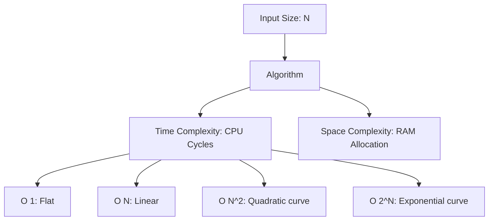

# Complexity Analysis

## Overview

Complexity analysis is the mathematical evaluation of how an algorithm's resource consumption (time or memory) scales as the input size grows. Commonly expressed using Big-O notation, it provides a hardware-independent vocabulary for predicting system performance bottlenecks before they hit production.

## Why It Matters

Mobile devices are highly constrained environments. A desktop backend can often brute-force a poorly written $O(N^2)$ algorithm with sheer CPU power. An Android device running the same algorithm will drop frames, drain the battery, and potentially trigger an Application Not Responding (ANR) error, especially on low-end hardware processing large datasets (like syncing a 50,000-row database).

## Historical Context

Big-O notation originated in mathematics (formally introduced by Paul Bachmann in 1894 and popularized by Edmund Landau). Knuth's 1976 paper clarified the use of O, Omega and Theta notation in algorithm analysis. It remains the universal language of performance analysis, allowing engineers to discuss the efficiency of an approach independent of language, compiler, or processor speed.

## First Principles

1.  **Focus on the Growth Rate:** Complexity describes scaling, not measured speed. Big-O is an asymptotic upper bound, so an algorithm with linear growth is also $O(N^2)$. Compare tight bounds, such as $\Theta(N)$ and $\Theta(N^2)$, before claiming that one eventually grows more slowly.
2.  **Worst-Case Matters Most:** While average-case is useful, mobile engineering heavily weights the worst-case scenario. If the worst case blocks the main thread for 200ms, you will drop frames.
3.  **Space vs. Time Tradeoff:** You can often reduce Time Complexity by increasing Space Complexity (e.g., using a Hash Map to cache lookups), or vice versa.

## Mental Model

Think of searching for a word in a physical dictionary.
- **$O(N)$ - Linear Time:** You flip through every single page from beginning to end until you find the word. If the dictionary doubles in size, it takes you twice as long.
- **$O(\log N)$ - Logarithmic Time:** You open the dictionary to the exact middle. If the word comes before, you discard the right half, open the left half to the middle, and repeat. Even if the dictionary doubles in size, it only takes *one extra step* to find the word.

## Internal Mechanics

The standard complexity classes encountered in mobile engineering:

| Notation | Name | Description | Common Android Example |
| :--- | :--- | :--- | :--- |
| **$O(1)$** | Constant | Time does not depend on input size. | Average `HashMap.get()` with well-distributed hashes; reading an array index. |
| **$O(\log N)$** | Logarithmic | Time increases slowly; input is halved each step. | Binary search; locating an indexed key before accounting for matching output rows. |
| **$O(N)$** | Linear | Time increases directly with input size. | Iterating over a `RecyclerView.Adapter` list, parsing a JSON array. |
| **$O(N \log N)$**| Linearithmic | slightly worse than linear. | Sorting a list (`Collections.sort()`). |
| **$O(N^2)$** | Quadratic | Time explodes as input grows. Double loops. | Comparing every item in a list against every other item. |
| **$O(2^N)$** | Exponential | Work doubles for every extra input item. | Exhaustive subset search, naive recursive combinatorics. |
| **$O(N!)$** | Factorial | Every ordering/permutation is explored. | Brute-force traveling salesperson, naive permutation generation. |

### The "Hidden" Complexities in Kotlin

Modern languages hide complexity behind elegant syntax. A single method call can secretly be $O(N)$.

```kotlin
val list = listOf(1, 2, 3, 4, 5)

// This is O(N) because it must scan the list.
val containsThree = list.contains(3) 

val set = setOf(1, 2, 3, 4, 5)

// This is O(1) average case, because it's a hash-backed set.
val containsThreeFast = set.contains(3) 

// This looks like O(N), but it creates intermediate lists!
// Space complexity scales with the number of chained operations.
val result = list.filter { it > 2 }.map { it * 2 }.sorted() 

// asSequence() fuses filter and map lazily, avoiding their eager lists.
// sorted() must still buffer O(N) elements, and toList() stores O(N) output.
val lazyResult = list.asSequence().filter { it > 2 }.map { it * 2 }.sorted().toList()
```

## Architecture



## Production Example

**Diffing Lists for RecyclerView**

`notifyDataSetChanged()` invalidates the data set; RecyclerView must rebind and relayout visible views, not perform one layout pass for every item in the full list.

A naive old-by-new comparison can perform N×M comparisons. At 10,000 items on each side that is 100,000,000 comparisons; whether this causes an ANR depends on the work, calling thread and elapsed time.

`DiffUtil` documents $O(N)$ space and expected $O(N + D^2)$ time for its Myers-based difference calculation. Move detection can add $O(M \times N)$ work for added and removed items. Calculate large diffs off the main thread; precise adapter updates do not guarantee $O(D)$ layout or drawing time.

## Android Example

**Database Queries and Indexes**

```sql
-- Querying without an index is a Full Table Scan: O(N)
SELECT * FROM users WHERE last_name = 'Smith';
```

If you have 1 million users, SQLite must read every row. This will block the thread heavily.

```kotlin
@Entity(indices = [Index(value = ["last_name"])])
data class User(
    // ...
    @ColumnInfo(name = "last_name") val lastName: String
)
```
The index lets SQLite seek the matching key range. If K rows match, it must still visit and return those rows; a non-covering index also fetches table records. SQLite models this example as roughly (K + 1) log N work, not a fixed 20 disk reads. Inspect the actual query plan and selectivity.

## Tradeoffs

**Advantages**
- **Predictability:** Allows you to confidently state, "This sync algorithm will still perform well even if the user has 10 years of offline data."
- **Language Agnostic:** Big-O is universal. An $O(N^2)$ algorithm in Kotlin is just as fundamentally flawed as an $O(N^2)$ algorithm in C++.

**Disadvantages**
- **Constants are ignored:** $O(N)$ strips out constants. An algorithm that takes $1000 \times N$ operations is technically $O(N)$, while an algorithm that takes $N^2$ operations is $O(N^2)$. For $N=10$, the $O(N^2)$ algorithm takes 100 operations, destroying the $O(N)$ algorithm (10,000 operations). Over-optimizing for theoretical Big-O on small, bounded datasets is a premature optimization trap.
- **Hardware ignores theory:** Caching, memory contiguity, and branch prediction on modern ARM CPUs mean that a theoretically "slower" algorithm using primitive arrays often drastically outperforms a theoretically "faster" algorithm jumping around the heap with linked lists.

## Failure Modes

- **The N+1 Query Problem:** Fetching a list of $N$ items (1 query), then looping through the list and executing another database query for each item ($N$ queries). You've turned a simple data fetch into an $O(N)$ network/disk bottleneck. (Fix: Use `JOIN` or `IN` clauses to fetch everything in $O(1)$ queries).
- **String Concatenation in Loops:** Repeatedly appending a fixed-size fragment to an immutable String can copy 1 + 2 + … + N characters: $O(N^2)$ total copying and allocation. Peak live storage can remain $O(N)$ if older strings are not retained. Use a StringBuilder to avoid copying the full prefix on every append.
- **Assuming standard library functions are O(1):** Assuming `list.removeAt(0)` is fast. On an `ArrayList`, removing the first element requires shifting every other element left. It is an $O(N)$ operation. In a loop, it becomes $O(N^2)$.

## Staff Engineer Thinking

When reviewing code, a Staff engineer focuses on the hidden multipliers:

1.  **What is the maximum bound of N?** If $N$ is the number of tabs a user can open, it might be capped at 10. $O(N^2)$ is fine. If $N$ is the number of rows in a local chat database, it could be 5,000,000. Any $O(N)$ operation on the main thread is a ticking time bomb.
2.  **Are we crossing boundaries inside the loop?** An $O(N)$ algorithm that just adds integers is microsecond-fast. An $O(N)$ loop that performs ContentResolver IPC or repeated storage work can have a large elapsed cost. SharedPreferences reads normally use an in-process map, although they can wait for its initial load; they are not themselves Binder IPC. The *cost of the constant* matters.
3.  **Is Space Complexity killing Time Complexity?** Allocating huge numbers of temporary objects inside a tight loop might have good theoretical time complexity, but the Garbage Collector will pause the app (Stop-The-World) to clean up the mess, causing extreme jank.

## Common Misconceptions

- **"Always optimize for O(1) or O(log N)."** False. If your data structure never exceeds 20 items, a simple linear search on an array is often faster than a hash map lookup due to memory contiguity and cache locality on the CPU.
- **"Big-O measures time in seconds."** False. It measures how the number of operations *scales* relative to the input size.

## Probing Questions

1.  Explain why appending to a `StringBuilder` in a loop is $O(N)$, but appending to a standard `String` is $O(N^2)$.
2.  What is the time complexity of searching for an item in a `HashSet`? What happens in the worst-case scenario (hash collision)?
3.  Why is `DiffUtil` calculated on a background thread if its complexity is heavily optimized?
4.  Describe the N+1 query problem in the context of Room/SQLite and how to resolve it.
5.  If you have an algorithm that is $O(N \log N)$ but uses $O(N)$ auxiliary space, and another that is $O(N^2)$ but uses $O(1)$ space, how do you choose which to use on a mobile device?
6.  How does the underlying data structure of Kotlin's `List` (e.g., `ArrayList` vs `LinkedList`) affect the time complexity of `get(index)` and `add(0, item)`?
7.  What is the time complexity of `SharedPreferences.apply()` vs `SharedPreferences.commit()`?
8.  Why is it dangerous to perform an $O(N)$ operation inside `onDraw()` of a custom View?
9.  Explain the concept of "Amortized Time Complexity" using the resizing of an `ArrayList` as an example.
10. Can an algorithm have a great theoretical Big-O but terrible real-world performance on a mobile CPU? Provide an example.

## Answer Key

1. **Explain why appending to a `StringBuilder` in a loop is $O(N)$, but appending to a standard `String` is $O(N^2)$.**
   For fixed-size fragments, a growing StringBuilder has amortized constant append cost; a resize can copy the buffer. Repeated immutable-string concatenation copies the growing prefix, giving $O(N^2)$ total copied characters for this loop. Appending a fragment of length K still costs at least $O(K)$.
2. **What is the time complexity of searching for an item in a `HashSet`? What happens in the worst-case scenario (hash collision)?**
   Average time complexity is $O(1)$. In the worst-case scenario with extreme hash collisions, elements are stored in a linked list or tree within the same bucket, degrading performance to $O(N)$ or $O(\log N)$.
3. **Why is `DiffUtil` calculated on a background thread if its complexity is heavily optimized?**
   Even with its optimized $O(N + D^2)$ time complexity, executing it on large lists can still take tens of milliseconds, easily exceeding the strict 16ms frame budget and causing UI jank if run on the main thread.
4. **Describe the N+1 query problem in the context of Room/SQLite and how to resolve it.**
   It occurs when you execute one query to fetch $N$ items, and then loop through them to execute another query for each item ($N$ extra queries). Resolve it by using a `JOIN` or an `IN` clause to fetch all necessary data in a single $O(1)$ query.
5. **If you have an algorithm that is $O(N \log N)$ but uses $O(N)$ auxiliary space, and another that is $O(N^2)$ but uses $O(1)$ space, how do you choose which to use on a mobile device?**
   Consider the bounds of $N$. If $N$ is small, the $O(N^2)$ / $O(1)$ space algorithm might be faster and avoids GC pauses. If $N$ is large, the $O(N \log N)$ algorithm is necessary to prevent freezing, but you must ensure the $O(N)$ memory allocation won't cause an OutOfMemoryError.
6. **How does the underlying data structure of Kotlin's `List` (e.g., `ArrayList` vs `LinkedList`) affect the time complexity of `get(index)` and `add(0, item)`?**
   For `ArrayList`, `get` is $O(1)$ but `add(0)` is $O(N)$ because elements must be shifted. For `LinkedList`, `get` is $O(N)$ (requires traversal) but `add(0)` is $O(1)$ (just updating a pointer).
7. **What is the time complexity of `SharedPreferences.apply()` vs `SharedPreferences.commit()`?**
   Both first apply edits to the in-memory preferences. apply() schedules persistence asynchronously and does not report a disk-write result; commit() waits for persistence and returns success. Neither API promises $O(1)$ caller work or an instant return: cost depends on edits, map size, synchronization and persistence work.
8. **Why is it dangerous to perform an $O(N)$ operation inside `onDraw()` of a custom View?**
   `onDraw()` is called very frequently (up to 60 or 120 times per second). An $O(N)$ operation here can easily blow past the 16ms frame budget, causing severe frame drops.
9. **Explain the concept of "Amortized Time Complexity" using the resizing of an `ArrayList` as an example.**
   Appending is amortized $O(1)$: occasional growth copies existing elements, but a sequence of N appends takes $O(N)$ total work. The Java API does not specify a doubling growth factor. Amortized cost is a bound over a sequence, not a probabilistic average-case claim.
10. **Can an algorithm have a great theoretical Big-O but terrible real-world performance on a mobile CPU? Provide an example.**
    Yes, if it has a massive constant factor or terrible cache locality. For example, traversing a linked list ($O(N)$) can be significantly slower than traversing a contiguous array ($O(N)$) because jumping around the heap ruins CPU cache lines.

---

## Further Reading

- [`performance.md`](../mobile-system-design/performance.md) — How complexity translates to frame drops.
- [`caching.md`](caching.md) — The ultimate tradeoff: increasing Space Complexity to reduce Time Complexity.

### Official verification references

The corrections in this chapter were checked against the following primary references.

- [xlinux.nist.gov: bigOnotation.html](https://xlinux.nist.gov/dads/HTML/bigOnotation.html)
- [docs.oracle.com: HashMap.html](https://docs.oracle.com/en/java/javase/25/docs/api/java.base/java/util/HashMap.html)
- [www.sqlite.org: queryplanner.html](https://www.sqlite.org/queryplanner.html)
- [github.com: DiffUtil.java](https://github.com/androidx/androidx/blob/androidx-main/recyclerview/recyclerview/src/main/java/androidx/recyclerview/widget/DiffUtil.java)
- [developer.android.com: diagnose-and-fix-anrs](https://developer.android.com/topic/performance/anrs/diagnose-and-fix-anrs)
- [docs.oracle.com: StringBuilder.html](https://docs.oracle.com/en/java/javase/25/docs/api/java.base/java/lang/StringBuilder.html)
- [android.googlesource.com: SharedPreferencesImpl.java](https://android.googlesource.com/platform/frameworks/base/+/refs/heads/main/core/java/android/app/SharedPreferencesImpl.java)
- [developer.android.com: SharedPreferences.Editor](https://developer.android.com/reference/android/content/SharedPreferences.Editor)
- [docs.oracle.com: ArrayList.html](https://docs.oracle.com/en/java/javase/25/docs/api/java.base/java/util/ArrayList.html)
