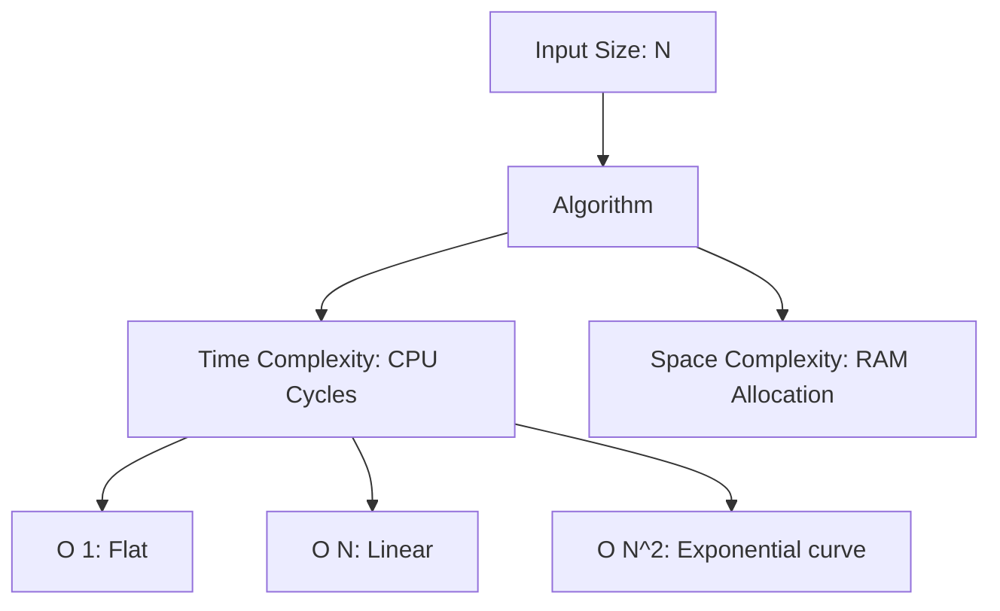

# Complexity Analysis

## Overview

Complexity analysis is the mathematical evaluation of how an algorithm's resource consumption (time or memory) scales as the input size grows. Commonly expressed using Big-O notation, it provides a hardware-independent vocabulary for predicting system performance bottlenecks before they hit production.

## Why It Matters

Mobile devices are highly constrained environments. A desktop backend can often brute-force a poorly written $O(N^2)$ algorithm with sheer CPU power. An Android device running the same algorithm will drop frames, drain the battery, and potentially trigger an Application Not Responding (ANR) error, especially on low-end hardware processing large datasets (like syncing a 50,000-row database).

## Historical Context

Big-O notation originated in mathematics (formally introduced by Paul Bachmann in 1894 and popularized by Edmund Landau). Donald Knuth introduced it to computer science in the 1970s. It remains the universal language of performance analysis, allowing engineers to discuss the efficiency of an approach independent of language, compiler, or processor speed.

## First Principles

1.  **Focus on the Growth Rate:** Complexity is about *scaling*, not absolute speed. An $O(N^2)$ algorithm might be faster than an $O(N)$ algorithm for $N=10$, but the $O(N)$ algorithm will always win as $N \rightarrow \infty$.
2.  **Worst-Case Matters Most:** While average-case is useful, mobile engineering heavily weights the worst-case scenario. If the worst case blocks the main thread for 200ms, you will drop frames.
3.  **Space vs. Time Tradeoff:** You can often reduce Time Complexity by increasing Space Complexity (e.g., using a Hash Map to cache lookups), or vice versa.

## Mental Model

Think of searching for a word in a physical dictionary.
- **$O(N)$ - Linear Time:** You flip through every single page from beginning to end until you find the word. If the dictionary doubles in size, it takes you twice as long.
- **$O(\log N)$ - Logarithmic Time:** You open the dictionary to the exact middle. If the word comes before, you discard the right half, open the left half to the middle, and repeat. Even if the dictionary doubles in size, it only takes *one extra step* to find the word.

## Internal Mechanics

The standard complexity classes encountered in mobile engineering:

| Notation | Name | Description | Common Android Example |
| :--- | :--- | :--- | :--- |
| **$O(1)$** | Constant | Time does not depend on input size. | `HashMap.get()`, reading an array index. |
| **$O(\log N)$** | Logarithmic | Time increases slowly; input is halved each step. | Binary search, looking up a record in an indexed SQLite table. |
| **$O(N)$** | Linear | Time increases directly with input size. | Iterating over a `RecyclerView.Adapter` list, parsing a JSON array. |
| **$O(N \log N)$**| Linearithmic | slightly worse than linear. | Sorting a list (`Collections.sort()`). |
| **$O(N^2)$** | Quadratic | Time explodes as input grows. Double loops. | Comparing every item in a list against every other item. |

### The "Hidden" Complexities in Kotlin

Modern languages hide complexity behind elegant syntax. A single method call can secretly be $O(N)$.

```kotlin
val list = listOf(1, 2, 3, 4, 5)

// This is O(N) because it must scan the list.
val containsThree = list.contains(3) 

val set = setOf(1, 2, 3, 4, 5)

// This is O(1) average case, because it's a hash-backed set.
val containsThreeFast = set.contains(3) 

// This looks like O(N), but it creates intermediate lists!
// Space complexity explodes.
val result = list.filter { it > 2 }.map { it * 2 }.sorted() 
```

## Architecture



## Production Example

**Diffing Lists for RecyclerView**

Before `DiffUtil`, updating a `RecyclerView` often meant calling `notifyDataSetChanged()`, forcing the entire list to re-render: $O(N)$ layout passes.

To be smarter, you could compare the old list and new list to find the exact insertions and deletions. If you do this naively (nested loops comparing every old item to every new item), it's $O(N^2)$. For a list of 10,000 items, that's 100,000,000 operations—a guaranteed ANR.

Android's `DiffUtil` uses Eugene Myers' difference algorithm to calculate the minimal number of updates in $O(N + D^2)$ time (where $N$ is total items and $D$ is the number of modifications). By offloading this to a background thread, the UI thread only receives the exact updates, keeping the render pass $O(D)$.

## Android Example

**Database Queries and Indexes**

```sql
-- Querying without an index is a Full Table Scan: O(N)
SELECT * FROM users WHERE last_name = 'Smith';
```

If you have 1 million users, SQLite must read every row. This will block the thread heavily.

```kotlin
@Entity(indices = [Index(value = ["last_name"])])
data class User(
    // ...
    @ColumnInfo(name = "last_name") val lastName: String
)
```
By adding an index in Room, SQLite builds a B-Tree. The exact same query now executes in $O(\log N)$ time. For 1 million users, instead of 1,000,000 reads, it takes roughly 20 reads to find the data.

## Tradeoffs

**Advantages**
- **Predictability:** Allows you to confidently state, "This sync algorithm will still perform well even if the user has 10 years of offline data."
- **Language Agnostic:** Big-O is universal. An $O(N^2)$ algorithm in Kotlin is just as fundamentally flawed as an $O(N^2)$ algorithm in C++.

**Disadvantages**
- **Constants are ignored:** $O(N)$ strips out constants. An algorithm that takes $1000 \times N$ operations is technically $O(N)$, while an algorithm that takes $N^2$ operations is $O(N^2)$. For $N=10$, the $O(N^2)$ algorithm takes 100 operations, destroying the $O(N)$ algorithm (10,000 operations). Over-optimizing for theoretical Big-O on small, bounded datasets is a premature optimization trap.
- **Hardware ignores theory:** Caching, memory contiguity, and branch prediction on modern ARM CPUs mean that a theoretically "slower" algorithm using primitive arrays often drastically outperforms a theoretically "faster" algorithm jumping around the heap with linked lists.

## Failure Modes

- **The N+1 Query Problem:** Fetching a list of $N$ items (1 query), then looping through the list and executing another database query for each item ($N$ queries). You've turned a simple data fetch into an $O(N)$ network/disk bottleneck. (Fix: Use `JOIN` or `IN` clauses to fetch everything in $O(1)$ queries).
- **String Concatenation in Loops:** Strings are immutable in Kotlin/Java. Doing `str += "a"` in a loop of size $N$ doesn't just take $O(N)$ time; it creates a new string object and copies the characters every iteration, making it $O(N^2)$ time and $O(N^2)$ space (garbage collection nightmare). (Fix: Use `StringBuilder`).
- **Assuming standard library functions are O(1):** Assuming `list.removeAt(0)` is fast. On an `ArrayList`, removing the first element requires shifting every other element left. It is an $O(N)$ operation. In a loop, it becomes $O(N^2)$.

## Staff Engineer Thinking

When reviewing code, a Staff engineer focuses on the hidden multipliers:

1.  **What is the maximum bound of N?** If $N$ is the number of tabs a user can open, it might be capped at 10. $O(N^2)$ is fine. If $N$ is the number of rows in a local chat database, it could be 5,000,000. Any $O(N)$ operation on the main thread is a ticking time bomb.
2.  **Are we crossing boundaries inside the loop?** An $O(N)$ algorithm that just adds integers is microsecond-fast. An $O(N)$ algorithm that makes an IPC call (like reading `SharedPreferences` or querying the `ContentResolver`) on each iteration will freeze the app. The *cost of the constant* matters.
3.  **Is Space Complexity killing Time Complexity?** Allocating huge numbers of temporary objects inside a tight loop might have good theoretical time complexity, but the Garbage Collector will pause the app (Stop-The-World) to clean up the mess, causing extreme jank.

## Common Misconceptions

- **"Always optimize for O(1) or O(log N)."** False. If your data structure never exceeds 20 items, a simple linear search on an array is often faster than a hash map lookup due to memory contiguity and cache locality on the CPU.
- **"Big-O measures time in seconds."** False. It measures how the number of operations *scales* relative to the input size.

## Probing Questions

1.  Explain why appending to a `StringBuilder` in a loop is $O(N)$, but appending to a standard `String` is $O(N^2)$.
2.  What is the time complexity of searching for an item in a `HashSet`? What happens in the worst-case scenario (hash collision)?
3.  Why is `DiffUtil` calculated on a background thread if its complexity is heavily optimized?
4.  Describe the N+1 query problem in the context of Room/SQLite and how to resolve it.
5.  If you have an algorithm that is $O(N \log N)$ but uses $O(N)$ auxiliary space, and another that is $O(N^2)$ but uses $O(1)$ space, how do you choose which to use on a mobile device?
6.  How does the underlying data structure of Kotlin's `List` (e.g., `ArrayList` vs `LinkedList`) affect the time complexity of `get(index)` and `add(0, item)`?
7.  What is the time complexity of `SharedPreferences.apply()` vs `SharedPreferences.commit()`?
8.  Why is it dangerous to perform an $O(N)$ operation inside `onDraw()` of a custom View?
9.  Explain the concept of "Amortized Time Complexity" using the resizing of an `ArrayList` as an example.
10. Can an algorithm have a great theoretical Big-O but terrible real-world performance on a mobile CPU? Provide an example.

## Further Reading

- [`performance.md`](../mobile-system-design/performance.md) — How complexity translates to frame drops.
- [`caching.md`](caching.md) — The ultimate tradeoff: increasing Space Complexity to reduce Time Complexity.
