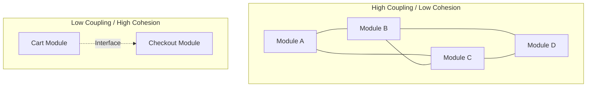

# Coupling vs Cohesion

## Overview

Coupling and Cohesion are the twin metrics by which the structure of a codebase is judged. **Coupling** is the degree of interdependence between software modules (how tightly connected they are). **Cohesion** is the degree to which the elements inside a module belong together (how focused they are). 

The universal goal of software architecture is **Low Coupling, High Cohesion.**

## Why It Matters

In mobile engineering, codebases grow rapidly and are often worked on by dozens of engineers simultaneously. If a codebase has High Coupling, a developer tweaking a UI animation in the `Cart` module might accidentally break the network logic in the `Checkout` module. This leads to fear-driven development and glacial release cycles. If a codebase has Low Cohesion, a developer looking to fix a bug in "Authentication" will have to open 15 different files scattered across 5 directories to piece the logic together.

## Historical Context

Coined by Larry Constantine in the late 1960s (published in *Structured Design*, 1974). They are the foundational concepts behind almost every modern architectural pattern (SOLID, Clean Architecture, MVVM). When we introduce an Interface or use Dependency Injection, we are doing it specifically to reduce coupling.

## First Principles

1.  **Low Coupling (Loose Connections):** Components should know as little as possible about the inner workings of other components. They communicate through strictly defined contracts (interfaces).
2.  **High Cohesion (Focused Purpose):** Things that change together should live together. A module or class should have exactly one well-defined responsibility.
3.  **The Tension:** Pushing too hard for low coupling can lead to fragmented, overly abstracted code (Low Cohesion). Pushing too hard for high cohesion can lead to God Objects that do everything (High Coupling to everything else). Balance is required.

## Mental Model

Think of a modern smartphone vs. a vintage stereo system.

- **High Coupling, Low Cohesion (The Smartphone):** The camera, battery, screen, and CPU are fused together. If the battery dies, you can't just replace it easily; the whole system is physically intertwined. The device does a thousand unrelated things (calculator, phone, camera, flashlight), meaning it has low cohesion.
- **Low Coupling, High Cohesion (The Stereo System):** You have a turntable, an amplifier, and speakers. They connect via standard RCA cables (Interfaces). If a speaker blows, you unplug it and plug in a new one without opening the amplifier. Each box has one singular, focused job (high cohesion) and knows nothing about the internals of the other boxes (low coupling).

## Internal Mechanics

### Cohesion: How focused is it?

**Bad (Low Cohesion - "Swiss Army Knife"):**
```kotlin
class UtilityManager {
    fun formatCurrency(amount: Double): String { ... }
    fun parseNetworkResponse(json: String): Data { ... }
    fun saveToDatabase(data: Data) { ... }
    fun validateEmail(email: String): Boolean { ... }
}
```
*Why it's bad:* If the networking library changes, you touch this file. If the currency format changes, you touch this file. It is a magnet for merge conflicts.

**Good (High Cohesion - "Specialized Tools"):**
```kotlin
class CurrencyFormatter {
    fun format(amount: Double): String { ... }
}

class EmailValidator {
    fun isValid(email: String): Boolean { ... }
}
```

### Coupling: How tangled is it?

**Bad (High Coupling - "Tight Knot"):**
```kotlin
class UserProfileViewModel {
    // Highly coupled to specific implementations and the Android Framework
    private val database = Room.databaseBuilder(context, AppDb::class.java).build()
    private val api = Retrofit.Builder().baseUrl("...").build().create(UserApi::class.java)
    
    fun loadUser() {
        // ... uses database and api directly
    }
}
```
*Why it's bad:* You cannot test this ViewModel without a real Android Context, a real SQLite database, and a real internet connection. It is cemented to its dependencies.

**Good (Low Coupling - "Plug and Play"):**
```kotlin
class UserProfileViewModel(
    // Coupled only to an interface. The ViewModel knows NOTHING about Room or Retrofit.
    private val repository: UserRepository 
) {
    fun loadUser() {
        // ... uses repository
    }
}
```

## Architecture



## Production Example

**Android Modularization (Multi-Module Architecture)**

The ultimate expression of managing coupling/cohesion in Android is splitting the app into Gradle modules.

- **Feature Modules (High Cohesion):** `feature:login`, `feature:cart`, `feature:video-player`. All UI, ViewModels, and localized business logic for the cart live in `feature:cart`.
- **Core Modules (Low Coupling via Interfaces):** `core:network`, `core:database`. 

If `feature:cart` needs to fetch data, it does *not* depend directly on `core:network` (which uses Retrofit). Instead, `feature:cart` defines an interface `CartRepository`. The app wiring (via Dagger/Hilt) links the feature to the network. This strict physical boundary prevents accidental coupling.

## Android Example

**ViewBinding vs `findViewById`**

Historically, using `findViewById<TextView>(R.id.title)` coupled the Java/Kotlin code directly to the XML layout structure. If a designer changed the ID or removed the view from XML, the code would compile perfectly but crash at runtime with a `NullPointerException`. The coupling was high, but invisible to the compiler.

`ViewBinding` (and later, Jetpack Compose) solves this by explicitly linking the UI definition and the logic, enforcing type safety and null safety at compile time, reducing the brittle runtime coupling.

## Tradeoffs

**Advantages of Low Coupling / High Cohesion**
- **Testability:** You can unit test a highly cohesive class in isolation because you can easily mock its loosely coupled dependencies.
- **Reusability:** A highly cohesive `CurrencyFormatter` can be used in 50 different apps. A `UtilityManager` cannot.
- **Maintainability:** Bugs are localized. Changing the database schema doesn't require modifying the UI logic.

**Disadvantages of Over-Optimization**
- **The "Ravioli Code" Anti-pattern:** If you push cohesion to the extreme, you get thousands of tiny classes with one method each. Tracing the execution flow through 20 layers of interfaces and single-line functions is a nightmare.
- **Indirection Tax:** Every interface and dependency injection layer adds a small amount of mental overhead for developers and slight performance/memory overhead at runtime.

## Failure Modes

- **Shotgun Surgery:** A symptom of low cohesion. You want to make one conceptual change (e.g., adding a new field to the User profile), but you have to modify the database class, the network parser, the domain model, the ViewModel, and the View. 
- **The Global State Trap:** Using singletons or global variables (like a static `UserManager.currentUser`) creates invisible, massive coupling. Any class, anywhere, can mutate the state, meaning every class is implicitly coupled to every other class.
- **Leaky Abstractions:** You create an interface `Cache<T>` to decouple from the database. But the interface throws an `SQLiteConstraintException`. The abstraction leaked the implementation detail; the client is still coupled to SQLite.

## Staff Engineer Thinking

When reviewing architecture, a Staff engineer asks:

1.  **What changes together?** If changing file A *always* means changing file B, they are highly coupled. Should they be merged into a single cohesive unit?
2.  **Is the interface actually hiding anything?** If we have an `interface UserApi` and the only implementation is `RetrofitUserApi`, and the interface methods are annotated with `@GET` and `@Path`, the interface is useless. It hasn't decoupled anything; it has just added boilerplate.
3.  **Feature vs Layer Cohesion:** Grouping by layer (all ViewModels in one package, all DAOs in another) is low cohesion. If I work on "Checkout", I have to open 4 packages. Grouping by feature (CheckoutViewModel and CheckoutDao in the same package) is high cohesion.

## Common Misconceptions

- **"Coupling is always bad."** False. Zero coupling means your software doesn't do anything because components can't talk to each other. The goal is *loose* coupling, not *no* coupling.
- **"DRY (Don't Repeat Yourself) is more important than Coupling."** False. Sometimes, duplicating a small data class in two different modules is vastly superior to creating a shared `core:models` module that tightly couples both features to the same lifecycle. See [`principles/simplicity.md`](../principles/simplicity.md).

## Probing Questions

1.  How does Dependency Injection (like Dagger/Hilt) directly impact the coupling of an Android application?
2.  Explain the concept of "Shotgun Surgery" and how it relates to cohesion.
3.  Give an example of a "Leaky Abstraction" in an Android networking layer that increases coupling.
4.  Why is "Package by Feature" considered more cohesive than "Package by Layer"?
5.  How do Kotlin's internal visibility modifiers (`internal`) help enforce low coupling in a multi-module architecture?
6.  If you have two microservices that communicate via a shared database, what kind of coupling is that, and why is it dangerous?
7.  How does the Observer pattern (e.g., Kotlin Flow) reduce coupling between the UI and the data layer compared to using callbacks?
8.  Can a class be highly cohesive but also highly coupled? Provide a theoretical example.
9.  Why might you intentionally choose to duplicate code across two feature modules rather than extract it into a shared core module?
10. Describe the difference between "Compile-time Coupling" and "Runtime Coupling" (e.g., via intent extras or deep links).

## Answer Key

1.  **How does Dependency Injection (like Dagger/Hilt) directly impact the coupling of an Android application?**
    It injects dependencies through interfaces rather than concrete implementations, preventing classes from being tied to the instantiation and specific types of their dependencies, thus achieving loose coupling.
2.  **Explain the concept of "Shotgun Surgery" and how it relates to cohesion.**
    Shotgun Surgery occurs when a single conceptual change requires edits across many different files. It indicates low cohesion because related logic is scattered rather than being grouped together.
3.  **Give an example of a "Leaky Abstraction" in an Android networking layer that increases coupling.**
    An interface returning a `RetrofitResponse` object or throwing an `HttpException`. Even though an interface is used, the caller is coupled to Retrofit-specific concepts.
4.  **Why is "Package by Feature" considered more cohesive than "Package by Layer"?**
    Package by Feature groups all related UI, domain, and data logic for a specific feature in one place, ensuring that files that change together live together (high cohesion). Package by Layer scatters a feature across multiple directories.
5.  **How do Kotlin's internal visibility modifiers (`internal`) help enforce low coupling in a multi-module architecture?**
    The `internal` keyword restricts visibility to the current module, preventing other modules from directly coupling to implementation details and forcing them to use public interfaces.
6.  **If you have two microservices that communicate via a shared database, what kind of coupling is that, and why is it dangerous?**
    This is called "database coupling" or "shared state coupling". It is dangerous because a schema change in one service will silently break the other, creating high implicit coupling.
7.  **How does the Observer pattern (e.g., Kotlin Flow) reduce coupling between the UI and the data layer compared to using callbacks?**
    The data layer simply emits a stream of state without knowing who is listening, rather than maintaining a reference to a specific callback interface. The UI layer independently subscribes to the stream.
8.  **Can a class be highly cohesive but also highly coupled? Provide a theoretical example.**
    Yes. A `BitcoinWallet` class might have perfectly focused logic (high cohesion) but depend directly on concrete classes for networking, databases, and cryptography rather than interfaces (high coupling).
9.  **Why might you intentionally choose to duplicate code across two feature modules rather than extract it into a shared core module?**
    To avoid coupling the modules to each other's lifecycles. A shared module means changing the code for one feature could inadvertently break the other. Duplication (violating DRY) can sometimes result in lower coupling.
10. **Describe the difference between "Compile-time Coupling" and "Runtime Coupling" (e.g., via intent extras or deep links).**
    Compile-time coupling involves hard references to classes and methods checked by the compiler. Runtime coupling involves string keys or implicit contracts (like Intent extras) where mismatches cause runtime crashes rather than compilation errors.

## Further Reading

- [`../patterns/adapter.md`](../patterns/adapter.md) — The pattern used to decouple an application from third-party libraries.
- [`../patterns/repository.md`](../patterns/repository.md) — The pattern used to decouple business logic from data access.
- [Solid Principles (Single Responsibility)](../principles/single-responsibility.md) — The foundation of high cohesion.
