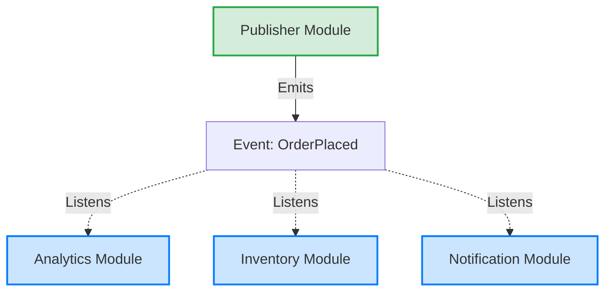

# Event-Driven Architecture (EDA)

## Overview

Event-Driven Architecture (EDA) is a design paradigm where the flow of the program is determined by events—messages signifying that a state change has occurred. Instead of components explicitly commanding each other to do work (Command pattern), components emit events and trust that interested parties will react to them.

## Why It Matters

In a highly modular Android application, if the `ShoppingCart` module explicitly calls the `Analytics` module, the `PushNotification` module, and the `UiRenderer` module when an item is added, the code is tightly coupled. Any change requires modifying the `ShoppingCart`. 

EDA completely severs this direct coupling. The `ShoppingCart` simply broadcasts an `ItemAddedEvent`. It doesn't know or care who is listening. This allows you to add or remove features (like a new `Recommendations` module) without ever touching the core cart logic.

## Historical Context

Rooted in publish-subscribe messaging patterns from the 1980s. On Android, it historically took the form of global Event Buses (like GreenRobot's EventBus or Guava EventBus) or `LocalBroadcastManager`. Today, these global buses are considered anti-patterns, replaced by scoped, type-safe reactive streams (Kotlin `SharedFlow` and `StateFlow`).

## First Principles

1.  **Fire and Forget:** The publisher of an event does not wait for a response, nor does it care if anyone is listening.
2.  **Decoupling:** Publishers and Subscribers do not know about each other. They only share knowledge of the Event object.
3.  **Facts of the Past:** Events describe something that *already happened*. They are named in the past tense (e.g., `UserLoggedIn`, not `LogInUser`).

## Mental Model

Think of a fire alarm in an office building.
- **Direct Command (Non-EDA):** The smoke detector detects fire. It must individually call the fire department, call the police, turn on the sprinklers, and email every employee. The detector is incredibly complex and knows too much.
- **Event-Driven (EDA):** The smoke detector detects fire. It triggers the alarm (Emits a `FireDetectedEvent`). It stops caring. The sprinkler system hears the alarm and turns on. Employees hear the alarm and evacuate. The fire department hears the alarm and dispatches trucks.

## Internal Mechanics

### 1. The Global Event Bus (Legacy Anti-Pattern)

```java
// Publisher (Anywhere in the app)
EventBus.getDefault().post(new UserLoggedInEvent(userId));

// Subscriber (Anywhere else in the app)
@Subscribe(threadMode = ThreadMode.MAIN)
public void onUserLoggedIn(UserLoggedInEvent event) {
    updateUi();
}
```
*Why it's legacy:* Any class can emit any event to any other class. It becomes impossible to trace the flow of execution, leading to "spaghetti architecture."

### 2. The Scoped Reactive Stream (Modern Kotlin)

Using `SharedFlow` to act as an event bus localized to a specific architectural layer (e.g., within a ViewModel or a Singleton Repository).

```kotlin
// The Event Definition
sealed interface AuthEvent {
    data class LoggedIn(val userId: String) : AuthEvent
    data object LoggedOut : AuthEvent
}

// The Publisher (Repository)
class AuthRepository {
    private val _events = MutableSharedFlow<AuthEvent>(
        extraBufferCapacity = 10,
        onBufferOverflow = BufferOverflow.DROP_OLDEST
    )
    val events = _events.asSharedFlow() // Expose as read-only

    suspend fun login(credentials: Credentials) {
        val id = api.authenticate(credentials)
        _events.emit(AuthEvent.LoggedIn(id)) // Fire event
    }
}

// The Subscriber (ViewModel)
class ProfileViewModel(private val authRepo: AuthRepository) {
    init {
        viewModelScope.launch {
            authRepo.events.collect { event ->
                when (event) {
                    is AuthEvent.LoggedIn -> loadProfile(event.userId)
                    is AuthEvent.LoggedOut -> clearProfile()
                }
            }
        }
    }
}
```

## Architecture



## Production Example

**Unidirectional Data Flow (UDF / MVI)**

Modern Android UI architecture is entirely event-driven. 
1. The user clicks a button. The View emits a `UiEvent.SubmitClicked`.
2. The ViewModel consumes the event, does work, and emits a new `ViewState`.
3. The View observes the state and re-renders. 

The View never directly commands the ViewModel (`viewModel.doSubmit()`), and the ViewModel never directly commands the View (`view.showLoading()`). They communicate exclusively via Events and State.

## Android Example

**System Broadcasts**

The Android OS uses EDA extensively via `Intents` and `BroadcastReceivers`. When the battery is low, the OS broadcasts `ACTION_BATTERY_LOW`. The OS doesn't know which apps care. If your app registered a receiver for that intent, it wakes up and reacts (e.g., pausing a background download).

## Tradeoffs

**Advantages**
- **Extreme Decoupling:** Adding a new subscriber requires exactly zero changes to the publisher.
- **Asynchrony:** naturally fits with background processing and coroutines.
- **Scalability:** The architecture naturally supports adding massive amounts of new features that react to core business flows.

**Disadvantages**
- **Implicit Execution Flow:** If you look at the `ShoppingCart` class, you cannot see what happens after an item is added. You have to use IDE tools (Find Usages) to hunt down every subscriber to understand the full system behavior.
- **Debugging Hell:** If an event triggers a subscriber, which emits another event, which triggers another subscriber, which emits a third event... tracing a bug through a chain of asynchronous events is incredibly difficult.
- **Event Storms:** An event loop where Event A triggers B, B triggers C, and C triggers A. The app locks up immediately.

## Failure Modes

- **The Global Bus Trap:** Re-creating GreenRobot's EventBus by making a massive global `object AppEventBus { val flow = MutableSharedFlow<Any>() }`. You have recreated the 1990s GOTO statement. Events should be strongly typed and scoped to specific domains.
- **Commands Disguised as Events:** Creating an event called `ShowSnackbarEvent`. If the publisher dictates *what* the subscriber should do, it is a Command, not an Event. An Event is a fact (`ItemDeletedEvent`). It is up to the subscriber to decide if it wants to show a snackbar.
- **Missing Delivery Guarantees:** A `SharedFlow` with `replay = 0` will drop events if no one is listening. If an Analytics tracker initializes *after* the `AppStartedEvent` fires, the event is lost forever. Understanding Hot vs. Cold streams is critical.

## Staff Engineer Thinking

When reviewing an event-driven system, a Staff engineer asks:

1.  **Are we using Events or State?** If an event is `CurrentTemperatureEvent(72)`, that is not an event. That is state. A new subscriber needs to know the temperature immediately, even if it didn't change recently. We should use `StateFlow` for state, and `SharedFlow` for one-time events.
2.  **What is the lifecycle of the subscriber?** If a Fragment subscribes to a global `UserRepository` event flow, but forgets to unsubscribe in `onDestroy`, the repository will leak the Fragment, crashing the app with an OOM. (Always use `repeatOnLifecycle` or `collectAsStateWithLifecycle`).
3.  **Is this a Command or an Event?** Does the publisher *expect* a specific outcome? If the `CheckoutScreen` fires an event, and the developer expects the `PaymentService` to catch it and process payment, it is a Command. If the `PaymentService` is refactored and stops listening, the app breaks silently. Commands require direct calls; Events are for side-effects.

## Common Misconceptions

- **"Event-Driven Architecture is the same as the Observer pattern."** Yes, structurally, EDA is implemented using the Observer pattern. EDA is the *architectural paradigm*; Observer is the *design pattern* used to build it.
- **"Callbacks are events."** Callbacks (`onSuccess()`) are highly coupled point-to-point communication. Events are 1-to-many broadcasts.

## Probing Questions

1.  Why has the Android community moved away from global Event Buses toward scoped `SharedFlow`?
2.  Explain the difference between a Command and an Event.
3.  In Kotlin, what is the difference between `StateFlow` and `SharedFlow` when used in an Event-Driven Architecture?
4.  How does UDF (Unidirectional Data Flow) utilize the principles of EDA?
5.  What is an "Event Storm," and how do you prevent it?
6.  If a publisher emits an event, but the primary subscriber hasn't initialized yet, how do you ensure the event isn't lost?
7.  Why should events be named in the past tense? (e.g., `PaymentProcessed` vs `ProcessPayment`).
8.  How do Android System Broadcasts demonstrate EDA?
9.  Explain why tracing bugs in an Event-Driven system is generally more difficult than in a procedural, tightly-coupled system.
10. Describe a scenario where using direct method calls (tight coupling) is actually superior to using an Event-Driven approach.

## Answer Key

1.  **Why has the Android community moved away from global Event Buses toward scoped `SharedFlow`?**
    Global event buses lead to spaghetti code, are not type-safe, and make tracking execution flow nearly impossible. Scoped `SharedFlow` provides type safety, scoped lifecycles, and predictable domains.
2.  **Explain the difference between a Command and an Event.**
    A Command dictates *what to do* (`ShowSnackbar`), implying the sender expects a specific outcome. An Event describes a fact of *what happened* (`ItemDeleted`), leaving it to the subscriber to decide how to react.
3.  **In Kotlin, what is the difference between `StateFlow` and `SharedFlow` when used in an Event-Driven Architecture?**
    `StateFlow` represents state (always has a value, emits the latest to new subscribers, conflates updates). `SharedFlow` is for one-time events (no default value, configurable replay, doesn't conflate unless configured).
4.  **How does UDF (Unidirectional Data Flow) utilize the principles of EDA?**
    In UDF, the View emits user intent as events. The ViewModel subscribes to these events and reduces them into a new State, which the View observes. They never command each other directly.
5.  **What is an "Event Storm," and how do you prevent it?**
    An Event Storm is an infinite loop where Event A triggers B, which triggers C, which triggers A. Prevent it by ensuring events flow in a single direction (e.g., UDF) and avoiding reactive chains that update the same state cyclically.
6.  **If a publisher emits an event, but the primary subscriber hasn't initialized yet, how do you ensure the event isn't lost?**
    Configure the `SharedFlow` with a `replay` value greater than 0, or cache the event if it's a critical application startup event, ensuring the subscriber receives it upon initialization.
7.  **Why should events be named in the past tense? (e.g., `PaymentProcessed` vs `ProcessPayment`).**
    To reinforce the conceptual model that events represent immutable facts of the past. Present-tense verbs imply commands, which violate the decoupling principle of EDA.
8.  **How do Android System Broadcasts demonstrate EDA?**
    The OS broadcasts system changes (`ACTION_BATTERY_LOW`) without knowing which apps are listening. Apps register receivers independently to react, decoupling the system core from installed applications.
9.  **Explain why tracing bugs in an Event-Driven system is generally more difficult than in a procedural, tightly-coupled system.**
    Execution flow is implicit and decoupled. You cannot step through the code linearly. You must use search tools to find all subscribers of an event, which may run asynchronously or on different threads.
10. **Describe a scenario where using direct method calls (tight coupling) is actually superior to using an Event-Driven approach.**
    When implementing linear, sequential business logic where a strict return value is immediately required, such as calculating a hash or validating a form field. EDA here would add unnecessary indirection and complexity.

## Further Reading

- [`../patterns/observer.md`](../patterns/observer.md) — The specific design pattern used to build EDA.
- [`../patterns/command.md`](../patterns/command.md) — The semantic opposite of an Event.
- [`coupling-vs-cohesion.md`](coupling-vs-cohesion.md) — EDA is the ultimate tool for achieving low coupling.
