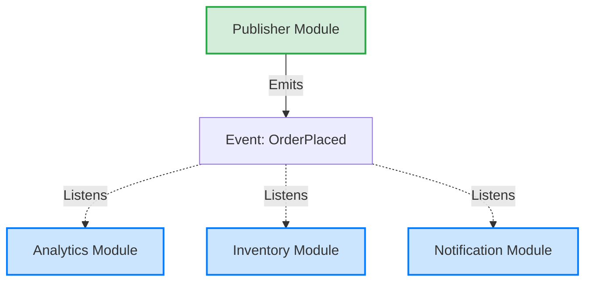

# Event-Driven Architecture (EDA)

## Overview

Event-Driven Architecture connects producers and consumers through event messages describing occurrences. Publishers need not call every consumer directly, but they still share event contracts and delivery assumptions. Commands can coexist with events; publishing an event does not by itself guarantee that a required action completes.

## Why It Matters

In a highly modular Android application, if the `ShoppingCart` module explicitly calls the `Analytics` module, the `PushNotification` module, and the `UiRenderer` module when an item is added, the code is tightly coupled. Any change requires modifying the `ShoppingCart`. 

Publishing an `ItemAddedEvent` can remove direct dependencies on individual subscribers. Consumers still depend on the event schema, meaning, ordering and delivery policy. Adding a subscriber may leave cart code unchanged, while changing those contracts can require coordinated updates.

## Historical Context

Rooted in publish-subscribe messaging patterns from the 1980s. On Android, it historically took the form of global Event Buses (like GreenRobot's EventBus or Guava EventBus) or `LocalBroadcastManager`. Today, these global buses are considered anti-patterns, replaced by scoped, type-safe reactive streams (Kotlin `SharedFlow` and `StateFlow`).

## First Principles

1.  **Delivery contract:** Publishing an event and completing downstream work are separate outcomes. Publication can wait for admission or acknowledgment; retries, retention and consumer processing guarantees depend on the transport.
2.  **Decoupling:** Publishers and Subscribers do not know about each other. They only share knowledge of the Event object.
3.  **Facts of the Past:** Events describe something that *already happened*. They are named in the past tense (e.g., `UserLoggedIn`, not `LogInUser`).

## Mental Model

Think of a fire alarm in an office building.
- **Direct Command (Non-EDA):** The smoke detector detects fire. It must individually call the fire department, call the police, turn on the sprinklers, and email every employee. The detector is incredibly complex and knows too much.
- **Event-Driven (EDA):** The smoke detector detects fire. It triggers the alarm (Emits a `FireDetectedEvent`). It stops caring. The sprinkler system hears the alarm and turns on. Employees hear the alarm and evacuate. The fire department hears the alarm and dispatches trucks.

## Internal Mechanics

### 1. The Global Event Bus (Legacy Anti-Pattern)

```java
// Publisher (Anywhere in the app)
EventBus.getDefault().post(new UserLoggedInEvent(userId));

// Subscriber (Anywhere else in the app)
@Subscribe(threadMode = ThreadMode.MAIN)
public void onUserLoggedIn(UserLoggedInEvent event) {
    updateUi();
}
```
*Why it's legacy:* Any class can emit any event to any other class. It becomes impossible to trace the flow of execution, leading to "spaghetti architecture."

### 2. The Scoped Reactive Stream (Modern Kotlin)

The following sketch broadcasts optional in-process notifications. Supply the application-specific `AuthApi`, `Credentials`, `loadProfile` and `clearProfile` implementations. A replay-zero `SharedFlow` is not authoritative authentication state: a late subscriber misses earlier logins, and process death removes the stream. Expose current session state separately when consumers need to recover it.

```kotlin
// The Event Definition
sealed interface AuthEvent {
    data class LoggedIn(val userId: String) : AuthEvent
    data object LoggedOut : AuthEvent
}

// The Publisher (Repository)
class AuthRepository(private val api: AuthApi) {
    private val _events = MutableSharedFlow<AuthEvent>(
        extraBufferCapacity = 10,
        onBufferOverflow = BufferOverflow.DROP_OLDEST
    )
    val events = _events.asSharedFlow() // Expose as read-only

    suspend fun login(credentials: Credentials) {
        val id = api.authenticate(credentials)
        _events.emit(AuthEvent.LoggedIn(id)) // Fire event
    }
}

// The Subscriber (ViewModel)
class ProfileViewModel(private val authRepo: AuthRepository) : ViewModel() {
    init {
        viewModelScope.launch {
            authRepo.events.collect { event ->
                when (event) {
                    is AuthEvent.LoggedIn -> loadProfile(event.userId)
                    is AuthEvent.LoggedOut -> clearProfile()
                }
            }
        }
    }
}
```

## Architecture



## Production Example

**Unidirectional Data Flow (UDF / MVI)**

Unidirectional Data Flow separates user actions from observable UI state. A UI callback can invoke a ViewModel function, the ViewModel updates state, and the UI renders that state. The direction and ownership of data matter more than choosing a generic event-bus API.

Calling `viewModel.doSubmit()` from a user-action callback is compatible with UDF. The ViewModel should expose state for the UI to render rather than retain a View reference and call `view.showLoading()`.

## Android Example

**System Broadcasts**

Android uses `Intents` and `BroadcastReceivers` for system and application notifications, such as `ACTION_BATTERY_LOW`. Delivery depends on registration, permissions, target/version restrictions and process state; a receiver does not grant unrestricted background execution, and delivery timing is not guaranteed.

## Tradeoffs

**Advantages**
- **Extreme Decoupling:** Adding a new subscriber requires exactly zero changes to the publisher.
- **Asynchronous integration:** A broker or asynchronous stream can let producers and consumers progress separately. EDA alone does not define scheduling: in-process event dispatch can also be synchronous.
- **Scalability:** The architecture naturally supports adding massive amounts of new features that react to core business flows.

**Disadvantages**
- **Implicit Execution Flow:** If you look at the `ShoppingCart` class, you cannot see what happens after an item is added. You have to use IDE tools (Find Usages) to hunt down every subscriber to understand the full system behavior.
- **Debugging Hell:** If an event triggers a subscriber, which emits another event, which triggers another subscriber, which emits a third event... tracing a bug through a chain of asynchronous events is incredibly difficult.
- **Event feedback:** A cycle such as A → B → C → A can create repeated work or overload. Trace causation, bound retries and suppress unintended feedback; the severity depends on scheduling, capacity and handlers.

## Failure Modes

- **The Global Bus Trap:** Re-creating GreenRobot's EventBus by making a massive global `object AppEventBus { val flow = MutableSharedFlow<Any>() }`. You have recreated the 1990s GOTO statement. Events should be strongly typed and scoped to specific domains.
- **Commands Disguised as Events:** Creating an event called `ShowSnackbarEvent`. If the publisher dictates *what* the subscriber should do, it is a Command, not an Event. An Event is a fact (`ItemDeletedEvent`). It is up to the subscriber to decide if it wants to show a snackbar.
- **Missing Delivery Guarantees:** A `SharedFlow` with `replay = 0` will drop events if no one is listening. If an Analytics tracker initializes *after* the `AppStartedEvent` fires, the event is lost forever. Understanding Hot vs. Cold streams is critical.

## Staff Engineer Thinking

When reviewing an event-driven system, a Staff engineer asks:

1.  **Does a subscriber need history or current state?** `TemperatureMeasured(72)` can be an event; a new subscriber may instead need the latest temperature. Use an explicit current-state model for that requirement. `StateFlow` holds a current value; `SharedFlow` broadcasts with configured replay and overflow. Neither is a durable event log.
2.  **Who owns collection?** A long-lived collection that retains a destroyed Fragment or its View can leak it. Collect UI state with `collectAsStateWithLifecycle`, or use `viewLifecycleOwner` and `repeatOnLifecycle` for a Fragment View. Scope cancellation and restarting must match the work; a retained reference does not inevitably cause an OOM.
3.  **Is this a Command or an Event?** `ProcessPayment` requests an action from a responsible owner; `PaymentProcessed` reports an outcome. A command can use a direct call, RPC or queue. Required work needs explicit acceptance, failure and completion handling; an optional broadcast is not a substitute for that protocol.

## Common Misconceptions

- **"EDA is the Observer pattern."** Observer is one in-process implementation technique. EDA can also use brokers, durable logs and separate services with independent consumer lifecycles.
- **"Callbacks cannot represent events."** A callback can notify a listener that something happened. Event meaning, routing cardinality, timing and durability are separate decisions; neither callbacks nor EDA imply one universal delivery topology.

## Probing Questions

1.  Why has the Android community moved away from global Event Buses toward scoped `SharedFlow`?
2.  Explain the difference between a Command and an Event.
3.  In Kotlin, what is the difference between `StateFlow` and `SharedFlow` when used in an Event-Driven Architecture?
4.  How does UDF (Unidirectional Data Flow) utilize the principles of EDA?
5.  What is an "Event Storm," and how do you prevent it?
6.  If a publisher emits an event, but the primary subscriber hasn't initialized yet, how do you ensure the event isn't lost?
7.  Why should events be named in the past tense? (e.g., `PaymentProcessed` vs `ProcessPayment`).
8.  How do Android System Broadcasts demonstrate EDA?
9.  Explain why tracing bugs in an Event-Driven system is generally more difficult than in a procedural, tightly-coupled system.
10. Describe a scenario where using direct method calls (tight coupling) is actually superior to using an Event-Driven approach.

## Answer Key

1.  **Why has the Android community moved away from global Event Buses toward scoped `SharedFlow`?**
    Domain-scoped typed streams can narrow dependencies and make ownership explicit. Global buses can also use typed event classes; SharedFlow does not automatically choose a lifecycle or prevent broad coupling. The publisher and collection owners still define scope, cancellation and replay policy.
2.  **Explain the difference between a Command and an Event.**
    A Command dictates *what to do* (`ShowSnackbar`), implying the sender expects a specific outcome. An Event describes a fact of *what happened* (`ItemDeleted`), leaving it to the subscriber to decide how to react.
3.  **In Kotlin, what is the difference between `StateFlow` and `SharedFlow` when used in an Event-Driven Architecture?**
    StateFlow exposes a current value and suppresses equal updates. SharedFlow broadcasts with configurable replay and buffering; subscribers may receive history or miss values according to that policy. Both live in memory, so neither alone provides durable exactly-once work.
4.  **How does UDF (Unidirectional Data Flow) utilize the principles of EDA?**
    User actions reach a state owner, often through callbacks or ViewModel functions. The owner updates observable UI state and the UI renders it. UDF constrains direction and ownership; it does not forbid direct event-handler calls.
5.  **What is an "Event Storm," and how do you prevent it?**
    An Event Storm is an infinite loop where Event A triggers B, which triggers C, which triggers A. Prevent it by ensuring events flow in a single direction (e.g., UDF) and avoiding reactive chains that update the same state cyclically.
6.  **If a publisher emits an event, but the primary subscriber hasn't initialized yet, how do you ensure the event isn't lost?**
    Choose a delivery contract. SharedFlow replay retains only its configured recent values within the live process and can replay them again to a restarted collector. Required work across process death needs durable intent, acknowledgment and duplicate handling; current state may be the appropriate UI model.
7.  **Why should events be named in the past tense? (e.g., `PaymentProcessed` vs `ProcessPayment`).**
    Past-tense names make it clear that the message reports an occurrence. ProcessPayment instead requests work from an owner. Commands can coexist with events in EDA; the name should expose the intended responsibility and outcome contract.
8.  **How do Android System Broadcasts demonstrate EDA?**
    The OS broadcasts system changes (`ACTION_BATTERY_LOW`) without knowing which apps are listening. Apps register receivers independently to react, decoupling the system core from installed applications.
9.  **Explain why tracing bugs in an Event-Driven system is generally more difficult than in a procedural, tightly-coupled system.**
    Execution flow is implicit and decoupled. You cannot step through the code linearly. You must use search tools to find all subscribers of an event, which may run asynchronously or on different threads.
10. **Describe a scenario where using direct method calls (tight coupling) is actually superior to using an Event-Driven approach.**
    When implementing linear, sequential business logic where a strict return value is immediately required, such as calculating a hash or validating a form field. EDA here would add unnecessary indirection and complexity.

## Further Reading

- [`../patterns/observer.md`](../patterns/observer.md) — The specific design pattern used to build EDA.
- [`../patterns/command.md`](../patterns/command.md) — The semantic opposite of an Event.
- [`coupling-vs-cohesion.md`](coupling-vs-cohesion.md) — EDA is the ultimate tool for achieving low coupling.

### Official verification references

The corrections in this chapter were checked against the following primary references.

- [learn.microsoft.com: event-driven](https://learn.microsoft.com/en-us/azure/architecture/guide/architecture-styles/event-driven)
- [kotlinlang.org: -shared-flow](https://kotlinlang.org/api/kotlinx.coroutines/kotlinx-coroutines-core/kotlinx.coroutines.flow/-shared-flow/)
- [kotlinlang.org: -state-flow](https://kotlinlang.org/api/kotlinx.coroutines/kotlinx-coroutines-core/kotlinx.coroutines.flow/-state-flow/)
- [developer.android.com: events](https://developer.android.com/topic/architecture/ui-layer/events)
- [developer.android.com: coroutines](https://developer.android.com/topic/libraries/architecture/coroutines)
- [developer.android.com: broadcasts](https://developer.android.com/develop/background-work/background-tasks/broadcasts)
- [github.com: transactional-outbox-pattern](https://github.com/aws-samples/transactional-outbox-pattern)
- [github.com: EventBus](https://github.com/greenrobot/EventBus)
