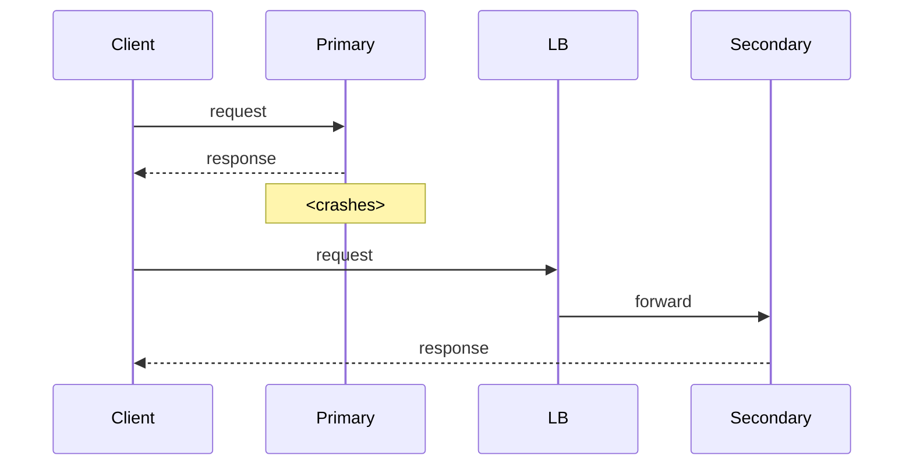
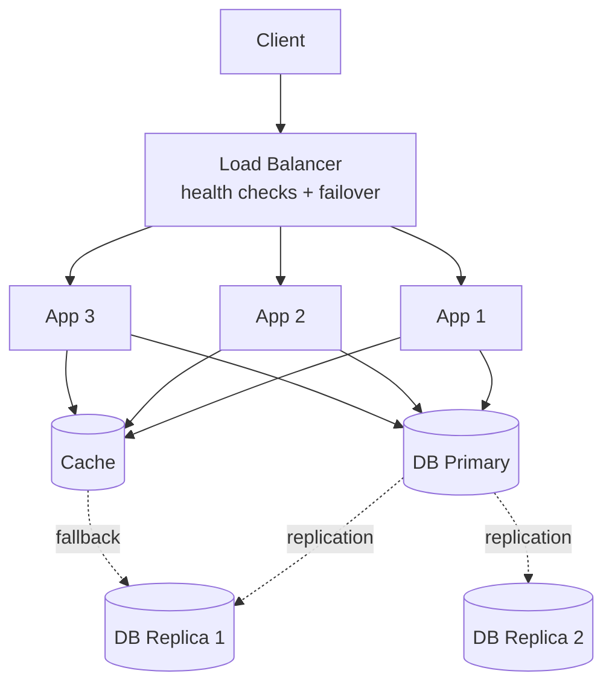

# Fault Tolerance

## Overview

**Fault tolerance** is the property of a system that continues to function correctly when parts of it fail. It is not the same as fault *avoidance* (preventing faults), nor *fault detection* (knowing about them). It is the discipline of acknowledging that faults *will* happen and designing so that they do not become outages. The shift in thinking — from "how do I prevent failure?" to "how do I survive failure?" — is the single biggest change in mindset that separates application engineers from systems engineers.

A famous corollary, often attributed to Jim Gray: *failures are the rule, not the exception*. At any non-trivial scale, *something* is broken right now. The system's correctness must not depend on nothing being broken.

---

## Why It Exists

Hardware fails. Networks partition. Disks fill. Processes die. Cosmic rays flip bits in RAM. Even at small scale, a system that depends on everything working will eventually fall over. At large scale — thousands of machines, millions of users, billions of operations — the failure rate of components ensures something is always failing somewhere.

What was broken before fault tolerance was treated as a first-class design property: every system was built assuming the happy path, with error handling bolted on as an afterthought. A hardware failure took the whole system down. A network blip caused a cascade of timeouts. A bug in one component leaked through to crash unrelated components.

Fault tolerance, treated as a design principle, lets a system absorb component-level failures without user-visible impact. The most reliable systems in the world are not built from more reliable components — they are built from *normal* components arranged so that any one (or any few) can fail without breaking the whole.

---

## Historical Context

1. **Mainframe RAS (1960s-70s).** "Reliability, Availability, Serviceability" was a mainframe selling point — redundant power, ECC memory, hot-swappable parts. Cost-no-object reliability.
2. **Tandem NonStop (1976).** Commercially-available fault-tolerant computers. Multiple CPUs, lockstep execution, automatic failover. The architectural patterns are still in use today.
3. **Internet-scale (1990s-2000s).** Google, Amazon, and the early hyperscalers couldn't afford Tandem-class hardware at their scale. They invented architectures that achieved fault tolerance through *redundancy of cheap hardware* — replication, sharding, and graceful degradation.
4. **Netflix Chaos Monkey (2011).** Deliberately killing production servers to verify the system survives. This crystallized fault tolerance as a *practice*, not just a design property: if your system is fault-tolerant, you should be able to prove it under controlled chaos.
5. **Service mesh / cloud-native (2017 onward).** Fault tolerance moved into the infrastructure layer — Envoy, Istio, Linkerd implement retries, circuit breakers, timeouts as platform concerns.

The arc: expensive hardware → cheap hardware + smart software → cheap hardware + smart infrastructure. Each generation pushed fault tolerance down the stack, making it the default rather than the exception.

---

## First Principles

### 1. Faults vs failures vs outages

- **Fault:** a defect or unexpected condition. A disk has a bad sector; a packet is lost; a process dies.
- **Failure:** when a fault produces an incorrect result. A component fails to return the right answer.
- **Outage:** when failures are user-visible. Customers cannot use the service.

The chain runs: fault → failure → outage. Fault tolerance breaks this chain. Faults should not become failures; failures should not become outages.

### 2. Redundancy is the universal mechanism

Every fault-tolerance technique reduces to *redundancy*: having more than one copy of something so the loss of one is survivable.

- **Replication:** multiple copies of the same data.
- **Multiple instances:** multiple copies of the same service.
- **Multiple regions:** multiple copies of the same datacenter.
- **Retries:** the same request, tried again — redundancy in time.
- **Quorums:** redundancy with a voting protocol.
- **Erasure coding:** redundancy with mathematical compression.

The cost of redundancy is real (storage, compute, complexity), and unbounded redundancy is impossible. The design question is *which* faults to tolerate, with how much redundancy.

### 3. Independence of failure modes

Redundancy only helps if the copies fail *independently*. Two database replicas in the same rack share fate (power, network). Two replicas in different racks share less. Two replicas in different regions share less still.

The expensive part of fault tolerance is not the redundancy — it's the *independence*. Achieving independence requires understanding the system's failure correlation: what breaks together?

### 4. Graceful degradation

A fault-tolerant system rarely fails fully. It degrades — some features stop working, some users see slightly stale data, some operations are slower. The art is making degradation *partial and predictable* rather than *total and surprising*.

Examples of graceful degradation:
- Search returns results from the primary index when the personalized index is unavailable.
- Video playback drops to a lower bitrate when bandwidth degrades.
- A feed shows cached posts when the backend is unreachable.
- A login flow accepts password-only when the 2FA service is down (or fails closed, depending on threat model).

---

## Mental Model

An aircraft.

Modern commercial aircraft have multiple engines. The aircraft can fly with one engine out. If both engines fail, the aircraft can still glide to a runway. Hydraulic systems are triple-redundant. Critical avionics are quadruple-redundant. The pilots can fly the aircraft manually if all the electronics fail.

No single failure can crash the plane.

Two things to notice:

1. The aircraft is not made of *more reliable* parts than a car. Jet engines fail at roughly the rate of car engines. The reliability comes from *arrangement*.
2. The aircraft is *heavier* and *more expensive* than it would be without redundancy. This is the cost of fault tolerance.

A software system designed for fault tolerance is the same. The components are normal; the *arrangement* is the technology.

---

## Internal Mechanics

### Failover

A primary serves requests; a secondary stands ready. When the primary fails, the secondary takes over.



Cold failover: secondary boots from scratch — minutes of downtime.
Warm failover: secondary is running but not serving — seconds of downtime.
Hot failover: secondary serves traffic too — near-zero downtime.

### Replication

Multiple replicas hold the same data. Reads can be served by any; writes go to one or many.

```kotlin
// Synchronous replication: write succeeds only if all replicas ack
fun write(value: V): Boolean {
    val acks = replicas.parallelMap { it.write(value) }
    return acks.all { it == OK }
}

// Asynchronous replication: write succeeds when primary acks; replicas catch up
fun write(value: V): Boolean {
    val ok = primary.write(value)
    if (ok) replicas.parallelLaunch { it.replicate(value) }  // fire-and-forget
    return ok
}
```

Synchronous replication is more durable; asynchronous replication is faster but can lose writes during a primary failure.

### Retry with backoff

```kotlin
suspend fun <T> withRetry(
    maxAttempts: Int = 3,
    initialDelay: Duration = 100.milliseconds,
    factor: Double = 2.0,
    op: suspend () -> T
): T {
    var attempt = 0
    var delay = initialDelay
    while (true) {
        try {
            return op()
        } catch (e: TransientException) {
            attempt++
            if (attempt >= maxAttempts) throw e
            delay(delay + jitter(delay))
            delay = delay * factor
        }
    }
}
```

Retries are the most common fault-tolerance pattern and the most commonly mis-implemented. The key properties:

- **Bounded.** A finite number of attempts (or a finite total time budget).
- **Backed off.** Exponentially increasing delay between attempts to avoid hammering.
- **Jittered.** Randomized delay to avoid synchronized thundering herds.
- **Over idempotent operations only.** See [`../distributed-systems/idempotency.md`](../distributed-systems/idempotency.md).

See [`../patterns/retry.md`](../patterns/retry.md) for the full pattern.

### Circuit breaker

A circuit breaker fails fast when downstream is unhealthy, preventing cascading retries from making things worse.

```text
Closed ─── (failure rate > threshold) ─▶ Open
                                          │
                       (timeout)          │
   ◀──── (probe succeeds) ─── HalfOpen ◀─┘
```

See [`../patterns/circuit-breaker.md`](../patterns/circuit-breaker.md).

### Bulkhead

Isolate resources by purpose so that exhaustion in one path doesn't starve others.

```kotlin
// Separate thread pools for different downstream services
val paymentsDispatcher = Dispatchers.IO.limitedParallelism(20)
val searchDispatcher = Dispatchers.IO.limitedParallelism(50)

// If search is slow and all search dispatcher threads block,
// payments are unaffected.
```

---

## Architecture

A typical fault-tolerant service architecture:



The pieces:

- **Load balancer:** detects unhealthy app instances and removes them from rotation.
- **Multiple app instances:** any one can be lost without affecting service.
- **Database replication:** survives a primary failure (failover) and serves read load.
- **Cache with fallback:** if the cache is down, the system serves from replicas (slower but functional).

Notable absence: a single point of failure. The load balancer itself is often paired (active-passive or anycast).

---

## Production Example

- **Amazon S3.** Designed for 11 9's of durability through erasure coding across availability zones. Built on commodity hardware; the math does the rest.
- **Google Spanner.** Globally-distributed database that survives entire datacenter losses. The TrueTime API hides the underlying complexity.
- **Netflix.** Famously survived the AWS US-East-1 outage in 2012 partly because of their multi-region architecture. The post-mortem became a classic.
- **WhatsApp.** Famously serves a billion users on a tiny ops team — graceful degradation, simple architectures, and aggressive failure-mode testing.
- **PostgreSQL with patroni.** Open-source automated failover for Postgres clusters. The reference implementation for warm failover in stateful services.

---

## Android Example

Mobile fault tolerance is different from server-side: the client has only one of itself, but it lives in a hostile network environment.

```kotlin
class ApiClient(private val backend: BackendService, private val cache: LocalCache) {
    suspend fun fetchUser(id: String): User {
        return try {
            val user = withRetry(maxAttempts = 3) {
                backend.getUser(id)  // network can fail anywhere
            }
            cache.put(id, user)
            user
        } catch (e: IOException) {
            cache.get(id) ?: throw e  // fallback to local cache
        }
    }
}
```

Specific mobile fault-tolerance patterns:

- **Local cache as fallback.** When the network is down, serve from the local DB. The whole offline-first architecture ([`../reference-architectures/offline-first-app.md`](../reference-architectures/offline-first-app.md)) is this pattern at scale.
- **Operation queue.** Mutations queue locally and retry when the network returns. WorkManager is the standard mechanism.
- **Idempotency-aware retries.** See [`../distributed-systems/idempotency.md`](../distributed-systems/idempotency.md). Retrying non-idempotent operations is worse than failing.
- **Graceful UI degradation.** A failed image load shows a placeholder, not a crash. A failed network call shows cached data, not a blank screen.

See [`../android/anrs.md`](../android/anrs.md), [`../android/process-death-and-state-restoration.md`](../android/process-death-and-state-restoration.md).

---

## Tradeoffs

**Advantages**

- The system stays available through component-level failures.
- Lower outage frequency and shorter outage duration.
- Catastrophic failures become rare and bounded.
- Confidence to make changes — the system absorbs mistakes.

**Disadvantages**

- Higher cost. Redundancy is not free.
- Higher complexity. More moving parts; more failure modes.
- Slower writes (synchronous replication) or weaker durability (asynchronous).
- More testing burden. Failure modes must be tested explicitly.

**Hidden costs**

- Independence assumptions are easy to violate. "Multiple instances" that share a network, a power source, or a deploy pipeline are not as independent as they appear.
- Fault tolerance can mask degradation. A system serving 60% from cache because the database is unhealthy looks fine until the cache also fails.
- Recovery time vs recovery point. RPO (data loss) and RTO (downtime) trade against each other; achieving both requires expensive infrastructure.

**When not to use**

- Single-user systems where the user is happy to retry manually.
- Internal tools where downtime is acceptable and recovery is cheap.
- MVPs where you're still figuring out what to build.

The right framing: fault tolerance is an *investment* — pay the cost upfront, reap the reliability benefit at scale. Premature fault-tolerance investment is over-engineering.

---

## Failure Modes

**Correlated failure.** Redundant copies share a hidden dependency. Mitigation: diversity — across rack, region, vendor, software version.

**Retry storms.** Failed calls retry; downstream becomes more overloaded; more failures; more retries. Mitigation: circuit breakers, retry budgets, exponential backoff, jitter.

**Cascading failures.** A slow component slows callers; callers' resources exhaust; their callers slow; the cascade propagates. Mitigation: timeouts, bulkheads, load shedding.

**Silent data corruption.** Some failures don't crash — they corrupt. Mitigation: checksums, ECC, end-to-end verification.

**Recovery worse than the failure.** Automatic failover triggers under partial-fault conditions and makes things worse (split-brain). Mitigation: careful health-check design, hysteresis, quorum-based decisions.

**Stale fallback.** Fallback paths (cached data, secondary services) silently serve old data. Mitigation: alert on time-since-last-fresh-data, not just on error rate.

**Untested redundancy.** "Secondary database" that's never been promoted in production, "failover plan" that's never been executed. Mitigation: chaos engineering — exercise the failure paths deliberately.

---

## Performance Considerations

- **Synchronous replication** adds latency proportional to the slowest replica.
- **Async replication** adds no latency but loses durability under primary failure.
- **Retries** add latency on the failure path; aggressive retries can dominate p99.
- **Circuit breakers** add latency only when tripping; when open, they short-circuit failures with no downstream call.
- **Health checks** are a continuous low-grade load on the system.

The general rule: fault tolerance is rarely free, but the cost is usually small relative to the cost of outages.

---

## Reliability Considerations

This whole topic *is* reliability. Some additional points:

- **SLOs frame the conversation.** A 99.9% SLO permits 43 minutes of outage per month. A 99.99% SLO permits 4.3 minutes. The two require very different investments.
- **The cost of a 9 grows exponentially.** Going from 99% to 99.9% costs less than going from 99.9% to 99.99%, which costs less than going from 99.99% to 99.999%.
- **Multi-region is the big expensive step.** Single-region fault tolerance is achievable; multi-region requires solving consistency, latency, and operational complexity.

See [`../observability/slos.md`](../observability/slos.md), [`../observability/error-budgets.md`](../observability/error-budgets.md).

---

## Security Considerations

- **Failure modes can be exploited.** An attacker can trigger fallbacks deliberately to reach weaker code paths. Fallback code must meet the same security bar as primary code.
- **Health checks can leak information.** A health-check endpoint that reveals internal state (load, downstream status) helps both operators and attackers.
- **Retries can be turned against you.** An attacker triggering retries amplifies their request load on downstream. Use retry budgets to bound this.
- **Replication channels are attack surfaces.** Replication traffic between datacenters carries production data; secure it like any other production data path.

---

## Observability

- **SLI metrics.** Error rate, latency, availability — the formal definitions of "is the system working?"
- **Failure mode counters.** Per type of failure (timeout, 5xx, connection refused), counted and trended.
- **Recovery time / recovery point.** How long the system was degraded; how much data was lost.
- **Retry rates.** Per downstream; high retry rates are leading indicators of upstream trouble.
- **Circuit breaker states.** Closed/open/half-open distribution across the system.
- **Dashboards.** Service-level dashboards that show the actual user-experienced SLIs, not just internal component health.
- **Alerts.** SLO burn rate alerts that page when error budgets are being consumed faster than sustainable.

See [`../observability/slis.md`](../observability/slis.md), [`../observability/slos.md`](../observability/slos.md), [`../observability/error-budgets.md`](../observability/error-budgets.md).

---

## Staff Engineer Thinking

**Pick the failure modes you'll tolerate.** A system cannot tolerate every failure. The Staff question: which failures are likely, which are expensive to tolerate, and which combinations of likelihood and cost justify the engineering investment?

**Test the recovery, not just the design.** The first failover in production should not be the first failover ever. Run game days. Use chaos engineering. The redundancy you didn't test is the redundancy that won't work.

**Be honest about independence.** "Two replicas in the same datacenter" provides correlated reliability — they fail together more often than the math suggests. Calling this out, naming the shared failure mode, is the Staff move.

**Resist the temptation to add reliability without measuring it.** Each layer of retry, replication, and fallback adds complexity. If you can't show that it improves the SLI, it's debt.

**Frame the conversation in SLOs.** Without a target reliability number, fault-tolerance discussions devolve into "more is better." With one, they become trade-offs against the SLO and the error budget.

**Operate from the assumption that something is always broken.** This is the cultural shift. New engineers ask "why is this thing failing?"; experienced engineers ask "what is failing right now, and is the system still functioning?" The latter is the right question.

---

## Common Misconceptions

**"Fault-tolerant systems don't fail."** They fail constantly — internally. They don't fail *for users*. Internal failures and external outages are different things.

**"Redundancy = fault tolerance."** Redundancy without independence is theater. Two replicas in the same rack on the same power source provide little protection.

**"Retries make everything reliable."** Retries amplify problems for non-idempotent operations and overload signals. Retries without bounds, backoff, and idempotency make things worse.

**"More 9's is always better."** Each 9 is exponentially expensive. The right question is "what does the next 9 cost, and is it worth it for our users?"

**"Fault tolerance is a framework problem."** Frameworks help (Hystrix, Resilience4j, Envoy), but the design decisions — which failures to tolerate, where to put the boundaries — are domain-specific.

---

## Probing Questions

1. Define fault, failure, and outage. Why does the distinction matter operationally?
2. Two database replicas in the same datacenter. What independence assumptions does this protect against? What does it not?
3. Explain why retries without idempotency can amplify a partial outage into a total one.
4. Compare synchronous vs asynchronous replication. What does each give up?
5. A team adds three layers of fallback to a critical path. The system feels more reliable. What new failure modes have they created?
6. The system "automatically fails over" but a human engineer is required to handle the post-failover repair. What's the user-visible RTO?
7. Multi-region active-active sounds reliable. What are the three hardest problems it creates?
8. How do you know your fault tolerance works? Stress-test it once a year? Once a quarter? Continuously?
9. The cache failed; the system "gracefully fell back" to the database; the database also failed. Where did the system's resilience model break down?
10. An SLO of 99.95% allows ~21 minutes of outage per month. How do you spend an error budget intentionally?

---

## Further Reading

In this repository:

- [`state-machines.md`](state-machines.md) — explicit recovery is a state machine.
- [`backpressure.md`](backpressure.md) — backpressure is a fault-tolerance tool against overload.
- [`time-and-clocks.md`](time-and-clocks.md) — fault-tolerant systems must reason about clock skew.
- [`../distributed-systems/idempotency.md`](../distributed-systems/idempotency.md) — the prerequisite for safe retries.
- [`../distributed-systems/cap-theorem.md`](../distributed-systems/cap-theorem.md) — fault tolerance under partition.
- [`../distributed-systems/consensus-basics.md`](../distributed-systems/consensus-basics.md) — quorums and consensus as fault-tolerance primitives.
- [`../patterns/retry.md`](../patterns/retry.md), [`../patterns/circuit-breaker.md`](../patterns/circuit-breaker.md), [`../patterns/saga.md`](../patterns/saga.md).
- [`../observability/slos.md`](../observability/slos.md), [`../observability/error-budgets.md`](../observability/error-budgets.md) — frame the conversation in numbers.
- [`../leadership/incident-response-on-call.md`](../leadership/incident-response-on-call.md) — what happens when fault tolerance isn't enough.

External:

- Jim Gray, *Why Do Computers Stop and What Can Be Done About It?* 1985. Still the clearest paper on the topic.
- *Site Reliability Engineering* (Google, 2016). Chapters on incident response, postmortems, and the SLO/error-budget framework.
- *Release It!* by Michael Nygard. Practical patterns for production-grade fault tolerance.
- *Chaos Engineering* (Netflix). The original case for testing failure paths in production.
