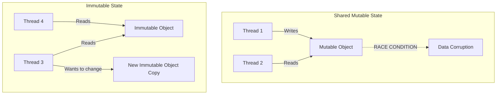

# Immutability

## Overview

Immutability is the principle that once an object is created, its state cannot be modified. If you need to change the data, you must create a new object with the new data. In modern Android engineering, immutable values help make state changes easier to reason about. They simplify shared snapshots, but Compose also supports observable mutable state, coroutines can coordinate mutable state, and UDF is primarily an ownership and update-flow discipline.

## Why It Matters

Shared mutable state is the root of all evil in concurrent programming. If Thread A and Thread B have a reference to the same `User` object, and Thread A changes the user's name while Thread B is writing the user to a database, you have a race condition leading to data corruption or a crash.

Compose observes reads and writes of supported snapshot state. Mutating an ordinary, unobservable field or MutableList does not notify it, whereas MutableState and snapshot collections can notify observers without replacing the containing object. Immutable snapshots help reasoning; publication and update observation still need their own contracts.

## Historical Context

Rooted in functional programming languages (Lisp, Haskell). For decades, Object-Oriented Programming (Java/C++) glorified mutability: objects encapsulating internal state and changing it via setters (`user.setName("John")`). The shift back to immutability in mainstream languages was driven by the rise of multi-core processors (which made thread-safety critical) and reactive UI paradigms (React, Compose). Kotlin was designed with immutability as a first-class citizen (`val` vs `var`, `List` vs `MutableList`, data classes).

## First Principles

1.  **Read-Only Is Not Enough:** A read-only reference or API can still expose a mutable object graph. Immutability requires that the object's observable state cannot change after construction.
2.  **Safe Concurrent Reads:** Properly constructed, safely published, deeply immutable values do not need locks to protect their contents from concurrent mutation. Publishing references and coordinating replacement versions remain separate concurrency concerns.
3.  **Predictability:** A function cannot mutate the contents of a truly immutable argument. It can still perform other side effects, such as I/O or changing separate mutable state.

## Mental Model

Think of a printed photograph versus a whiteboard.

- **Mutable (The Whiteboard):** You draw a diagram. Someone walks by and erases part of it while you aren't looking. You return and the diagram is ruined. You have to put a lock on the door (Synchronization) to stop people.
- **Immutable (The Photograph):** You print a photo of the diagram and hand copies to 10 people. None of them can change *your* photo. If they want a version with a mustache drawn on it, they must draw on *their own* copy. No locks are needed.

## Internal Mechanics

In Kotlin, immutability is enforced at the language level, but it requires discipline.

### The "Good" (Data Classes and Vals)

```kotlin
// 100% Immutable
data class UserProfile(
    val id: String,
    val name: String,
    val age: Int
)

val profile = UserProfile("123", "Alice", 30)
// To "mutate", use the copy() method to generate a new instance
val updatedProfile = profile.copy(age = 31) 
```

### The "Bad" (Hidden Mutability)

Just because a variable is a `val` doesn't mean the object it points to is immutable.

```kotlin
// DANGEROUS: The list is mutable, even though the variable is a 'val'
class ShoppingCart {
    val items = mutableListOf<String>() 
}

val cart = ShoppingCart()
cart.items.add("Apple") // The state just mutated. This is not thread-safe.
```

### The "Ugly" (Deep Mutability)

An object is only immutable if *all* its properties are immutable.

```kotlin
// FAKE IMMUTABILITY
data class Company(
    val name: String,
    val employees: MutableList<String> // <-- The poison pill
)

val google = Company("Google", mutableListOf("Alice", "Bob"))
val reference = google

// Thread B changes the internal list
google.employees.add("Charlie")

// Thread A is now looking at corrupted/changed data
println(reference.employees) // Prints [Alice, Bob, Charlie]
```

## Architecture



## Production Example

**Jetpack Compose State**

Compose tracks snapshot-state reads and invalidates dependent scopes when observable state changes. State mutation policies and composable-parameter skipping are separate checks. Under strong skipping, stable parameters use equals while unstable parameters use identity; recomposition is not determined solely by a containing object's memory address.

```kotlin
// BAD: Compose will NOT redraw when items are added.
class ViewState {
    var isLoading: Boolean = false
    val items = mutableListOf<String>()
}

// New state must reach observable state collected/read by Compose. copy() alone is not a notification.
data class ImmutableViewState(
    val isLoading: Boolean = false,
    val items: List<String> = emptyList() // Read-only list
)

// In ViewModel
_state.value = _state.value.copy(
    isLoading = false,
    items = newItemsList
)
```

## Tradeoffs

**Advantages**
- **Simpler Read Sharing:** Deeply immutable contents need no mutation locks. Publication, replacement updates and any surrounding mutable resources can still require synchronization.
- **Stable Cached Values:** Another component cannot mutate a truly immutable cached value, but it can still become stale relative to the source. Freshness, invalidation and retention policies remain necessary.
- **Replayability:** In Redux/MVI architectures, because every state change produces a brand new object, you can keep a history of states and implement "Undo" or "Time Travel Debugging" trivially.

**Disadvantages**
- **Memory Allocation (GC Pressure):** If you are updating a complex object 60 times a second (e.g., moving a character on screen), creating a new copy of the object every frame puts massive pressure on the Garbage Collector, leading to jank.
- **Deep Copy Costs:** Copying a deeply nested object tree (`Company -> Department -> Employee -> Address`) just to change the Zip Code is computationally expensive.
- **Kotlin Standard Library Limitations:** Kotlin's `List` interface is read-only, not strictly immutable. Under the hood, it's often a Java `ArrayList`. If someone casts it back to `MutableList` via `(myList as MutableList<String>).add("Hacked")`, it will mutate. An immutable collection implementation can enforce the collection boundary; Kotlinx.Collections.Immutable is one option. Its elements must also satisfy the required immutability contract. A cast to MutableList is not guaranteed to work for every read-only list implementation.

## Failure Modes

- **The List Cast Exploit:** Exposing a `MutableList` as a `List` interface, thinking it is safe.
  ```kotlin
  class Repo {
      private val _cache = mutableListOf<String>()
      val cache: List<String> = _cache // Exposes as read-only
  }
  // Client code:
  val list = repo.cache
  (list as MutableList<String>).clear() // The client just wiped the Repo's internal cache!
  ```
  *(Fix: `val cache: List<String> get() = _cache.toList()` to create a defensive copy).*
- **Mutable Data Classes:** Using `var` inside a `data class`. `data class User(var name: String)`. copy() still creates a shallow copy. The risk is that later mutation changes an equality/hash-relevant property or bypasses the observable-state update path; a mutable data class is not automatically unusable in every context.
- **Over-allocation in tight loops:** Using `copy()` inside an $O(N)$ loop of 10,000 items. (Fix: Mutate locally inside a function, then freeze and return as immutable).

## Staff Engineer Thinking

When reviewing code, a Staff engineer hunts for hidden mutability:

1.  **Is the data class deeply immutable?** If `data class Document(val title: String, val metadata: HashMap<String, String>)` exists, the `metadata` map is a mutable time bomb. I will flag this in PR and ask for an immutable map.
2.  **Are we defensive copying at the boundary?** When taking a list from the network layer and passing it to the UI layer, are we ensuring no one retains a reference to the mutable builder array?
3.  **Is immutability causing performance issues?** If trace profiles show the UI thread dropping frames due to GC pauses, and the culprit is `copy()` spam on a massive state object, I will suggest splitting the monolithic state into smaller, independent immutable objects.

## Common Misconceptions

- **"Val means immutable."** No. `val` means *read-only reference*. You cannot reassign the variable to a new object. It says nothing about the object itself. You can mutate the contents of a `val list = ArrayList()`.
- **"Immutability is slow."** Usually false. While copying takes time, the JVM is highly optimized for short-lived object allocation and garbage collection. The time saved by avoiding thread-locking and the bugs prevented far outweigh the micro-costs of allocation.

## Probing Questions

1.  Explain the difference between `val` and true object immutability in Kotlin.
2.  How do immutable snapshots support Unidirectional Data Flow (UDF), and which ownership rule must still be enforced?
3.  How does Jetpack Compose use immutability to determine if Recomposition is necessary?
4.  What is a "Defensive Copy," and when should you use it?
5.  Why is it dangerous to use a mutable object as a key in a `HashMap`?
6.  If you have a 10,000-item list and you need to change one item, copying the whole list is expensive. How do persistent data structures (like those in Kotlinx.Collections.Immutable) solve this? (Hint: Structural Sharing).
7.  Write a snippet of code demonstrating how a "read-only" Kotlin `List` can still be mutated via casting.
8.  How does immutability eliminate the need for `synchronized` blocks in multithreaded code?
9.  If creating new objects causes Garbage Collection (GC) pauses, when might you intentionally choose to use a mutable object instead of an immutable one?
10. Describe the impact of using `var` properties inside a Kotlin `data class`.

## Answer Key

1.  **Explain the difference between `val` and true object immutability in Kotlin.**
    `val` means a read-only reference (you can't reassign the variable), while true object immutability means the object's internal state cannot be modified. A `val` pointing to a `MutableList` is not immutable.
2.  **How do immutable snapshots support Unidirectional Data Flow (UDF), and which ownership rule must still be enforced?**
    Immutable snapshots prevent readers from changing published contents. UDF still needs a state owner that accepts events and controls updates. Observable mutable state can also participate when changes go through that owner; immutability alone does not enforce event direction.
3.  **How does Jetpack Compose use immutability to determine if Recomposition is necessary?**
    Immutable state is useful when new values are published through observable state. Compose observes snapshot-state reads and writes; copy() by itself triggers nothing. MutableStateFlow also suppresses equal assignments, while strong-skipping parameter comparisons depend on stability.
4.  **What is a "Defensive Copy," and when should you use it?**
    A defensive copy is creating a new instance (usually immutable) of a mutable object when exposing it across boundaries. Use it when returning internal mutable state (like a `MutableList`) to prevent external callers from modifying it.
5.  **Why is it dangerous to use a mutable object as a key in a `HashMap`?**
    The `HashMap` relies on the object's `hashCode()` to find its bucket. If a mutable key's state changes, its hash code changes, making it impossible to retrieve the value associated with it.
6.  **If you have a 10,000-item list and you need to change one item, copying the whole list is expensive. How do persistent data structures (like those in Kotlinx.Collections.Immutable) solve this? (Hint: Structural Sharing).**
    Persistent data structures use structural sharing (typically trees). When an item changes, a new root is created, but it reuses the unchanged branches of the old tree, resulting in efficient updates without full copies.
7.  **Write a snippet of code demonstrating how a "read-only" Kotlin `List` can still be mutated via casting.**
    ```kotlin
    val list: List<String> = arrayListOf("A", "B")
    (list as MutableList<String>).add("C")
    ```
8.  **How does immutability eliminate the need for `synchronized` blocks in multithreaded code?**
    Properly constructed and safely published immutable contents can be read concurrently without mutation locks. A shared reference that selects the current version, and any other mutable resources used alongside it, still need appropriate visibility and atomic-update rules.
9.  **If creating new objects causes Garbage Collection (GC) pauses, when might you intentionally choose to use a mutable object instead of an immutable one?**
    In performance-critical, tight loops (e.g., rendering loops in games or heavy numerical computations) where the overhead of continuous object allocation and GC outweighs the benefits of immutability.
10. **Describe the impact of using `var` properties inside a Kotlin `data class`.**
    A var makes that property mutable; generated copy() still performs a shallow copy. Changing a primary-constructor property can change generated equals/hashCode results, which is dangerous while the object is a hash key. Mutation must also use an observable or otherwise coordinated update path where required.

## Further Reading

- [`state-machines.md`](state-machines.md) — Immutability makes state transitions safe.
- [`../patterns/state.md`](../patterns/state.md) — The UI pattern that relies entirely on immutable states.
- Kotlinx Immutable Collections: [GitHub Repository](https://github.com/Kotlin/kotlinx.collections.immutable)

### Official verification references

The corrections in this chapter were checked against the following primary references.

- [developer.android.com: state](https://developer.android.com/develop/ui/compose/state)
- [developer.android.com: ui-layer](https://developer.android.com/topic/architecture/ui-layer)
- [kotlinlang.org: shared-mutable-state-and-concurrency.html](https://kotlinlang.org/docs/shared-mutable-state-and-concurrency.html)
- [kotlinlang.org: collections-overview.html](https://kotlinlang.org/docs/collections-overview.html)
- [kotlinlang.org: data-classes.html](https://kotlinlang.org/docs/data-classes.html)
- [docs.oracle.com: jls-17.html](https://docs.oracle.com/javase/specs/jls/se25/html/jls-17.html)
- [developer.android.com: strongskipping](https://developer.android.com/develop/ui/compose/performance/stability/strongskipping)
- [kotlinlang.org: -state-flow](https://kotlinlang.org/api/kotlinx.coroutines/kotlinx-coroutines-core/kotlinx.coroutines.flow/-state-flow/)
- [aws.amazon.com: caching-challenges-and-strategies](https://aws.amazon.com/builders-library/caching-challenges-and-strategies/)
- [github.com: kotlinx.collections.immutable](https://github.com/Kotlin/kotlinx.collections.immutable)
- [docs.oracle.com: HashMap.html](https://docs.oracle.com/en/java/javase/25/docs/api/java.base/java/util/HashMap.html)
