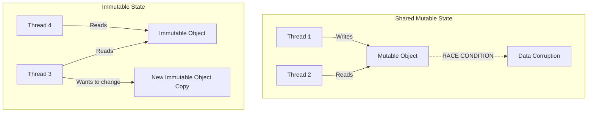

# Immutability

## Overview

Immutability is the principle that once an object is created, its state cannot be modified. If you need to change the data, you must create a new object with the new data. In modern Android engineering, immutability is the absolute bedrock of robust architecture. Without it, Jetpack Compose, Kotlin Coroutines, and Unidirectional Data Flow (UDF) simply do not work reliably.

## Why It Matters

Shared mutable state is the root of all evil in concurrent programming. If Thread A and Thread B have a reference to the same `User` object, and Thread A changes the user's name while Thread B is writing the user to a database, you have a race condition leading to data corruption or a crash.

In UI frameworks like Jetpack Compose, if a UI state object is mutated internally (e.g., changing a property without replacing the object), Compose has no idea the state changed, and the UI will not re-render. Immutability guarantees thread safety and predictable change observation.

## Historical Context

Rooted in functional programming languages (Lisp, Haskell). For decades, Object-Oriented Programming (Java/C++) glorified mutability: objects encapsulating internal state and changing it via setters (`user.setName("John")`). The shift back to immutability in mainstream languages was driven by the rise of multi-core processors (which made thread-safety critical) and reactive UI paradigms (React, Compose). Kotlin was designed with immutability as a first-class citizen (`val` vs `var`, `List` vs `MutableList`, data classes).

## First Principles

1.  **Read-Only:** An immutable object has no setters or mutating methods.
2.  **Thread Safety by Default:** If an object cannot be changed, it can be shared across 1,000 threads simultaneously without any locks, mutexes, or synchronization.
3.  **Predictability:** If a function takes an immutable object as an argument, the caller is guaranteed that the object will not be altered by the function. (No side effects).

## Mental Model

Think of a printed photograph versus a whiteboard.

- **Mutable (The Whiteboard):** You draw a diagram. Someone walks by and erases part of it while you aren't looking. You return and the diagram is ruined. You have to put a lock on the door (Synchronization) to stop people.
- **Immutable (The Photograph):** You print a photo of the diagram and hand copies to 10 people. None of them can change *your* photo. If they want a version with a mustache drawn on it, they must draw on *their own* copy. No locks are needed.

## Internal Mechanics

In Kotlin, immutability is enforced at the language level, but it requires discipline.

### The "Good" (Data Classes and Vals)

```kotlin
// 100% Immutable
data class UserProfile(
    val id: String,
    val name: String,
    val age: Int
)

val profile = UserProfile("123", "Alice", 30)
// To "mutate", use the copy() method to generate a new instance
val updatedProfile = profile.copy(age = 31) 
```

### The "Bad" (Hidden Mutability)

Just because a variable is a `val` doesn't mean the object it points to is immutable.

```kotlin
// DANGEROUS: The list is mutable, even though the variable is a 'val'
class ShoppingCart {
    val items = mutableListOf<String>() 
}

val cart = ShoppingCart()
cart.items.add("Apple") // The state just mutated. This is not thread-safe.
```

### The "Ugly" (Deep Mutability)

An object is only immutable if *all* its properties are immutable.

```kotlin
// FAKE IMMUTABILITY
data class Company(
    val name: String,
    val employees: MutableList<String> // <-- The poison pill
)

val google = Company("Google", mutableListOf("Alice", "Bob"))
val reference = google

// Thread B changes the internal list
google.employees.add("Charlie")

// Thread A is now looking at corrupted/changed data
println(reference.employees) // Prints [Alice, Bob, Charlie]
```

## Architecture



## Production Example

**Jetpack Compose State**

Compose relies entirely on object equality (`==`) to know when to redraw the screen (Recomposition). If you mutate an object internally, its memory address doesn't change, and Compose thinks nothing happened.

```kotlin
// BAD: Compose will NOT redraw when items are added.
class ViewState {
    var isLoading: Boolean = false
    val items = mutableListOf<String>()
}

// GOOD: Compose WILL redraw when state is updated via copy()
data class ImmutableViewState(
    val isLoading: Boolean = false,
    val items: List<String> = emptyList() // Read-only list
)

// In ViewModel
_state.value = _state.value.copy(
    isLoading = false,
    items = newItemsList
)
```

## Tradeoffs

**Advantages**
- **Zero Synchronization Overhead:** No `synchronized` blocks, no mutexes, no deadlocks.
- **Trivial Caching:** You can cache immutable objects forever without worrying that they will become stale or corrupted by another component.
- **Replayability:** In Redux/MVI architectures, because every state change produces a brand new object, you can keep a history of states and implement "Undo" or "Time Travel Debugging" trivially.

**Disadvantages**
- **Memory Allocation (GC Pressure):** If you are updating a complex object 60 times a second (e.g., moving a character on screen), creating a new copy of the object every frame puts massive pressure on the Garbage Collector, leading to jank.
- **Deep Copy Costs:** Copying a deeply nested object tree (`Company -> Department -> Employee -> Address`) just to change the Zip Code is computationally expensive.
- **Kotlin Standard Library Limitations:** Kotlin's `List` interface is read-only, not strictly immutable. Under the hood, it's often a Java `ArrayList`. If someone casts it back to `MutableList` via `(myList as MutableList<String>).add("Hacked")`, it will mutate. For strict immutability, external libraries like Kotlinx.Collections.Immutable are required.

## Failure Modes

- **The List Cast Exploit:** Exposing a `MutableList` as a `List` interface, thinking it is safe.
  ```kotlin
  class Repo {
      private val _cache = mutableListOf<String>()
      val cache: List<String> = _cache // Exposes as read-only
  }
  // Client code:
  val list = repo.cache
  (list as MutableList<String>).clear() // The client just wiped the Repo's internal cache!
  ```
  *(Fix: `val cache: List<String> get() = _cache.toList()` to create a defensive copy).*
- **Mutable Data Classes:** Using `var` inside a `data class`. `data class User(var name: String)`. This destroys the safety of the `copy()` mechanism and makes it useless as a key in a `HashMap` or a State object in Compose.
- **Over-allocation in tight loops:** Using `copy()` inside an $O(N)$ loop of 10,000 items. (Fix: Mutate locally inside a function, then freeze and return as immutable).

## Staff Engineer Thinking

When reviewing code, a Staff engineer hunts for hidden mutability:

1.  **Is the data class deeply immutable?** If `data class Document(val title: String, val metadata: HashMap<String, String>)` exists, the `metadata` map is a mutable time bomb. I will flag this in PR and ask for an immutable map.
2.  **Are we defensive copying at the boundary?** When taking a list from the network layer and passing it to the UI layer, are we ensuring no one retains a reference to the mutable builder array?
3.  **Is immutability causing performance issues?** If trace profiles show the UI thread dropping frames due to GC pauses, and the culprit is `copy()` spam on a massive state object, I will suggest splitting the monolithic state into smaller, independent immutable objects.

## Common Misconceptions

- **"Val means immutable."** No. `val` means *read-only reference*. You cannot reassign the variable to a new object. It says nothing about the object itself. You can mutate the contents of a `val list = ArrayList()`.
- **"Immutability is slow."** Usually false. While copying takes time, the JVM is highly optimized for short-lived object allocation and garbage collection. The time saved by avoiding thread-locking and the bugs prevented far outweigh the micro-costs of allocation.

## Probing Questions

1.  Explain the difference between `val` and true object immutability in Kotlin.
2.  Why is immutability a strict requirement for Unidirectional Data Flow (UDF) architectures?
3.  How does Jetpack Compose use immutability to determine if Recomposition is necessary?
4.  What is a "Defensive Copy," and when should you use it?
5.  Why is it dangerous to use a mutable object as a key in a `HashMap`?
6.  If you have a 10,000-item list and you need to change one item, copying the whole list is expensive. How do persistent data structures (like those in Kotlinx.Collections.Immutable) solve this? (Hint: Structural Sharing).
7.  Write a snippet of code demonstrating how a "read-only" Kotlin `List` can still be mutated via casting.
8.  How does immutability eliminate the need for `synchronized` blocks in multithreaded code?
9.  If creating new objects causes Garbage Collection (GC) pauses, when might you intentionally choose to use a mutable object instead of an immutable one?
10. Describe the impact of using `var` properties inside a Kotlin `data class`.

## Further Reading

- [`state-machines.md`](state-machines.md) — Immutability makes state transitions safe.
- [`../patterns/state.md`](../patterns/state.md) — The UI pattern that relies entirely on immutable states.
- Kotlinx Immutable Collections: [GitHub Repository](https://github.com/Kotlin/kotlinx.collections.immutable)
