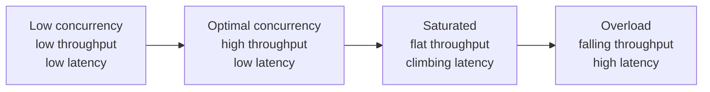
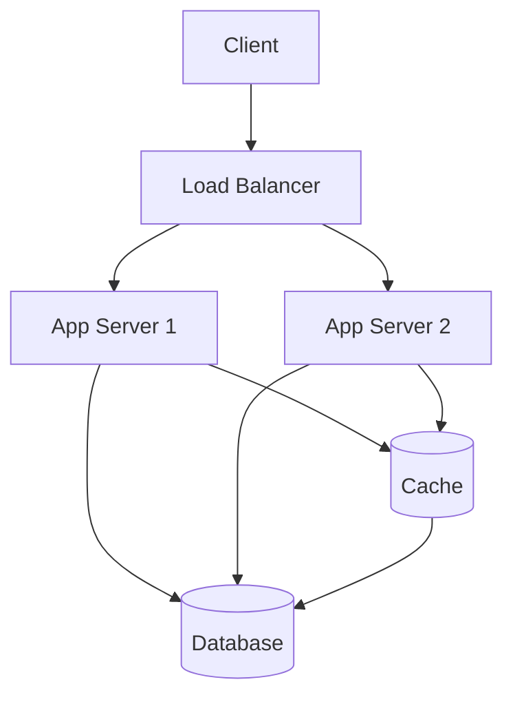

# Latency vs Throughput

## Overview

**Latency** is the time one operation takes from start to finish. **Throughput** is the number of operations completed per unit of time. They are different things measured in different units (latency in *time*, throughput in *count-per-time*), they are influenced by different design choices, and they often *trade against each other*. Mistaking one for the other — or assuming improving one automatically improves the other — is the most common analytical error in performance work.

---

## Why It Exists

Performance is multi-dimensional. A system that responds to a single request in 50 ms (low latency) might handle only 100 requests per second (low throughput). A system that responds to a request in 2 seconds (higher latency) might handle 100,000 requests per second (very high throughput). Neither is universally "better." The right answer depends on what the system is *for*.

What was broken before this distinction was treated explicitly: engineers optimized "performance" as a single number and made trade-offs without seeing them. A team would speed up a request handler — accidentally serializing it — and watch their throughput halve while celebrating the latency improvement. A team would batch operations for throughput and tank the user-facing latency.

These are the same operations, viewed two ways. Both views must be present in any serious performance conversation.

---

## Historical Context

The distinction is ancient in queueing theory (Little's Law, 1961) but became operationally important in computing in three waves:

1. **Batch computing (1960s-70s).** Throughput was everything. A job took as long as it took; what mattered was how many jobs the mainframe processed per day.
2. **Interactive computing (1980s onward).** Latency became the primary metric. A 200 ms response delay was noticeable to the user; throughput, while still important, was secondary.
3. **Distributed systems and SLOs (2000s onward).** Both metrics were tracked explicitly, often with percentile distributions rather than averages. Google's *The Tail at Scale* (2013) crystallized the idea that p99 latency matters as much as p50 because users experience the tail.

The arc: throughput-centric → latency-centric → percentile-aware. The current state of practice tracks both as distributions, not single numbers.

---

## First Principles

### Latency is time

Per-operation time. Measured in seconds, milliseconds, microseconds, nanoseconds. Has a *distribution* — not every request takes the same time. The distribution matters more than the mean. Common percentiles:

- **p50 (median):** half the requests are faster than this, half are slower.
- **p95:** 95% are faster; 5% are slower. The "common slow case."
- **p99:** 99% are faster; 1% are slower. The "tail."
- **p99.9:** the long tail. For high-traffic systems, 0.1% of requests is still a lot of requests.

### Throughput is rate

Operations per second (ops/sec, QPS, RPS, TPS). Measured by counting completed operations over a window. Like latency, it has a distribution over time — instantaneous throughput, sustained throughput, peak throughput.

### Little's Law connects them

For a stable system:

```
L = λ × W
```

Where:
- **L** = average number of operations in the system (concurrency)
- **λ** = throughput (operations arriving per unit time)
- **W** = average latency (time per operation)

This is one of the few exact, useful formulas in performance engineering. It says: if your throughput goes up and your latency stays the same, the number of concurrent operations in your system goes up. If your concurrency is capped (e.g., by a fixed thread pool), increasing throughput *must* decrease latency or the system saturates.

### Trade-offs

Most optimizations trade one for the other:

- **Batching:** trades latency (you wait for the batch) for throughput (one batched operation is cheaper than N individual ones).
- **Caching:** improves both for cache hits; degrades both for cache misses (lookup + miss + store).
- **Concurrency:** can improve throughput up to a point, then degrades latency due to contention.
- **Pipelining:** improves throughput; can either improve or worsen per-operation latency depending on contention.

---

## Mental Model

A car wash.

**Latency** is how long one car takes to go through the wash: drive in, soap, rinse, dry, drive out. Say 8 minutes per car.

**Throughput** is how many cars are washed per hour. If the car wash has 4 bays and each car takes 8 minutes, peak throughput is 30 cars/hour (4 bays × 60 min ÷ 8 min). Latency for any single car is still 8 minutes.

You can double throughput by adding bays: now 60 cars/hour, latency still 8 minutes per car.

You can reduce latency by streamlining the wash itself: now 4 minutes per car, throughput rises to 60 cars/hour even with the original 4 bays.

You can ruin throughput by adding a slow step that happens once per car ("the bay operator must approve each car after the wash"): the bay operator becomes the bottleneck regardless of how many bays you have.

This is the whole topic. Throughput is gated by the slowest sequential step. Latency is gated by the sum of all steps. They move differently.

---

## Internal Mechanics

### Latency components

A single operation's latency is usually a sum of components:

```
latency = queue_wait + processing_time + downstream_latency + network_round_trips
```

Most "latency optimization" work is identifying which component dominates and shrinking it.

```kotlin
// Example trace breakdown for a typical mobile API request:
//
// Queue wait (server-side):       2 ms
// Processing (in-handler):       18 ms
// Database query:                85 ms   <-- dominant
// Serialization:                  5 ms
// Network (round-trip):          40 ms
// -----------------------------------
// Total:                        150 ms
```

If you spend a week shaving 4 ms off serialization, the user notices nothing. If you cache the database query and turn 85 ms into 1 ms, the user feels it.

### Throughput limits

A system's throughput is bounded by its slowest sequential resource — the *bottleneck*. Common bottlenecks:

- **CPU:** the system runs out of compute.
- **Memory bandwidth:** allocations and GC pauses.
- **Disk I/O:** the storage layer can only serve so many reads per second.
- **Network bandwidth:** the pipe is full.
- **Lock contention:** threads queue on a critical section.
- **Downstream services:** a slow dependency limits how fast you can ask it.

Identifying the bottleneck is *the* throughput-optimization task. Speeding up anything that isn't the bottleneck doesn't help.

### Concurrency, latency, and saturation

Throughput rises with concurrency *up to saturation*. Beyond saturation, throughput plateaus (or drops, if contention costs become significant) and latency rises sharply.



The goal of capacity planning is to keep the system in the *Mid* zone — high throughput, predictable latency — and to set load-shedding thresholds before *Sat* tips into *Over*.

---

## Architecture

The system's architecture determines where latency accumulates and where throughput is capped.



In this typical architecture:

- **Cache hit:** ~1 ms latency, very high throughput (cache is in-memory).
- **Cache miss:** 50-100 ms latency (database query), throughput bounded by database capacity.
- **Throughput ceiling:** the database. Adding app servers won't help past that point.

A common scaling mistake is to add app servers when the database is the bottleneck. The right move is to reduce database load (caching, query optimization, read replicas).

---

## Production Example

- **Google search.** p50 ~200 ms, p99 measured in milliseconds, billions of queries per day. Latency comes from the user-facing front-end; throughput comes from massively parallel back-end fan-out and per-shard caching.
- **Netflix streaming.** Stream start latency (how fast playback begins) is the headline metric — sub-2-second start is the target. Throughput per CDN node is in the gigabits per second, but the user only cares about their own stream.
- **Stripe API.** Public SLO: 99% of API requests complete under 250 ms. Throughput is gated by the database; Stripe runs an enormous Postgres cluster with sharding and read replicas to keep latency low while throughput rises.
- **High-frequency trading.** Microsecond-level latency dominates everything. Throughput per second is modest; latency per order is everything.
- **Batch ETL pipelines (e.g., Snowflake nightly jobs).** Throughput is paramount; per-row latency is irrelevant.

The shared lesson: the right metric depends on the workload. A trading system optimized like an ETL pipeline would fail; an ETL pipeline optimized like a trading system would be absurdly expensive.

---

## Android Example

On Android, latency and throughput live at very different time scales than on the server.

**Frame budget:** 60 fps requires a frame every 16.6 ms. Each frame is a *latency budget*. Anything (layout, draw, decode) that exceeds 16 ms causes a dropped frame — jank. The user perceives 1-2 dropped frames as a glitch and 10+ as broken.

**Startup latency:** cold start should complete in 5 seconds; warm start in 2; hot resume in 1. These are latency SLOs visible to the user.

**Background throughput:** WorkManager batches jobs by network availability and charging state. The throughput of background uploads (e.g., a photo backup) is what users notice over hours and days; the latency of any individual upload is not user-facing.

```kotlin
// Latency-sensitive path: must finish in <16 ms
@Composable
fun ProfileScreen(user: User) {
    // Anything here runs every frame during recomposition
    Text(user.displayName)
}

// Throughput-sensitive path: doesn't matter when each item finishes
suspend fun uploadAllPhotos(photos: List<Photo>) {
    photos.chunked(10).forEach { batch ->
        batch.map { async { upload(it) } }.awaitAll()
    }
}
```

The optimization for each path is different. The first must be O(1) and allocation-free; the second can be O(N) with batching.

See [`../android/performance/jank.md`](../android/performance/jank.md), [`../mobile-system-design/app-startup.md`](../mobile-system-design/app-startup.md), [`../android/concurrency/workmanager.md`](../android/concurrency/workmanager.md).

---

## Tradeoffs

**Choosing to optimize latency**

- Pro: better user experience for interactive workloads.
- Pro: lower tail latencies improve perceived reliability.
- Con: usually costs throughput (less batching, more per-operation overhead).
- Con: usually costs hardware (more parallelism, less efficient resource use).

**Choosing to optimize throughput**

- Pro: lower hardware cost per operation.
- Pro: better fit for batch / offline workloads.
- Con: per-operation latency can be much higher.
- Con: users may notice batching artifacts.

**Hidden costs**

- Optimizing the mean latency while ignoring the tail. Most production incidents are tail latency, not mean.
- Measuring only at the server. The user's experience includes network round-trips and client rendering — server p50 of 50 ms can be a user experience of 500 ms.
- Tuning a system to one metric and not noticing that another regressed.

---

## Failure Modes

**Tail latency hides in averages.** Mean latency of 60 ms can hide a p99 of 2 seconds. Always look at the distribution. Alert on percentiles, not means.

**Throughput saturation under load.** As load approaches capacity, latency rises sharply (queues build up). Past capacity, throughput drops as the system thrashes. Mitigation: load shedding — explicit rejection of requests beyond capacity is better than implicit slowdown.

**Latency amplification under fan-out.** A request that hits 10 downstream services has tail latency dominated by the slowest of the 10. If each has p99 = 100 ms, the overall p99 is closer to 250-300 ms. Mitigation: parallel fanout; hedged requests; aggressive timeouts on the slowest paths.

**Coordinated omission in benchmarks.** Many benchmark tools measure latency only when they're not stalled. Real systems experience full queue wait time. Use load generators that pre-schedule requests and measure end-to-end time (e.g., wrk2, k6).

**Death spirals.** Slow requests hold resources, which slows the next request, which holds resources, etc. A small latency uptick can cascade into total saturation. Mitigation: circuit breakers ([`../patterns/circuit-breaker.md`](../patterns/circuit-breaker.md)), bulkheads, timeouts.

---

## Performance Considerations

The whole topic is performance. The framing tools:

- **Latency profile:** a histogram, not a number. Plot p50/p95/p99/p99.9. If you can only see one, see p99.
- **Throughput curve:** plot throughput vs offered load. The curve flattens at saturation; the inflection point is the operating limit.
- **Concurrency:** track the number of in-flight operations. Use Little's Law (`L = λ × W`) to sanity-check.
- **Bottleneck analysis:** which resource is at 100% when the system saturates? That's the bottleneck.

---

## Reliability Considerations

Latency and throughput interact with reliability:

- **Timeouts** must be set with the latency distribution in mind. A timeout below p99 will fail 1% of legitimate requests. A timeout above p99.9 fails to protect against pathological tail latency. The right value is usually p99 + headroom.
- **Retries** add load. Retrying every failed request can amplify a partial outage into a total one. Use bounded retries with backoff ([`../patterns/retry.md`](../patterns/retry.md)).
- **Capacity planning** is a throughput question. Reliability under load comes from being well *below* saturation in steady state.
- **Tail latency reduction** is a reliability technique. Hedged requests, request cancellation, and load shedding are all tail-latency tools.

---

## Security Considerations

Performance characteristics can leak information.

- **Timing side channels.** Different latencies for valid vs invalid inputs leak which is which. Use constant-time comparison for security-sensitive checks.
- **DoS amplification.** Operations that take much longer than they appear to (regex on attacker input, password hashing without rate limits) are DoS vectors.
- **Rate limiting.** Throughput limits are a security control. Per-user and per-IP rate limits protect the system from abuse.

---

## Observability

- **Per-endpoint latency histograms.** p50/p95/p99/p99.9 over rolling windows.
- **Throughput counters.** Per-endpoint requests-per-second.
- **Concurrency gauges.** In-flight requests, queue depth, dispatcher saturation.
- **Distributed traces.** A single trace shows per-component latency for one request. The histogram across traces shows the latency distribution.
- **Dashboards.** Latency percentile plots; throughput vs concurrency; saturation indicators.
- **Alerts.** p99 latency above SLO; throughput drop below baseline; concurrency above safe operating range.

Canonical: [`../observability/metrics.md`](../observability/metrics.md), [`../observability/slos.md`](../observability/slos.md), [`../observability/tracing.md`](../observability/tracing.md).

---

## Staff Engineer Thinking

**Set explicit SLOs for both.** A latency SLO without a throughput SLO is meaningless — you can hit any latency target by handling zero traffic. A throughput SLO without a latency one is dystopian — you can handle huge traffic by responding in 10 minutes. Both must exist; see [`../observability/slos.md`](../observability/slos.md).

**Look at the tail before the mean.** In any system with skewed latency (most production systems), the mean is a misleading summary. Build dashboards that show distributions, not averages. Train the team to ask "what's p99?" reflexively.

**Find the bottleneck before optimizing.** Speed-up of a non-bottleneck does not improve overall throughput. Use profiling and queueing analysis to identify the actual constraint; optimize there.

**Choose batch vs interactive consciously.** Many internal systems are reflexively designed as interactive (one-request-one-response) when they would benefit enormously from batch semantics. Conversely, user-facing systems are reflexively batched when the user perceives the delay. The choice is a Staff-level design decision.

**Tail latency is a leadership problem.** Reducing p99 latency is usually a cross-team effort — caching policy, network topology, code structure, capacity headroom. Owning that conversation across teams is a Staff responsibility.

---

## Common Misconceptions

**"Lower latency = higher throughput."** Sometimes (Little's Law: if concurrency is held constant, lower W means higher λ). But often not — a 10x lower-latency operation that requires 100x more resources per operation can lower system throughput.

**"Average latency is the right metric."** Almost never. Users experience the tail.

**"More machines = higher throughput."** Only if the bottleneck is the machines. If the database is the bottleneck, adding application servers does nothing.

**"Faster is always better."** Faster usually costs something — hardware, complexity, code clarity. The right framing is: faster *enough* to meet the SLO, no faster.

**"Batching is free."** Batching adds latency (you wait for the batch). Sometimes that's fine; sometimes it isn't.

---

## Probing Questions

1. Define p99 latency in your own words. Why does it matter more than the mean?
2. A system handles 1,000 requests per second with p50 = 50 ms. What's the average concurrency? (Apply Little's Law.)
3. Throughput drops as load increases past some point. Why?
4. A request that fans out to 5 services, each with p99 = 100 ms. Estimate the request's overall p99. Why is your estimate higher than 100 ms?
5. You have 100 ms latency budget for a screen. Network round-trip is 40 ms, deserialization is 8 ms, render is 12 ms. Where should you invest optimization effort?
6. Why does retrying every failed request risk amplifying a partial outage?
7. Compare and contrast: optimizing for a video-streaming service vs optimizing for a high-frequency trading system. What are the relevant metrics in each?
8. A team adds caching and sees mean latency drop. What might *not* have improved? Why?
9. Define a sensible timeout for an operation with p50 = 100 ms, p99 = 500 ms, p99.9 = 2 seconds. Justify.
10. How would you detect "coordinated omission" in a benchmark? Why does it matter?

---

## Answer Key

1. **Define p99 latency in your own words. Why does it matter more than the mean?**
   p99 is the time within which 99% of requests complete (1% are slower). It matters more than the mean because in high-traffic or fan-out systems, the long tail (p99) dictates the experience for a massive number of users, whereas the mean hides extreme outliers.
2. **A system handles 1,000 requests per second with p50 = 50 ms. What's the average concurrency? (Apply Little's Law.)**
   Using $L = \lambda \times W$, $1000 \text{ req/s} \times 0.05 \text{ seconds} = 50$ concurrent operations.
3. **Throughput drops as load increases past some point. Why?**
   The system reaches saturation, leading to extreme resource contention (CPU context switching, lock contention, GC thrashing), which degrades both latency and the rate of completed operations.
4. **A request that fans out to 5 services, each with p99 = 100 ms. Estimate the request's overall p99. Why is your estimate higher than 100 ms?**
   It will be higher because the parent request is gated by the *slowest* of the 5 calls. If each independently has a 1% chance of being slow, the chance that *at least one* is slow is much higher (~4.9%), meaning the overall p99 will be substantially worse than 100 ms.
5. **You have 100 ms latency budget for a screen. Network round-trip is 40 ms, deserialization is 8 ms, render is 12 ms. Where should you invest optimization effort?**
   Investigate the remaining 40 ms of unaccounted time first (queue wait, server processing, etc.). If you must pick from the listed ones, optimize the network (40ms), as it's the dominant component.
6. **Why does retrying every failed request risk amplifying a partial outage?**
   It effectively multiplies the load (throughput) on an already struggling system, turning a bottleneck into total saturation (a retry storm).
7. **Compare and contrast: optimizing for a video-streaming service vs optimizing for a high-frequency trading system. What are the relevant metrics in each?**
   Video streaming optimizes for high sustained throughput (gigabits/sec) and acceptable initial start latency. Trading optimizes for microsecond-level latency per operation, while throughput is secondary.
8. **A team adds caching and sees mean latency drop. What might *not* have improved? Why?**
   Tail latency (p99) might not have improved, because the 1% of cache misses still suffer the full downstream latency plus the new overhead of the cache lookup.
9. **Define a sensible timeout for an operation with p50 = 100 ms, p99 = 500 ms, p99.9 = 2 seconds. Justify.**
   Around 600-700 ms. Setting it above p99 protects 99% of valid requests, but setting it as high as p99.9 (2s) risks tying up client resources for too long on pathological outliers.
10. **How would you detect "coordinated omission" in a benchmark? Why does it matter?**
    Use a tool that measures full end-to-end time based on a fixed schedule (e.g., wrk2). It matters because coordinated omission hides real-world queueing delays by pausing the load generator when the system stalls, painting a falsely optimistic picture of latency.

---

## Further Reading

In this repository:

- [`sync-vs-async.md`](sync-vs-async.md) — async's primary benefit is throughput; latency is roughly unchanged.
- [`caching.md`](caching.md) — caching's primary benefit is latency *and* throughput, simultaneously.
- [`backpressure.md`](backpressure.md) — how systems behave when throughput is exceeded.
- [`queues.md`](queues.md) — queues smooth throughput at the cost of latency.
- [`../observability/slis.md`](../observability/slis.md), [`../observability/slos.md`](../observability/slos.md) — formal latency and throughput objectives.
- [`../observability/metrics.md`](../observability/metrics.md) — how to measure both correctly.
- [`../android/performance/jank.md`](../android/performance/jank.md), [`../mobile-system-design/app-startup.md`](../mobile-system-design/app-startup.md) — latency on the client.

External:

- Jeff Dean and Luiz Barroso, *The Tail at Scale*. CACM, 2013. The seminal paper on why p99 matters in distributed systems.
- Gil Tene, *How NOT to Measure Latency*. Conference talks on coordinated omission and percentile measurement.
- John Little's original 1961 paper on Little's Law. Surprisingly readable for a foundational queueing result.
