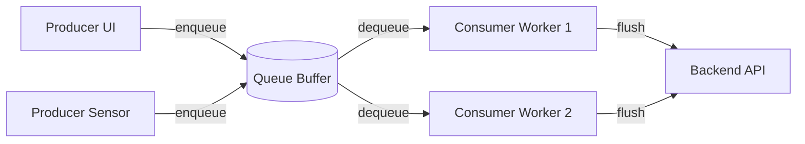

# Queues

## Overview

A queue holds items until processing. FIFO queues remove items in insertion order; priority and other queue implementations define different ordering. In mobile systems, buffering can absorb bursts and separate producers from consumers. Reliable offline execution additionally needs durable storage, scheduling, retry, acknowledgment and recovery policies.

## Why It Matters

Rapid user activity can create more concurrent work than the app can usefully process. Fifty taps do not necessarily exhaust a connection pool or crash the app; the risk depends on request cost and resource limits. Bound concurrent work and decide whether repeated Likes represent distinct commands or only the latest desired state.

By placing those 50 "Likes" into a queue, a single background worker can process them one by one at a safe, sustainable pace. Queues are the shock absorbers of software engineering.

## Historical Context

Queuing Theory is a branch of mathematics developed in 1909 by A.K. Erlang to manage telephone exchange traffic. In computer science, queues are the foundation of operating system task scheduling, network packet routing, and message brokers (Kafka, RabbitMQ). On Android, the OS itself is built on the `Looper` and `MessageQueue` which power the Main Thread.

## First Principles

1.  **Asynchronous Decoupling:** The entity adding to the queue (Producer) does not need to know when or how the entity reading from the queue (Consumer) will process the item.
2.  **Rate Limiting / Smoothing:** A bounded buffer can absorb a temporary arrival spike. If arrivals remain faster than completion, it eventually fills; the design must suspend, reject, coalesce or drop according to the operation contract.
3.  **Durability:** Committed disk-backed items can survive process death while app data remains. Eventual execution still depends on scheduling eligibility, connectivity, successful retries and recovery; uninstalling or clearing data removes local work.

## Mental Model

Think of the checkout line at a grocery store.
- **The Shoppers (Producers):** They arrive randomly and sometimes in massive groups (e.g., right before a storm).
- **The Cashier (Consumer):** They can only scan one item at a time.
- **The Line (The Queue):** Without the line, shoppers would crash into the cashier trying to pay all at once (System Crash). The line buffers the shoppers, enforcing order and protecting the cashier. If the line gets too long, you can open another register (Adding Consumer Threads).

## Internal Mechanics

A standard Queue requires two main operations: `enqueue` (add to the back) and `dequeue` (remove from the front). 

### 1. In-Memory Queues (Transitive)

Used for fast, temporary buffering. Destroyed if the app crashes or the OS kills the process.

```kotlin
// A thread-safe queue from the standard library
val eventQueue = ConcurrentLinkedQueue<Event>()

// Producer
fun onUserAction(event: Event) {
    eventQueue.offer(event) // Enqueue
}

// Consumer (Running on a background thread)
fun startProcessing() {
    while (true) {
        val event = eventQueue.poll() // Dequeue
        if (event != null) {
            process(event)
        } else {
            Thread.sleep(100) // Don't burn CPU if empty
        }
    }
}
```

*(Note: In modern Kotlin, `Channel` is the idiomatic coroutine-based queue, replacing manual `ConcurrentLinkedQueue` implementations).*

### 2. Disk-Backed Queues (Persistent)

Used for Offline-First architectures. Survives app death.

```kotlin
@Entity
data class SyncTask(
    @PrimaryKey val id: String = UUID.randomUUID().toString(),
    val payload: String,
    val timestamp: Long = System.currentTimeMillis()
)

@Dao
interface QueueDao {
    @Insert
    fun enqueue(task: SyncTask)
    
    // Peek only: the row remains until acknowledged. Concurrent workers need an atomic claim.
    @Query("SELECT * FROM SyncTask ORDER BY timestamp ASC LIMIT 1")
    fun peekOldest(): SyncTask?
    
    @Delete
    fun remove(task: SyncTask)
}
```

## Architecture



## Production Example

**Kotlin Coroutines: Channels**

A `Channel` is a thread-safe, non-blocking queue designed specifically for coroutines. It solves the "burn CPU when empty" problem of classic queues by suspending the consumer until an item is available.

```kotlin
class AnalyticsTracker(private val api: AnalyticsApi) {
    private val eventChannel = Channel<String>(capacity = 100)

    // One explicit caller owns this suspending consumer and handles its failure.
    suspend fun consume() {
        try {
            // api.send is a main-safe suspend API supplied by the application.
            for (event in eventChannel) api.send(event)
        } finally {
            // Cancellation or failure ends admission and discards pending data.
            eventChannel.cancel()
        }
    }

    // Best-effort analytics: the caller must handle false (full or closed).
    fun trackClick(buttonId: String): Boolean =
        eventChannel.trySend("Clicked $buttonId").isSuccess

    // Stop accepting new events; a live consumer can drain accepted events.
    fun close() { eventChannel.close() }
}
```

## Android Example

**The Main Thread (Looper/Handler)**

The UI thread processes scheduled callbacks through its `Looper` and `MessageQueue`. `view.post { doWork() }` schedules a Runnable for that thread; a direct UI-property assignment does not necessarily enqueue a separate message. Messages can be scheduled for future times, so this is not simply insertion-order FIFO.

A long-running callback blocks later work and can contribute to an ANR when an applicable responsiveness timeout is exceeded. Five seconds of work alone is not a universal ANR rule; the operation, target version and system conditions matter.

## Tradeoffs

**Advantages**
- **Concurrency Management:** Safely channels input from multiple threads into a single processing pipeline.
- **Resilience:** Disk-backed queues allow apps to function seamlessly without a network connection.
- **Batching:** A consumer can wait for the queue to reach 50 items and send them to the backend in one single, efficient API call rather than 50 separate calls.

**Disadvantages**
- **Stale Data:** If the queue backs up, an item might sit in the queue for hours. By the time it is processed, the backend data might have changed.
- **Complexity:** Disk-backed queues require complex retry logic, poison-pill handling (what if an item always crashes the consumer?), and conflict resolution.
- **Asynchronous outcomes:** Acceptance into a queue differs from completion. Expose pending, confirmed or failed outcomes as the product requires; optimistic UI is one choice, not a requirement of queues.

## Failure Modes

- **Poison message / redelivery loop:** A malformed durable item can fail repeatedly if it remains unacknowledged and is redelivered. Bound retries and quarantine or dead-letter permanent failures with diagnostics. An in-memory poll that already removed the item has different loss semantics; some systems use "poison pill" for an intentional shutdown sentinel, so document the term.
- **Queue overflow:** A bounded queue eventually fills under sustained overload. An unbounded queue such as ConcurrentLinkedQueue or Channel.UNLIMITED instead risks memory growth. Select blocking, suspension, rejection, coalescing or dropping explicitly; a bounded channel alone does not bound independently launched producers waiting to send. See [`backpressure.md`](backpressure.md).
- **The "Send-and-Pray" Disk Queue:** Putting items in a SQLite queue and relying on `WorkManager` to flush them. If the user uninstalls the app or clears app data before the network connects, the queue is destroyed and the data is permanently lost.

## Staff Engineer Thinking

When reviewing queue-based architectures, a Staff engineer asks:

1.  **What is the Dead Letter strategy?** If an item fails 5 times, where does it go? Does it block the queue? Does it silently drop? We need telemetry on dropped queue items to detect failing business logic.
2.  **Which ordering matters?** FIFO dequeue order does not guarantee completion order with concurrent workers. For per-conversation ordering, serialize processing within each conversation key while allowing independent keys to run concurrently; a global order requires a global serialization boundary or a protocol that reconstructs it.
3.  **Can we batch?** If we are queuing analytics events, we should not wake the radio for every event. The consumer should read 100 items from the queue and send a single JSON array payload.

## Common Misconceptions

- **"Queues and Stacks are the same thing."** No. Queues are FIFO (First-In, First-Out). Stacks are LIFO (Last-In, First-Out).
- **"Coroutines replace queues."** Coroutines execute work; channels can distribute queued items among receivers. SharedFlow instead broadcasts to subscribers and has different replay/overflow semantics, so it is not a drop-in competing-consumer work queue.

## Probing Questions

1.  How does an Android `Handler` interact with the `MessageQueue`?
2.  What is the difference between a `Queue` and a `Channel` in Kotlin?
3.  Explain the concept of a "Dead Letter Queue".
4.  When does offline-first work require a durable queue or outbox?
5.  If a queue has multiple consumers, what guarantees do you have about the execution order of the items?
6.  How does a Queue solve the problem of "Backpressure"?
7.  What happens in a Kotlin `Channel` if the Producer sends data but no Consumer is actively listening? (Discuss capacity and suspending).
8.  Describe a scenario where `BufferOverflow.DROP_OLDEST` is the correct strategy for a full queue.
9.  How would you design a SQLite-backed queue to efficiently allow batching of 50 items at a time?
10. What is a Priority Queue, and when would you use it over a standard FIFO queue in an Android app?

## Answer Key

1.  **How does an Android `Handler` interact with the `MessageQueue`?**
    A `Handler` enqueues messages or runnables into the thread's `MessageQueue`. The `Looper` continuously dequeues these items and dispatches them for execution on that thread.
2.  **What is the difference between a `Queue` and a `Channel` in Kotlin?**
    A standard `Queue` is typically blocking or non-suspending (like polling), whereas a `Channel` is designed for coroutines, offering suspending `send` and `receive` operations without blocking native threads.
3.  **Explain the concept of a "Dead Letter Queue".**
    A Dead Letter Queue (DLQ) is a secondary queue where messages are sent if they cannot be processed successfully after a certain number of retries (e.g., poison pills), preventing them from blocking the primary queue.
4.  **When does offline-first work require a durable queue or outbox?**
    Use a durable queue or outbox when accepted pending operations must survive process death. An offline-first reader may only need a local database/cache. Durable pending writes also need eligible scheduling, retry, acknowledgments and reconciliation; connectivity returning alone does not guarantee completion.
5.  **If a queue has multiple consumers, what guarantees do you have about the execution order of the items?**
    With concurrent consumers, FIFO dequeue order does not imply completion order. The queue and consumer protocol determine remaining guarantees; per-key serialization can preserve conversation order while independent keys run in parallel.
6.  **How does a Queue solve the problem of "Backpressure"?**
    A bounded queue provides a buffer that absorbs temporary spikes in producer rate, preventing the fast producer from immediately overwhelming a slower consumer. Once the queue is full, backpressure policies (like dropping or suspending) manage the overflow.
7.  **What happens in a Kotlin `Channel` if the Producer sends data but no Consumer is actively listening? (Discuss capacity and suspending).**
    Behavior depends on capacity and overflow policy. Rendezvous send suspends without a receiver; a bounded SUSPEND buffer admits values until full, then suspends. Unlimited buffering does not suspend for space; conflated or dropping configurations can discard values. trySend reports whether immediate admission succeeded rather than suspending.
8.  **Describe a scenario where `BufferOverflow.DROP_OLDEST` is the correct strategy for a full queue.**
    When streaming live location updates or real-time sensor data, where only the most recent data is relevant, and processing stale data is useless or detrimental.
9.  **How would you design a SQLite-backed queue to efficiently allow batching of 50 items at a time?**
    Select or atomically claim up to 50 eligible operations in a deterministic order, retain their stable IDs, and send them under a defined per-item or atomic-batch server contract. Acknowledge only confirmed successes in a local transaction. Handle partial responses and uncertain outcomes without deleting unconfirmed operations; concurrent workers need leases or transactional claims.
10. **What is a Priority Queue, and when would you use it over a standard FIFO queue in an Android app?**
    A Priority Queue orders elements based on priority rather than FIFO. Use it when some tasks are more critical than others, such as processing user-initiated actions before background sync tasks.

## Further Reading

- [`backpressure.md`](backpressure.md) — What happens when the queue fills up.
- [`../patterns/command.md`](../patterns/command.md) — The objects that are typically placed *inside* the queue.
- [`../reference-architectures/offline-first-app.md`](../reference-architectures/offline-first-app.md) — The ultimate application of disk-backed queues.

### Official verification references

The corrections in this chapter were checked against the following primary references.

- [docs.oracle.com: Queue.html](https://docs.oracle.com/en/java/javase/21/docs/api/java.base/java/util/Queue.html)
- [developer.android.com: offline-first](https://developer.android.com/topic/architecture/data-layer/offline-first)
- [developer.android.com: coroutines-best-practices](https://developer.android.com/kotlin/coroutines/coroutines-best-practices)
- [kotlinlang.org: -channel](https://kotlinlang.org/api/kotlinx.coroutines/kotlinx-coroutines-core/kotlinx.coroutines.channels/-channel/)
- [www.sqlite.org: lang_transaction.html](https://www.sqlite.org/lang_transaction.html)
- [developer.android.com: Handler](https://developer.android.com/reference/android/os/Handler)
- [developer.android.com: diagnose-and-fix-anrs](https://developer.android.com/topic/performance/anrs/diagnose-and-fix-anrs)
- [www.rabbitmq.com: queues](https://www.rabbitmq.com/docs/queues)
- [www.rabbitmq.com: dlx](https://www.rabbitmq.com/docs/dlx)
- [docs.oracle.com: ConcurrentLinkedQueue.html](https://docs.oracle.com/en/java/javase/21/docs/api/java.base/java/util/concurrent/ConcurrentLinkedQueue.html)
- [docs.aws.amazon.com: using-messagegroupid-property.html](https://docs.aws.amazon.com/AWSSimpleQueueService/latest/SQSDeveloperGuide/using-messagegroupid-property.html)
- [kotlinlang.org: -shared-flow](https://kotlinlang.org/api/kotlinx.coroutines/kotlinx-coroutines-core/kotlinx.coroutines.flow/-shared-flow/)
- [github.com: transactional-outbox-pattern](https://github.com/aws-samples/transactional-outbox-pattern)
