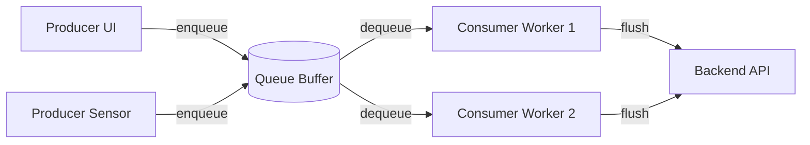

# Queues

## Overview

A Queue is a fundamental data structure and architectural pattern that processes items in a First-In-First-Out (FIFO) manner. In mobile engineering, queues are the primary mechanism for smoothing out unpredictable spikes in user activity, decoupling producers from consumers, and guaranteeing the execution of tasks across unreliable networks (Offline-First).

## Why It Matters

Mobile processors and networks are easily overwhelmed. If a user rapidly taps a "Like" button 50 times in 3 seconds, launching 50 concurrent network requests will exhaust the connection pool, spike the CPU, and crash the app with an `OutOfMemoryError`. 

By placing those 50 "Likes" into a queue, a single background worker can process them one by one at a safe, sustainable pace. Queues are the shock absorbers of software engineering.

## Historical Context

Queuing Theory is a branch of mathematics developed in 1909 by A.K. Erlang to manage telephone exchange traffic. In computer science, queues are the foundation of operating system task scheduling, network packet routing, and message brokers (Kafka, RabbitMQ). On Android, the OS itself is built on the `Looper` and `MessageQueue` which power the Main Thread.

## First Principles

1.  **Asynchronous Decoupling:** The entity adding to the queue (Producer) does not need to know when or how the entity reading from the queue (Consumer) will process the item.
2.  **Rate Limiting / Smoothing:** Queues act as a buffer. Producers can spike to 10,000 items/sec, but the Consumer can safely process them at 10 items/sec.
3.  **Durability:** If the queue is backed by disk (e.g., SQLite), the items survive process death, ensuring guaranteed eventual execution.

## Mental Model

Think of the checkout line at a grocery store.
- **The Shoppers (Producers):** They arrive randomly and sometimes in massive groups (e.g., right before a storm).
- **The Cashier (Consumer):** They can only scan one item at a time.
- **The Line (The Queue):** Without the line, shoppers would crash into the cashier trying to pay all at once (System Crash). The line buffers the shoppers, enforcing order and protecting the cashier. If the line gets too long, you can open another register (Adding Consumer Threads).

## Internal Mechanics

A standard Queue requires two main operations: `enqueue` (add to the back) and `dequeue` (remove from the front). 

### 1. In-Memory Queues (Transitive)

Used for fast, temporary buffering. Destroyed if the app crashes or the OS kills the process.

```kotlin
// A thread-safe queue from the standard library
val eventQueue = ConcurrentLinkedQueue<Event>()

// Producer
fun onUserAction(event: Event) {
    eventQueue.offer(event) // Enqueue
}

// Consumer (Running on a background thread)
fun startProcessing() {
    while (true) {
        val event = eventQueue.poll() // Dequeue
        if (event != null) {
            process(event)
        } else {
            Thread.sleep(100) // Don't burn CPU if empty
        }
    }
}
```

*(Note: In modern Kotlin, `Channel` is the idiomatic coroutine-based queue, replacing manual `ConcurrentLinkedQueue` implementations).*

### 2. Disk-Backed Queues (Persistent)

Used for Offline-First architectures. Survives app death.

```kotlin
@Entity
data class SyncTask(
    @PrimaryKey val id: String = UUID.randomUUID().toString(),
    val payload: String,
    val timestamp: Long = System.currentTimeMillis()
)

@Dao
interface QueueDao {
    @Insert
    fun enqueue(task: SyncTask)
    
    // Dequeue: Get the oldest task
    @Query("SELECT * FROM SyncTask ORDER BY timestamp ASC LIMIT 1")
    fun peekOldest(): SyncTask?
    
    @Delete
    fun remove(task: SyncTask)
}
```

## Architecture



## Production Example

**Kotlin Coroutines: Channels**

A `Channel` is a thread-safe, non-blocking queue designed specifically for coroutines. It solves the "burn CPU when empty" problem of classic queues by suspending the consumer until an item is available.

```kotlin
class AnalyticsTracker(private val api: AnalyticsApi) {
    
    // A queue with a buffer of 100 items
    private val eventChannel = Channel<String>(capacity = 100)

    init {
        // The Consumer coroutine
        CoroutineScope(Dispatchers.IO).launch {
            // Suspends when empty, resumes when items arrive
            for (event in eventChannel) { 
                api.send(event)
            }
        }
    }

    // The Producer (called from UI thread)
    fun trackClick(buttonId: String) {
        CoroutineScope(Dispatchers.Default).launch {
            eventChannel.send("Clicked $buttonId")
        }
    }
}
```

## Android Example

**The Main Thread (Looper/Handler)**

Every time you update a `TextView` or handle an `onClick`, you are interacting with a Queue. 

The Android UI thread is powered by a `Looper`, which loops infinitely over a `MessageQueue`. When you call `view.post { doWork() }`, the `Handler` enqueues your `Runnable` into the `MessageQueue`. The Main Thread dequeues it and executes it. If you enqueue a `Runnable` that takes 5 seconds, the Main Thread is blocked, the queue backs up, and the app ANRs.

## Tradeoffs

**Advantages**
- **Concurrency Management:** Safely channels input from multiple threads into a single processing pipeline.
- **Resilience:** Disk-backed queues allow apps to function seamlessly without a network connection.
- **Batching:** A consumer can wait for the queue to reach 50 items and send them to the backend in one single, efficient API call rather than 50 separate calls.

**Disadvantages**
- **Stale Data:** If the queue backs up, an item might sit in the queue for hours. By the time it is processed, the backend data might have changed.
- **Complexity:** Disk-backed queues require complex retry logic, poison-pill handling (what if an item always crashes the consumer?), and conflict resolution.
- **Loss of Synchronicity:** Once a producer drops an item in a queue, it cannot easily get a "return value" back. The UI must be optimistically updated.

## Failure Modes

- **The Poison Pill:** A malformed payload is placed in the queue. The Consumer dequeues it, tries to parse it, crashes, and restarts. The item is still in the queue. The Consumer reads it again, crashes again. The queue is permanently blocked. *(Fix: Consumers must wrap processing in `try/catch` and discard or move failed items to a "Dead Letter Queue" after max retries).*
- **Queue Overflow:** A Channel or in-memory queue has a fixed capacity. If the Producer is producing at 100/sec and the Consumer is processing at 10/sec, the queue fills up. Does the Producer block? Do new items overwrite old items (`BufferOverflow.DROP_OLDEST`)? This must be explicitly designed. See [`backpressure.md`](backpressure.md).
- **The "Send-and-Pray" Disk Queue:** Putting items in a SQLite queue and relying on `WorkManager` to flush them. If the user uninstalls the app or clears app data before the network connects, the queue is destroyed and the data is permanently lost.

## Staff Engineer Thinking

When reviewing queue-based architectures, a Staff engineer asks:

1.  **What is the Dead Letter strategy?** If an item fails 5 times, where does it go? Does it block the queue? Does it silently drop? We need telemetry on dropped queue items to detect failing business logic.
2.  **Is the queue strictly ordered?** In a chat app, messages *must* be processed in order. If Consumer 1 grabs Message A, and Consumer 2 grabs Message B, and Consumer 2 finishes the network request first, the messages appear out of order on the server. If order matters, you can only have *one* concurrent consumer.
3.  **Can we batch?** If we are queuing analytics events, we should not wake the radio for every event. The consumer should read 100 items from the queue and send a single JSON array payload.

## Common Misconceptions

- **"Queues and Stacks are the same thing."** No. Queues are FIFO (First-In, First-Out). Stacks are LIFO (Last-In, First-Out).
- **"Coroutines replace Queues."** False. Coroutines are the execution mechanism. They heavily *utilize* queues (like `Channel` or `SharedFlow`) to pass data safely between themselves.

## Probing Questions

1.  How does an Android `Handler` interact with the `MessageQueue`?
2.  What is the difference between a `Queue` and a `Channel` in Kotlin?
3.  Explain the concept of a "Dead Letter Queue".
4.  Why is a disk-backed queue mandatory for an offline-first mobile architecture?
5.  If a queue has multiple consumers, what guarantees do you have about the execution order of the items?
6.  How does a Queue solve the problem of "Backpressure"?
7.  What happens in a Kotlin `Channel` if the Producer sends data but no Consumer is actively listening? (Discuss capacity and suspending).
8.  Describe a scenario where `BufferOverflow.DROP_OLDEST` is the correct strategy for a full queue.
9.  How would you design a SQLite-backed queue to efficiently allow batching of 50 items at a time?
10. What is a Priority Queue, and when would you use it over a standard FIFO queue in an Android app?

## Further Reading

- [`backpressure.md`](backpressure.md) — What happens when the queue fills up.
- [`../patterns/command.md`](../patterns/command.md) — The objects that are typically placed *inside* the queue.
- [`../reference-architectures/offline-first-app.md`](../reference-architectures/offline-first-app.md) — The ultimate application of disk-backed queues.
