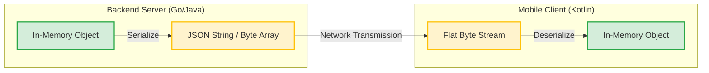

# Serialization

## Overview

Serialization is the process of converting complex in-memory data structures (like objects or object graphs) into a flat sequence of bytes so they can be transmitted across a network, saved to a disk, or passed between processes. Deserialization is the reverse process.

In mobile engineering, you cannot send a Kotlin `User` object directly to a Ruby backend. You must serialize it into a universal format (like JSON or Protocol Buffers) first.

## Why It Matters

Mobile apps are inherently disconnected from their data sources. Almost every single piece of data displayed on a screen must first be serialized by the backend, transmitted over the radio, and deserialized by the mobile client. 

If your serialization mechanism is slow, the app drops frames while parsing network responses. If your serialization format is bloated, the user burns through their mobile data cap and waits longer for data to load. If your deserialization logic is brittle, a backend engineer adding a new field will crash your app.

## Historical Context

In the early days of computing, custom binary formats were the norm. Later, XML (Extensible Markup Language) dominated Enterprise architectures (SOAP). It was human-readable but incredibly verbose and slow to parse. JSON (JavaScript Object Notation) replaced XML as the de facto standard for REST APIs because it is lighter and native to web browsers. Today, hyper-efficient binary formats like Protocol Buffers (gRPC) and FlatBuffers are increasingly used for high-performance mobile APIs.

## First Principles

1.  **Translation:** Serialization translates language-specific memory structures into language-agnostic data formats.
2.  **Size vs. Readability:** Text-based formats (JSON) are easy for humans to debug but consume more bytes. Binary formats (Protobuf) are unreadable without a schema but are incredibly compact and fast.
3.  **Forward/Backward Compatibility:** The schema will change. Old mobile apps must not crash when receiving new data structures from the backend.

## Mental Model

Think of moving a fully assembled Lego castle to a new house.
- You can't fit the castle through the door or into the moving box (Cannot send objects over the network).
- You take the castle apart into individual bricks and write down the instructions on how to rebuild it (**Serialization**).
- You pack the bricks and instructions into a box and put it in a truck (**Transmission**).
- At the new house, you open the box and use the instructions to rebuild the exact same castle (**Deserialization**).

## Internal Mechanics

### 1. JSON (Moshi / Kotlinx.serialization)

The most common format. Relies on reflection or compile-time code generation to map JSON keys to Kotlin properties.

```kotlin
// Data Class
@Serializable
data class User(
    val id: String,
    @SerialName("full_name") val fullName: String, // Map JSON key to Kotlin variable
    val age: Int? = null // Optional fields are critical for compatibility
)

// The JSON string payload
val jsonString = """{"id": "123", "full_name": "Alice"}"""

// Deserialization
val user: User = Json.decodeFromString(jsonString)
```

### 2. Binary Formats (Protocol Buffers)

Instead of sending `{"id": 123}`, which takes 10 bytes (characters) to represent a simple integer ID, Protocol Buffers send pure binary. The schema must be defined in a `.proto` file shared between backend and mobile.

```protobuf
// user.proto
message User {
  string id = 1;
  string full_name = 2;
  int32 age = 3;
}
```
The compiler generates Kotlin/Java classes from this file. The resulting payload over the wire is stripped of all keys (`"full_name"` is not sent, only the data and the index `2` are sent), making it magnitudes smaller.

## Architecture



## Production Example

**IPC (Inter-Process Communication) on Android**

Serialization isn't just for networking; it's how Android components talk to each other. When you pass data between Activities via an `Intent`, it crosses process boundaries (via the Android Binder). The data must be serialized.

Historically, Android used `Serializable` (standard Java, uses slow reflection). The production solution is `Parcelable`.

```kotlin
@Parcelize // Kotlin compiler plugin generates the serialization code
data class UserProfile(
    val id: String,
    val username: String
) : Parcelable

// Serialization: The OS flattens the object into a Parcel
val intent = Intent(context, ProfileActivity::class.java).apply {
    putExtra("USER_DATA", userProfile) 
}

// Deserialization: The new Activity reconstructs the object
val profile = intent.getParcelableExtra<UserProfile>("USER_DATA")
```

## Tradeoffs

**JSON via Gson/Moshi/Kotlinx**
- *Advantages:* Universally understood. Easy to debug via Charles Proxy/Wireshark.
- *Disadvantages:* Bloated payloads. Parsing requires string manipulation and sometimes reflection, which is CPU intensive.

**Protocol Buffers (Protobuf/gRPC)**
- *Advantages:* Extremely small payloads. Blazing fast parsing (it's just reading byte offsets). Strong typing guaranteed across backend and mobile.
- *Disadvantages:* Human unreadable. Requires complex build-step integration to compile `.proto` files.

**Java `Serializable` vs Android `Parcelable`**
- *Serializable:* Zero boilerplate, but uses massive amounts of reflection. Causes GC thrashing and ANRs if passing large objects.
- *Parcelable:* Highly optimized for Android IPC memory limits.

## Failure Modes

- **The Strict Parser Crash:** The backend adds a new field `{"is_premium": true}` to the JSON response. The mobile JSON parser (e.g., Gson) encounters an unknown key and throws an exception, crashing the app. *Parsers must be configured to ignore unknown keys for forward compatibility.*
- **Implicit Nulls:** The backend drops a field from the JSON. The Kotlin parser creates the object using reflection and leaves a non-nullable Kotlin `String` as `null` in memory. The moment the app touches it, a `NullPointerException` brings the app down.
- **The Parcelable TransactionTooLargeException:** Serializing a 2MB image or a massive list of data into an Intent. The Android Binder has a strict ~1MB limit per process. Passing massive serialized objects between activities crashes the app. (Fix: Pass IDs and load data from a shared Repository).

## Staff Engineer Thinking

When designing an API contract or data architecture, a Staff engineer asks:

1.  **Do we own both ends?** If we own the backend and the mobile app, and the data payloads are massive (like a real-time multiplayer game), JSON is a massive waste of resources. We should mandate Protocol Buffers or FlatBuffers.
2.  **Is code generation optimal?** Reflection-based parsers (Gson) are slow at runtime. Code-generation parsers (Moshi with codegen, Kotlinx.Serialization) are fast at runtime but increase build times. For massive apps, the runtime speed is usually prioritized.
3.  **Are we over-serializing?** If a feature requires storing a complex data structure locally just to retrieve it exactly as-is later (e.g., caching a raw API response), it might be faster to just save the raw JSON string to disk rather than deserializing it to an object, saving it to a relational SQLite database, reading it back, and reconstructing the object.

## Common Misconceptions

- **"JSON is an object."** False. JSON is a String. It only becomes an object after your CPU spends millions of cycles parsing it.
- **"Serialization is fast enough that it doesn't matter."** False. Deserializing a 500kb JSON payload on the Main Thread is a guaranteed way to drop 10-20 frames and cause visible UI stutter. Always deserialize on a background thread (`Dispatchers.IO`).

## Probing Questions

1.  Why is Android's `Parcelable` significantly faster than Java's `Serializable`?
2.  Explain the concept of Forward Compatibility in JSON parsing. How do you prevent an old app from crashing when a new field is added?
3.  What are Protocol Buffers, and why do they generate significantly smaller network payloads than JSON?
4.  Why must you never pass a massive serialized object (like a Bitmap) between Activities via an Intent? What is the architectural solution?
5.  What is the difference between Reflection-based serialization (e.g., standard Gson) and Code-Generation serialization (e.g., Kotlinx.serialization)?
6.  If a JSON payload omits a field that is defined as non-nullable in your Kotlin `data class`, what happens during deserialization? How do you defend against this?
7.  Explain the tradeoffs of caching raw serialized JSON strings vs caching parsed domain objects in a local database.
8.  How does a tool like Charles Proxy intercept and display HTTPS traffic, and why is this harder to do if you use Protocol Buffers instead of JSON?
9.  What is FlatBuffers, and how does its "zero-copy" deserialization differ from standard Protobufs or JSON?
10. Describe the impact of performing JSON deserialization on the Main Thread vs the IO Thread.

## Answer Key

1. **Why is Android's `Parcelable` significantly faster than Java's `Serializable`?**
   `Serializable` relies on heavy Java reflection to inspect object graphs at runtime, whereas `Parcelable` requires explicit, compiled code to write/read specific fields directly to a memory buffer.
2. **Explain the concept of Forward Compatibility in JSON parsing. How do you prevent an old app from crashing when a new field is added?**
   Forward compatibility means an older client can handle newer data structures. You prevent crashes by configuring your JSON parser (e.g., Moshi) to explicitly ignore unknown keys rather than throwing an exception.
3. **What are Protocol Buffers, and why do they generate significantly smaller network payloads than JSON?**
   Protobuf is a binary serialization format. It is smaller because it omits text-based keys entirely, transmitting only the raw binary data alongside a numeric index defined by a shared `.proto` schema.
4. **Why must you never pass a massive serialized object (like a Bitmap) between Activities via an Intent? What is the architectural solution?**
   Intents pass through the OS Binder, which has a strict ~1MB limit per process; exceeding it causes a `TransactionTooLargeException` crash. The solution is to pass a lightweight ID and read the data from a shared cache or Repository.
5. **What is the difference between Reflection-based serialization (e.g., standard Gson) and Code-Generation serialization (e.g., Kotlinx.serialization)?**
   Reflection parses objects dynamically at runtime, which is CPU intensive. Code-generation creates static parsing code at compile time, resulting in much faster runtime performance at the cost of slightly longer build times.
6. **If a JSON payload omits a field that is defined as non-nullable in your Kotlin `data class`, what happens during deserialization? How do you defend against this?**
   Depending on the parser, it may crash immediately (Moshi) or silently leave a null in a non-nullable field via reflection/Unsafe (Gson), causing a delayed NullPointerException. Defend by defining optional fields with nullable types (`?`) or providing default values.
7. **Explain the tradeoffs of caching raw serialized JSON strings vs caching parsed domain objects in a local database.**
   Caching raw JSON avoids repeated serialization/deserialization CPU costs if you just need to return the exact response later, but it makes querying individual fields impossible. Caching domain objects in a structured DB (like Room) allows complex queries but requires more upfront processing.
8. **How does a tool like Charles Proxy intercept and display HTTPS traffic, and why is this harder to do if you use Protocol Buffers instead of JSON?**
   Charles acts as a Man-in-the-Middle by replacing SSL certificates. It's harder with Protobufs because the intercepted binary payload is unreadable without the specific `.proto` schema file to decode it.
9. **What is FlatBuffers, and how does its "zero-copy" deserialization differ from standard Protobufs or JSON?**
   FlatBuffers allows accessing serialized data directly from the byte buffer without parsing it into intermediate objects in memory, skipping the CPU and memory allocation costs entirely.
10. **Describe the impact of performing JSON deserialization on the Main Thread vs the IO Thread.**
    Deserializing a large payload on the Main Thread blocks the UI, causing frame drops (jank) or ANRs. Deserializing on the IO Thread frees the Main Thread to maintain 60fps animations while the data is processed.

---

## Further Reading

- [`../patterns/command.md`](../patterns/command.md) — Commands must be serializable to be queued for offline execution.
- [`../android/architecture/savedstatehandle.md`](../android/architecture/savedstatehandle.md) *(Pending)* — How Android serializes ViewModel state to survive process death.
- Google Developers: [Parcelables and Bundles](https://developer.android.com/guide/components/activities/parcelables-and-bundles)
