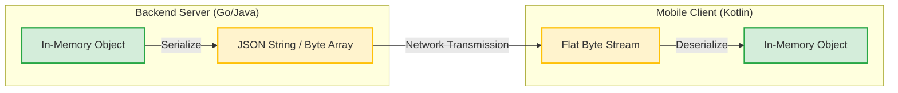

# Serialization

## Overview

Serialization is the process of converting complex in-memory data structures (like objects or object graphs) into a flat sequence of bytes so they can be transmitted across a network, saved to a disk, or passed between processes. Deserialization is the reverse process.

When a Kotlin client exchanges data with a Ruby backend, both sides need an agreed wire representation, such as JSON or Protocol Buffers. They must also agree on field meaning and evolution; serialization preserves the chosen data representation, not arbitrary object identity or executable behavior.

## Why It Matters

Mobile apps are inherently disconnected from their data sources. Almost every single piece of data displayed on a screen must first be serialized by the backend, transmitted over the radio, and deserialized by the mobile client. 

Parsing large responses on the UI thread can delay rendering. Payload size affects transfer and storage costs. Compatibility depends on the schema and parser policy: adding a field is safe for some readers and rejected by others, so test old-reader/new-writer combinations.

## Historical Context

In the early days of computing, custom binary formats were the norm. Later, XML (Extensible Markup Language) dominated Enterprise architectures (SOAP). It was human-readable but incredibly verbose and slow to parse. JSON (JavaScript Object Notation) replaced XML as the de facto standard for REST APIs because it is lighter and native to web browsers. Today, hyper-efficient binary formats like Protocol Buffers (gRPC) and FlatBuffers are increasingly used for high-performance mobile APIs.

## First Principles

1.  **Translation:** Serialization translates language-specific memory structures into language-agnostic data formats.
2.  **Representation trade-off:** JSON is textual and can be inspected without a binary decoder. Binary formats can save space or parsing work for suitable data, but compactness and speed depend on schema, values, compression and implementation. Measure the actual payload.
3.  **Forward/Backward Compatibility:** The schema will change. Old mobile apps must not crash when receiving new data structures from the backend.

## Mental Model

Think of moving a fully assembled Lego castle to a new house.
- You can't fit the castle through the door or into the moving box (Cannot send objects over the network).
- You take the castle apart into individual bricks and write down the instructions on how to rebuild it (**Serialization**).
- You pack the bricks and instructions into a box and put it in a truck (**Transmission**).
- At the new house, you open the box and use the instructions to rebuild the exact same castle (**Deserialization**).

## Internal Mechanics

### 1. JSON (Moshi / Kotlinx.serialization)

The most common format. Relies on reflection or compile-time code generation to map JSON keys to Kotlin properties.

```kotlin
// Data Class
@Serializable
data class User(
    val id: String,
    @SerialName("full_name") val fullName: String, // Map JSON key to Kotlin variable
    val age: Int? = null // Optional fields are critical for compatibility
)

// The JSON string payload
val jsonString = """{"id": "123", "full_name": "Alice"}"""

// Deserialization
val user: User = Json.decodeFromString(jsonString)
```

### 2. Binary Formats (Protocol Buffers)

Instead of sending `{"id": 123}`, which takes 10 bytes (characters) to represent a simple integer ID, Protocol Buffers send pure binary. The schema must be defined in a `.proto` file shared between backend and mobile.

```protobuf
// user.proto
message User {
  string id = 1;
  string full_name = 2;
  int32 age = 3;
}
```
The compiler generates classes and builders from the schema. Protobuf binary fields carry a field number and wire type rather than textual field names. Strings, lengths and other data still occupy bytes; size savings depend on the message and comparison format, rather than a fixed orders-of-magnitude guarantee.

## Architecture



## Production Example

**IPC (Inter-Process Communication) on Android**

Android also flattens values for Binder transactions and Activity intents, including Activity launches within one app. Parcelable is designed for Android IPC and transient state; Parcel bytes are not a supported general-purpose disk or network format.

Java Serializable and Android Parcelable have different contracts and implementations. Parcelable defines how fields are written to and restored from a Parcel; `@Parcelize` generates that code. Java serialization supports object graphs and customization. Avoid universal speed claims and benchmark representative data when the choice affects performance.

```kotlin
@Parcelize // Kotlin compiler plugin generates the serialization code
data class UserProfile(
    val id: String,
    val username: String
) : Parcelable

// Serialization: The OS flattens the object into a Parcel
val intent = Intent(context, ProfileActivity::class.java).apply {
    putExtra("USER_DATA", userProfile) 
}

// Deserialization: The new Activity reconstructs the object
val profile = intent.getParcelableExtra<UserProfile>("USER_DATA")
```

## Tradeoffs

**JSON via Gson/Moshi/Kotlinx**
- *Advantages:* Universally understood. Easy to debug via Charles Proxy/Wireshark.
- *Disadvantages:* Bloated payloads. Parsing requires string manipulation and sometimes reflection, which is CPU intensive.

**Protocol Buffers (Protobuf/gRPC)**
- *Advantages:* Numeric field tags and typed generated APIs can reduce representation overhead and support schema-aware tooling. The wire format includes tags, variable-length values and lengths; parsing is not simply reading fixed byte offsets, and a schema cannot guarantee business correctness.
- *Disadvantages:* Human unreadable. Requires complex build-step integration to compile `.proto` files.

**Java `Serializable` vs Android `Parcelable`**
- *Serializable:* The marker interface can be convenient for supported object graphs; custom handling, class compatibility and runtime cost still need consideration. Large graphs may allocate heavily, but GC thrashing or ANRs are not inevitable.
- *Parcelable:* An Android IPC representation with generated or manual field handling. It does not remove Binder transaction-size constraints and should not be used as a long-term persistence format.

## Failure Modes

- **Unknown-field policy:** Gson normally skips unknown object fields, and Moshi normally ignores them unless configured to fail. Kotlinx Json rejects unknown keys by default; configure `ignoreUnknownKeys` where additive-field compatibility is intended. Test the exact adapter and schema rather than assuming every parser is strict.
- **Missing, null and unsafe reflection:** Behavior depends on the adapter. Kotlinx generated serializers reject missing required properties under their default policy; nullable without a default is still required with the default explicitNulls setting. Reflective Gson may create values that violate Kotlin nullability, so validate its output or use a Kotlin-aware adapter. Defaults handle omission only where the serializer contract defines them.
- **Oversized Binder transactions:** Binder has a currently documented 1 MB transaction buffer shared by transactions in progress for a process. A large payload, or concurrent smaller transactions, can exceed available capacity. The resulting failure depends on the calling API and handling; it is not automatically an app crash. Prefer small IDs or handles and load bulk data from a suitable store.

## Staff Engineer Thinking

When designing an API contract or data architecture, a Staff engineer asks:

1.  **What do measurements and compatibility require?** Owning both ends allows schema and transport changes, but does not mandate Protobuf or FlatBuffers. Compare actual transfer size, parse/access cost, evolution, tooling and operational support before changing formats.
2.  **Which adapter runs in production?** Code generation can avoid runtime reflective field discovery; reflection can reduce generated-code setup. Actual speed, code size and build impact depend on models and adapters. Benchmark before treating generation as universally faster.
3.  **Are we over-serializing?** If a feature requires storing a complex data structure locally just to retrieve it exactly as-is later (e.g., caching a raw API response), it might be faster to just save the raw JSON string to disk rather than deserializing it to an object, saving it to a relational SQLite database, reading it back, and reconstructing the object.

## Common Misconceptions

- **"JSON text is already a Kotlin object."** JSON is a textual interchange format whose values can include objects, arrays and scalars. A reader must parse the text before using a typed Kotlin model; the cost depends on the input and implementation.
- **"Serialization cost never matters."** Large or frequent decoding can delay UI work, but a 500 KB response does not imply a fixed number of dropped frames. Measure it. Move substantial CPU decoding to an appropriate background dispatcher, commonly Default; use IO for blocking I/O. A suspend function alone does not move work off Main.

## Probing Questions

1.  How do Android Parcelable and Java Serializable differ, and how should you compare their costs?
2.  Explain the concept of Forward Compatibility in JSON parsing. How do you prevent an old app from crashing when a new field is added?
3.  How do Protocol Buffers encode fields, and when can they reduce payload size compared with JSON?
4.  Why must you never pass a massive serialized object (like a Bitmap) between Activities via an Intent? What is the architectural solution?
5.  What is the difference between Reflection-based serialization (e.g., standard Gson) and Code-Generation serialization (e.g., Kotlinx.serialization)?
6.  If a JSON payload omits a field that is defined as non-nullable in your Kotlin `data class`, what happens during deserialization? How do you defend against this?
7.  Explain the tradeoffs of caching raw serialized JSON strings vs caching parsed domain objects in a local database.
8.  How does a tool like Charles Proxy intercept and display HTTPS traffic, and why is this harder to do if you use Protocol Buffers instead of JSON?
9.  What is FlatBuffers, and how does its "zero-copy" deserialization differ from standard Protobufs or JSON?
10. Describe the impact of performing JSON deserialization on the Main Thread vs the IO Thread.

## Answer Key

1. **How do Android Parcelable and Java Serializable differ, and how should you compare their costs?**
   Parcelable writes a defined representation to an Android Parcel; Parcelize can generate the field-handling code. Java serialization traverses supported object graphs with its own compatibility and customization rules. Compare representative models and usage rather than assuming a fixed speed ratio; keep IPC payloads small.
2. **Explain the concept of Forward Compatibility in JSON parsing. How do you prevent an old app from crashing when a new field is added?**
   Test that the old reader accepts the intended new payload. Gson and Moshi generally ignore unknown keys; Kotlinx Json requires an appropriate unknown-key policy. Ignoring extra fields does not make removed required fields or incompatible type changes safe.
3. **How do Protocol Buffers encode fields, and when can they reduce payload size compared with JSON?**
   Protobuf binary fields use numeric field tags and wire types instead of textual names, with encodings such as varints and length-delimited values. This can save space for suitable schemas and values. Compare representative payloads, including compression; a fixed or universal size saving is not guaranteed.
4. **Why must you never pass a massive serialized object (like a Bitmap) between Activities via an Intent? What is the architectural solution?**
   Activity launch data travels through Binder, whose currently documented 1 MB buffer is shared across in-progress transactions for a process. Avoid bulk payloads; pass a small stable ID or suitable handle and load the data from a store with defined lifetime and access control. Failure is not a guaranteed crash at one fixed object size.
5. **What is the difference between Reflection-based serialization (e.g., standard Gson) and Code-Generation serialization (e.g., Kotlinx.serialization)?**
   Reflective adapters discover or access members at runtime; generated serializers encode model handling ahead of time. Setup, supported model features, generated code and runtime costs differ. Test the actual adapters and payloads rather than assuming a universal performance result.
6. **If a JSON payload omits a field that is defined as non-nullable in your Kotlin `data class`, what happens during deserialization? How do you defend against this?**
   The adapter and configuration decide. Kotlinx normally rejects a missing required field; a declared default makes it optional, while nullable without a default is still required with default explicitNulls. Kotlin-aware Moshi and reflective Gson have different construction rules. Model omission explicitly, validate inputs, and test missing, explicit-null and unknown-field cases separately.
7. **Explain the tradeoffs of caching raw serialized JSON strings vs caching parsed domain objects in a local database.**
   Retaining raw JSON can avoid decoding and re-encoding a response that will be reused unchanged; reading it as a domain model still requires decoding. Structured columns support explicit constraints and indexes. JSON fields are also queryable where the store provides JSON functions, including supported SQLite builds; compare query/index support and measured processing cost.
8. **How does a tool like Charles Proxy intercept and display HTTPS traffic, and why is this harder to do if you use Protocol Buffers instead of JSON?**
   An inspection proxy can terminate and re-establish TLS only when the test client trusts its certificate configuration and no other policy blocks it. JSON text is usually easier to inspect; Protobuf values need schema-aware interpretation to recover field names and types. Binary encoding is not encryption.
9. **What is FlatBuffers, and how does its "zero-copy" deserialization differ from standard Protobufs or JSON?**
   FlatBuffers supports reading fields from a serialized buffer without first constructing a complete intermediate object graph. Buffer access, bounds/validity checks and application work still cost CPU; APIs that materialize strings or copy data may allocate. Keep the buffer alive for the views that use it.
10. **Describe the impact of performing JSON deserialization on the Main Thread vs the IO Thread.**
    Substantial decoding on Main delays other UI work. Move CPU-heavy decoding to a suitable background dispatcher, commonly Default; use IO for blocking I/O and measure the complete pipeline. Offloading improves responsiveness but does not guarantee a specific frame rate or eliminate contention.

---

## Further Reading

- [`../patterns/command.md`](../patterns/command.md) — Commands must be serializable to be queued for offline execution.
- [`../android/architecture/savedstatehandle.md`](../android/architecture/savedstatehandle.md) *(Pending)* — How Android serializes ViewModel state to survive process death.
- Google Developers: [Parcelables and Bundles](https://developer.android.com/guide/components/activities/parcelables-and-bundles)

### Official verification references

The corrections in this chapter were checked against the following primary references.

- [www.rfc-editor.org: rfc8259](https://www.rfc-editor.org/rfc/rfc8259)
- [protobuf.dev: encoding](https://protobuf.dev/programming-guides/encoding/)
- [kotlinlang.org: ignore-unknown-keys.html](https://kotlinlang.org/api/kotlinx.serialization/kotlinx-serialization-json/kotlinx.serialization.json/-json-builder/ignore-unknown-keys.html)
- [github.com: ReflectiveTypeAdapterFactory.java](https://github.com/google/gson/blob/main/gson/src/main/java/com/google/gson/internal/bind/ReflectiveTypeAdapterFactory.java)
- [developer.android.com: parcelables-and-bundles](https://developer.android.com/guide/components/activities/parcelables-and-bundles)
- [docs.oracle.com: serial-arch.html](https://docs.oracle.com/en/java/javase/21/docs/specs/serialization/serial-arch.html)
- [developer.android.com: TransactionTooLargeException](https://developer.android.com/reference/android/os/TransactionTooLargeException)
- [github.com: README.md](https://github.com/square/moshi/blob/master/README.md)
- [flatbuffers.dev: white_paper](https://flatbuffers.dev/white_paper/)
- [kotlinlang.org: -serializable](https://kotlinlang.org/api/kotlinx.serialization/kotlinx-serialization-core/kotlinx.serialization/-serializable/)
- [developer.android.com: coroutines-best-practices](https://developer.android.com/kotlin/coroutines/coroutines-best-practices)
- [developer.android.com: security-config](https://developer.android.com/privacy-and-security/security-config)
- [kotlinlang.org: serialization-customization-options.html#optional-properties](https://kotlinlang.org/docs/serialization-customization-options.html#optional-properties)
- [kotlinlang.org: explicit-nulls.html](https://kotlinlang.org/api/kotlinx.serialization/kotlinx-serialization-json/kotlinx.serialization.json/-json-builder/explicit-nulls.html)
- [github.com: README.md](https://github.com/google/gson/blob/main/README.md)
- [www.sqlite.org: json1.html](https://www.sqlite.org/json1.html)
