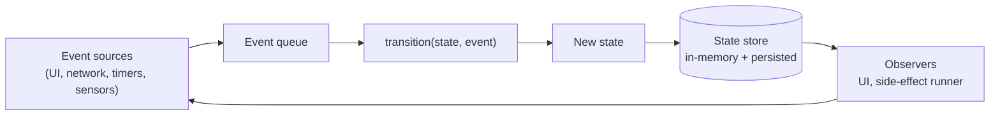
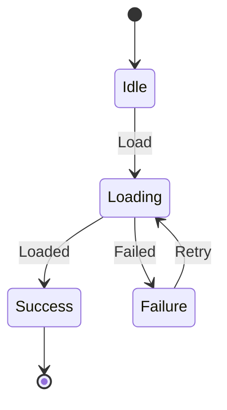

# State Machines

## Overview

A state machine is a model of computation defined by a finite set of *states*, a finite set of *events*, and a *transition function* that, given the current state and an event, decides the next state. The model is older than programming itself, but it is one of the most underused tools in application code — and one of the highest-leverage tools available to a Staff engineer. Most "weird bug" tickets in long-lived mobile systems are state machines that were never written down.

---

## Why It Exists

Almost every non-trivial system has *modes*: an upload is idle, then uploading, then paused, then retrying; an auth session is unauthenticated, authenticating, authenticated, expired; a Bluetooth device is disconnected, connecting, connected, disconnecting. The transitions between these modes are the actual business logic.

What was broken before this existed: developers expressed mode logic as a bag of boolean flags (`isLoading`, `isError`, `hasData`, `isPaused`). Booleans compose multiplicatively — five flags is thirty-two possible combinations — and almost none of those combinations are valid. The combinations that are invalid are exactly where bugs live. ("Why is `isLoading` true and `hasData` true at the same time?")

A state machine replaces the implicit set of "currently valid flag combinations" with an explicit set of states and an explicit set of legal transitions. Invalid combinations become unrepresentable.

---

## Historical Context

State machines come from automata theory in the 1930s — Turing, Kleene, McCulloch & Pitts. They became practical engineering tools in three waves:

1. **Hardware (1940s–60s).** Digital circuits *are* state machines. Counters, flip-flops, sequencers — everything synchronous logic.
2. **Compilers and protocols (1960s–80s).** Lexers, parsers, TCP. TCP's state diagram (LISTEN → SYN_SENT → ESTABLISHED → ...) is the canonical example most engineers know.
3. **Application code (2010s onward).** Promoted by libraries like XState (JS) and statecharts (Harel, 1987, but only popularized recently in app code). Compose UI's lifecycle, Kotlin coroutines' `Job` state, and modern reactive frameworks are explicit state machines under the hood.

The evolution moved upward through the stack: from logic gates, to network protocols, to language runtimes, to application code. Each generation realized that what they had been writing as ad-hoc flag soup was actually a state machine all along.

---

## First Principles

A state machine has four ingredients. None of them are optional; if any is missing, you have flag soup, not a state machine.

**1. States.** A finite, named set. `Idle`, `Loading`, `Success`, `Failure`. The cardinality of valid states is `|S|`, not `2^n` for `n` booleans. This collapse is the whole point.

**2. Events.** What can happen. `UserPressedRetry`, `NetworkResponseReceived`, `Timeout`. Events are *inputs* — they arrive from the outside (UI taps, network, timers, sensors).

**3. Transitions.** A function `(State, Event) → State`. The transition function is total over the state-event pairs you actually allow, and undefined (or explicit error) elsewhere. Defining what *cannot* happen is as important as defining what can.

**4. Side effects.** Sometimes called *actions* or *effects*. On entering a state, on leaving a state, or on a specific transition, the machine triggers a side effect: log a metric, fire a network request, vibrate the phone. Side effects are decoupled from the state graph itself — the graph defines *what is true*, the effects define *what to do about it*.

That's the entire model. Everything else is an embellishment on these four ingredients.

### Variants worth knowing

- **Mealy machine.** Outputs depend on `(state, event)`. The transition produces the output.
- **Moore machine.** Outputs depend only on `state`. Entering a state produces the output. Less expressive, easier to reason about.
- **Hierarchical state machine (statechart, Harel).** States can contain sub-states. Lets you factor out shared transitions ("from any state, on `LogOut`, go to `Unauthenticated`") into a parent state. Crucial for large machines.
- **Parallel / orthogonal regions.** Multiple state machines that run independently and compose. The full app state is the *product* of region states. Used to model "user is authenticated AND playback is paused AND network is offline" without an exponential blowup of single states.

---

## Mental Model

Think of a state machine as a board game.

- The **board** is the set of states (positions you can occupy).
- The **rules** are the transitions (which moves are legal from which position).
- The **dice roll** is the event (what just happened).
- The **side effects** are what you do *after* moving — collect rent, draw a card, lose a turn.

In flag-soup code, there is no board. Every variable is independently mutable, and the game state is whatever combination of variables happens to exist right now. With a state machine, the board defines the game; the variables are derived from your position.

A useful test: if you can draw the system's behavior as a diagram a non-programmer can follow, you have a state machine. If you can't, you have something else (usually a bug factory).

---

## Internal Mechanics

A minimal state machine in code looks like this:

```kotlin
sealed interface State {
    data object Idle : State
    data object Loading : State
    data class Success(val data: Payload) : State
    data class Failure(val cause: Throwable) : State
}

sealed interface Event {
    data object Load : Event
    data class Loaded(val data: Payload) : Event
    data class Failed(val cause: Throwable) : Event
    data object Retry : Event
}

fun transition(current: State, event: Event): State = when (current to event) {
    State.Idle to Event.Load -> State.Loading
    State.Loading to is Event.Loaded -> State.Success((event as Event.Loaded).data)
    State.Loading to is Event.Failed -> State.Failure((event as Event.Failed).cause)
    State.Failure to Event.Retry -> State.Loading
    else -> current  // ignore illegal events
}
```

(The `when` matching above is illustrative; real Kotlin uses `when (val s = current)` with nested branches.)

The four ingredients map directly:

- `sealed interface State` — states.
- `sealed interface Event` — events.
- `fun transition(...)` — transitions.
- Side effects (logging, network calls) sit *outside* `transition`. They are triggered by observing transitions, not buried in them.

### Where side effects go

The cleanest model treats `transition` as a *pure function*. The system around it observes state changes and fires effects:

```text
Event ────▶ transition() ────▶ NewState
                                  │
                                  ▼
                            EffectRunner
                       (log, network, timer)
```

This separation is what makes a state machine testable. You can verify the transition function with a table of `(state, event, expected)` tuples — no mocks, no timing, no network. Effects are tested separately.

### Persistence

For long-lived flows that survive process death (uploads, downloads, multi-step purchases), the state must be persisted. The pattern: serialize the current `State` to disk on every transition, restore it on launch. Idempotency of the effects is what makes this safe — see [`../distributed-systems/idempotency.md`](../distributed-systems/idempotency.md).

---

## Architecture



The loop is intentional: side effects produced by the system become new events that re-enter the queue. This is what makes a state machine a *reactive* model — the system is always responding to its own outputs as new inputs.



A diagram like this is the *specification* of the system. If the implementation does anything the diagram doesn't allow, the implementation has a bug. This is a stronger guarantee than test coverage.

---

## Production Example

Almost every production system you can name is built on state machines, whether named that way or not.

- **TCP.** The TCP state diagram is the most-cited automaton in computing. `LISTEN → SYN_RCVD → ESTABLISHED → FIN_WAIT_1 → ...`. It exists because reliable transport over an unreliable network is *only* expressible as a state machine; any other formulation has gaps.
- **Stripe payments.** A `PaymentIntent` is an explicit state machine: `requires_payment_method → requires_confirmation → processing → succeeded | requires_action | canceled`. The state is exposed in the API. This makes integrations possible without coupling to Stripe's internal implementation.
- **Uber driver dispatch.** Drivers move through `Offline → Online → Matching → EnRoute → Trip → Settling`. The state machine is the contract between mobile app, dispatch server, and pricing system.
- **Netflix playback.** The Netflix player is a hierarchical state machine: parent states (`Initializing`, `Playing`, `Errored`) with sub-states for buffering, ABR adaptation, and DRM. Documented publicly in their engineering blog.
- **Kubernetes Pod.** Pod lifecycle (`Pending → Running → Succeeded | Failed`) is a state machine; the controller reconciles toward desired state.

The shared property: in each system, the state machine is the *interface* — the thing external callers reason about — and the implementation is constrained to match.

---

## Android Example

Android exposes state machines at multiple layers. Knowing this changes what code you write.

**Activity / Fragment lifecycle** is a state machine: `Initialized → Created → Started → Resumed → Paused → Stopped → Destroyed`. The Lifecycle library exposes these as observable states; modern code subscribes instead of overriding lifecycle methods.

**`androidx.lifecycle.Lifecycle.State`** is literally an enum of states with an explicit ordering relation (`isAtLeast`). The framework treats lifecycle as the state machine it always was — just for years it was hidden behind eight callback methods.

**Coroutines.** A Kotlin `Job` is a state machine: `Active → Completing → Completed`, or `Active → Cancelling → Cancelled`. Cancellation is a state transition, not a flag check, which is why structured concurrency works.

**Compose.** The recomposition lifecycle and the snapshot system are state machines underneath; the public API hides them but the mental model holds.

Idiomatic Android uses these state machines instead of fighting them. Most Android bugs that survive review are caused by treating these as flag bags.


## Tradeoffs

**Advantages**

- Invalid states become unrepresentable. The class of "impossible bug" tickets disappears.
- Pure transition functions are trivial to test — table-driven, no mocks.
- The state diagram is documentation that cannot drift from the code, if the code is generated from or constrained by it.
- New requirements show up as new states or new transitions, both of which are localized changes.

**Disadvantages**

- More upfront design. You have to think before you type.
- For genuinely linear flows (read this value, return it), a state machine is over-engineering.
- Hierarchical machines and parallel regions add their own complexity — at a certain size, you trade one kind of complexity for another.

**Hidden costs**

- State-machine libraries (XState, Tinder's StateMachine for Kotlin, etc.) add a dependency and a learning curve. A handwritten sealed-class approach often beats them for small machines.
- Persistence schemas couple state-machine evolution to migration logic. Adding a new state to a long-lived persisted machine is a schema change.

**When not to use**

- Stateless transformations. A function that maps `Request` to `Response` is not a state machine and shouldn't be modeled as one.
- Computations whose state is *data*, not *mode*. If your "states" are just different values of one variable, that's not what a state machine is for.

---

## Failure Modes

**Untracked side effects re-run on transition.** A side effect that runs every time you *enter* a state will re-run on persistence-driven recovery. Fix: tag effects as `OnEntry` (run once when entering) vs `OnTransition` (run once on the specific edge) vs `OnExit`. Or — preferred — make all effects idempotent.

**Event flooding.** UI sources can fire events faster than the machine processes them. Fix: a bounded event queue with explicit drop or coalesce policy. Avoid `Channel(UNLIMITED)` in production.

**Implicit states.** Engineers add "just one more boolean" alongside the state. Within six months, half the modes live in the state machine and half live in flags. Fix: ban auxiliary booleans by code review. If a flag is needed, it becomes a sub-state or a parallel region.

**Invalid persistence.** A persisted state can be unreachable in the current code version (e.g., the state was renamed or removed). Fix: persisted state needs a version tag and a migration story, just like a database schema.

**Recovery races.** On process restart, two effects fire concurrently from the recovery path. Fix: serialize recovery through the event queue, same as any other event source.

---

## Performance Considerations

State machines are cheap. The transition function is a `when` expression; it runs in nanoseconds. Performance concerns are about the *surrounding* infrastructure:

- **CPU.** Negligible for the state machine itself. Watch for hot loops in the event queue (e.g., UI events firing on every frame).
- **Memory.** A sealed-class `State` value is one allocation per transition (or zero if all states are `data object`). Total memory is proportional to the depth of the persistence history if you log transitions.
- **Disk.** Persisted state writes happen on every transition for durable machines. Use append-only journaling rather than rewriting the whole state file; periodically compact.
- **Battery.** Wakelocks held to "wait for the next event" are a real cost on mobile. Prefer pull-based event sources (cold flows, lifecycle observers) over push-based wakers.
- **Network.** Not inherent. The effects triggered by transitions may be expensive; the machine itself is not.
- **Latency.** End-to-end latency in a state-machine-driven system is dominated by the slowest effect, not by the transition.

---

## Reliability Considerations

State machines are a reliability *strategy*, not just a code pattern. The reliability story for any upload pipeline, sync engine, or payment flow is the state machine.

- **Retries.** Belong in the state machine, not in callers. The `Retrying` state encapsulates exponential backoff (see [`../patterns/retry.md`](../patterns/retry.md)) and clearly bounds when retry happens.
- **Backoff.** State transitions are guarded by timers in retry states. Persist the next-retry-at timestamp; on recovery, resume the timer.
- **Circuit breakers.** Model the breaker itself as a state machine (`Closed → Open → HalfOpen`) — see [`../patterns/circuit-breaker.md`](../patterns/circuit-breaker.md). Compose it with the larger machine via parallel regions.
- **Recovery.** Persistence + idempotency = recovery. The state machine defines *what* to recover to; idempotency makes it safe to repeat the entry effects.

---

## Security Considerations

State machines are mostly neutral from a security perspective, but two patterns matter.

**Authorization is state.** Modeling auth as a state machine (`Unauthenticated → Authenticating → Authenticated → Expired`) makes authorization checks structural rather than scattered. A check like "must be Authenticated" is a state assertion, not an ad-hoc condition.

**Replay resistance.** Persisted state machines can be tampered with on-device if the persistence is unsigned. For sensitive flows (payments, key exchange), the persisted state needs integrity (HMAC) and freshness (a server-issued nonce per transition). Otherwise an attacker can rewind the machine to a more permissive state.

---

## Observability

State machines are inherently observable — every transition is an event you can log.

- **Logs.** Structured log on every transition: `{from, to, event, timestamp, machine_id}`. Don't free-text it; downstream pipelines need to query this.
- **Metrics.** Counter per `(from, to)` edge. Histogram of dwell time per state. Counter for illegal-event-ignored. These three together tell you whether the machine behaves the way the diagram says it should.
- **Traces.** Attach a `machine_id` and `correlation_id` to every transition log. A trace becomes a sequence of transitions across one machine instance.
- **Dashboards.** A panel that visualizes the live distribution of instances across states. If 80% of upload instances are stuck in `Retrying`, that is visible at a glance.
- **Alerts.** Alert on illegal-event-ignored rate > 0. That rate should be 0 in steady state; non-zero means the machine and the system disagree.

Link to [`../observability/structured-logging.md`](../observability/structured-logging.md) and [`../observability/metrics.md`](../observability/metrics.md) for canonical treatment.

---

## Staff Engineer Thinking

**Make the state machine the contract.** When a Staff engineer takes ownership of a complex flow, the first deliverable is the state diagram — *before* code. The diagram becomes the artifact reviewed by other teams. Once the diagram is agreed, the code is constrained to match. This inverts the normal "code first, document later" cycle.

**Push state machines outward.** Internal state machines are useful; *exposed* state machines are leverage. When upstream callers can read your machine's state, they stop guessing. Stripe's `PaymentIntent` API is the textbook example — the public API exposes the state graph because the alternative (a soup of booleans) would have made integration impossible.

**Refuse flag soup in review.** A code review that lets `isLoading + hasData + isError + isStale` ship without state-machine refactoring has accepted a long-term cost. Flag soup compounds. Staff engineers reject it early — not because the patch is bad, but because the *missing structure* is.

**Organizational decisions.** Adopting state machines as a default requires:

- A shared library or convention (sealed-class style vs. library-driven).
- Persistence and migration guidelines for durable machines.
- An observability convention (the structured-log schema above).
- Onboarding material so new engineers reach for state machines before booleans.

These are platform-engineering investments. Without them, individual machines proliferate without coherence.

---

## Common Misconceptions

**"State machines are for protocols, not apps."** Every UI screen with `Loading` / `Success` / `Error` is a state machine. The myth is that state machines are heavyweight; the reality is that *flag soup is heavier* — it just doesn't look like it.

**"You need a library."** No. A `sealed interface State` and a `when` expression are sufficient for the vast majority of cases. Libraries help when you need hierarchy, parallel regions, or persistence-with-migrations — not before.

**"State machines mean enum-driven design."** Enums encode states but lose associated data. `sealed interface` (or `enum class` with payloads via separate data classes per variant) is the right shape — each state can carry the data only valid in that state.

**"It's just a switch statement."** A switch statement evaluates *outputs* given inputs. A state machine *advances* the system from one mode to another. They look similar in code; they differ in what they represent.

**"You can't change a state machine after it ships."** You can, but every change is a schema change for any persisted machine. Treat machine evolution with the same rigor as database migrations.

---

## Probing Questions

Questions a Staff engineer should be able to answer cold about state machines:

1. Given a flag-soup snippet (three booleans + a string), reverse-engineer the implicit state machine and identify which combinations are valid.
2. When should you choose a hierarchical state machine over a flat one? Give a concrete example.
3. Why is `transition(state, event) → state` typically a pure function, and what would you have to change if it weren't?
4. How do you migrate a persisted state machine when you add a new state? Remove one? Rename one?
5. What is the difference between a Mealy and a Moore machine, and when does it matter in practice?
6. How do parallel regions compose? What new failure mode do they introduce that a flat machine doesn't have?
7. A file-upload pipeline persists state on every transition. What property must the side effects have for this to be safe?
8. If your `Retrying` state has a 30-second backoff and the process dies after 5 seconds, what's the correct behavior on restart?
9. Show me three real systems in this repo (or in your work) whose behavior is best modeled as a state machine and explain why.
10. When is a state machine the *wrong* abstraction? Give a concrete example.

---

## Further Reading

In this repository:

- [`../patterns/state.md`](../patterns/state.md) — the pattern-shaped implementation. Cross-link both ways.
- [`../distributed-systems/idempotency.md`](../distributed-systems/idempotency.md) — what makes persisted state machines safe to recover.
- [`../principles/determinism.md`](../principles/determinism.md) — the decision heuristic that pushes you toward state machines in the first place.
- [`../patterns/retry.md`](../patterns/retry.md) — retries are themselves a small state machine; this file shows the canonical retry shape.
- [`../patterns/circuit-breaker.md`](../patterns/circuit-breaker.md) — a three-state machine, often composed with larger machines.
- [`../mobile-system-design/offline-sync.md`](../mobile-system-design/offline-sync.md) — sync as an FSM.

External:

- David Harel, *Statecharts: A Visual Formalism for Complex Systems* (1987). The hierarchical-machine paper. Reads surprisingly well.
- *TCP/IP Illustrated* by W. Richard Stevens. The TCP state diagram in chapter 18 is the textbook example of a real-world state machine.
- XState documentation (statecharts.dev). Even if you don't use the library, the conceptual material is the clearest practical introduction online.
