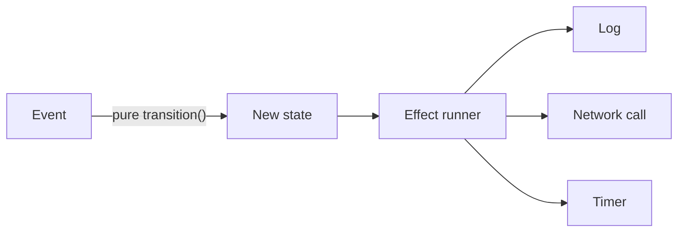
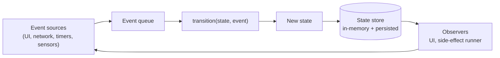
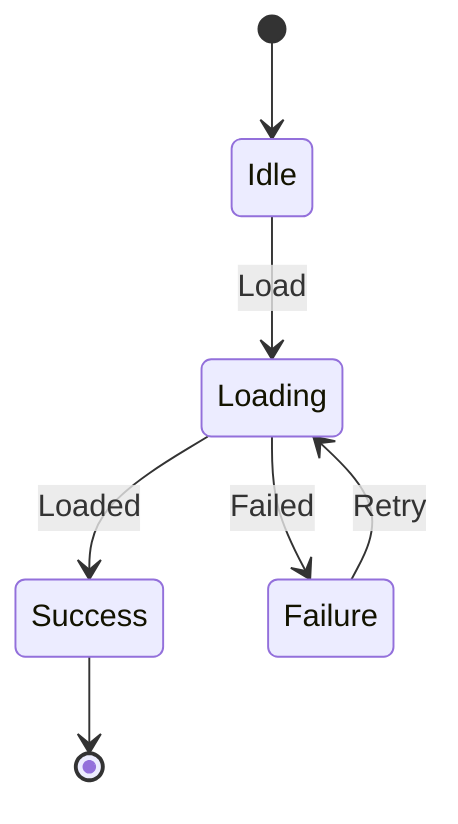

# State Machines

## Overview

This chapter focuses on machines with finite, named *control states*, an initial configuration, events and a transition function. Application machines can also carry data, such as a payload or retry deadline; their complete state space is not limited to the number of control-state names. The model is older than programming itself, but it is one of the most underused tools in application code — and one of the highest-leverage tools available to a Staff engineer. Most "weird bug" tickets in long-lived mobile systems are state machines that were never written down.

---

## Why It Exists

Almost every non-trivial system has *modes*: an upload is idle, then uploading, then paused, then retrying; an auth session is unauthenticated, authenticating, authenticated, expired; a Bluetooth device is disconnected, connecting, connected, disconnecting. The transitions between these modes are the actual business logic.

Without an explicit model, mode logic can become independently mutable flags (`isLoading`, `isError`, `hasData`, `isPaused`). Five booleans permit thirty-two combinations. Which combinations are valid depends on the product: `isLoading && hasData` can correctly represent refreshing cached content. Write those invariants before deciding which modes should be mutually exclusive.

A state machine replaces implicit mode rules with named states, data invariants and explicit transitions. A suitable representation can rule out selected invalid combinations; guards, serialized event handling and tests are still needed to enforce valid behavior.

---

## Historical Context

State machines come from automata theory in the 1930s — Turing, Kleene, McCulloch & Pitts. They became practical engineering tools in three waves:

1. **Hardware (1940s–60s).** Digital circuits *are* state machines. Counters, flip-flops, sequencers — everything synchronous logic.
2. **Compilers and protocols (1960s–80s).** Lexers, parsers, TCP. TCP's state diagram (LISTEN → SYN_SENT → ESTABLISHED → ...) is the canonical example most engineers know.
3. **Application code (2010s onward).** Promoted by libraries like XState (JS) and statecharts (Harel, 1987, but only popularized recently in app code). Compose UI's lifecycle, Kotlin coroutines' `Job` state, and modern reactive frameworks are explicit state machines under the hood.

The evolution moved upward through the stack: from logic gates, to network protocols, to language runtimes, to application code. Each generation realized that what they had been writing as ad-hoc flag soup was actually a state machine all along.

---

## First Principles

A practical application machine defines its states, initial configuration, input events and transition rules. Actions or side effects are optional additions; a machine that only changes or recognizes state is still a state machine.

**1. States.** A named control-state set, such as `Idle`, `Loading`, `Success`, `Failure`. Associated payloads and orthogonal regions also contribute to the complete state space; naming four control modes does not reduce every application state to four values.

**2. Events.** Inputs such as `UserPressedRetry`, `NetworkResponseReceived` or `Timeout`. A machine can receive external events and can also raise internal events or react to completion; events need not all originate outside the machine.

**3. Transitions.** A function `(State, Event) → State`. The transition function is total over the state-event pairs you actually allow, and undefined (or explicit error) elsewhere. Defining what *cannot* happen is as important as defining what can.

**4. Optional side effects.** Actions can run on entry, exit or a transition, such as recording a metric or starting an operation. Keeping their execution separate from a pure transition calculation helps testing; entry/exit placement does not itself guarantee exactly-once execution.

That's the entire model. Everything else is an embellishment on these four ingredients.

### Variants worth knowing

- **Mealy machine.** Outputs depend on `(state, event)`. The transition produces the output.
- **Moore machine.** Outputs depend only on state. Mealy and Moore machines can represent equivalent finite-state input/output behavior, allowing for the Moore initial output; the conversion can change state count and output timing.
- **Hierarchical state machine (statechart, Harel).** States can contain sub-states. Lets you factor out shared transitions ("from any state, on `LogOut`, go to `Unauthenticated`") into a parent state. Crucial for large machines.
- **Parallel / orthogonal regions.** Concurrent state regions compose as a product. Hierarchical notation can avoid explicitly drawing every combination, but the reachable product state space and cross-region interactions still need analysis.

---

## Mental Model

Think of a state machine as a board game.

- The **board** is the set of states (positions you can occupy).
- The **rules** are the transitions (which moves are legal from which position).
- The **dice roll** is the event (what just happened).
- The **side effects** are what you do *after* moving — collect rent, draw a card, lose a turn.

In flag-soup code, there is no board. Every variable is independently mutable, and the game state is whatever combination of variables happens to exist right now. With a state machine, the board defines the game; the variables are derived from your position.

A useful test: if you can draw the system's behavior as a diagram a non-programmer can follow, you have a state machine. If you can't, you have something else (usually a bug factory).

---

## Internal Mechanics

A minimal state machine in code looks like this:

```kotlin
sealed interface State {
    data object Idle : State
    data object Loading : State
    data class Success(val data: Payload) : State
    data class Failure(val cause: Throwable) : State
}

sealed interface Event {
    data object Load : Event
    data class Loaded(val data: Payload) : Event
    data class Failed(val cause: Throwable) : Event
    data object Retry : Event
}

fun transition(current: State, event: Event): State = when (current) {
    State.Idle -> if (event == Event.Load) State.Loading else current
    State.Loading -> when (event) {
        is Event.Loaded -> State.Success(event.data)
        is Event.Failed -> State.Failure(event.cause)
        else -> current
    }
    is State.Failure -> if (event == Event.Retry) State.Loading else current
    is State.Success -> current
}
```

The transition function above uses valid Kotlin syntax. `Payload` is an application-defined type, and this example deliberately ignores unhandled events by returning the current state.

The four ingredients map directly:

- `sealed interface State` — states.
- `sealed interface Event` — events.
- `fun transition(...)` — transitions.
- Side effects (logging, network calls) sit *outside* `transition`. They are triggered by observing transitions, not buried in them.

### Where side effects go

A useful model keeps the transition calculation pure. The event processor can produce the next state and explicit effect instructions, then a separate runner executes those instructions. Observing only a conflated state stream is insufficient when an effect is attached to a transition that leaves the state value unchanged.



This separation is what makes a state machine testable. You can verify the transition function with a table of `(state, event, expected)` tuples — no mocks, no timing, no network. Effects are tested separately.

### Persistence

For uploads or purchases that must recover after process death, persist sufficient state and pending-effect intent atomically, for example with an outbox. Execute effects using stable operation IDs, retain outcomes and reconcile uncertain remote results. Persisting a state name alone can leave a crash gap; idempotent retries address duplicates but do not create missing effect records. See [`../distributed-systems/idempotency.md`](../distributed-systems/idempotency.md).

---

## Architecture



The loop is intentional: side effects produced by the system become new events that re-enter the queue. This is what makes a state machine a *reactive* model — the system is always responding to its own outputs as new inputs.



A diagram like this can be the reviewed specification. Verify that code and effects obey it using transition tests, invariant checks or model checking as appropriate. Drawing the graph alone provides no stronger correctness guarantee than testing.

---

## Production Example

Almost every production system you can name is built on state machines, whether named that way or not.

- **TCP.** RFC 9293 specifies TCP connection states and transitions. The state model makes permitted connection behavior explicit; it does not imply that every other formal description of the same protocol is incomplete.
- **Stripe payments.** A `PaymentIntent` is an explicit state machine: `requires_payment_method → requires_confirmation → processing → succeeded | requires_action | canceled`. The state is exposed in the API. This makes integrations possible without coupling to Stripe's internal implementation.
- **Uber driver dispatch.** Drivers move through `Offline → Online → Matching → EnRoute → Trip → Settling`. The state machine is the contract between mobile app, dispatch server, and pricing system.
- **Netflix playback.** The Netflix player is a hierarchical state machine: parent states (`Initializing`, `Playing`, `Errored`) with sub-states for buffering, ABR adaptation, and DRM. Documented publicly in their engineering blog.
- **Kubernetes Pod.** Pod lifecycle (`Pending → Running → Succeeded | Failed`) is a state machine; the controller reconciles toward desired state.

The shared property: in each system, the state machine is the *interface* — the thing external callers reason about — and the implementation is constrained to match.

---

## Android Example

Android exposes state machines at multiple layers. Knowing this changes what code you write.

**Activity / Fragment lifecycle** has callbacks and an observable state model. Jetpack `Lifecycle.State` contains `INITIALIZED`, `CREATED`, `STARTED`, `RESUMED` and `DESTROYED`. Pausing moves the owner back toward `STARTED`; stopping moves it toward `CREATED`. `PAUSED` and `STOPPED` are not enum values.

**`androidx.lifecycle.Lifecycle.State`** is literally an enum of states with an explicit ordering relation (`isAtLeast`). The framework treats lifecycle as the state machine it always was — just for years it was hidden behind eight callback methods.

**Coroutines.** A Kotlin `Job` is a state machine: `Active → Completing → Completed`, or `Active → Cancelling → Cancelled`. Cancellation is a state transition, not a flag check, which is why structured concurrency works.

**Compose.** The recomposition lifecycle and the snapshot system are state machines underneath; the public API hides them but the mental model holds.

Idiomatic Android uses these state machines instead of fighting them. Most Android bugs that survive review are caused by treating these as flag bags.


## Tradeoffs

**Advantages**

- Selected invalid mode combinations can become unrepresentable. Other invariants, stale events and incorrect effects still require validation.
- Pure transition functions are trivial to test — table-driven, no mocks.
- The state diagram is documentation that cannot drift from the code, if the code is generated from or constrained by it.
- New requirements show up as new states or new transitions, both of which are localized changes.

**Disadvantages**

- More upfront design. You have to think before you type.
- For genuinely linear flows (read this value, return it), a state machine is over-engineering.
- Hierarchical machines and parallel regions add their own complexity — at a certain size, you trade one kind of complexity for another.

**Hidden costs**

- State-machine libraries (XState, Tinder's StateMachine for Kotlin, etc.) add a dependency and a learning curve. A handwritten sealed-class approach often beats them for small machines.
- Persistence schemas couple state-machine evolution to migration logic. Adding a new state to a long-lived persisted machine is a schema change.

**When not to use**

- Stateless transformations. A function that maps `Request` to `Response` is not a state machine and shouldn't be modeled as one.
- Computations whose state is *data*, not *mode*. If your "states" are just different values of one variable, that's not what a state machine is for.

---

## Failure Modes

**Effects can repeat or be lost during recovery.** Entry, transition and exit actions describe when an action is triggered, not whether it has already completed durably. Persist pending work with stable identities, make retries idempotent where required, and reconcile uncertain remote outcomes before repeating a sensitive operation.

**Event flooding.** UI sources can fire events faster than the machine processes them. Fix: a bounded event queue with explicit drop or coalesce policy. Avoid `Channel(UNLIMITED)` in production.

**Implicit states.** Engineers add "just one more boolean" alongside the state. Within six months, half the modes live in the state machine and half live in flags. Fix: ban auxiliary booleans by code review. If a flag is needed, it becomes a sub-state or a parallel region.

**Invalid persistence.** A persisted state can be unreachable in the current code version (e.g., the state was renamed or removed). Fix: persisted state needs a version tag and a migration story, just like a database schema.

**Recovery races.** On process restart, two effects fire concurrently from the recovery path. Fix: serialize recovery through the event queue, same as any other event source.

---

## Performance Considerations

A small transition calculation often needs little work, but its actual cost depends on guards, payload handling and the implementation. There is no universal nanosecond timing guarantee. Measure the transition and its surrounding event, persistence and effect pipeline.

- **CPU.** Negligible for the state machine itself. Watch for hot loops in the event queue (e.g., UI events firing on every frame).
- **Memory.** A transition may reuse an existing state value or construct new state and effect data. Allocation count depends on the implementation and optimizations; retained history and queued events also contribute to memory use.
- **Disk.** Persisted state writes happen on every transition for durable machines. Use append-only journaling rather than rewriting the whole state file; periodically compact.
- **Battery.** Wakelocks held to "wait for the next event" are a real cost on mobile. Prefer pull-based event sources (cold flows, lifecycle observers) over push-based wakers.
- **Network.** Not inherent. The effects triggered by transitions may be expensive; the machine itself is not.
- **Latency.** Account for event-queue delay, transition work, persistence and required effects. Any of these can dominate the measured end-to-end operation.

---

## Reliability Considerations

State machines are a reliability *strategy*, not just a code pattern. The reliability story for any upload pipeline, sync engine, or payment flow is the state machine.

- **Retries.** Belong in the state machine, not in callers. The `Retrying` state encapsulates exponential backoff (see [`../patterns/retry.md`](../patterns/retry.md)) and clearly bounds when retry happens.
- **Backoff.** State transitions are guarded by timers in retry states. Persist the next-retry-at timestamp; on recovery, resume the timer.
- **Circuit breakers.** Model the breaker itself as a state machine (`Closed → Open → HalfOpen`) — see [`../patterns/circuit-breaker.md`](../patterns/circuit-breaker.md). Compose it with the larger machine via parallel regions.
- **Recovery.** Durable state, recoverable effect intent, idempotent or reconciled remote work and an explicit replay policy work together. A state name plus an idempotency claim is not a complete recovery protocol.

---

## Security Considerations

State machines are mostly neutral from a security perspective, but two patterns matter.

**Authorization is state.** Modeling auth as a state machine (`Unauthenticated → Authenticating → Authenticated → Expired`) makes authorization checks structural rather than scattered. A check like "must be Authenticated" is a state assertion, not an ad-hoc condition.

**Replay resistance.** Treat persisted client state as untrusted input to privileged server operations. Enforce authorization and sensitive transition validity on the server. Local integrity protection and freshness checks can support a threat model, but a client-held HMAC or a persisted `Authenticated` state is not sufficient authorization; nonce and replay policies must be designed for the actual protocol.

---

## Observability

State machines are inherently observable — every transition is an event you can log.

- **Logs.** Structured log on every transition: `{from, to, event, timestamp, machine_id}`. Don't free-text it; downstream pipelines need to query this.
- **Metrics.** Counter per `(from, to)` edge. Histogram of dwell time per state. Counter for illegal-event-ignored. These three together tell you whether the machine behaves the way the diagram says it should.
- **Traces.** Attach a `machine_id` and `correlation_id` to every transition log. A trace becomes a sequence of transitions across one machine instance.
- **Dashboards.** A panel that visualizes the live distribution of instances across states. If 80% of upload instances are stuck in `Retrying`, that is visible at a glance.
- **Alerts.** Track ignored events by reason. Alert on unexpected invalid transitions or anomalous rates; deliberately ignored stale completions, duplicate requests and events outside the current mode can be valid policy.

Link to [`../observability/structured-logging.md`](../observability/structured-logging.md) and [`../observability/metrics.md`](../observability/metrics.md) for canonical treatment.

---

## Staff Engineer Thinking

**Make the state machine the contract.** When a Staff engineer takes ownership of a complex flow, the first deliverable is the state diagram — *before* code. The diagram becomes the artifact reviewed by other teams. Once the diagram is agreed, the code is constrained to match. This inverts the normal "code first, document later" cycle.

**Push state machines outward.** Internal state machines are useful; *exposed* state machines are leverage. When upstream callers can read your machine's state, they stop guessing. Stripe's `PaymentIntent` API is the textbook example — the public API exposes the state graph because the alternative (a soup of booleans) would have made integration impossible.

**Refuse flag soup in review.** A code review that lets `isLoading + hasData + isError + isStale` ship without state-machine refactoring has accepted a long-term cost. Flag soup compounds. Staff engineers reject it early — not because the patch is bad, but because the *missing structure* is.

**Organizational decisions.** Adopting state machines as a default requires:

- A shared library or convention (sealed-class style vs. library-driven).
- Persistence and migration guidelines for durable machines.
- An observability convention (the structured-log schema above).
- Onboarding material so new engineers reach for state machines before booleans.

These are platform-engineering investments. Without them, individual machines proliferate without coherence.

---

## Common Misconceptions

**"State machines are for protocols, not apps."** Every UI screen with `Loading` / `Success` / `Error` is a state machine. The myth is that state machines are heavyweight; the reality is that *flag soup is heavier* — it just doesn't look like it.

**"You need a library."** No. A `sealed interface State` and a `when` expression are sufficient for the vast majority of cases. Libraries help when you need hierarchy, parallel regions, or persistence-with-migrations — not before.

**"State machines mean enum-driven design."** Enums encode states but lose associated data. `sealed interface` (or `enum class` with payloads via separate data classes per variant) is the right shape — each state can carry the data only valid in that state.

**"It's just a switch statement."** A switch statement evaluates *outputs* given inputs. A state machine *advances* the system from one mode to another. They look similar in code; they differ in what they represent.

**"You can't change a state machine after it ships."** You can, but every change is a schema change for any persisted machine. Treat machine evolution with the same rigor as database migrations.

---

## Probing Questions

Questions a Staff engineer should be able to answer cold about state machines:

1. Given a flag-soup snippet (three booleans + a string), reverse-engineer the implicit state machine and identify which combinations are valid.
2. When should you choose a hierarchical state machine over a flat one? Give a concrete example.
3. Why is `transition(state, event) → state` typically a pure function, and what would you have to change if it weren't?
4. How do you migrate a persisted state machine when you add a new state? Remove one? Rename one?
5. What is the difference between a Mealy and a Moore machine, and when does it matter in practice?
6. How do parallel regions compose? What new failure mode do they introduce that a flat machine doesn't have?
7. A file-upload pipeline persists state on every transition. What property must the side effects have for this to be safe?
8. If your `Retrying` state has a 30-second backoff and the process dies after 5 seconds, what's the correct behavior on restart?
9. Show me three real systems in this repo (or in your work) whose behavior is best modeled as a state machine and explain why.
10. When is a state machine the *wrong* abstraction? Give a concrete example.

## Answer Key

1.  **Given a flag-soup snippet (three booleans + a string), reverse-engineer the implicit state machine and identify which combinations are valid.**
    Identify the actual mutually exclusive modes (e.g., `Loading`, `Success`, `Error`). Map the valid boolean combinations to these explicit states. All other combinations represent invalid, unrepresentable states.
2.  **When should you choose a hierarchical state machine over a flat one? Give a concrete example.**
    When you have states that share identical transitions. For example, a `Playing` video state and a `Paused` video state might both transition to an `Unauthenticated` state on a `Logout` event. Grouping them under an `Authenticated` parent state avoids duplicating the transition.
3.  **Why is `transition(state, event) → state` typically a pure function, and what would you have to change if it weren't?**
    A pure function is predictable, easy to test, and enables replayability. If it weren't pure, it would perform side effects (like network calls) directly, making testing difficult and risking duplicate side effects during state recovery.
4.  **How do you migrate a persisted state machine when you add a new state? Remove one? Rename one?**
    Treat it like a database migration. Persisted states must include a version tag. When loading an old version, write explicit migration logic to map removed/renamed states to their new logical equivalents before resuming the machine.
5.  **What is the difference between a Mealy and a Moore machine, and when does it matter in practice?**
    Mealy output depends on the current state and input; Moore output depends only on the current state. Equivalent finite-state behavior can be represented in either form after accounting for the Moore initial output, with possible differences in state count and timing.
6.  **How do parallel regions compose? What new failure mode do they introduce that a flat machine doesn't have?**
    They compose orthogonally, where the total state is the product of all regions. They introduce the risk of conflicting side effects or implicit dependencies between regions that aren't structurally represented.
7.  **A file-upload pipeline persists state on every transition. What property must the side effects have for this to be safe?**
    Recovery must retain enough durable state and effect intent to know what remains to do. Stable operation IDs and idempotent effects make retries safe when execution may have occurred already; uncertain remote outcomes may require reconciliation. State and pending intent should commit atomically so an effect is not lost before it can be retried.
8.  **If your `Retrying` state has a 30-second backoff and the process dies after 5 seconds, what's the correct behavior on restart?**
    Persist a deadline with a defined clock/reboot policy. On restart, recompute max(0, deadline - now); process downtime also counts, so the remainder is not necessarily 25 seconds. A wall-clock deadline must handle clock changes, while elapsedRealtime is monotonic within one boot and cannot be reused unchanged across a reboot.
9.  **Show me three real systems in this repo (or in your work) whose behavior is best modeled as a state machine and explain why.**
    (e.g., Video Player, Payment Checkout, Offline Sync Engine). They are best modeled as state machines because they have distinct modes, explicit valid transitions, and complex side effects dependent on mode changes.
10. **When is a state machine the *wrong* abstraction? Give a concrete example.**
    For pure data transformations or stateless functions. Mapping a JSON response to a domain model, or performing math calculations, has no "modes" and doesn't benefit from state machine constraints.

---

## Further Reading

In this repository:

- [`../patterns/state.md`](../patterns/state.md) — the pattern-shaped implementation. Cross-link both ways.
- [`../distributed-systems/idempotency.md`](../distributed-systems/idempotency.md) — what makes persisted state machines safe to recover.
- [`../principles/determinism.md`](../principles/determinism.md) — the decision heuristic that pushes you toward state machines in the first place.
- [`../patterns/retry.md`](../patterns/retry.md) — retries are themselves a small state machine; this file shows the canonical retry shape.
- [`../patterns/circuit-breaker.md`](../patterns/circuit-breaker.md) — a three-state machine, often composed with larger machines.
- [`../mobile-system-design/offline-sync.md`](../mobile-system-design/offline-sync.md) — sync as an FSM.

External:

- David Harel, *Statecharts: A Visual Formalism for Complex Systems* (1987). The hierarchical-machine paper. Reads surprisingly well.
- *TCP/IP Illustrated* by W. Richard Stevens. The TCP state diagram in chapter 18 is the textbook example of a real-world state machine.
- XState documentation (statecharts.dev). Even if you don't use the library, the conceptual material is the clearest practical introduction online.

### Official verification references

The corrections in this chapter were checked against the following primary references.

- [www.w3.org: scxml](https://www.w3.org/TR/scxml/)
- [www.w3.org: #raise](https://www.w3.org/TR/scxml/#raise)
- [www.w3.org: #onentry](https://www.w3.org/TR/scxml/#onentry)
- [github.com: transactional-outbox-pattern](https://github.com/aws-samples/transactional-outbox-pattern)
- [www.cs.umd.edu: fsm.html](https://www.cs.umd.edu/class/sum2003/cmsc311/Notes/Seq/fsm.html)
- [www.w3.org: #parallel](https://www.w3.org/TR/scxml/#parallel)
- [kotlinlang.org: control-flow.html#when-expressions-and-statements](https://kotlinlang.org/docs/control-flow.html#when-expressions-and-statements)
- [www.w3.org: #transition](https://www.w3.org/TR/scxml/#transition)
- [kotlinlang.org: -shared-flow](https://kotlinlang.org/api/kotlinx.coroutines/kotlinx-coroutines-core/kotlinx.coroutines.flow/-shared-flow/)
- [www.rfc-editor.org: rfc9293.html](https://www.rfc-editor.org/rfc/rfc9293.html)
- [developer.android.com: Lifecycle.State](https://developer.android.com/reference/androidx/lifecycle/Lifecycle.State)
- [mas.owasp.org: 0x04e-Testing-Authentication-and-Session-Management](https://mas.owasp.org/MASTG/0x04e-Testing-Authentication-and-Session-Management/)
- [developer.android.com: SystemClock](https://developer.android.com/reference/android/os/SystemClock)
