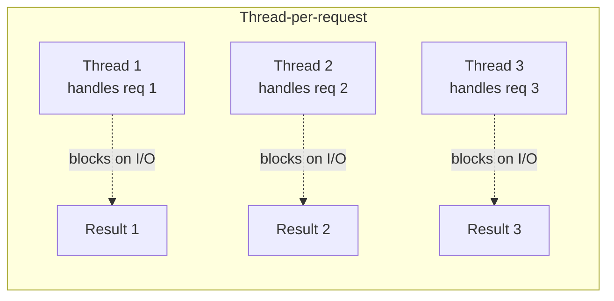
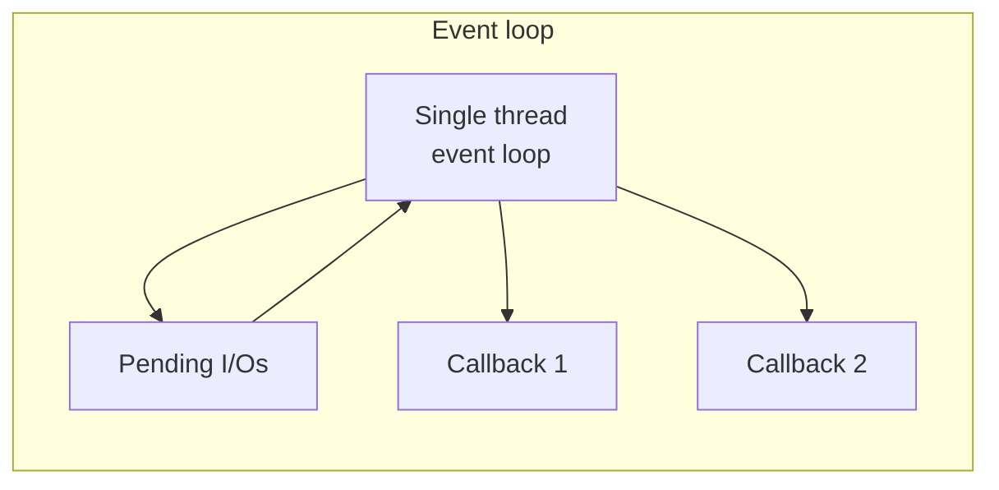
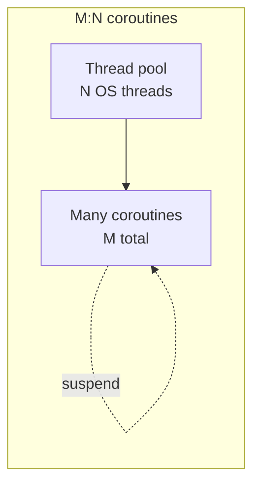

# Sync vs Async

## Overview

A **synchronous** operation blocks the caller until it produces a result. An **asynchronous** operation returns control to the caller immediately and produces its result later, by some other mechanism (callback, future, suspension point). Almost every reliability and performance problem in modern systems traces back to where this line is drawn — and where it is drawn *wrong*. The choice is not "which is faster" (a common misconception); it is "what does the calling thread do during the wait?"

---

## Why It Exists

Computers are fast. I/O is slow. A modern CPU can execute billions of instructions per second; a disk read takes milliseconds; a network round-trip takes tens to hundreds of milliseconds. If a thread waits synchronously for an I/O operation, it spends almost all of its life doing nothing — the CPU is parked, holding the thread's stack in memory, contributing zero useful work.

What was broken before asynchrony was treated explicitly: every server used "thread-per-request" architecture — one OS thread per incoming connection — which meant a 10,000-concurrent-user system needed 10,000 mostly-idle threads. Each thread costs memory (typically 0.5-2 MB of stack), context-switch overhead, and scheduler attention. The C10K problem (handling 10,000 simultaneous connections) was the inflection point in the early 2000s that pushed servers toward event loops, non-blocking I/O, and eventually async/await syntax.

Async exists because the alternative — blocking a thread for the duration of an I/O wait — is expensive at scale.

---

## Historical Context

The arc moved roughly through five stages:

1. **Synchronous blocking I/O (1970s-2000s).** `read()` returns when bytes arrive. Simple to reason about. Doesn't scale past thousands of concurrent operations on a single machine.
2. **Multi-threading (1990s onward).** OS threads let one process handle multiple concurrent I/Os, each blocking on its own thread. The model behind classic Apache, classic Tomcat.
3. **Non-blocking I/O + event loops (early 2000s).** `select()`, `poll()`, `epoll()`, `kqueue()`. A single thread handles thousands of file descriptors by waiting on whichever one is ready next. Used by nginx, Node.js, libuv.
4. **Callbacks and Promises (mid-2000s onward).** Application code expressed in terms of "when this finishes, do that." Node.js made this mainstream. Callback hell — deeply nested error-prone chains — was the cost.
5. **Async/await and coroutines (2010s onward).** Syntactic sugar that lets asynchronous code *look* synchronous while still being non-blocking. C# (2012), Python (2015), Kotlin coroutines (2017), Swift (2021). The current state of the art.

Each stage was an answer to the previous stage's pain. The pattern is identifiable: humans want to *write* sequential code; machines want to *execute* non-blocking I/O. Each generation found a way to do both at once.

---

## First Principles

Three concepts underlie the whole topic.

### 1. A thread is an OS scheduling unit with a stack

Threads cost memory (the stack) and CPU (context switches when the scheduler switches between them). They exist *whether or not they are doing work*. A thread sleeping on `read()` consumes its stack and its slot in the scheduler.

### 2. "Asynchronous" means the calling thread can do something else

Async does not mean "faster." It means "the calling thread is not blocked." The work itself takes the same time. The difference is what the rest of the program does during that time.

```kotlin
// Synchronous — thread blocks here
fun fetchUserSync(id: String): User {
    return httpClient.get("/users/$id")  // blocks until response
}

// Asynchronous — thread is free during the wait
suspend fun fetchUserAsync(id: String): User {
    return httpClient.get("/users/$id")  // suspends; thread returns to pool
}
```

In the async version, the *function* still takes (say) 200 ms to produce a result. But the thread that called it is released back to do other work during those 200 ms. Same wall-clock time per request; vastly more concurrent requests per thread.

### 3. The cost of async is complexity, not throughput

You buy throughput; you pay in complexity. Async code is harder to debug (stack traces don't go where you expect), harder to reason about (control flow leaves the function and comes back), and harder to test (timing-sensitive). The complexity is the trade.

---

## Mental Model

Synchronous: you call a restaurant for takeout. The receptionist puts you on hold while they cook. You hold the phone for 20 minutes, doing nothing. When the food is ready, they tell you.

Asynchronous: you call the same restaurant. They take your order, give you an order number, and tell you they'll text when it's ready. You hang up. You do other things. The text arrives 20 minutes later.

Cooking time is identical. The phone line (the thread) is free in the second case. If 1,000 people call, the synchronous restaurant needs 1,000 phone lines; the async restaurant needs one phone line and a SMS gateway.

Async doesn't make the food cook faster. It makes the phone line available for the next customer.

---

## Internal Mechanics

### Blocking I/O on a thread

```text
Thread ─── read() ─── (parked by kernel) ─── (data arrives) ─── continues
            │
            └── stack stays allocated, thread holds scheduler slot
```

### Non-blocking I/O with an event loop

```text
EventLoop ─── register(fd, callback) ─── poll() ──── data ready ─── invoke callback
                                            │
                                            └── handles 10,000 fds in one thread
```

### Suspending functions (Kotlin coroutines)

A `suspend` function compiles to a state machine. At each suspension point, the function captures its local state, returns control to the dispatcher, and resumes later when the awaited value is available.

```kotlin
suspend fun fetchAndProcess(id: String): Result {
    val user = httpClient.get("/users/$id")  // suspension point 1
    val data = database.load(user.id)        // suspension point 2
    return process(user, data)
}
```

Internally, the compiler turns this into approximately:

```kotlin
fun fetchAndProcess(id: String, continuation: Continuation<Result>): Any {
    when (continuation.state) {
        0 -> {
            continuation.state = 1
            httpClient.getAsync("/users/$id", continuation)  // returns immediately
            return SUSPENDED
        }
        1 -> {
            val user = continuation.result as User
            continuation.state = 2
            database.loadAsync(user.id, continuation)
            return SUSPENDED
        }
        2 -> {
            val data = continuation.result as Data
            return process(user, data)
        }
    }
}
```

The function "returns" three times and "resumes" twice. Between resumes, the calling thread is free to run other coroutines.

### Why "structured concurrency" matters

Plain async lets you fire-and-forget work that outlives its caller. That is almost always a bug — orphaned work that runs after its purpose has expired (the user navigated away, the request was cancelled, the parent operation failed). Structured concurrency (Kotlin's `coroutineScope`, Java's structured task scopes) ties child coroutines to their parent's lifetime. When the parent ends, children are cancelled. See [`../android/architecture/structured-concurrency.md`](../android/architecture/structured-concurrency.md).

---

## Architecture

Three concurrency architectures, with the same I/O workload:







Coroutines are the modern default because they let you write code that *looks* sequential (like thread-per-request) but *executes* non-blocking (like an event loop).

---

## Production Example

- **nginx.** A handful of worker threads, each running an epoll-based event loop. Handles 100k+ concurrent connections per worker.
- **Node.js.** One event-loop thread per process; a worker pool for CPU-bound work. Excellent for I/O-heavy workloads; poor for CPU-heavy ones.
- **Netflix Zuul 2.** The migration from blocking (Zuul 1, thread-per-request) to non-blocking (Zuul 2, async + Netty) is publicly documented. Same throughput, ~50% fewer machines.
- **Stripe API.** Ruby (sync) at the edge; Go and Java (async) for internal high-fanout services. The choice of sync vs async per service is explicit.
- **Slack mobile.** Coroutines + Flow for all async work; the old callback-based code paths were systematically migrated.

The shared observation: at scale, async wins on throughput per machine, and the engineering investment is justified by the hardware savings.

---

## Android Example

On Android, the main thread is the UI thread — it must never block. Any blocking call on the main thread (network, disk, slow computation) produces an Application Not Responding (ANR) dialog after about 5 seconds. See [`../android/performance/anrs.md`](../android/performance/anrs.md).

The idiomatic pattern:

```kotlin
class UserViewModel(private val repo: UserRepository) : ViewModel() {
    private val _state = MutableStateFlow<UiState>(UiState.Loading)
    val state: StateFlow<UiState> = _state

    fun loadUser(id: String) {
        viewModelScope.launch {  // structured concurrency: tied to ViewModel
            _state.value = UiState.Loading
            try {
                val user = repo.fetchUser(id)  // suspends; main thread free
                _state.value = UiState.Success(user)
            } catch (e: Exception) {
                _state.value = UiState.Error(e)
            }
        }
    }
}
```

`fetchUser` is a `suspend fun` that internally uses `withContext(Dispatchers.IO) { ... }` to do its blocking I/O on a worker thread. The main thread is never blocked. The ViewModel scope ensures that if the user navigates away, the work is cancelled.

The legacy alternative (callbacks, `AsyncTask`, `Thread`) is deprecated. Coroutines are the standard.

---

## Tradeoffs

**Advantages of async**

- Much higher throughput per machine.
- No idle threads consuming memory.
- Naturally composable with cancellation and timeouts.
- The same code can handle 100 or 100,000 concurrent operations without re-architecture.

**Disadvantages of async**

- Harder to debug. Stack traces are partial; the "where was this called from?" question is harder.
- Subtle bugs (forgetting to await, accidentally blocking the dispatcher with a sync call).
- Two function colors. `suspend` functions can call `suspend` functions; non-suspend functions cannot. The boundary is a real cost — JavaScript and Python users describe this as a "viral" property.
- Premature async-ification of code that doesn't benefit from it adds complexity without payoff.

**Hidden costs**

- Async libraries propagate through your codebase. You don't get to be partially async.
- Debugging async deadlocks is significantly harder than sync deadlocks (the call stack doesn't tell you who is waiting on whom).
- Performance-debugging an async system requires different tools (flight recorders, async-aware profilers).

**When not to use async**

- CPU-bound work. Async helps when threads are *idle waiting*. If they're busy *computing*, async adds overhead without benefit. CPU-bound work belongs on a thread pool sized to the CPU count.
- Small scripts and tools that handle one operation at a time.
- Code where simplicity beats throughput. A daily-cron-job script does not benefit from async.

---

## Failure Modes

**Blocking inside a coroutine.** A sync call (`Thread.sleep`, blocking JDBC) inside a coroutine running on the main dispatcher blocks the whole event loop. Symptom: UI freezes; ANR. Mitigation: route blocking calls through `withContext(Dispatchers.IO)`; use code review and lint rules to catch sync calls in suspend contexts.

**Thread-pool exhaustion in async code.** Underneath every async system is a finite pool of threads. If every coroutine ends up running blocking work on `Dispatchers.IO`, you can run out of IO threads — and the whole system stalls. Mitigation: a separate dispatcher for genuinely blocking work, sized appropriately; avoid mixing sync calls into async dispatchers.

**Orphaned coroutines.** A coroutine launched without a structured scope outlives its purpose. Symptom: events arriving for screens the user already left. Mitigation: always launch into a scope tied to a lifecycle (viewModelScope, lifecycleScope).

**Async deadlock.** Two coroutines each waiting on the other's result. Same as sync deadlocks but harder to detect. Mitigation: timeouts on every external await; design for non-circular dependencies.

**Callback retention.** A registered callback holds a reference to its enclosing scope, leaking memory. Common in older Android code. Mitigation: use coroutines or weak references for long-lived registrations.

---

## Performance Considerations

- **CPU:** Async runtime overhead is small but real — function-call indirection through dispatchers, continuation allocation. For CPU-bound code, this overhead exceeds the benefit; use threads directly.
- **Memory:** Async drastically reduces memory pressure under high concurrency. 10,000 OS threads is 10-20 GB of stacks; 10,000 coroutines is megabytes.
- **Throughput:** Higher with async for I/O-bound work. Often identical for CPU-bound work.
- **Latency:** Per-operation latency can be slightly higher with async (dispatcher hops add nanoseconds). For interactive systems, this is negligible. For high-frequency trading, it matters.
- **Battery (mobile):** Async correctly used reduces wakelocks and unnecessary CPU spin. Misused, it can fragment work into many tiny pieces, each requiring a wake.

---

## Reliability Considerations

- **Cancellation.** Async work must support cancellation; sync work usually cannot. Kotlin coroutines propagate cancellation through suspension points. Long-running suspend functions should check `ensureActive()` periodically.
- **Timeouts.** Sync calls can hang indefinitely if the underlying network does. Async calls should always wrap external waits in `withTimeout`.
- **Retries.** See [`../patterns/retry.md`](../patterns/retry.md). Retries are simpler over async than sync — the await is the natural retry boundary.
- **Backpressure.** When producers outrun consumers in an async system, the system must signal upstream to slow down. See [`backpressure.md`](backpressure.md).

---

## Security Considerations

Mostly orthogonal to security. Two specific concerns:

- **TOCTOU (Time-of-Check-Time-of-Use).** Async creates more opportunities for state to change between a check and a use. Authorization checks must be re-validated at the point of action, not at the entry point of an async chain.
- **Side-channel timing.** Async dispatchers can introduce variable latency that leaks information about internal state. For security-sensitive comparison (HMAC verification, password checks), use constant-time primitives even inside async code.

---

## Observability

- **Per-dispatcher metrics.** Queue depth, active tasks, mean wait time. A growing queue is a leading indicator of saturation.
- **Tracing.** Async traces must propagate context across suspension points. Kotlin coroutines use `CoroutineContext` for this; OpenTelemetry has Kotlin-specific bindings.
- **Logs.** Each suspension point can lose log context if not propagated explicitly. MDC-style context propagation is a coroutine-context element.
- **Alerts.** Dispatcher saturation, growing queue depth, structured-cancellation rate spikes.

Canonical: [`../observability/tracing.md`](../observability/tracing.md), [`../observability/metrics.md`](../observability/metrics.md).

---

## Staff Engineer Thinking

**Choose the abstraction at the right layer.** Async at the leaves of your code is leaky and complex. Async at the framework layer (e.g., your HTTP client returns suspend functions) means most application code is sync-looking but async-executing. Push async upward to where the dispatcher lives; let application code call `suspend` functions in a sequential style.

**Don't async-ify CPU-bound work.** A Staff engineer notices when "we made it async" gives no measurable benefit. CPU-bound algorithms belong on a fixed-size thread pool, not on the async dispatcher. The general rule: async for waits, threads for work.

**Hold the line at boundaries.** Mixing sync and async in the same codebase creates dispatcher footguns. Either pick a side per service, or define explicit bridge points (`runBlocking`, `Future.await()`) and document them.

**Test the async failure modes explicitly.** Cancellation, timeout, partial failure, and dispatcher saturation are all real production scenarios. Write tests that simulate them. Most async bugs are *bugs of timing*; tests must exercise timing or they won't catch them.

---

## Common Misconceptions

**"Async is faster than sync."** No. Async has the same wall-clock time per operation. Async wins on *throughput* by freeing the thread, not on per-operation speed.

**"Async means parallel."** Async means concurrent; parallel means simultaneous execution on multiple cores. A single-threaded event loop is async but not parallel. A parallel computation can be sync or async.

**"Coroutines are threads."** Coroutines are a higher-level abstraction over threads. Many coroutines share a pool of threads. A coroutine that calls a blocking function uses a thread for the duration of the block; a suspending coroutine releases the thread.

**"`Dispatchers.IO` is for any I/O."** It's for *blocking* I/O. Non-blocking I/O (the kind that's truly async under the hood) doesn't need `Dispatchers.IO` — it would just bounce through the dispatcher for nothing.

**"If it's slow, make it async."** Async helps when threads are idle waiting. If the operation is slow because of computation, async makes it slower (dispatcher overhead) without helping.

---

## Probing Questions

1. A coroutine running on the main dispatcher calls a blocking JDBC method. What happens, and why?
2. Why is `viewModelScope.launch { ... }` preferred over `GlobalScope.launch { ... }` in Android?
3. Two coroutines each `await` on the other's result. How do you detect this in production?
4. You have a CPU-bound algorithm that takes 800 ms to compute. Should it be a `suspend fun`? Why or why not?
5. Explain how a `suspend fun` returns "twice" — once when it suspends, once when it resumes.
6. Under what conditions does async *not* improve throughput?
7. Why might `Dispatchers.IO` be exhausted in a system that has plenty of CPU and memory available?
8. A user navigates away from a screen mid-network-request. What is the idiomatic way to ensure the request is cancelled?
9. Compare the memory footprint of 10,000 OS threads vs 10,000 coroutines under load.
10. Where in your architecture should the sync/async boundary live — at the HTTP client, the repository, the ViewModel, or somewhere else? Justify.

---

## Further Reading

In this repository:

- [`state-machines.md`](state-machines.md) — async systems are state machines; the suspend mechanism is a compiler-generated FSM.
- [`backpressure.md`](backpressure.md) — what async systems do when producers outrun consumers.
- [`../patterns/retry.md`](../patterns/retry.md), [`../patterns/circuit-breaker.md`](../patterns/circuit-breaker.md) — resilience patterns native to async.
- [`../kotlin/coroutines.md`](../kotlin/coroutines.md) — Kotlin-specific mechanics.
- [`../android/architecture/structured-concurrency.md`](../android/architecture/structured-concurrency.md) — tying coroutine lifetimes to Android lifecycles.
- [`../android/performance/anrs.md`](../android/performance/anrs.md) — what happens when async goes wrong on Android.

External:

- Dan Kegel, *The C10K Problem*. The 1999 essay that started the move to non-blocking servers.
- Roman Elizarov, *Structured Concurrency*. The motivation behind Kotlin's structured-concurrency model.
- Bob Nystrom, *What Color is Your Function?* — the most-cited essay on the function-coloring cost of async.
