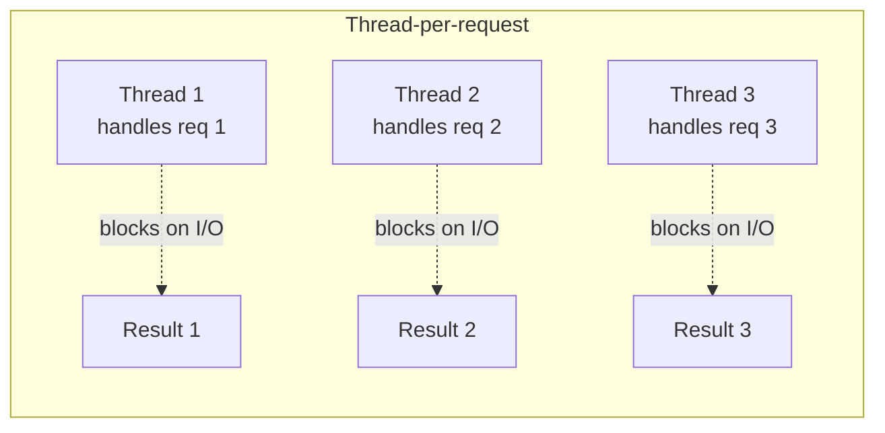
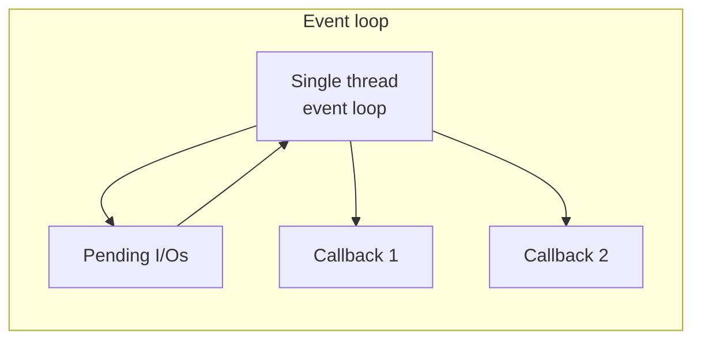
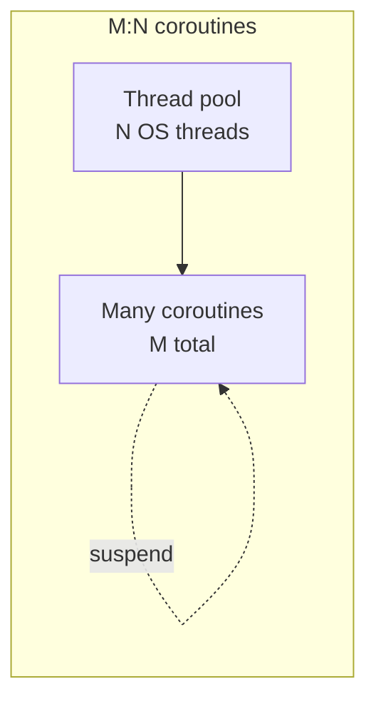

# Sync vs Async

## Overview

A **synchronous** API completes before the caller continues past that call. An **asynchronous** API separates initiation from completion, often using a callback, future or coroutine continuation. Whether an OS thread blocks is a separate implementation property: asynchronous work may still run blocking I/O on a worker. Almost every reliability and performance problem in modern systems traces back to where this line is drawn — and where it is drawn *wrong*. The choice is not "which is faster" (a common misconception); it includes both "how is completion delivered?" and "which thread, if any, waits?"

---

## Why It Exists

Computers are fast. I/O is slow. A modern CPU can execute billions of instructions per second; a disk read takes milliseconds; a network round-trip takes tens to hundreds of milliseconds. If a thread waits synchronously for an I/O operation, the waiting thread may be parked while its stack and request state remain allocated. The CPU can run another runnable thread; parking the caller does not park the whole CPU.

What was broken before asynchrony was treated explicitly: a common design used one platform thread per active request. That can consume substantial resources during blocking waits, but a connection, a user and an active request are not interchangeable counts, and thread-per-request is not the only synchronous execution model. Each thread costs memory (typically 0.5-2 MB of stack), context-switch overhead, and scheduler attention. The C10K problem (handling 10,000 simultaneous connections) was the inflection point in the early 2000s that pushed servers toward event loops, non-blocking I/O, and eventually async/await syntax.

Async exists because the alternative — blocking a thread for the duration of an I/O wait — is expensive at scale.

---

## Historical Context

The arc moved roughly through five stages:

1. **Synchronous blocking I/O (1970s-2000s).** `read()` returns when bytes arrive. Simple to reason about. Doesn't scale past thousands of concurrent operations on a single machine.
2. **Multi-threading (1990s onward).** OS threads let one process handle multiple concurrent I/Os, each blocking on its own thread. The model behind classic Apache, classic Tomcat.
3. **Non-blocking I/O + event loops (early 2000s).** `select()`, `poll()`, `epoll()`, `kqueue()`. A single thread handles thousands of file descriptors by waiting on whichever one is ready next. Used by nginx, Node.js, libuv.
4. **Callbacks and Promises (mid-2000s onward).** Application code expressed in terms of "when this finishes, do that." Node.js made this mainstream. Callback hell — deeply nested error-prone chains — was the cost.
5. **Async/await and coroutines (2010s onward).** Syntactic sugar that lets asynchronous code *look* synchronous while still being non-blocking. C# (2012), Python (2015), Kotlin coroutines (2017), Swift (2021). The current state of the art.

Each stage was an answer to the previous stage's pain. The pattern is identifiable: humans want to *write* sequential code; machines want to *execute* non-blocking I/O. Each generation found a way to do both at once.

---

## First Principles

Three concepts underlie the whole topic.

### 1. A thread is an OS scheduling unit with a stack

Threads cost memory (the stack) and CPU (context switches when the scheduler switches between them). They exist *whether or not they are doing work*. A thread sleeping on `read()` consumes its stack and its slot in the scheduler.

### 2. Non-blocking waits let the calling thread do something else

Asynchrony does not guarantee non-blocking execution or a speedup. A non-blocking wait can release a thread for other work; offloaded blocking I/O instead occupies a worker. Overlapping independent operations can reduce end-to-end latency, while scheduling and contention can add delay.

```kotlin
// Synchronous — thread blocks here
fun fetchUserSync(id: String): User {
    return blockingHttpClient.get("/users/$id")  // API contract: blocking request
}

// Asynchronous — thread is free during the wait
suspend fun fetchUserAsync(id: String): User {
    return suspendingHttpClient.get("/users/$id")  // API contract: non-blocking suspension
}
```

In the async version, the *function* still takes (say) 200 ms to produce a result. But the thread that called it is released back to do other work during those 200 ms. This example assumes the same remote service time in both versions. The difference is thread occupancy during the wait, not a guarantee of identical measured latency or unlimited capacity.

### 3. Resource use and complexity need separate evaluation

Non-blocking waits can improve utilization when waiting threads are a bottleneck. They do not guarantee higher throughput: CPU demand, dependency limits, queueing and scheduling overhead still matter. Asynchronous control flow also requires explicit lifetime, error and cancellation handling; measure the workload rather than treating extra concurrency as a performance result.

---

## Mental Model

Synchronous: you call a restaurant for takeout. The receptionist puts you on hold while they cook. You hold the phone for 20 minutes, doing nothing. When the food is ready, they tell you.

Asynchronous: you call the same restaurant. They take your order, give you an order number, and tell you they'll text when it's ready. You hang up. You do other things. The text arrives 20 minutes later.

Cooking time is identical. The phone line (the thread) is free in the second case. If 1,000 people call, the synchronous restaurant needs 1,000 phone lines; the async restaurant needs one phone line and a SMS gateway.

Async doesn't make the food cook faster. It makes the phone line available for the next customer.

---

## Internal Mechanics

### Blocking I/O on a thread


### Non-blocking I/O with an event loop


### Suspending functions (Kotlin coroutines)

A suspending function can compile to a state machine, but calling it does not guarantee suspension. A called operation may produce its result immediately. When it actually suspends, continuation state permits the computation to resume after the awaited result becomes available.

```kotlin
suspend fun fetchAndProcess(id: String): Result {
    val user = httpClient.get("/users/$id")  // suspension point 1
    val data = database.load(user.id)        // suspension point 2
    return process(user, data)
}
```

The following pseudocode sketches only an execution where both operations actually suspend. Real generated code also handles immediate completion. The custom continuation fields and `SUSPENDED` name are explanatory placeholders, not an API to paste into Kotlin:

```kotlin
fun fetchAndProcess(id: String, continuation: Continuation<Result>): Any {
    when (continuation.state) {
        0 -> {
            continuation.state = 1
            httpClient.getAsync("/users/$id", continuation)  // returns immediately
            return SUSPENDED
        }
        1 -> {
            val user = continuation.result as User
            continuation.state = 2
            database.loadAsync(user.id, continuation)
            return SUSPENDED
        }
        2 -> {
            val data = continuation.result as Data
            return process(user, data)
        }
    }
}
```

In that chosen execution, two waits suspend and later resume the computation. Either operation could instead complete inline in another execution. An actual non-blocking suspension releases the thread for other work; merely reaching a suspend-function call does not guarantee a dispatch or a thread change.

### Why "structured concurrency" matters

Plain async lets you fire-and-forget work that outlives its caller. That is almost always a bug — orphaned work that runs after its purpose has expired (the user navigated away, the request was cancelled, the parent operation failed). Structured concurrency (Kotlin's `coroutineScope`, Java's structured task scopes) ties child coroutines to their parent's lifetime. A normal structured parent waits for its children before completing. Parent cancellation or failure cancels children; ordinary child failure propagation also depends on supervision. See [`../android/architecture/structured-concurrency.md`](../android/architecture/structured-concurrency.md).

---

## Architecture

Three concurrency architectures, with the same I/O workload:







Coroutines let code express suspending work in a sequential style. Whether a wait releases a thread depends on the called API; a blocking call inside a coroutine still occupies its executing thread. Choose a dispatcher appropriate to the actual work.

---

## Production Example

- **nginx:** its master manages worker processes, and request handling uses an event-driven model. Worker count and achievable connection capacity depend on configuration and workload; there is no universal connections-per-worker guarantee.
- **Node.js:** JavaScript callbacks generally run on the event-loop thread. Selected blocking native operations use the libuv worker pool; CPU-heavy JavaScript can use worker threads or another execution boundary. Blocking either the event loop or its pool harms progress.
- **JVM virtual threads:** a synchronous-looking blocking API can run on lightweight virtual threads. Evaluate it alongside non-blocking APIs for the actual workload rather than assuming every synchronous call consumes a dedicated platform thread for its full lifetime.

These examples describe documented execution models, not an uncited company-wide stack or a promised hardware saving.

## Android Example

On Android, the main thread is the UI thread — it must never block. Blocking that thread can miss frame deadlines. An input-dispatch timeout is commonly 5 seconds, but ANR categories, device policies and whether input is pending matter; not every blocking call causes a dialog after one universal duration. See [`../android/performance/anrs.md`](../android/performance/anrs.md).

The idiomatic pattern:

```kotlin
class UserViewModel(private val repo: UserRepository) : ViewModel() {
    private val _state = MutableStateFlow<UiState>(UiState.Loading)
    val state: StateFlow<UiState> = _state

    fun loadUser(id: String) {
        viewModelScope.launch {  // structured concurrency: tied to ViewModel
            _state.value = UiState.Loading
            try {
                val user = repo.fetchUser(id)  // suspends; main thread free
                _state.value = UiState.Success(user)
            } catch (e: CancellationException) {
                throw e
            } catch (e: Exception) {
                _state.value = UiState.Error(e)
            }
        }
    }
}
```

`fetchUser` is a `suspend fun` that internally uses `withContext(Dispatchers.IO) { ... }` to do its blocking I/O on a worker thread. The main thread is never blocked. The ViewModel scope cancels when that ViewModel is cleared, which is not every navigation or background event. Choose a visible-lifecycle collection boundary when that is the required lifetime; a blocking dependency still needs its own cancellation support.

AsyncTask is deprecated. Callbacks and Thread are still valid APIs; coroutines often provide a convenient structured interface, including wrappers around correctly cleaned-up callback registrations.

---

## Tradeoffs

**Advantages of async**

- Potentially better utilization for non-blocking waits when thread occupancy limits the workload; higher throughput still needs measurement.
- Non-blocking waits can reduce platform-thread occupancy; blocking workers and retained coroutine/request state still consume resources.
- Naturally composable with cancellation and timeouts.
- Suspending work can scale concurrency without one platform thread per wait, but memory, connection pools, queues and downstream capacity still require bounds.

**Disadvantages of async**

- Harder to debug. Stack traces are partial; the "where was this called from?" question is harder.
- Subtle bugs (forgetting to await, accidentally blocking the dispatcher with a sync call).
- Two function colors. `suspend` functions can call `suspend` functions; non-suspend functions cannot. The boundary is a real cost — JavaScript and Python users describe this as a "viral" property.
- Premature async-ification of code that doesn't benefit from it adds complexity without payoff.

**Hidden costs**

- Integration boundaries: suspending APIs can coexist with callbacks, futures and synchronous callers through explicit adapters. Document which bridges block; a blocking bridge such as runBlocking must not occupy the UI thread.
- Debugging async deadlocks is significantly harder than sync deadlocks (the call stack doesn't tell you who is waiting on whom).
- Performance-debugging an async system requires different tools (flight recorders, async-aware profilers).

**When not to use async**

- CPU-bound work does not benefit from freeing a thread during an I/O wait, but coroutines can still manage its lifetime and dispatch it to a CPU-oriented pool such as Dispatchers.Default. Measure parallelism and scheduling overhead rather than treating suspend functions as forbidden for computation.
- Small scripts and tools that handle one operation at a time.
- Code where simplicity beats throughput. A daily-cron-job script does not benefit from async.

---

## Failure Modes

**Blocking inside a coroutine.** A sync call (`Thread.sleep`, blocking JDBC) inside a coroutine running on the main dispatcher blocks the whole event loop. Symptom: UI freezes; ANR. Mitigation: route blocking calls through `withContext(Dispatchers.IO)`; use code review and lint rules to catch sync calls in suspend contexts.

**Thread-pool exhaustion in async code.** Underneath every async system is a finite pool of threads. If every coroutine ends up running blocking work on `Dispatchers.IO`, you can run out of IO threads — and the whole system stalls. Mitigation: a separate dispatcher for genuinely blocking work, sized appropriately; avoid mixing sync calls into async dispatchers.

**Orphaned coroutines.** A coroutine launched without a structured scope outlives its purpose. Symptom: events arriving for screens the user already left. Mitigation: always launch into a scope tied to a lifecycle (viewModelScope, lifecycleScope).

**Async deadlock.** Two coroutines each waiting on the other's result. Same as sync deadlocks but harder to detect. Mitigation: timeouts on every external await; design for non-circular dependencies.

**Callback retention.** A registered callback holds a reference to its enclosing scope, leaking memory. Common in older Android code. Mitigation: unregister at the matching lifetime boundary; callbackFlow with awaitClose can express this cleanup. Merely using a coroutine or weakening a reference does not remove the registration.

---

## Performance Considerations

- **CPU:** coroutine scheduling and continuation handling can add overhead. CPU work can run inside structured coroutines on Dispatchers.Default; raw threads are not a required optimization, and the trade-off needs measurement.
- **Memory:** retained coroutine state can be cheaper than one platform thread per blocked request, but neither a fixed per-coroutine size nor 10–20 GB of resident stack memory follows from these counts. Stack reservation, commitment, captured objects and runtime choices matter.
- **Throughput:** Higher with async for I/O-bound work. Often identical for CPU-bound work.
- **Latency:** dispatch delay depends on queueing, contention and runtime behavior; it is not universally a nanosecond cost. Overlapping independent work can shorten end-to-end latency, while extra scheduling or saturation can increase it.
- **Battery (mobile):** Choosing an asynchronous API does not itself reduce wake locks or device wakeups. Power use depends on the work, scheduling, batching and any API that keeps the device awake. Use the appropriate background-work API and minimize wake-lock duration where one is necessary.

---

## Reliability Considerations

- **Cancellation.** Both synchronous and asynchronous APIs may support cancellation. Kotlin coroutine cancellation is cooperative: cancellable suspensions and explicit checks such as ensureActive() observe it. A CPU loop or blocking library call does not become interruptible merely because its caller is suspend.
- **Timeouts.** Bound remote waits using the client's supported deadlines and an appropriate overall budget. withTimeout cancels cooperatively; it does not forcibly terminate an arbitrary blocking call.
- **Retries.** See [`../patterns/retry.md`](../patterns/retry.md). Retries are simpler over async than sync — the await is the natural retry boundary.
- **Backpressure.** When producers outrun consumers in an async system, the system must signal upstream to slow down. See [`backpressure.md`](backpressure.md).

---

## Security Considerations

Mostly orthogonal to security. Two specific concerns:

- **TOCTOU (Time-of-Check-Time-of-Use).** Async creates more opportunities for state to change between a check and a use. Authorization checks must be re-validated at the point of action, not at the entry point of an async chain.
- **Side-channel timing.** Async dispatchers can introduce variable latency that leaks information about internal state. For security-sensitive comparison (HMAC verification, password checks), use constant-time primitives even inside async code.

---

## Observability

- **Per-dispatcher metrics.** Queue depth, active tasks, mean wait time. A growing queue is a leading indicator of saturation.
- **Tracing.** Async traces must propagate context across suspension points. Kotlin coroutines use `CoroutineContext` for this; OpenTelemetry has Kotlin-specific bindings.
- **Logs.** Each suspension point can lose log context if not propagated explicitly. MDC-style context propagation is a coroutine-context element.
- **Alerts.** Dispatcher saturation, growing queue depth, structured-cancellation rate spikes.

Canonical: [`../observability/tracing.md`](../observability/tracing.md), [`../observability/metrics.md`](../observability/metrics.md).

---

## Staff Engineer Thinking

**Choose the abstraction at the right layer.** Async at the leaves of your code is leaky and complex. Async at the framework layer (e.g., your HTTP client returns suspend functions) means most application code is sync-looking but async-executing. Push async upward to where the dispatcher lives; let application code call `suspend` functions in a sequential style.

**Separate execution policy from API shape.** CPU-bound work can be a main-safe suspend function that uses an injected CPU dispatcher. Coroutines still execute CPU instructions on threads; the question is which pool, how much parallelism and which owner controls cancellation.

**Hold the line at boundaries.** Mixing sync and async in the same codebase creates dispatcher footguns. Either pick a side per service, or define explicit bridge points (`runBlocking`, `Future.await()`) and document them.

**Test the async failure modes explicitly.** Cancellation, timeout, partial failure, and dispatcher saturation are all real production scenarios. Write tests that simulate them. Most async bugs are *bugs of timing*; tests must exercise timing or they won't catch them.

---

## Common Misconceptions

**"Async is always faster."** No. Non-blocking waits can improve resource utilization, and overlapping independent operations can reduce end-to-end latency. Scheduling, contention and serialization can erase those benefits; measure the complete path.

**"Async means parallel."** Async means concurrent; parallel means simultaneous execution on multiple cores. A single-threaded event loop is async but not parallel. A parallel computation can be sync or async.

**"Coroutines are threads."** Coroutines are a higher-level abstraction over threads. Many coroutines share a pool of threads. A coroutine that calls a blocking function uses a thread for the duration of the block; a suspending coroutine releases the thread.

**"`Dispatchers.IO` is for any I/O."** It's for *blocking* I/O. Non-blocking I/O (the kind that's truly async under the hood) doesn't need `Dispatchers.IO` — it would just bounce through the dispatcher for nothing.

**"If it's slow, make it async."** First identify waiting, computation and contention. Moving CPU work off the UI thread can improve responsiveness without reducing its CPU cost; a blocking wait still occupies whichever thread executes it.

---

## Probing Questions

1. A coroutine running on the main dispatcher calls a blocking JDBC method. What happens, and why?
2. Why is `viewModelScope.launch { ... }` preferred over `GlobalScope.launch { ... }` in Android?
3. Two coroutines each `await` on the other's result. How do you detect this in production?
4. You have a CPU-bound algorithm that takes 800 ms to compute. Should it be a `suspend fun`? Why or why not?
5. Explain immediate completion versus actual suspension in a `suspend fun`. How does its continuation support later resumption?
6. Under what conditions does async *not* improve throughput?
7. Why might `Dispatchers.IO` be exhausted in a system that has plenty of CPU and memory available?
8. A user navigates away from a screen mid-network-request. What is the idiomatic way to ensure the request is cancelled?
9. Compare the memory footprint of 10,000 OS threads vs 10,000 coroutines under load.
10. Where in your architecture should the sync/async boundary live — at the HTTP client, the repository, the ViewModel, or somewhere else? Justify.

## Answer Key

1.  **A coroutine running on the main dispatcher calls a blocking JDBC method. What happens, and why?**
    The main thread becomes blocked waiting for the I/O operation. The UI freezes, and the OS will eventually show an Application Not Responding (ANR) dialog, because the blocking call doesn't suspend, it locks the thread.
2.  **Why is `viewModelScope.launch { ... }` preferred over `GlobalScope.launch { ... }` in Android?**
    `viewModelScope` uses structured concurrency tied to the ViewModel's lifecycle. When the ViewModel is cleared, ongoing coroutines are automatically canceled, preventing memory leaks and orphaned work. `GlobalScope` coroutines outlive the component.
3.  **Two coroutines each `await` on the other's result. How do you detect this in production?**
    This is an async deadlock. It can be detected using timeouts on all `await` calls, monitoring for coroutines that never complete, or observing metrics for tasks stuck in progress indefinitely.
4.  **You have a CPU-bound algorithm that takes 800 ms to compute. Should it be a `suspend fun`? Why or why not?**
    It can be a main-safe suspend API that moves substantial CPU work to an injected CPU-oriented dispatcher such as Dispatchers.Default. The suspend keyword alone neither changes threads nor reduces CPU cost. The computation still executes on a thread; add cooperative cancellation checks where a long loop needs them.
5.  **Explain immediate completion versus actual suspension in a `suspend fun`. How does its continuation support later resumption?**
    A call to a suspend function may complete without suspending: if the result is already available, it returns that value directly. Only when it actually suspends does it return the COROUTINE_SUSPENDED marker, releasing the calling thread. Its continuation holds the state machine's label and locals; when the awaited result is ready, resuming the continuation re-enters the function at that label and eventually delivers the final result to the caller's continuation.
6.  **Under what conditions does async *not* improve throughput?**
    When the workload is purely CPU-bound (no I/O or waiting). In this case, async just adds overhead (context switching and state machine allocation) without freeing up threads that could be doing other work.
7.  **Why might `Dispatchers.IO` be exhausted in a system that has plenty of CPU and memory available?**
    Dispatchers.IO limits parallel blocking tasks by default to max(64, available processors). Its limitedParallelism views have documented elasticity, so that is not a strict global thread cap. Long-running blocking calls can occupy the available execution slots; bound admission and dependency concurrency rather than enqueueing without limit.
8.  **A user navigates away from a screen mid-network-request. What is the idiomatic way to ensure the request is cancelled?**
    Choose the owner whose end matches the requirement. viewModelScope cancels when the ViewModel is cleared; lifecycleScope cancels when that Lifecycle is destroyed. For work restricted to a visible lifecycle state, use an appropriate repeatOnLifecycle block. The network API must cooperate with cancellation.
9.  **Compare the memory footprint of 10,000 OS threads vs 10,000 coroutines under load.**
    There is no fixed memory total from task counts alone. Platform threads carry stack/runtime costs; coroutines retain continuations and reachable data; virtual threads are another JVM model. Measure resident memory and retained objects under the actual load rather than multiplying an assumed reserved stack size.
10. **Where in your architecture should the sync/async boundary live — at the HTTP client, the repository, the ViewModel, or somewhere else? Justify.**
    At the lowest boundary possible, such as the HTTP client or database driver. This ensures the entire application layer uses suspending functions, maximizing throughput and preventing accidental blocking at higher layers.

---

## Further Reading

In this repository:

- [`state-machines.md`](state-machines.md) — async systems are state machines; the suspend mechanism is a compiler-generated FSM.
- [`backpressure.md`](backpressure.md) — what async systems do when producers outrun consumers.
- [`../patterns/retry.md`](../patterns/retry.md), [`../patterns/circuit-breaker.md`](../patterns/circuit-breaker.md) — resilience patterns native to async.
- [`../kotlin/coroutines-and-flow/coroutines.md`](../kotlin/coroutines-and-flow/coroutines.md) — Kotlin-specific mechanics.
- [`../android/architecture/structured-concurrency.md`](../android/architecture/structured-concurrency.md) — tying coroutine lifetimes to Android lifecycles.
- [`../android/performance/anrs.md`](../android/performance/anrs.md) — what happens when async goes wrong on Android.

External:

- Dan Kegel, *The C10K Problem*. The 1999 essay that started the move to non-blocking servers.
- Roman Elizarov, *Structured Concurrency*. The motivation behind Kotlin's structured-concurrency model.
- Bob Nystrom, *What Color is Your Function?* — the most-cited essay on the function-coloring cost of async.

### Official verification references

The corrections in this chapter were checked against the following primary references.

- [learn.microsoft.com: asynchronous-programming](https://learn.microsoft.com/en-us/dotnet/csharp/asynchronous-programming/)
- [nodejs.org: dont-block-the-event-loop](https://nodejs.org/learn/asynchronous-work/dont-block-the-event-loop)
- [docs.oracle.com: virtual-threads.html](https://docs.oracle.com/en/java/javase/25/core/virtual-threads.html)
- [developer.android.com: coroutines-best-practices](https://developer.android.com/kotlin/coroutines/coroutines-best-practices)
- [kotlinlang.org: coroutine-scope.html](https://kotlinlang.org/api/kotlinx.coroutines/kotlinx-coroutines-core/kotlinx.coroutines/coroutine-scope.html)
- [nginx.org: beginners_guide.html](https://nginx.org/en/docs/beginners_guide.html)
- [developer.android.com: diagnose-and-fix-anrs](https://developer.android.com/topic/performance/anrs/diagnose-and-fix-anrs)
- [developer.android.com: coroutines](https://developer.android.com/topic/libraries/architecture/coroutines)
- [developer.android.com: AsyncTask](https://developer.android.com/reference/android/os/AsyncTask)
- [kotlinlang.org: callback-flow.html](https://kotlinlang.org/api/kotlinx.coroutines/kotlinx-coroutines-core/kotlinx.coroutines.flow/callback-flow.html)
- [kotlinlang.org: -i-o.html](https://kotlinlang.org/api/kotlinx.coroutines/kotlinx-coroutines-core/kotlinx.coroutines/-dispatchers/-i-o.html)
- [kotlinlang.org: coroutines-basics.html](https://kotlinlang.org/docs/coroutines-basics.html)
- [kotlinlang.org: -default.html](https://kotlinlang.org/api/kotlinx.coroutines/kotlinx-coroutines-core/kotlinx.coroutines/-dispatchers/-default.html)
- [kotlinlang.org: ensure-active.html](https://kotlinlang.org/api/kotlinx.coroutines/kotlinx-coroutines-core/kotlinx.coroutines/ensure-active.html)
- [kotlinlang.org: with-timeout.html](https://kotlinlang.org/api/kotlinx.coroutines/kotlinx-coroutines-core/kotlinx.coroutines/with-timeout.html)
- [kotlinlang.org: asynchronous-programming-with-coroutines.html](https://kotlinlang.org/spec/asynchronous-programming-with-coroutines.html)
- [kotlinlang.org: run-blocking.html](https://kotlinlang.org/api/kotlinx.coroutines/kotlinx-coroutines-core/kotlinx.coroutines/run-blocking.html)
- [developer.android.com: awake](https://developer.android.com/develop/background-work/background-tasks/awake/)
- [developer.android.com: wakelock](https://developer.android.com/develop/background-work/background-tasks/awake/wakelock/)
