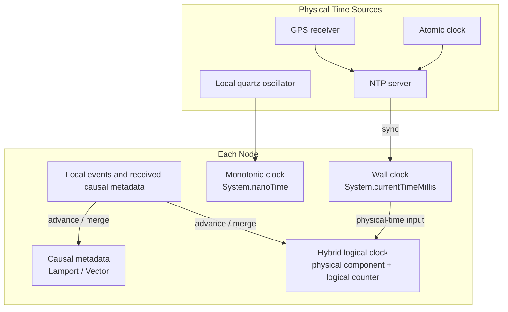
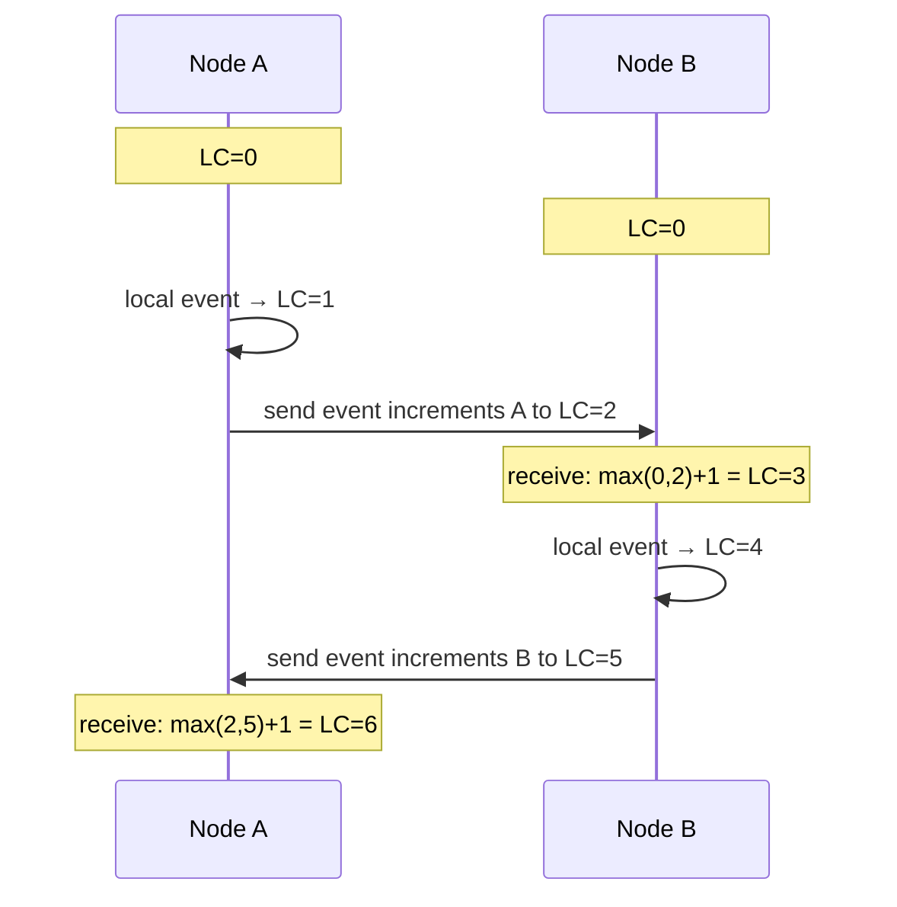

# Time & Clocks

## Overview

**Time** in computing is not one concept — it is at least three, and conflating them causes bugs that are subtle, intermittent, and extremely expensive. A **wall clock** tells you what time it is (\"2:35 PM\"). A **monotonic clock** tells you how much time has passed since an arbitrary starting point. A **logical clock** tells you the *order* of events without referencing physical time at all. Every distributed-systems failure involving time traces back to using one kind of clock where another was needed, or to assuming that two clocks on different machines agree — which they don't.

---

## Why It Exists

Computers need to answer two different questions about time:

1. **When did this happen?** (Calendar time — used for logging, displaying timestamps to humans, scheduling cron jobs.)
2. **How long did this take?** (Duration — used for timeouts, rate limiting, performance measurement, cache TTLs.)

What was broken before the distinction was treated explicitly: developers used wall-clock time for both. `System.currentTimeMillis()` was used for timeouts, cache expiry, and ordering events. Then the system wall clock was adjusted, for example by an NTP step or manual epoch-time change, and timeouts expired early or late. A timezone or daylight-saving change alters local calendar rendering; it does not by itself change the epoch value returned by currentTimeMillis().

The fundamental problem: wall clocks are not monotonic. They can jump forward, jump backward, or stop. Any system logic that depends on time *always moving forward at a constant rate* must use a monotonic clock. Any system logic that depends on clocks on different machines *agreeing* must use a logical clock or a protocol that accounts for clock skew.

---

## Historical Context

1. **UNIX epoch (1970).** Time as \"seconds since midnight Jan 1, 1970 UTC.\" Simple, universal, and wrong in multiple ways (no leap seconds, 32-bit overflow in 2038, wall clock masquerading as a duration clock).
2. **NTP (1985).** David Mills' Network Time Protocol synchronized clocks across the internet to within milliseconds. Made wall-clock time *useful* for distributed systems — but not *trustworthy* for ordering.
3. **Lamport timestamps (1978).** Leslie Lamport showed that physical time is unnecessary for ordering events in a distributed system. A monotonically incrementing counter, synchronized by message exchange, is sufficient. This decoupled *logical ordering* from *physical clocks*.
4. **Vector clocks (1988).** Mattern and Fidge independently extended Lamport timestamps to detect *concurrent* events — events with no causal relationship. Essential for conflict resolution in distributed databases.
5. **Google TrueTime (2012).** Spanner exposed physical-clock uncertainty as an interval and combined that bound with its transaction protocol and commit-wait to provide externally consistent distributed transactions. GPS and atomic-clock references keep uncertainty small.
6. **Hybrid Logical Clocks (2014).** HLC combined physical timestamps with logical counters, providing causally-consistent ordering while staying close to physical time. Used by CockroachDB and others who can't afford GPS clocks.

The arc: physical time (fragile) → logical time (correct but opaque) → hybrid time (correct and human-readable). Each generation accepted more of the underlying reality: clocks drift, networks delay, and time is relative.

---

## First Principles

### 1. Wall clock (real-time clock)

Returns the current date and time as understood by the operating system. Synchronized to an external source (NTP, GPS) and subject to adjustment.

Properties:
- **Non-monotonic.** Can jump backward or forward when the system epoch clock is adjusted. Local daylight-saving and timezone changes affect calendar representation, not UTC epoch progression by themselves.
- **Shared across machines** (via NTP), but never exactly synchronized — there is always *skew*.
- **Useful for:** timestamps humans read, log correlation across systems, scheduling.
- **Dangerous for:** measuring duration, ordering events, cache TTLs, timeouts.

### 2. Monotonic clock

Returns a counter that only goes up. The zero point is arbitrary (usually system boot) and meaningless to humans. Not synchronized across machines.

Properties:
- **Non-decreasing over its supported interval.** Consecutive reads may be equal because clock resolution is finite. Whether time in suspend/hibernate is counted depends on the particular clock.
- **Not shared.** Two machines' monotonic clocks have no relationship.
- **Useful for:** measuring elapsed time, timeouts, rate limiting, performance profiling.
- **Dangerous for:** timestamps in logs (meaningless to other machines), scheduling future events (meaningless after reboot).

### 3. Logical clock

A counter with no connection to physical time. Advanced by *events* (message sends, message receives), not by the passage of seconds. Processes follow a shared timestamp protocol; their counter values need not be equal. Message receipt advances a receiver beyond the received timestamp, preserving happened-before relationships rather than synchronizing every counter.

Properties:
- **Causally ordered.** If event A happened before event B (A caused B), A's logical timestamp is less than B's. The converse is not guaranteed by Lamport clocks (but is by vector clocks).
- **No relation to wall time.** Logical timestamp 42 does not mean 42 seconds.
- **Useful for:** ordering events across machines, detecting conflicts, maintaining causality.
- **Insufficient for:** elapsed durations, calendar deadlines or proving causality from Lamport timestamp order alone. A total order also needs a tie-breaker for equal timestamps.

### 4. Clock skew

The difference between two clocks at the same instant. NTP keeps skew under a few milliseconds on a well-configured LAN and under tens of milliseconds across the internet. But:

- **Skew drifts between NTP syncs.** A typical quartz crystal drifts 10-100 ppm (10-100 µs per second). Over an hour, that's 36-360 ms of drift.
- **NTP corrections are not instant.** NTP can slew (gradually adjust) or step (jump) the clock. Steps cause backward jumps.
- **VM clocks are worse.** VMs share a physical clock with their host; migration between hosts can cause large jumps.

The operational consequence: any computation that compares timestamps from two different machines must account for skew. An event timestamped 12:00:00.000 on machine A and 12:00:00.005 on machine B may have happened in either order — you cannot tell from the timestamps alone.

---

## Mental Model

Three wristwatches.

**Wall clock:** Your wristwatch. It's set to the correct time (roughly). Occasionally the battery skips and it jumps forward an hour, or you cross a time zone and adjust it. It tells you *what time it is* — but if you start a stopwatch feature and the watch jumps, the elapsed time is wrong.

**Monotonic clock:** A stopwatch app. It measures elapsed time from when you pressed Start. It doesn't know what time it is; it knows how long things take. It never jumps backward. It stops when you stop it.

**Logical clock:** A ticket dispenser at a bakery. Each customer takes a number. The numbers tell you the *order* of arrivals. The numbers have nothing to do with the time of day. If a customer arrives and takes number 7, and another takes number 8, you know 7 arrived first — even without looking at a clock.

When two bakeries on different streets each have their own ticket dispenser, the ticket numbers from different bakeries are *not comparable* — unless they coordinate. That coordination is what Lamport and vector clocks provide.

---

## Internal Mechanics

### Wall clock in practice

```kotlin
// Java/Kotlin/Android wall clock
val wallTimeMs: Long = System.currentTimeMillis()  // milliseconds since epoch
val wallTimeInstant: Instant = Clock.systemUTC().instant()  // Java 8+

// DANGER: using wall clock for elapsed time
val start = System.currentTimeMillis()
doWork()
val elapsed = System.currentTimeMillis() - start  // WRONG if NTP adjusts during doWork()
```

### Monotonic clock in practice

```kotlin
// JVM monotonic clock
val start = System.nanoTime()  // elapsed-time source, values expressed in nanoseconds
doWork()
val elapsedNanos = System.nanoTime() - start  // SAFE: never goes backward

// Kotlin Duration: measureTime uses TimeSource.Monotonic; JVM uses nanoTime
val elapsed = measureTime { doWork() }

// Android-specific monotonic clocks
val uptimeMs = SystemClock.uptimeMillis()      // since boot, excludes deep sleep
val realtimeMs = SystemClock.elapsedRealtime() // since boot, includes deep sleep
```

### Lamport timestamp

```kotlin
class LamportClock {
    private var counter: Long = 0

    @Synchronized
    fun tick(): Long = ++counter  // local event

    @Synchronized
    fun send(): Long {
        counter++
        return counter  // attach to outgoing message
    }

    @Synchronized
    fun receive(messageTimestamp: Long) {
        counter = maxOf(counter, messageTimestamp) + 1
    }
}
```

The rule: on every event, increment. On receive, merge (take the max) then increment. This guarantees: if A causally precedes B, then `timestamp(A) < timestamp(B)`. The converse is not guaranteed — concurrent events may be arbitrarily ordered.

### Vector clock

```kotlin
// Each participant needs a unique stable index in the same membership epoch.
// Snapshot copies from this illustrative clock must use that same index mapping.
class VectorClock(private val nodeIndex: Int, private val nodeCount: Int) {
    init { require(nodeCount > 0 && nodeIndex in 0 until nodeCount) }
    private val vector = LongArray(nodeCount)

    @Synchronized fun tick() { vector[nodeIndex]++ }

    @Synchronized fun send(): LongArray {
        vector[nodeIndex]++
        return vector.copyOf()
    }

    @Synchronized fun receive(other: LongArray) {
        require(other.size == nodeCount)
        for (i in vector.indices) vector[i] = maxOf(vector[i], other[i])
        vector[nodeIndex]++
    }

    @Synchronized fun happenedBefore(other: LongArray): Boolean {
        require(other.size == nodeCount)
        return vector.indices.all { vector[it] <= other[it] } &&
            vector.indices.any { vector[it] < other[it] }
    }

    @Synchronized fun concurrent(other: LongArray): Boolean {
        require(other.size == nodeCount)
        return vector.indices.any { vector[it] < other[it] } &&
            vector.indices.any { vector[it] > other[it] }
    }
}
```

Vector clocks answer the question Lamport clocks cannot: *are these two events concurrent?* If neither vector dominates the other (element-wise), the events are concurrent — no causal relationship exists between them. This is the foundation of conflict detection in distributed databases like Dynamo and Riak.

### Hybrid Logical Clock (HLC)

```kotlin
data class HLC(val physicalTime: Long, val logicalCounter: Int)

class HybridLogicalClock {
    private var hlc = HLC(System.currentTimeMillis(), 0)

    @Synchronized
    fun now(): HLC {
        val pt = System.currentTimeMillis()
        hlc = if (pt > hlc.physicalTime) {
            HLC(pt, 0)
        } else {
            HLC(hlc.physicalTime, hlc.logicalCounter + 1)
        }
        return hlc
    }

    @Synchronized
    fun receive(other: HLC): HLC {
        val pt = System.currentTimeMillis()
        hlc = when {
            pt > hlc.physicalTime && pt > other.physicalTime ->
                HLC(pt, 0)
            hlc.physicalTime == other.physicalTime ->
                HLC(hlc.physicalTime, maxOf(hlc.logicalCounter, other.logicalCounter) + 1)
            hlc.physicalTime > other.physicalTime ->
                HLC(hlc.physicalTime, hlc.logicalCounter + 1)
            else ->
                HLC(other.physicalTime, other.logicalCounter + 1)
        }
        return hlc
    }
}
```

HLC gives you causal ordering (like a logical clock) while staying close to physical time (so timestamps are human-readable). CockroachDB uses HLC for its transaction timestamps.

---

## Architecture





The diagram shows Lamport clock synchronization. Logical time flows forward based on events, not physics. When messages cross, clocks merge — ensuring causal consistency without physical time agreement.

---

## Production Example

- **Google Spanner / TrueTime.** TrueTime reports a bounded uncertainty interval. For a write transaction, commit-wait delays visibility until its chosen commit timestamp is definitely in the past. Together with the transaction protocol, this supports external consistency; it is not a rule that all concurrent transactions have distinct, non-overlapping timestamps.
- **Amazon Dynamo (2007 research system).** The original Dynamo paper describes vector clocks and application-assisted reconciliation. This is distinct from making a claim about the current Amazon DynamoDB product or its conflict-resolution options.
- **CockroachDB.** Uses HLC timestamps and enforces a configured clock-offset bound for guarantees beyond basic HLC causality. Its documented enforcement crashes a node that detects offset beyond 80% of that bound from at least half of the cluster. Serializability under SERIALIZABLE isolation is maintained despite skew; excessive skew can violate single-key linearizability assumptions.
- **Cassandra.** Uses wall-clock timestamps for last-writer-wins conflict resolution. Relies on NTP keeping clocks within a few milliseconds. Known to produce anomalies when NTP drifts — the documentation explicitly warns about this.
- **Kafka.** Partition offsets define record order; producer/broker timestamps are separate metadata and need not increase in offset order. Consumer offset lag counts records/positions, while time-based lag is a separate measurement. There is no single total order across partitions.

The shared lesson: every distributed system must choose a time model, and the choice has deep consequences for consistency, cost, and operational complexity.

---

## Android Example

Android exposes three clocks, each for a different purpose:

```kotlin
// 1. Wall clock — what time is it?
val now = System.currentTimeMillis()
// Use for: display to user, log timestamps, server-sync timestamps
// Avoid for elapsed intervals; persistent expiry needs an authoritative deadline policy.

// 2. Uptime — how long since boot? (excludes deep sleep)
val uptime = SystemClock.uptimeMillis()
// Use for: animation timing, Handler.postDelayed, UI frame timing
// Note: pauses during deep sleep — not suitable for alarm scheduling

// 3. Elapsed realtime — how long since boot? (includes deep sleep)
val realtime = SystemClock.elapsedRealtime()
// Use for: elapsed intervals within one boot, including time spent asleep.
// AlarmManager uses ELAPSED_REALTIME or ELAPSED_REALTIME_WAKEUP types.
```

Common Android time bugs:

```kotlin
// BUG: measuring duration with wall clock
val start = System.currentTimeMillis()
doExpensiveWork()
val elapsed = System.currentTimeMillis() - start
// If user changes time, or NTP corrects, elapsed can be negative or wildly large

// FIX: use kotlin.time.measureTime, backed by TimeSource.Monotonic
val elapsed = kotlin.time.measureTime { doExpensiveWork() }
// elapsed is a Duration; use elapsed.inWholeMilliseconds when needed

// BUG: scheduling a future event with wall clock
val fireAt = System.currentTimeMillis() + 60_000  // "60 seconds from now"
// If clock adjusts forward by 2 minutes, the event fires immediately
// If clock adjusts backward by 1 minute, the event fires 2 minutes late

// FIX: use elapsed realtime
val fireAt = SystemClock.elapsedRealtime() + 60_000
// Assume a permitted exact-alarm use case and a valid PendingIntent.
// On versions/targets requiring special access, check canScheduleExactAlarms() first.
alarmManager.setExact(AlarmManager.ELAPSED_REALTIME_WAKEUP, fireAt, intent)
```

For server synchronization, mobile clients must account for clock skew between the device and the server:

```kotlin
// Server sends its timestamp with every response
data class ApiResponse<T>(val data: T, val serverTimeMs: Long)

// Rough offset observation; includes response transport/processing delay.
val observedOffsetMs = response.serverTimeMs - System.currentTimeMillis()
// Do not treat this as exact skew or proof of cross-machine event ordering.
// Use a protocol with round-trip/uncertainty bounds for that requirement.
```

See [`../android/concurrency/battery-optimizations.md`](../android/concurrency/battery-optimizations.md) for how deep sleep affects clocks.

---

## Tradeoffs

**Wall clocks**

- Pro: human-readable, cross-system comparable (if NTP is working).
- Con: non-monotonic, subject to jumps, not reliable for ordering.

**Monotonic clocks**

- Pro: non-decreasing with finite resolution and designed for elapsed-time measurement; choose a clock whose sleep behavior matches the requirement.
- Con: meaningless across machines, meaningless after reboot.

**Logical clocks (Lamport)**

- Pro: simple, no dependency on physical time, correct causal ordering.
- Con: cannot infer causality or concurrency from timestamp order alone. Add a deterministic tie-breaker to construct a total order that extends causality; there is no elapsed-time meaning.

**Vector clocks**

- Pro: detect concurrency, full causal ordering.
- Con: size grows with number of nodes, expensive to compare and transmit.

**Hybrid Logical Clocks**

- Pro: causal ordering + stays close to physical time.
- Con: HLC timestamps can advance ahead of physical time. A database can impose clock-offset limits for additional consistency guarantees; those limits and shutdown policies are system-specific, not the basic HLC causal-ordering rule.

**When not to use (each):**

- Don't use wall clocks for duration measurement. Period.
- Don't use monotonic clocks for cross-machine ordering.
- Don't use Lamport clocks when you need to detect conflicts (use vector clocks).
- Budget vector metadata for the actual participants and membership policy. Pruning trades metadata size against retained causality; there is no universal 100-node threshold.

---

## Failure Modes

**Clock skew causes ordering anomalies.** Machine A writes at T=100, machine B writes at T=99. A last-writer-wins policy picks A, but B's write was actually later. Mitigation: use logical clocks for ordering; use physical clocks only for human-readable timestamps.

**NTP step correction jumps the clock backward.** A timeout computed as `currentTimeMillis() + 5000` expires immediately if the clock jumps forward by 6 seconds, or fires 6 seconds late if the clock jumps backward. Mitigation: use monotonic clocks for timeouts.

**Leap seconds.** UTC has leap seconds; POSIX time doesn't. On a leap-second day, some systems repeat a second (non-monotonic wall clock) or smear the second over hours (Google's leap-second smear). Either way, computations assuming 86,400 seconds per day are wrong on that day.

**Clock drift during deep sleep (mobile).** `uptimeMillis()` pauses during deep sleep; `elapsedRealtime()` does not. Using `uptimeMillis()` for alarm scheduling causes alarms to fire late. Mitigation: use `elapsedRealtime()` for anything that should account for sleep.

**32-bit epoch overflow (2038 problem).** `time_t` as a 32-bit signed integer overflows on January 19, 2038. Embedded systems and legacy code are affected. Mitigation: use 64-bit timestamps.

**Monotonic clock arithmetic.** nanoTime may already be negative because its origin is arbitrary. Differences within one JVM instance are useful, but intervals spanning more than about 292 years exceed signed-Long difference arithmetic. Use elapsed differences rather than comparing now with start + timeout, which can overflow sooner. Never compare readings from unrelated JVM instances.

---

## Performance Considerations

- **CPU:** Reading `System.nanoTime()` is a `vdso` call on Linux — tens of nanoseconds. Reading `System.currentTimeMillis()` is similar. Neither is expensive.
- **Memory:** Clocks themselves are trivial. Logical clocks (especially vector clocks) scale with the number of nodes — a vector clock for a 1,000-node cluster is 4-8 KB per event.
- **Network:** NTP uses minimal bandwidth. Logical-clock metadata adds bytes per message — negligible for Lamport (one integer), significant for large vector clocks.
- **Latency:** Spanner commit-wait depends on current TrueTime uncertainty and the chosen commit timestamp; some of it can overlap replication. A fixed maximum such as 7 ms is not a general API guarantee.
- **Battery (mobile):** Waking to check elapsed time is expensive. `AlarmManager` and `WorkManager` batch wakeups; don't use busy-wait on clock values.

---

## Reliability Considerations

- **Monotonic clocks are a reliability prerequisite.** Any timeout, retry backoff, circuit-breaker timer, or rate limiter that uses a wall clock has a latent failure mode. Use monotonic clocks for all duration-based logic.
- **Clock synchronization can be a dependency.** If a system relies on bounded wall-clock error, monitor its actual synchronization source and error budget. Kafka partition ordering instead follows offsets; timestamp-based retention and application event-time logic have separate clock assumptions.
- **Clock-offset enforcement.** Follow the database's actual detection threshold and failure response. CockroachDB documents immediate node crash when its measured offset from at least half the cluster exceeds 80% of the configured maximum; this is not a generic property of HLC.
- **Idempotency and time.** Use a monotonic elapsed-time source for an in-process retention interval. Persistent or cross-node expiration needs a durable authoritative deadline and a documented clock/restart policy; raw nanoTime values cannot be persisted and compared across JVM starts. Retention must also cover the supported retry/reconciliation horizon.

---

## Security Considerations

- **Time-based authentication.** TOTP commonly uses 30-second steps, but acceptance depends on the verifier's bounded drift policy and the current step phase. Enlarging that window increases exposure; use controlled resynchronization and prevent reuse of accepted codes.
- **Certificate validity.** TLS certificates have `notBefore` and `notAfter` timestamps. A client with a wrong clock rejects valid certificates or accepts expired ones. Root cause of many mobile TLS errors.
- **Signed-request freshness.** Protocols such as AWS SigV4 limit acceptance using signed timestamps and validity rules. This bounds a replay window rather than making an accepted request inherently one-time; nonce, idempotency or duplicate-handling rules depend on the protocol. Clock skew can cause legitimate requests to be rejected.
- **Clock manipulation.** Client clocks and client-side enforcement are not authoritative against a user controlling the device. Monotonic time helps local duration logic but does not prevent reboot, data rollback or tampering. Enforce security-sensitive expiry and quotas at a trusted service, with a deliberate offline policy.

---

## Observability

- **Clock skew metrics.** Monitor NTP offset across all nodes; alert when any node exceeds the configured maximum.
- **Timestamp quality.** For logs, tag whether the timestamp came from a wall clock, a monotonic clock, or a logical clock. This affects how downstream tools can correlate.
- **Drift rate.** Track how fast the local oscillator drifts between NTP syncs. High drift rate = unreliable clock between syncs.
- **Logical-clock health.** For HLC, monitor how far its physical component is ahead of the local wall clock and investigate remote future timestamps or clock adjustments. A vector clock has no physical-time unit to subtract from wall time; use causal progress and replication/backlog metrics appropriate to that protocol. Neither measure alone diagnoses a partition.
- **Dashboards.** A time-health dashboard: NTP offset per node, max skew across the cluster, logical-clock drift.
- **Alerts.** NTP offset > threshold; NTP daemon not running; clock step (discontinuity) detected.

Canonical: [`../observability/metrics.md`](../observability/metrics.md), [`../observability/distributed-tracing.md`](../observability/distributed-tracing.md).

---

## Staff Engineer Thinking

**Use the right clock for the job.** This is the single highest-leverage intervention. Most time bugs come from using `System.currentTimeMillis()` where `System.nanoTime()` or `SystemClock.elapsedRealtime()` was needed. A platform-level guideline — "wall clocks for display and logging; monotonic clocks for computation" — prevents an entire class of bugs.

**Treat NTP as critical infrastructure.** If your distributed system's correctness depends on clock agreement, NTP is as critical as the database. Monitor it, alert on it, and have a playbook for NTP failures.

**Choose your ordering primitive early.** The decision between wall-clock ordering (cheap, approximate), Lamport clocks (cheap, causal), vector clocks (expensive, precise), and HLC (moderate, hybrid) shapes the entire consistency model. Changing it later is a data migration.

**Be honest about skew bounds.** \"Our clocks are accurate enough\" is a statement that deserves a number. What's the maximum skew you've observed? What happens at 2× that skew? If you can't answer, your system has a latent bug.

**Push for monotonic clocks in mobile SDK guidelines.** Android's `SystemClock.elapsedRealtime()` is the right default for almost all duration-based computations, but many developers default to `System.currentTimeMillis()` by habit. A lint rule or code-review convention catches this cheaply.

---

## Common Misconceptions

**"System.currentTimeMillis() measures elapsed time."** It measures wall time, which can jump. Use `System.nanoTime()` or Kotlin's `measureTime` for elapsed time.

**"NTP makes all clocks agree."** NTP reduces skew but never eliminates it. Typical LAN skew is 0.1-1 ms; internet skew is 10-100 ms. Wall clocks across machines are *close*, not *equal*.

**"Monotonic clocks are the same across machines."** They're not. `System.nanoTime()` on machine A and machine B have unrelated zero points. You cannot subtract one from the other.

**"Timestamps can order events across machines."** Only if clock skew is smaller than the gap between events. For events milliseconds apart on different machines, wall-clock ordering is unreliable.

**"Logical clocks are complicated."** A Lamport clock is a single integer incremented on every event and merged on every message. Simpler than most code review comments.

**"More precision = more accuracy."** nanoTime values are expressed with nanosecond precision, but actual resolution need not be one nanosecond and absolute wall-clock accuracy is not its contract. Measure the platform's effective resolution; do not assume a universal microsecond accuracy.

---

## Probing Questions

1. `System.currentTimeMillis()` returns 1000, you do work, it returns 999. Is this a bug? Why or why not?
2. You're measuring API call latency. Should you use `currentTimeMillis` or `nanoTime`? What goes wrong with the other choice?
3. Two servers write to a shared database at T=100 and T=101 respectively. Can you guarantee which wrote first? Under what conditions?
4. Explain the difference between `SystemClock.uptimeMillis()` and `SystemClock.elapsedRealtime()` on Android. When does the difference matter?
5. A TOTP code is valid for 30 seconds. A mobile device's clock is 45 seconds ahead of the server. What happens? What's the mitigation?
6. Describe how a Lamport clock maintains causal ordering. Give an example where two events have the same Lamport timestamp.
7. Why do vector clocks grow linearly with the number of nodes? What's the practical limit?
8. Google Spanner waits out a "commit-wait" interval. What does it wait for, and why is this necessary?
9. Your cache TTL is implemented as `expiresAt = System.currentTimeMillis() + ttlMs`. What failure modes does this have?
10. CockroachDB crashes nodes whose clocks drift too far. Why is this better than silently tolerating drift?

---

## Answer Key

1. **`System.currentTimeMillis()` returns 1000, you do work, it returns 999. Is this a bug? Why or why not?**
   It is not a bug in the OS, it is expected behavior. Wall clocks can jump backward due to NTP step corrections. The bug is in using a wall clock to measure elapsed time.
2. **You're measuring API call latency. Should you use `currentTimeMillis` or `nanoTime`? What goes wrong with the other choice?**
   Use nanoTime differences or kotlin.time.measureTime. An epoch-clock adjustment can make currentTimeMillis differences inaccurate or negative; a timezone/DST display change alone does not change the epoch clock.
3. **Two servers write to a shared database at T=100 and T=101 respectively. Can you guarantee which wrote first? Under what conditions?**
   The timestamp units and error bounds must be known. Disjoint uncertainty intervals can establish physical order; overlapping intervals cannot. Without those bounds, T=100 and T=101 do not prove real order, and timestamp order alone does not establish causality.
4. **Explain the difference between `SystemClock.uptimeMillis()` and `SystemClock.elapsedRealtime()` on Android. When does the difference matter?**
   `uptimeMillis()` pauses during deep sleep, while `elapsedRealtime()` continues ticking. This matters for timeouts or alarms; using `uptimeMillis()` for a timeout while the device sleeps will cause it to fire extremely late.
5. **A TOTP code is valid for 30 seconds. A mobile device's clock is 45 seconds ahead of the server. What happens? What's the mitigation?**
   With 30-second steps, a device 45 seconds ahead can be one or two steps ahead, depending on the current phase. Acceptance depends on the verifier's configured drift window; ±1 is not guaranteed to cover it. Correct clock drift or use an authenticated resynchronization/recovery path, keep the window bounded, and reject reuse of an already accepted OTP.
6. **Describe how a Lamport clock maintains causal ordering. Give an example where two events have the same Lamport timestamp.**
   It increments on every local event and updates to `max(local, message_timestamp) + 1` on receive. Two completely independent events on different machines with no messages exchanged between them can naturally end up with the same Lamport timestamp.
7. **Why do vector clocks grow linearly with the number of nodes? What's the practical limit?**
   A fixed-membership vector stores one counter per participating process, so metadata grows with that membership. There is no universal hundred-node cutoff. Membership changes, encoding, pruning and the application's bandwidth/storage budget determine the limit; pruning can weaken what historical causality can be distinguished.
8. **Google Spanner waits out a "commit-wait" interval. What does it wait for, and why is this necessary?**
   Commit-wait waits until `TT.after(commitTimestamp)` is true: the chosen timestamp is definitely in the past according to TrueTime's uncertainty bound. Combined with Spanner's timestamp assignment and transaction protocol, this supplies external consistency; waiting a fixed uncertainty duration alone is not the complete guarantee.
9. **Your cache TTL is implemented as `expiresAt = System.currentTimeMillis() + ttlMs`. What failure modes does this have?**
   If the system wall clock jumps forward, the cache expires immediately. If it jumps backward, the cache serves stale data longer than intended.
10. **CockroachDB crashes nodes whose clocks drift too far. Why is this better than silently tolerating drift?**
    CockroachDB enforces a configured maximum offset for consistency guarantees beyond basic HLC causality, including its real-time ordering assumptions. Its documented response is to crash a node whose offset from at least half the cluster exceeds the enforcement threshold. This is system-specific; HLC message merging alone does not require synchronized physical clocks.

---

## Further Reading

In this repository:

- [`../distributed-systems/vector-clocks.md`](../distributed-systems/vector-clocks.md) — the full canonical treatment of vector clocks as a distributed-systems primitive.
- [`../distributed-systems/consistency-models.md`](../distributed-systems/consistency-models.md) — consistency models that depend on time ordering.
- [`../distributed-systems/cap-theorem.md`](../distributed-systems/cap-theorem.md) — partitions interact with clock assumptions.
- [`caching.md`](caching.md) — cache TTLs depend on clocks; clock skew breaks TTLs.
- [`fault-tolerance.md`](fault-tolerance.md) — clock failures as a fault-tolerance concern.
- [`../observability/distributed-tracing.md`](../observability/distributed-tracing.md) — traces depend on clock agreement for visualization.
- [`../observability/metrics.md`](../observability/metrics.md) — time-series metrics depend on timestamp accuracy.

External:

- Leslie Lamport, *Time, Clocks, and the Ordering of Events in a Distributed System* (1978). The foundational paper; still the clearest explanation.
- James Corbett et al., *Spanner: Google's Globally-Distributed Database* (2012). TrueTime and its consequences.
- Sandeep Kulkarni et al., *Logical Physical Clocks and Consistent Snapshots in Globally Distributed Databases* (2014). The HLC paper.
- Martin Kleppmann, *Designing Data-Intensive Applications*, Chapter 8 ("The Trouble with Distributed Systems"). The most accessible overview of clock problems.

### Official verification references

The corrections in this chapter were checked against the following primary references.

- [docs.oracle.com: System.html](https://docs.oracle.com/en/java/javase/25/docs/api/java.base/java/lang/System.html)
- [developer.android.com: SystemClock](https://developer.android.com/reference/android/os/SystemClock)
- [kotlinlang.org: -monotonic](https://kotlinlang.org/api/core/kotlin-stdlib/kotlin.time/-time-source/-monotonic/)
- [kotlinlang.org: measure-time-millis.html](https://kotlinlang.org/api/core/kotlin-stdlib/kotlin.system/measure-time-millis.html)
- [www.allthingsdistributed.com: amazon-dynamo-sosp2007.pdf](https://www.allthingsdistributed.com/files/amazon-dynamo-sosp2007.pdf)
- [lamport.azurewebsites.net: time-clocks.pdf](https://lamport.azurewebsites.net/pubs/time-clocks.pdf)
- [kafka.apache.org: KafkaConsumer.html](https://kafka.apache.org/41/javadoc/org/apache/kafka/clients/consumer/KafkaConsumer.html)
- [www.usenix.org: osdi12-final-16.pdf](https://www.usenix.org/system/files/conference/osdi12/osdi12-final-16.pdf)
- [cse.buffalo.edu: 2014-04.pdf](https://cse.buffalo.edu/tech-reports/2014-04.pdf)
- [docs.cockroachlabs.com: transaction-layer](https://docs.cockroachlabs.com/docs/stable/architecture/transaction-layer)
- [www.rfc-editor.org: rfc6238.html](https://www.rfc-editor.org/rfc/rfc6238.html)
- [aws.amazon.com: timeouts-retries-and-backoff-with-jitter](https://aws.amazon.com/builders-library/timeouts-retries-and-backoff-with-jitter/)
- [pages.nist.gov: sp800-63b.html](https://pages.nist.gov/800-63-4/sp800-63b.html)
- [kafka.apache.org: design](https://kafka.apache.org/41/design/design/)
- [developer.android.com: AlarmManager](https://developer.android.com/reference/android/app/AlarmManager)
- [developer.android.com: alarms](https://developer.android.com/develop/background-work/services/alarms)
- [docs.aws.amazon.com: reference_sigv.html](https://docs.aws.amazon.com/IAM/latest/UserGuide/reference_sigv.html)
