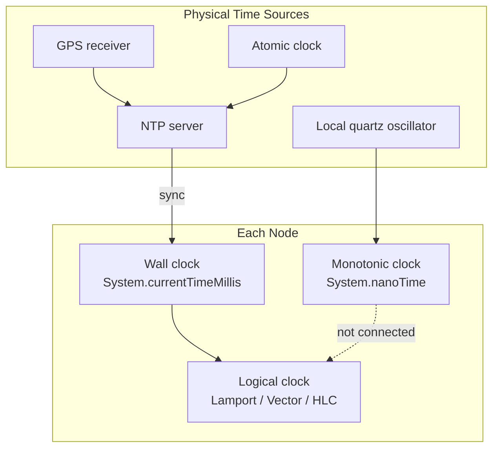
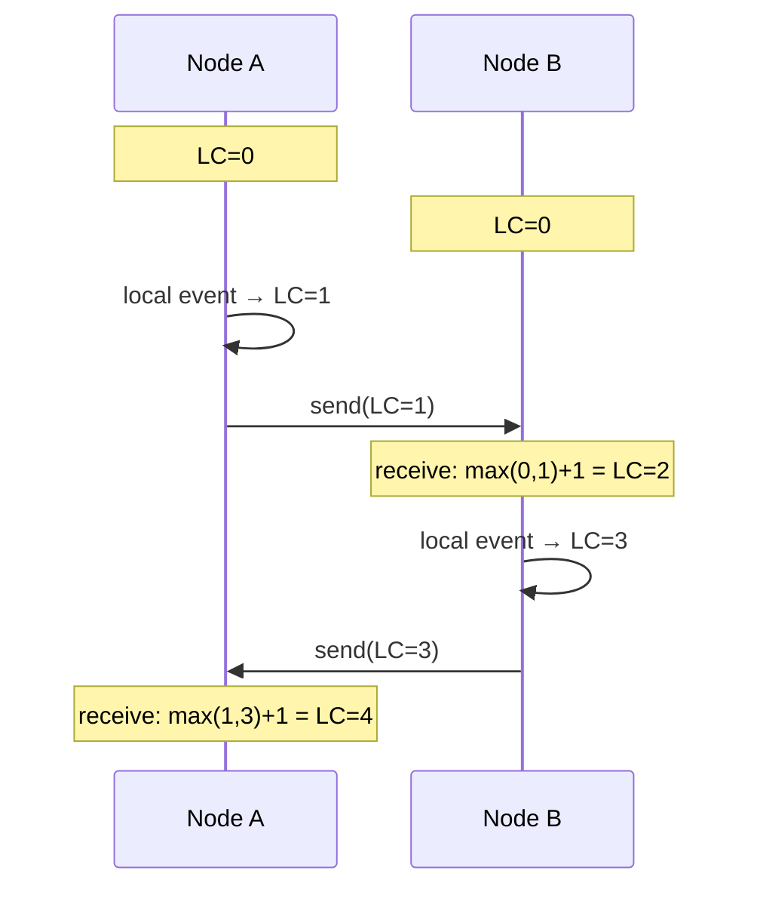

# Time & Clocks

## Overview

**Time** in computing is not one concept — it is at least three, and conflating them causes bugs that are subtle, intermittent, and extremely expensive. A **wall clock** tells you what time it is (\"2:35 PM\"). A **monotonic clock** tells you how much time has passed since an arbitrary starting point. A **logical clock** tells you the *order* of events without referencing physical time at all. Every distributed-systems failure involving time traces back to using one kind of clock where another was needed, or to assuming that two clocks on different machines agree — which they don't.

---

## Why It Exists

Computers need to answer two different questions about time:

1. **When did this happen?** (Calendar time — used for logging, displaying timestamps to humans, scheduling cron jobs.)
2. **How long did this take?** (Duration — used for timeouts, rate limiting, performance measurement, cache TTLs.)

What was broken before the distinction was treated explicitly: developers used wall-clock time for both. `System.currentTimeMillis()` was used for timeouts, cache expiry, and ordering events. Then the system's clock jumped — NTP corrected a drift, the user changed the time zone, daylight saving time shifted — and timeouts expired early, caches invalidated prematurely, and events appeared to happen out of order.

The fundamental problem: wall clocks are not monotonic. They can jump forward, jump backward, or stop. Any system logic that depends on time *always moving forward at a constant rate* must use a monotonic clock. Any system logic that depends on clocks on different machines *agreeing* must use a logical clock or a protocol that accounts for clock skew.

---

## Historical Context

1. **UNIX epoch (1970).** Time as \"seconds since midnight Jan 1, 1970 UTC.\" Simple, universal, and wrong in multiple ways (no leap seconds, 32-bit overflow in 2038, wall clock masquerading as a duration clock).
2. **NTP (1985).** David Mills' Network Time Protocol synchronized clocks across the internet to within milliseconds. Made wall-clock time *useful* for distributed systems — but not *trustworthy* for ordering.
3. **Lamport timestamps (1978).** Leslie Lamport showed that physical time is unnecessary for ordering events in a distributed system. A monotonically incrementing counter, synchronized by message exchange, is sufficient. This decoupled *logical ordering* from *physical clocks*.
4. **Vector clocks (1988).** Mattern and Fidge independently extended Lamport timestamps to detect *concurrent* events — events with no causal relationship. Essential for conflict resolution in distributed databases.
5. **Google TrueTime (2012).** Spanner introduced TrueTime, which reports clock time as an *interval* — \"the current time is between [earliest, latest]\" — and uses GPS receivers and atomic clocks to keep the interval small. The first system to make physical clocks reliable enough for ordering.
6. **Hybrid Logical Clocks (2014).** HLC combined physical timestamps with logical counters, providing causally-consistent ordering while staying close to physical time. Used by CockroachDB and others who can't afford GPS clocks.

The arc: physical time (fragile) → logical time (correct but opaque) → hybrid time (correct and human-readable). Each generation accepted more of the underlying reality: clocks drift, networks delay, and time is relative.

---

## First Principles

### 1. Wall clock (real-time clock)

Returns the current date and time as understood by the operating system. Synchronized to an external source (NTP, GPS) and subject to adjustment.

Properties:
- **Non-monotonic.** Can jump backward (NTP step correction) or forward (daylight saving, manual adjustment).
- **Shared across machines** (via NTP), but never exactly synchronized — there is always *skew*.
- **Useful for:** timestamps humans read, log correlation across systems, scheduling.
- **Dangerous for:** measuring duration, ordering events, cache TTLs, timeouts.

### 2. Monotonic clock

Returns a counter that only goes up. The zero point is arbitrary (usually system boot) and meaningless to humans. Not synchronized across machines.

Properties:
- **Strictly monotonic.** Never jumps backward. May pause during suspend/hibernate (depends on implementation).
- **Not shared.** Two machines' monotonic clocks have no relationship.
- **Useful for:** measuring elapsed time, timeouts, rate limiting, performance profiling.
- **Dangerous for:** timestamps in logs (meaningless to other machines), scheduling future events (meaningless after reboot).

### 3. Logical clock

A counter with no connection to physical time. Advanced by *events* (message sends, message receives), not by the passage of seconds. Two machines can have logical clocks that agree perfectly — because agreement is defined by the protocol, not by physics.

Properties:
- **Causally ordered.** If event A happened before event B (A caused B), A's logical timestamp is less than B's. The converse is not guaranteed by Lamport clocks (but is by vector clocks).
- **No relation to wall time.** Logical timestamp 42 does not mean 42 seconds.
- **Useful for:** ordering events across machines, detecting conflicts, maintaining causality.
- **Dangerous for:** nothing — but insufficient for humans who want to know *when* something happened.

### 4. Clock skew

The difference between two clocks at the same instant. NTP keeps skew under a few milliseconds on a well-configured LAN and under tens of milliseconds across the internet. But:

- **Skew drifts between NTP syncs.** A typical quartz crystal drifts 10-100 ppm (10-100 µs per second). Over an hour, that's 36-360 ms of drift.
- **NTP corrections are not instant.** NTP can slew (gradually adjust) or step (jump) the clock. Steps cause backward jumps.
- **VM clocks are worse.** VMs share a physical clock with their host; migration between hosts can cause large jumps.

The operational consequence: any computation that compares timestamps from two different machines must account for skew. An event timestamped 12:00:00.000 on machine A and 12:00:00.005 on machine B may have happened in either order — you cannot tell from the timestamps alone.

---

## Mental Model

Three wristwatches.

**Wall clock:** Your wristwatch. It's set to the correct time (roughly). Occasionally the battery skips and it jumps forward an hour, or you cross a time zone and adjust it. It tells you *what time it is* — but if you start a stopwatch feature and the watch jumps, the elapsed time is wrong.

**Monotonic clock:** A stopwatch app. It measures elapsed time from when you pressed Start. It doesn't know what time it is; it knows how long things take. It never jumps backward. It stops when you stop it.

**Logical clock:** A ticket dispenser at a bakery. Each customer takes a number. The numbers tell you the *order* of arrivals. The numbers have nothing to do with the time of day. If a customer arrives and takes number 7, and another takes number 8, you know 7 arrived first — even without looking at a clock.

When two bakeries on different streets each have their own ticket dispenser, the ticket numbers from different bakeries are *not comparable* — unless they coordinate. That coordination is what Lamport and vector clocks provide.

---

## Internal Mechanics

### Wall clock in practice

```kotlin
// Java/Kotlin/Android wall clock
val wallTimeMs: Long = System.currentTimeMillis()  // milliseconds since epoch
val wallTimeInstant: Instant = Clock.systemUTC().instant()  // Java 8+

// DANGER: using wall clock for elapsed time
val start = System.currentTimeMillis()
doWork()
val elapsed = System.currentTimeMillis() - start  // WRONG if NTP adjusts during doWork()
```

### Monotonic clock in practice

```kotlin
// JVM monotonic clock
val start = System.nanoTime()  // monotonic, nanosecond resolution
doWork()
val elapsedNanos = System.nanoTime() - start  // SAFE: never goes backward

// Kotlin Duration (wraps System.nanoTime)
val elapsed = measureTime { doWork() }

// Android-specific monotonic clocks
val uptimeMs = SystemClock.uptimeMillis()      // since boot, excludes deep sleep
val realtimeMs = SystemClock.elapsedRealtime() // since boot, includes deep sleep
```

### Lamport timestamp

```kotlin
class LamportClock {
    private var counter: Long = 0

    @Synchronized
    fun tick(): Long = ++counter  // local event

    @Synchronized
    fun send(): Long {
        counter++
        return counter  // attach to outgoing message
    }

    @Synchronized
    fun receive(messageTimestamp: Long) {
        counter = maxOf(counter, messageTimestamp) + 1
    }
}
```

The rule: on every event, increment. On receive, merge (take the max) then increment. This guarantees: if A causally precedes B, then `timestamp(A) < timestamp(B)`. The converse is not guaranteed — concurrent events may be arbitrarily ordered.

### Vector clock

```kotlin
class VectorClock(private val nodeId: String, private val nodeCount: Int) {
    private val vector = IntArray(nodeCount)
    private val nodeIndex: Int = nodeId.hashCode() % nodeCount  // simplified

    @Synchronized
    fun tick() { vector[nodeIndex]++ }

    @Synchronized
    fun send(): IntArray {
        vector[nodeIndex]++
        return vector.copyOf()
    }

    @Synchronized
    fun receive(other: IntArray) {
        for (i in vector.indices) {
            vector[i] = maxOf(vector[i], other[i])
        }
        vector[nodeIndex]++
    }

    fun happenedBefore(other: IntArray): Boolean =
        vector.indices.all { vector[it] <= other[it] } &&
        vector.indices.any { vector[it] < other[it] }

    fun concurrent(other: IntArray): Boolean =
        !happenedBefore(other) && !other.let { o ->
            o.indices.all { o[it] <= vector[it] } &&
            o.indices.any { o[it] < vector[it] }
        }
}
```

Vector clocks answer the question Lamport clocks cannot: *are these two events concurrent?* If neither vector dominates the other (element-wise), the events are concurrent — no causal relationship exists between them. This is the foundation of conflict detection in distributed databases like Dynamo and Riak.

### Hybrid Logical Clock (HLC)

```kotlin
data class HLC(val physicalTime: Long, val logicalCounter: Int)

class HybridLogicalClock {
    private var hlc = HLC(System.currentTimeMillis(), 0)

    @Synchronized
    fun now(): HLC {
        val pt = System.currentTimeMillis()
        hlc = if (pt > hlc.physicalTime) {
            HLC(pt, 0)
        } else {
            HLC(hlc.physicalTime, hlc.logicalCounter + 1)
        }
        return hlc
    }

    @Synchronized
    fun receive(other: HLC): HLC {
        val pt = System.currentTimeMillis()
        hlc = when {
            pt > hlc.physicalTime && pt > other.physicalTime ->
                HLC(pt, 0)
            hlc.physicalTime == other.physicalTime ->
                HLC(hlc.physicalTime, maxOf(hlc.logicalCounter, other.logicalCounter) + 1)
            hlc.physicalTime > other.physicalTime ->
                HLC(hlc.physicalTime, hlc.logicalCounter + 1)
            else ->
                HLC(other.physicalTime, other.logicalCounter + 1)
        }
        return hlc
    }
}
```

HLC gives you causal ordering (like a logical clock) while staying close to physical time (so timestamps are human-readable). CockroachDB uses HLC for its transaction timestamps.

---

## Architecture





The diagram shows Lamport clock synchronization. Logical time flows forward based on events, not physics. When messages cross, clocks merge — ensuring causal consistency without physical time agreement.

---

## Production Example

- **Google Spanner / TrueTime.** GPS receivers and atomic clocks in every datacenter provide a `TT.now()` that returns an interval `[earliest, latest]`. Spanner waits out the uncertainty interval before committing — ensuring that no two transactions have overlapping commit timestamps. Cost: dedicated hardware per datacenter. Benefit: globally-consistent transactions.
- **Amazon DynamoDB (original Dynamo paper, 2007).** Used vector clocks for conflict detection. When two replicas accepted conflicting writes, vector clocks identified the conflict for application-level resolution. (Later simplified to last-writer-wins in many cases for operational simplicity.)
- **CockroachDB.** Uses Hybrid Logical Clocks for transaction ordering. Stays within a configurable maximum clock offset (default 500 ms); if a node's clock drifts beyond the offset, it self-quarantines. No GPS hardware required.
- **Cassandra.** Uses wall-clock timestamps for last-writer-wins conflict resolution. Relies on NTP keeping clocks within a few milliseconds. Known to produce anomalies when NTP drifts — the documentation explicitly warns about this.
- **Kafka.** Uses wall-clock timestamps for message ordering within partitions. Consumer lag is measured in wall time. Cross-partition ordering is undefined.

The shared lesson: every distributed system must choose a time model, and the choice has deep consequences for consistency, cost, and operational complexity.

---

## Android Example

Android exposes three clocks, each for a different purpose:

```kotlin
// 1. Wall clock — what time is it?
val now = System.currentTimeMillis()
// Use for: display to user, log timestamps, server-sync timestamps
// NEVER for: measuring elapsed time, timeouts, cache TTLs

// 2. Uptime — how long since boot? (excludes deep sleep)
val uptime = SystemClock.uptimeMillis()
// Use for: animation timing, Handler.postDelayed, UI frame timing
// Note: pauses during deep sleep — not suitable for alarm scheduling

// 3. Elapsed realtime — how long since boot? (includes deep sleep)
val realtime = SystemClock.elapsedRealtime()
// Use for: timeouts, cache TTLs, AlarmManager.setElapsed*
// This is the closest Android has to a true monotonic clock
```

Common Android time bugs:

```kotlin
// BUG: measuring duration with wall clock
val start = System.currentTimeMillis()
doExpensiveWork()
val elapsed = System.currentTimeMillis() - start
// If user changes time, or NTP corrects, elapsed can be negative or wildly large

// FIX: use monotonic clock
val elapsed = measureTimeMillis { doExpensiveWork() }
// Wraps System.nanoTime() — safe

// BUG: scheduling a future event with wall clock
val fireAt = System.currentTimeMillis() + 60_000  // "60 seconds from now"
// If clock adjusts forward by 2 minutes, the event fires immediately
// If clock adjusts backward by 1 minute, the event fires 2 minutes late

// FIX: use elapsed realtime
val fireAt = SystemClock.elapsedRealtime() + 60_000
alarmManager.setExact(AlarmManager.ELAPSED_REALTIME_WAKEUP, fireAt, intent)
```

For server synchronization, mobile clients must account for clock skew between the device and the server:

```kotlin
// Server sends its timestamp with every response
data class ApiResponse<T>(val data: T, val serverTimeMs: Long)

// Calculate approximate skew
val skew = response.serverTimeMs - System.currentTimeMillis()
// Use skew to adjust local timestamps when comparing with server events
```

See [`../android/concurrency/battery-optimizations.md`](../android/concurrency/battery-optimizations.md) for how deep sleep affects clocks.

---

## Tradeoffs

**Wall clocks**

- Pro: human-readable, cross-system comparable (if NTP is working).
- Con: non-monotonic, subject to jumps, not reliable for ordering.

**Monotonic clocks**

- Pro: strictly increasing, correct for measuring duration.
- Con: meaningless across machines, meaningless after reboot.

**Logical clocks (Lamport)**

- Pro: simple, no dependency on physical time, correct causal ordering.
- Con: cannot detect concurrency (only partial order), no connection to wall time.

**Vector clocks**

- Pro: detect concurrency, full causal ordering.
- Con: size grows with number of nodes, expensive to compare and transmit.

**Hybrid Logical Clocks**

- Pro: causal ordering + stays close to physical time.
- Con: depends on bounded clock skew (nodes with large skew must be quarantined).

**When not to use (each):**

- Don't use wall clocks for duration measurement. Period.
- Don't use monotonic clocks for cross-machine ordering.
- Don't use Lamport clocks when you need to detect conflicts (use vector clocks).
- Don't use vector clocks at large scale (>100 nodes) without pruning.

---

## Failure Modes

**Clock skew causes ordering anomalies.** Machine A writes at T=100, machine B writes at T=99. A last-writer-wins policy picks A, but B's write was actually later. Mitigation: use logical clocks for ordering; use physical clocks only for human-readable timestamps.

**NTP step correction jumps the clock backward.** A timeout computed as `currentTimeMillis() + 5000` expires immediately if the clock jumps forward by 6 seconds, or fires 6 seconds late if the clock jumps backward. Mitigation: use monotonic clocks for timeouts.

**Leap seconds.** UTC has leap seconds; POSIX time doesn't. On a leap-second day, some systems repeat a second (non-monotonic wall clock) or smear the second over hours (Google's leap-second smear). Either way, computations assuming 86,400 seconds per day are wrong on that day.

**Clock drift during deep sleep (mobile).** `uptimeMillis()` pauses during deep sleep; `elapsedRealtime()` does not. Using `uptimeMillis()` for alarm scheduling causes alarms to fire late. Mitigation: use `elapsedRealtime()` for anything that should account for sleep.

**32-bit epoch overflow (2038 problem).** `time_t` as a 32-bit signed integer overflows on January 19, 2038. Embedded systems and legacy code are affected. Mitigation: use 64-bit timestamps.

**Monotonic clock overflow.** `System.nanoTime()` returns a `Long`, which overflows after ~292 years. Not a practical concern per JVM instance, but subtracting two values from different JVM starts is undefined.

---

## Performance Considerations

- **CPU:** Reading `System.nanoTime()` is a `vdso` call on Linux — tens of nanoseconds. Reading `System.currentTimeMillis()` is similar. Neither is expensive.
- **Memory:** Clocks themselves are trivial. Logical clocks (especially vector clocks) scale with the number of nodes — a vector clock for a 1,000-node cluster is 4-8 KB per event.
- **Network:** NTP uses minimal bandwidth. Logical-clock metadata adds bytes per message — negligible for Lamport (one integer), significant for large vector clocks.
- **Latency:** Google TrueTime's `commit-wait` adds up to ~7 ms per transaction (the uncertainty interval). This is the cost of turning physical clocks into a reliable ordering primitive.
- **Battery (mobile):** Waking to check elapsed time is expensive. `AlarmManager` and `WorkManager` batch wakeups; don't use busy-wait on clock values.

---

## Reliability Considerations

- **Monotonic clocks are a reliability prerequisite.** Any timeout, retry backoff, circuit-breaker timer, or rate limiter that uses a wall clock has a latent failure mode. Use monotonic clocks for all duration-based logic.
- **NTP availability is a dependency.** If NTP is unavailable, wall clocks drift. For systems that depend on wall-clock agreement (Cassandra, Kafka), NTP must be treated as critical infrastructure.
- **Clock quarantine.** CockroachDB rejects nodes whose clocks have drifted beyond the configured maximum offset. This is a fault-tolerance mechanism — a drifted clock is a faulty component, and the system tolerates it by excluding it.
- **Idempotency and time.** Idempotency keys with wall-clock-based TTLs are vulnerable to clock jumps. Use monotonic clocks for TTL enforcement; use wall clocks only for the human-readable expiry display.

---

## Security Considerations

- **Time-based authentication.** TOTP (Time-based One-Time Password) depends on clock agreement between client and server within a 30-second window. Clock skew beyond that window causes authentication failures. Mitigation: servers accept codes from adjacent windows (±1).
- **Certificate validity.** TLS certificates have `notBefore` and `notAfter` timestamps. A client with a wrong clock rejects valid certificates or accepts expired ones. Root cause of many mobile TLS errors.
- **Replay protection.** Timestamps in signed requests (AWS SigV4, OAuth) prevent replay by rejecting requests older than N minutes. A client with a skewed clock has its requests rejected.
- **Clock manipulation.** On rooted/jailbroken devices, the user can set the wall clock arbitrarily. Any security mechanism based on wall-clock time (trial periods, rate limits) is bypassable. Use server-issued timestamps or monotonic clocks for enforcement.

---

## Observability

- **Clock skew metrics.** Monitor NTP offset across all nodes; alert when any node exceeds the configured maximum.
- **Timestamp quality.** For logs, tag whether the timestamp came from a wall clock, a monotonic clock, or a logical clock. This affects how downstream tools can correlate.
- **Drift rate.** Track how fast the local oscillator drifts between NTP syncs. High drift rate = unreliable clock between syncs.
- **Logical clock lag.** In systems using HLC or vector clocks, monitor the gap between physical time and logical time. A growing gap means messages are arriving out of order or nodes are partitioned.
- **Dashboards.** A time-health dashboard: NTP offset per node, max skew across the cluster, logical-clock drift.
- **Alerts.** NTP offset > threshold; NTP daemon not running; clock step (discontinuity) detected.

Canonical: [`../observability/metrics.md`](../observability/metrics.md), [`../observability/distributed-tracing.md`](../observability/distributed-tracing.md).

---

## Staff Engineer Thinking

**Use the right clock for the job.** This is the single highest-leverage intervention. Most time bugs come from using `System.currentTimeMillis()` where `System.nanoTime()` or `SystemClock.elapsedRealtime()` was needed. A platform-level guideline — "wall clocks for display and logging; monotonic clocks for computation" — prevents an entire class of bugs.

**Treat NTP as critical infrastructure.** If your distributed system's correctness depends on clock agreement, NTP is as critical as the database. Monitor it, alert on it, and have a playbook for NTP failures.

**Choose your ordering primitive early.** The decision between wall-clock ordering (cheap, approximate), Lamport clocks (cheap, causal), vector clocks (expensive, precise), and HLC (moderate, hybrid) shapes the entire consistency model. Changing it later is a data migration.

**Be honest about skew bounds.** \"Our clocks are accurate enough\" is a statement that deserves a number. What's the maximum skew you've observed? What happens at 2× that skew? If you can't answer, your system has a latent bug.

**Push for monotonic clocks in mobile SDK guidelines.** Android's `SystemClock.elapsedRealtime()` is the right default for almost all duration-based computations, but many developers default to `System.currentTimeMillis()` by habit. A lint rule or code-review convention catches this cheaply.

---

## Common Misconceptions

**"System.currentTimeMillis() measures elapsed time."** It measures wall time, which can jump. Use `System.nanoTime()` or Kotlin's `measureTime` for elapsed time.

**"NTP makes all clocks agree."** NTP reduces skew but never eliminates it. Typical LAN skew is 0.1-1 ms; internet skew is 10-100 ms. Wall clocks across machines are *close*, not *equal*.

**"Monotonic clocks are the same across machines."** They're not. `System.nanoTime()` on machine A and machine B have unrelated zero points. You cannot subtract one from the other.

**"Timestamps can order events across machines."** Only if clock skew is smaller than the gap between events. For events milliseconds apart on different machines, wall-clock ordering is unreliable.

**"Logical clocks are complicated."** A Lamport clock is a single integer incremented on every event and merged on every message. Simpler than most code review comments.

**"More precision = more accuracy."** Nanosecond resolution does not mean nanosecond accuracy. `System.nanoTime()` has nanosecond *resolution* but microsecond *accuracy* on most hardware. Don't confuse the two.

---

## Probing Questions

1. `System.currentTimeMillis()` returns 1000, you do work, it returns 999. Is this a bug? Why or why not?
2. You're measuring API call latency. Should you use `currentTimeMillis` or `nanoTime`? What goes wrong with the other choice?
3. Two servers write to a shared database at T=100 and T=101 respectively. Can you guarantee which wrote first? Under what conditions?
4. Explain the difference between `SystemClock.uptimeMillis()` and `SystemClock.elapsedRealtime()` on Android. When does the difference matter?
5. A TOTP code is valid for 30 seconds. A mobile device's clock is 45 seconds ahead of the server. What happens? What's the mitigation?
6. Describe how a Lamport clock maintains causal ordering. Give an example where two events have the same Lamport timestamp.
7. Why do vector clocks grow linearly with the number of nodes? What's the practical limit?
8. Google Spanner waits out a "commit-wait" interval. What does it wait for, and why is this necessary?
9. Your cache TTL is implemented as `expiresAt = System.currentTimeMillis() + ttlMs`. What failure modes does this have?
10. CockroachDB quarantines nodes whose clocks drift too far. Why is this better than silently tolerating drift?

---

## Answer Key

1. **`System.currentTimeMillis()` returns 1000, you do work, it returns 999. Is this a bug? Why or why not?**
   It is not a bug in the OS, it is expected behavior. Wall clocks can jump backward due to NTP step corrections. The bug is in using a wall clock to measure elapsed time.
2. **You're measuring API call latency. Should you use `currentTimeMillis` or `nanoTime`? What goes wrong with the other choice?**
   Use `nanoTime`. If you use `currentTimeMillis`, NTP corrections or daylight saving adjustments could cause the measured latency to be wildly inaccurate or even negative.
3. **Two servers write to a shared database at T=100 and T=101 respectively. Can you guarantee which wrote first? Under what conditions?**
   No, unless you know their clock skew is strictly less than 1ms (the gap between T=100 and T=101), which is practically impossible to guarantee without specialized hardware.
4. **Explain the difference between `SystemClock.uptimeMillis()` and `SystemClock.elapsedRealtime()` on Android. When does the difference matter?**
   `uptimeMillis()` pauses during deep sleep, while `elapsedRealtime()` continues ticking. This matters for timeouts or alarms; using `uptimeMillis()` for a timeout while the device sleeps will cause it to fire extremely late.
5. **A TOTP code is valid for 30 seconds. A mobile device's clock is 45 seconds ahead of the server. What happens? What's the mitigation?**
   The client will generate a code for the next time window, and the server will reject it. The mitigation is for the server to accept codes from adjacent windows (e.g., ±1 window).
6. **Describe how a Lamport clock maintains causal ordering. Give an example where two events have the same Lamport timestamp.**
   It increments on every local event and updates to `max(local, message_timestamp) + 1` on receive. Two completely independent events on different machines with no messages exchanged between them can naturally end up with the same Lamport timestamp.
7. **Why do vector clocks grow linearly with the number of nodes? What's the practical limit?**
   A vector clock must maintain a counter for every single node in the system to detect concurrency. The practical limit is usually a few dozen to a hundred nodes, beyond which the metadata payload becomes too large.
8. **Google Spanner waits out a "commit-wait" interval. What does it wait for, and why is this necessary?**
   It waits out the "uncertainty interval" returned by TrueTime (the maximum possible clock skew). This ensures the transaction's commit timestamp is strictly in the past for any subsequent transaction, guaranteeing global consistency.
9. **Your cache TTL is implemented as `expiresAt = System.currentTimeMillis() + ttlMs`. What failure modes does this have?**
   If the system wall clock jumps forward, the cache expires immediately. If it jumps backward, the cache serves stale data longer than intended.
10. **CockroachDB quarantines nodes whose clocks drift too far. Why is this better than silently tolerating drift?**
    Because it uses Hybrid Logical Clocks, extreme drift breaks its causal ordering guarantees. Quarantining treats the drifted clock as a faulty component, preserving the integrity of the overall system data.

---

## Further Reading

In this repository:

- [`../distributed-systems/vector-clocks.md`](../distributed-systems/vector-clocks.md) — the full canonical treatment of vector clocks as a distributed-systems primitive.
- [`../distributed-systems/consistency-models.md`](../distributed-systems/consistency-models.md) — consistency models that depend on time ordering.
- [`../distributed-systems/cap-theorem.md`](../distributed-systems/cap-theorem.md) — partitions interact with clock assumptions.
- [`caching.md`](caching.md) — cache TTLs depend on clocks; clock skew breaks TTLs.
- [`fault-tolerance.md`](fault-tolerance.md) — clock failures as a fault-tolerance concern.
- [`../observability/distributed-tracing.md`](../observability/distributed-tracing.md) — traces depend on clock agreement for visualization.
- [`../observability/metrics.md`](../observability/metrics.md) — time-series metrics depend on timestamp accuracy.

External:

- Leslie Lamport, *Time, Clocks, and the Ordering of Events in a Distributed System* (1978). The foundational paper; still the clearest explanation.
- James Corbett et al., *Spanner: Google's Globally-Distributed Database* (2012). TrueTime and its consequences.
- Sandeep Kulkarni et al., *Logical Physical Clocks and Consistent Snapshots in Globally Distributed Databases* (2014). The HLC paper.
- Martin Kleppmann, *Designing Data-Intensive Applications*, Chapter 8 ("The Trouble with Distributed Systems"). The most accessible overview of clock problems.
