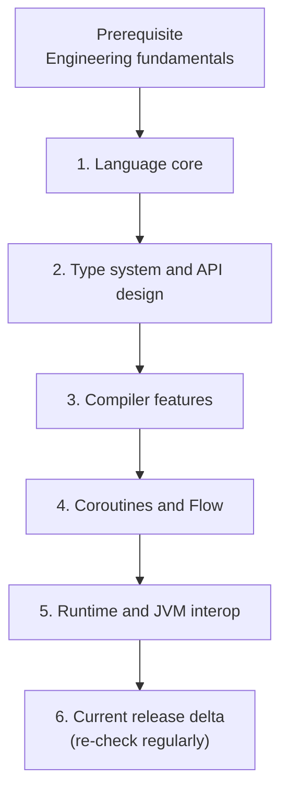

# Kotlin

## Purpose

The Kotlin language—from design choices to bytecode. This tree owns coroutine and Flow language mechanics; Android application guidance links back here.

## Why It Matters

Kotlin is the substrate of the Android tree. Deep knowledge of nullability, variance, inline code, suspend state machines, memory, and JVM interop separates engineers who write Kotlin syntax from engineers who can shape safe, evolvable Kotlin codebases.

## What This Folder Helps You Do

- Write null-safe, type-safe, binary-conscious, coroutine-friendly APIs.
- Understand compiler output for data/value classes, inline/reified functions, suspend functions, and Java-facing APIs.
- Reason about allocation, continuations, cancellation, backpressure, dispatchers, and virtual time.
- Review Android and KMP code for abstraction leaks, compatibility promises, and production concurrency failures.

## Guided Reading Sequence

Prerequisite: [Engineering Fundamentals](engineering-fundamentals.md) through immutability, state machines, and backpressure. Follow phases in order and read each numbered list top to bottom.

The sequence first makes values and APIs safe, then explains compiler transformation, asynchronous execution, and runtime consequences. Release-specific material comes last so changing versions do not replace stable mental models.

### Phase 1 — Language core

1. [Variables](kotlin/language-core/variables.md)
2. [Null Safety](kotlin/language-core/null-safety.md)
3. [Functions](kotlin/language-core/functions.md)
4. [Extensions](kotlin/language-core/extensions.md)
5. [Data Classes](kotlin/language-core/data-classes.md)
6. [Value Classes](kotlin/language-core/value-classes.md)
7. [Sealed Classes](kotlin/language-core/sealed-classes.md)
8. [Delegation](kotlin/language-core/delegation.md)

**Checkpoint:** model a UI or domain state so illegal states are difficult to construct, and explain its nullability and equality contracts.

### Phase 2 — Type-system and API design

1. [Generics](kotlin/type-system/generics.md)
2. [Variance](kotlin/type-system/variance.md)

**Checkpoint:** design a producer/consumer API and explain every `in`, `out`, star projection, and public compatibility consequence.

### Phase 3 — Compiler features and metaprogramming

1. [Inline Functions](kotlin/compiler-features/inline-functions.md)
2. [Reified Types](kotlin/compiler-features/reified-types.md)
3. [Context Parameters](kotlin/version-updates/kotlin-2-4-update.md#context-parameters-are-stable) — modeling named contextual dependencies. Context receivers were withdrawn and should not be used for new code.

**Checkpoint:** explain what is copied at a call site, which allocations may disappear, why reified access requires inlining, and how named context parameters model multiple required capabilities.

### Phase 4 — Coroutines and Flow

1. [Coroutines](kotlin/coroutines-and-flow/coroutines.md) — canonical owner; Android internals apply it later.
2. [Channels and Select](kotlin/coroutines-and-flow/channels-and-select.md)
3. [Flow Operators and Backpressure](kotlin/coroutines-and-flow/flow-operators-and-backpressure.md)
4. [callbackFlow and Bridging Callbacks](kotlin/coroutines-and-flow/callbackflow-and-bridging-callbacks.md)
5. [Coroutines Debugging and Profiling](kotlin/coroutines-and-flow/coroutines-debugging-and-profiling.md)
6. [Test Dispatchers and Virtual Time](kotlin/coroutines-and-flow/test-dispatchers-virtual-time.md)

**Checkpoint:** draw a coroutine job tree, show cancellation propagation, and explain queueing/dropping behavior when a Flow producer outruns its consumer.

### Phase 5 — Runtime and JVM interoperability

1. [Memory Model](kotlin/runtime-and-jvm/memory-model.md)
2. [JVM Interop](kotlin/runtime-and-jvm/jvm-interop.md)
3. [Bytecode](kotlin/runtime-and-jvm/bytecode.md)

**Checkpoint:** inspect a Kotlin API from Java and bytecode perspectives, identify allocations/boxing, and predict its binary compatibility risk.

### Phase 6 — Current release delta (read last and re-check regularly)

1. [Kotlin 2.4 Update for Android and KMP](kotlin/version-updates/kotlin-2-4-update.md)

Release digests assume the stable mechanics above and are not substitutes for them.

## Continue the Complete Curriculum

Continue to [Principles](principles.md), [Patterns](patterns.md), and then the [Android guided sequence](android.md#guided-reading-sequence).
