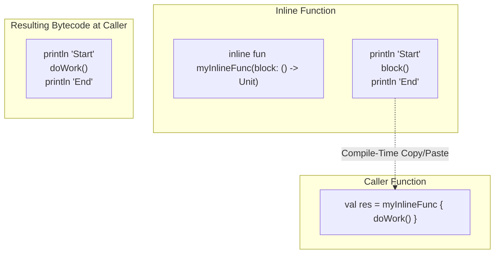

# Inline Functions

## Overview

The `inline` keyword is a compiler directive that tells Kotlin to take the exact bytecode of a function and paste it directly into every place that function is called, rather than actually invoking the function at runtime.

It is primarily used to eliminate the severe memory and performance overhead of using Lambdas (Higher-Order Functions) on the JVM. 

## Why It Matters

Kotlin encourages functional programming. You frequently pass functions as arguments to other functions: `list.filter { it > 5 }`. 

A non-inline higher-order call can involve a function object, captures, boxing, and indirect calls. This is not a new anonymous object on every invocation: noncapturing lambdas may be reused, and Kotlin/JVM 2.0+ uses `invokedynamic` by default. Capturing lambdas and runtime optimisations need separate inspection. Also, stdlib `filter` is already inline.

Inlining can remove the inlinable lambda object and indirect call at a Kotlin call site. It does not remove unrelated allocations, such as the result list. Measure hot paths before attributing UI jank to lambda allocation.

## Historical Context

In C and C++, `inline` was used to save the CPU from the overhead of a "function call" (pushing parameters to the stack, jumping memory addresses). 
In Java, you cannot explicitly ask for inlining. The Java Just-In-Time (JIT) compiler dynamically decides whether to inline small functions at runtime based on profiling data. 
Kotlin introduced explicit `inline` not to save CPU cycles on function jumps, but specifically to stop the JVM from creating hidden Anonymous Classes for Lambdas.

## First Principles

1.  **Copy and Paste:** The compiler literally copies the body of the inline function, and the body of the lambda you passed to it, and pastes them directly into the call site.
2.  **No Lambda Objects:** Because the lambda's code is pasted directly into the caller, no anonymous `Function` object is ever instantiated on the heap.
3.  **Non-Local Returns:** Standard lambdas cannot use the `return` keyword to exit the outer function. But if a lambda is inlined, it becomes part of the outer function, allowing a "non-local return" that exits the caller immediately.

## Mental Model

Think of a Lawyer (The Caller) and a Paralegal (The Function).
- **Normal Function:** The Lawyer tells the Paralegal to draft a contract (The Lambda). The Paralegal goes to another room, prints a new piece of paper (Memory Allocation), drafts the contract, and brings it back.
- **Inline Function:** The Lawyer tells the Paralegal to draft a contract. The Paralegal walks over, takes the Lawyer's pen, and writes the contract directly onto the Lawyer's existing piece of paper. No new paper is created. No rooms were changed.

## Internal Mechanics

Look at this simple Higher-Order Function:

```kotlin
// WITHOUT INLINE
fun doMath(a: Int, b: Int, operation: (Int, Int) -> Int): Int {
    return operation(a, b)
}

fun calculate() {
    val result = doMath(5, 10) { x, y -> x + y }
}
```

The following Java-shaped sketch illustrates a possible function-object call. It is pseudocode, not guaranteed decompiler output: this noncapturing lambda can be reused, and modern Kotlin/JVM normally emits `invokedynamic`.

```java
// Conceptual Java-shaped sketch (No Inline)
public final void calculate() {
    // Illustrative function object; not proof of a fresh allocation per call.
    int result = doMath(5, 10, new Function2<Integer, Integer, Integer>() {
        public Integer invoke(Integer x, Integer y) {
            return x + y;
        }
    });
}
```

Now, let's add `inline`:

```kotlin
// WITH INLINE
inline fun doMath(a: Int, b: Int, operation: (Int, Int) -> Int): Int {
    return operation(a, b)
}

fun calculate() {
    val result = doMath(5, 10) { x, y -> x + y }
}
```

Decompiled Java:

```java
// Decompiled Java (With Inline)
public final void calculate() {
    // The compiler literally copied the logic (x + y) and pasted it here!
    // No doMath function is called. No Object is instantiated. Zero overhead.
    int x = 5;
    int y = 10;
    int result = x + y; 
}
```

## Architecture



## Bytecode Evidence

Showing decompiled Java is one level of evidence; reading actual JVM bytecode is another. Compile both versions and run `javap -c -p`:

**Without `inline`** — this illustrative listing shows one possible class-based call shape. It is not the output of the noncapturing example on current defaults. Kotlin/JVM 2.2.21 emits `invokedynamic`; with `-Xlambdas=class` it uses a cached `INSTANCE` for this lambda:

```
public final void calculate();
  Code:
     0: aload_0
     1: iconst_5                                              // push 5
     2: bipush        10                                      // push 10
     4: new           #15  // class CalcKt$calculate$1        // ALLOCATE new lambda
     7: dup
     8: invokespecial #19  // CalcKt$calculate$1."<init>":()V // construct it
    11: checkcast     #21  // kotlin/jvm/functions/Function2
    14: invokevirtual #25  // Method doMath:(IILkotlin/jvm/functions/Function2;)I
    17: istore_1                                              // result -> local 1
    18: return
```

In the illustrative listing, `new` followed by construction would allocate a fresh function object. Do not apply that count to the source above: its noncapturing lambda can be cached or linked using `invokedynamic`. Actual allocation rates and jank require measurement.

**With `inline`** — the lambda body is pasted into the caller. No allocation:

```
public final void calculate();
  Code:
     0: iconst_5                                              // push 5
     1: istore_1                                              // a -> local 1
     2: bipush        10                                      // push 10
     4: istore_2                                              // b -> local 2
     5: iload_1                                               // push a
     6: iload_2                                               // push b
     7: iadd                                                  // add (the lambda body!)
     8: istore_3                                              // result -> local 3
     9: return
```

Zero `new` opcodes, zero `invokevirtual` on a lambda interface, zero `Function2` reference anywhere. The math (`iadd`) happens directly in the caller's frame.

**Compare the actual call sites.** Inlining can eliminate the function-object invocation and boxing used by a generic Function interface. It does not establish a fixed number of heap allocations or a runtime speedup for this example. Inspect compiler output for the chosen version and flags, then measure the optimised Android build.

## Production Example

**The Kotlin Standard Library**

Almost all collection operators (`forEach`, `map`, `filter`) and scope functions (`let`, `apply`, `run`) in the Kotlin Standard Library are `inline`.

Inlining reduces overhead for many stdlib higher-order calls. It does not fuse eager collection operations: `filter` and `map` still create their result collections, and sorting has its own allocations and comparison cost. A chain is not guaranteed to crash without inlining or become allocation-free with it.

```kotlin
// Kotlin Standard Library Source Code
public inline fun <T, R> Iterable<T>.map(transform: (T) -> R): List<R> {
    val destination = ArrayList<R>()
    for (item in this)
        destination.add(transform(item))
    return destination
}
```

## Tradeoffs

**Advantages**
- **Zero-Cost Abstractions:** You can write highly readable functional code without paying the JVM object-allocation tax.
- **Reified Types:** Inlining allows you to use `reified` type parameters to magically bypass Type Erasure (covered in [Reified Types](reified-types.md)).

**Disadvantages**
- **Bytecode Bloat:** If you `inline` a massive, 500-line function, and you call it in 100 places, the compiler copies those 500 lines 100 times. Your APK size will explode, and the Android ART compiler will choke. 
- **Public API visibility:** Public/protected inline bodies cannot access non-public implementation declarations. Private inline functions can use private members. An `internal` helper marked `@PublishedApi` can support a public inline wrapper, but then becomes part of its binary compatibility contract.
- **Stack Traces:** When an exception is thrown inside an inlined lambda, the stack trace can be confusing because the function call that *looks* like it should be on the stack doesn't actually exist at runtime. Instead, the stack trace will point directly to the caller's line of code.
- **Inline Properties:** You can also apply `inline` to custom property getters (`inline val foo: String get() = ...`). Kotlin call sites that can inline the accessor avoid that call, but a public accessor is still emitted for JVM ABI, Java callers, reflection, and callable references.

## Failure Modes

- **Inlining Normal Functions:**
  ```kotlin
  // BAD: The IDE will warn you: "Expected performance impact from inlining is insignificant"
  inline fun add(a: Int, b: Int): Int {
      return a + b
  }
  ```
  *(Fix: Only use `inline` for functions that take Lambdas as parameters, or when using `reified` types. The JVM JIT compiler is already perfectly capable of inlining normal functions at runtime. Doing it manually just bloats the bytecode).*
- **The Crossinline Trap:**
  If an inline function takes a lambda, but tries to pass that lambda into another thread or a callback, the compiler will fail. 
  ```kotlin
  inline fun executeAsync(action: () -> Unit) {
      // COMPILER ERROR! You cannot inline a lambda that escapes to another context.
      Thread { action() }.start() 
  }
  ```
  *(Fix: Use `crossinline` when an inlined lambda is invoked from another callable context such as a Runnable; this forbids non-local returns. Use `noinline` when the function value itself must be stored or passed to a non-inline consumer. A crossinline invocation does not require the outer function to have finished.)*
- **The Noline Trap:**
  If your inline function takes *two* lambdas, but you only want to inline one of them, you use `noinline` on the second one to prevent it from being copied.

## Staff Engineer Thinking

When reviewing code containing `inline`, a Staff engineer enforces strict boundaries:

1.  **Is inlining justified by the call sites?** Inspect generated code size and measure hot paths. Larger bodies can increase bytecode, but a universal 3–4-line threshold does not predict instruction-cache misses or APK impact. Extract substantial non-inline helpers when that preserves the API contract.
2.  **Why did you use `inline` here?** If a developer puts `inline` on a function that has no lambda parameters and no `reified` types, I know they are "Cargo Culting" (copying syntax without understanding it). I will explain that they are actively fighting the JVM's optimized JIT compiler.
3.  **Are we hiding substantial logic in scope functions?** `apply` and `let` inline their lambdas, but code written directly at a single call site is not multiplied just because it is inside `let`. Extract a named function for clarity, reuse, or measured size concerns rather than assuming scope-function syntax itself duplicates that one block.

## Common Misconceptions

- **"Inline makes my code execute faster like it does in C++."** While it saves a tiny fraction of a microsecond on a function jump, the primary purpose in Kotlin is memory management: preventing the allocation of hidden `Function` objects on the Heap.
- **"I can use `return` inside a `forEach` to stop the loop."** If you use `return` inside a `forEach` (which is inline), you will execute a "Non-Local Return". It won't just break the loop; it will instantly exit the *entire outer function* that contains the `forEach`. To just exit the loop iteration, you must use a labeled return: `return@forEach`.

## Probing Questions

1.  What is the primary memory/performance problem that the `inline` keyword solves on the JVM?
2.  Explain the "Copy and Paste" mental model of how the `kotlinc` compiler implements `inline`.
3.  Why does the IDE generate a warning if you place `inline` on a function that does not accept a lambda as a parameter?
4.  If you have an `inline` function that is 200 lines long and is called 50 times across your app, what is the architectural consequence?
5.  What is a "Non-Local Return," and why is it only possible inside an inlined lambda?
6.  Explain the purpose of the `crossinline` modifier. In what scenario are you forced to use it?
7.  Why are almost all higher-order functions in the Kotlin Standard Library (like `map`, `filter`, `let`) marked as `inline`?
8.  Why can't a public API `inline` function access a private implementation declaration, while a private inline function can?
9.  If you decompile a Kotlin `inline` function invocation back into Java, what does the resulting code look like?
10. Describe the difference between `crossinline` and `noinline`.

## Answer Key

1. **What is the primary memory/performance problem that the `inline` keyword solves on the JVM?**
   It can remove function-object invocation and allocation for inlinable lambdas. Non-inline lambdas do not necessarily allocate anew on every call: noncapturing instances can be reused, and current Kotlin/JVM normally uses `invokedynamic`. Measure allocation and latency on the target runtime.
2. **Explain the "Copy and Paste" mental model of how the `kotlinc` compiler implements `inline`.**
   The compiler literally copies the bytecode body of the inline function, along with the body of the lambda passed to it, and pastes them directly into the caller's bytecode. This removes the function call jump and the object allocation entirely.
3. **Why does the IDE generate a warning if you place `inline` on a function that does not accept a lambda as a parameter?**
   The JVM's Just-In-Time (JIT) compiler is already highly optimized to inline small, standard functions at runtime. Doing it manually via Kotlin provides no lambda-allocation savings (since there are no lambdas) and just unnecessarily bloats the compile-time bytecode.
4. **If you have an `inline` function that is 200 lines long and is called 50 times across your app, what is the architectural consequence?**
   You will suffer massive bytecode bloat. Those 200 lines are copied 50 times, adding 10,000 lines of duplicated instructions to your Dex file, increasing APK size, and potentially degrading CPU instruction cache performance.
5. **What is a "Non-Local Return," and why is it only possible inside an inlined lambda?**
   A Non-Local Return allows a `return` keyword inside a lambda to exit the *outer* calling function, not just the lambda. It is only possible with `inline` because the lambda's code is pasted directly into the outer function's body, making the `return` statement natively part of the outer function.
6. **Explain the purpose of the `crossinline` modifier. In what scenario are you forced to use it?**
   `crossinline` is used when an inline function takes a lambda but passes that lambda to another context (like a background thread or a callback). You are forced to use it because the compiler cannot allow a Non-Local Return if the lambda executes asynchronously after the outer function has already returned.
7. **Why are almost all higher-order functions in the Kotlin Standard Library (like `map`, `filter`, `let`) marked as `inline`?**
   Inlining can avoid inlinable function objects and indirect calls at many stdlib call sites. It does not imply that the non-inline alternative would crash; eager operations such as `filter` and `map` still allocate result collections.
8. **Why can't a public API `inline` function access a private implementation declaration, while a private inline function can?**
   A public API inline body can be copied into another module, so it cannot depend on private implementation declarations. A private inline function has no such external API exposure and can use private members. Use an appropriate public helper or an `internal @PublishedApi` helper when an external inline wrapper requires one.
9. **If you decompile a Kotlin `inline` function invocation back into Java, what does the resulting code look like?**
   There is no function call to the inline function, and there is no instantiation of a `Function` interface. Instead, the raw logic from the inline function and the lambda are seamlessly woven directly into the local variables and instructions of the caller.
10. **Describe the difference between `crossinline` and `noinline`.**
    `crossinline` tells the compiler to *still inline* the lambda, but forbid Non-Local Returns because it executes in a different context. `noinline` tells the compiler to *not inline the lambda at all*, keeping it as an allocated `Function` object, usually because you need to store it in a variable or pass it to a non-inline function.

## Further Reading

- [`reified-types.md`](reified-types.md) — The other major feature unlocked by `inline`.
- [`memory-model.md`](../runtime-and-jvm/memory-model.md) — Understanding the Heap vs Stack implications of allocating hidden Lambda objects.

### Official verification references

- [Primary documentation or owning implementation](https://kotlinlang.org/docs/inline-functions.html)
- [Primary documentation or owning implementation](https://kotlinlang.org/docs/inline-functions.html#non-local-jump-expressions)
- [Primary documentation or owning implementation](https://kotlinlang.org/docs/whatsnew20.html#generation-of-lambda-functions-using-invokedynamic)
