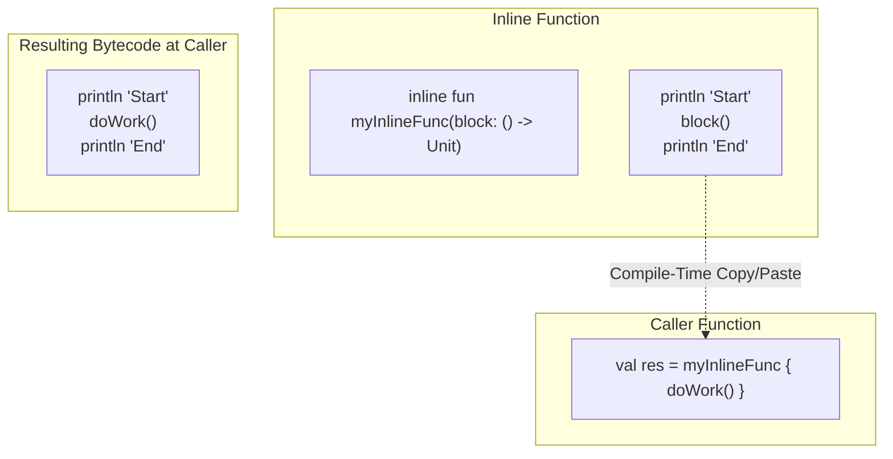

# Inline Functions

## Overview

The `inline` keyword is a compiler directive that tells Kotlin to take the exact bytecode of a function and paste it directly into every place that function is called, rather than actually invoking the function at runtime.

It is primarily used to eliminate the severe memory and performance overhead of using Lambdas (Higher-Order Functions) on the JVM. 

## Why It Matters

Kotlin encourages functional programming. You frequently pass functions as arguments to other functions: `list.filter { it > 5 }`. 

In the JVM world, every time you define a lambda `{ it > 5 }`, the compiler creates an anonymous class implementation under the hood (e.g., `Function1<Int, Boolean>`). Every time that code is executed, the JVM allocates a new object on the heap. If you call `filter` inside a `RecyclerView` loop 60 times a second, you allocate 60 hidden objects a second. This causes massive Garbage Collection (GC) churn, freezing the UI.

The `inline` keyword solves this by removing the object allocation entirely.

## Historical Context

In C and C++, `inline` was used to save the CPU from the overhead of a "function call" (pushing parameters to the stack, jumping memory addresses). 
In Java, you cannot explicitly ask for inlining. The Java Just-In-Time (JIT) compiler dynamically decides whether to inline small functions at runtime based on profiling data. 
Kotlin introduced explicit `inline` not to save CPU cycles on function jumps, but specifically to stop the JVM from creating hidden Anonymous Classes for Lambdas.

## First Principles

1.  **Copy and Paste:** The compiler literally copies the body of the inline function, and the body of the lambda you passed to it, and pastes them directly into the call site.
2.  **No Lambda Objects:** Because the lambda's code is pasted directly into the caller, no anonymous `Function` object is ever instantiated on the heap.
3.  **Non-Local Returns:** Standard lambdas cannot use the `return` keyword to exit the outer function. But if a lambda is inlined, it becomes part of the outer function, allowing a "non-local return" that exits the caller immediately.

## Mental Model

Think of a Lawyer (The Caller) and a Paralegal (The Function).
- **Normal Function:** The Lawyer tells the Paralegal to draft a contract (The Lambda). The Paralegal goes to another room, prints a new piece of paper (Memory Allocation), drafts the contract, and brings it back.
- **Inline Function:** The Lawyer tells the Paralegal to draft a contract. The Paralegal walks over, takes the Lawyer's pen, and writes the contract directly onto the Lawyer's existing piece of paper. No new paper is created. No rooms were changed.

## Internal Mechanics

Look at this simple Higher-Order Function:

```kotlin
// WITHOUT INLINE
fun doMath(a: Int, b: Int, operation: (Int, Int) -> Int): Int {
    return operation(a, b)
}

fun calculate() {
    val result = doMath(5, 10) { x, y -> x + y }
}
```

If you decompile the generated Java code for `calculate()`, you will see something horrifying:

```java
// Decompiled Java (No Inline)
public final void calculate() {
    // The JVM instantiated a hidden object!
    int result = doMath(5, 10, new Function2<Integer, Integer, Integer>() {
        public Integer invoke(Integer x, Integer y) {
            return x + y;
        }
    });
}
```

Now, let's add `inline`:

```kotlin
// WITH INLINE
inline fun doMath(a: Int, b: Int, operation: (Int, Int) -> Int): Int {
    return operation(a, b)
}

fun calculate() {
    val result = doMath(5, 10) { x, y -> x + y }
}
```

Decompiled Java:

```java
// Decompiled Java (With Inline)
public final void calculate() {
    // The compiler literally copied the logic (x + y) and pasted it here!
    // No doMath function is called. No Object is instantiated. Zero overhead.
    int x = 5;
    int y = 10;
    int result = x + y; 
}
```

## Architecture



## Bytecode Evidence

Showing decompiled Java is one level of evidence; reading actual JVM bytecode is another. Compile both versions and run `javap -c -p`:

**Without `inline`** — `calculate()` allocates a `Function2` object on every call:

```
public final void calculate();
  Code:
     0: aload_0
     1: iconst_5                                              // push 5
     2: bipush        10                                      // push 10
     4: new           #15  // class CalcKt$calculate$1        // ALLOCATE new lambda
     7: dup
     8: invokespecial #19  // CalcKt$calculate$1."<init>":()V // construct it
    11: checkcast     #21  // kotlin/jvm/functions/Function2
    14: invokevirtual #25  // Method doMath:(IILkotlin/jvm/functions/Function2;)I
    17: istore_1                                              // result -> local 1
    18: return
```

The `new #15` + `dup` + `invokespecial #19` triplet is the JVM allocating + initializing a brand-new `Function2` object every invocation. In a 60Hz scroll loop, that's 60 allocations per second → GC churn → jank.

**With `inline`** — the lambda body is pasted into the caller. No allocation:

```
public final void calculate();
  Code:
     0: iconst_5                                              // push 5
     1: istore_1                                              // a -> local 1
     2: bipush        10                                      // push 10
     4: istore_2                                              // b -> local 2
     5: iload_1                                               // push a
     6: iload_2                                               // push b
     7: iadd                                                  // add (the lambda body!)
     8: istore_3                                              // result -> local 3
     9: return
```

Zero `new` opcodes, zero `invokevirtual` on a lambda interface, zero `Function2` reference anywhere. The math (`iadd`) happens directly in the caller's frame.

**The diff matters per call site.** If `doMath` is called 1,000 times in a scroll, the inlined version produces 8,000 stack ops total; the non-inlined version produces 1,000 heap allocations + 1,000 virtual dispatches. R8 + ART will optimize some away — but you've removed the regression entirely at the source instead of hoping.

## Production Example

**The Kotlin Standard Library**

Almost all collection operators (`forEach`, `map`, `filter`) and scope functions (`let`, `apply`, `run`) in the Kotlin Standard Library are `inline`.

This is why chaining 5 Kotlin collection operations together `list.filter{}.map{}.sortedBy{}` does not immediately crash an Android phone with out-of-memory errors. The compiler squashes all of those lambdas flat into massive blocks of inline bytecode.

```kotlin
// Kotlin Standard Library Source Code
public inline fun <T, R> Iterable<T>.map(transform: (T) -> R): List<R> {
    val destination = ArrayList<R>()
    for (item in this)
        destination.add(transform(item))
    return destination
}
```

## Tradeoffs

**Advantages**
- **Zero-Cost Abstractions:** You can write highly readable functional code without paying the JVM object-allocation tax.
- **Reified Types:** Inlining allows you to use `reified` type parameters to magically bypass Type Erasure (covered in [Reified Types](reified-types.md)).

**Disadvantages**
- **Bytecode Bloat:** If you `inline` a massive, 500-line function, and you call it in 100 places, the compiler copies those 500 lines 100 times. Your APK size will explode, and the Android ART compiler will choke. 
- **No Encapsulation:** Inline functions cannot access `private` members of the class they are defined in, because their code will be executed in a completely different class (the caller's class).
- **Stack Traces:** When an exception is thrown inside an inlined lambda, the stack trace can be confusing because the function call that *looks* like it should be on the stack doesn't actually exist at runtime.

## Failure Modes

- **Inlining Normal Functions:**
  ```kotlin
  // BAD: The IDE will warn you: "Expected performance impact from inlining is insignificant"
  inline fun add(a: Int, b: Int): Int {
      return a + b
  }
  ```
  *(Fix: Only use `inline` for functions that take Lambdas as parameters, or when using `reified` types. The JVM JIT compiler is already perfectly capable of inlining normal functions at runtime. Doing it manually just bloats the bytecode).*
- **The Crossinline Trap:**
  If an inline function takes a lambda, but tries to pass that lambda into another thread or a callback, the compiler will fail. 
  ```kotlin
  inline fun executeAsync(action: () -> Unit) {
      // COMPILER ERROR! You cannot inline a lambda that escapes to another context.
      Thread { action() }.start() 
  }
  ```
  *(Fix: If the lambda must escape, you must mark it as `crossinline`. This tells the compiler: "Still inline the function, but forbid the user from using non-local returns inside this lambda, because the outer function will have already finished before this thread runs").*
- **The Noline Trap:**
  If your inline function takes *two* lambdas, but you only want to inline one of them, you use `noinline` on the second one to prevent it from being copied.

## Staff Engineer Thinking

When reviewing code containing `inline`, a Staff engineer enforces strict boundaries:

1.  **Is the inline function too big?** I look at the line count. If an `inline` function is more than 3-4 lines of logic, I will reject the PR. Massive inline functions cause severe instruction cache misses at the CPU level and bloat the dex file. 
2.  **Why did you use `inline` here?** If a developer puts `inline` on a function that has no lambda parameters and no `reified` types, I know they are "Cargo Culting" (copying syntax without understanding it). I will explain that they are actively fighting the JVM's optimized JIT compiler.
3.  **Are we hiding massive logic in Scope Functions?** `apply` and `let` are inline. If a developer puts 50 lines of complex database transactions inside a `.let { }` block, it makes the bytecode of the caller massive. I will demand the logic be extracted to a standard `private fun`.

## Common Misconceptions

- **"Inline makes my code execute faster like it does in C++."** While it saves a tiny fraction of a microsecond on a function jump, the primary purpose in Kotlin is memory management: preventing the allocation of hidden `Function` objects on the Heap.
- **"I can use `return` inside a `forEach` to stop the loop."** If you use `return` inside a `forEach` (which is inline), you will execute a "Non-Local Return". It won't just break the loop; it will instantly exit the *entire outer function* that contains the `forEach`. To just exit the loop iteration, you must use a labeled return: `return@forEach`.

## Probing Questions

1.  What is the primary memory/performance problem that the `inline` keyword solves on the JVM?
2.  Explain the "Copy and Paste" mental model of how the `kotlinc` compiler implements `inline`.
3.  Why does the IDE generate a warning if you place `inline` on a function that does not accept a lambda as a parameter?
4.  If you have an `inline` function that is 200 lines long and is called 50 times across your app, what is the architectural consequence?
5.  What is a "Non-Local Return," and why is it only possible inside an inlined lambda?
6.  Explain the purpose of the `crossinline` modifier. In what scenario are you forced to use it?
7.  Why are almost all higher-order functions in the Kotlin Standard Library (like `map`, `filter`, `let`) marked as `inline`?
8.  Why can't an `inline` function access a `private` variable belonging to the class it is declared inside?
9.  If you decompile a Kotlin `inline` function invocation back into Java, what does the resulting code look like?
10. Describe the difference between `crossinline` and `noinline`.

## Further Reading

- [`reified-types.md`](reified-types.md) — The other major feature unlocked by `inline`.
- [`memory-model.md`](../runtime-and-jvm/memory-model.md) — Understanding the Heap vs Stack implications of allocating hidden Lambda objects.
