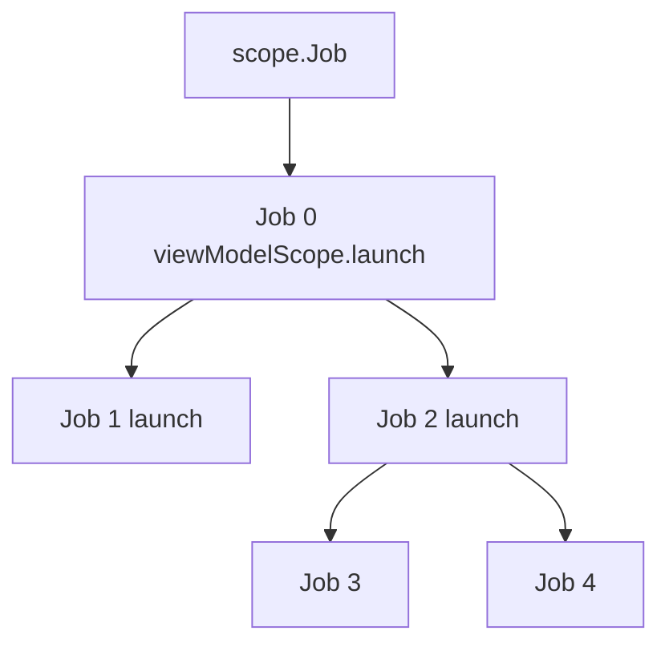

# Coroutines

> Coroutines are the single most-used Kotlin feature in modern Android. Every screen load, every background sync, every `viewModelScope.launch { ... }` rides on them. Knowing them at a *staff* level means understanding the Job tree, what happens when one branch fails, how cancellation propagates, and why `Thread.sleep` inside a coroutine is a production incident waiting to happen.

---

## Overview

A coroutine is a "lightweight thread" — a unit of work that can be **suspended** (paused without blocking the OS thread) and **resumed** later. Tens of thousands of coroutines can share a handful of OS threads.

This solves Android's two non-negotiable rules:

- Keep blocking calls and substantial CPU work off Main. A slow Main thread causes missed frames and can eventually cause an ANR; every slow operation does not immediately trigger one. Already main-safe suspend APIs can be called from Main.
- Android View operations normally belong on Main. Follow the UI toolkit’s thread-safety contract rather than treating every state holder as a View.

Pre-coroutines, you wrote callback hell or RxJava. Coroutines let you write asynchronous code that *reads sequentially*, top-to-bottom.

---

## How `suspend` Works (Mental Model + Mechanism)

### Mental model: chef in a kitchen

- **Blocking (`Thread.sleep`):** Chef puts pizza in oven, then stands frozen in front of the oven for 20 minutes. Salad doesn't get made. Need second chef (second thread).
- **Suspending (`delay`):** Chef puts pizza in oven, sets a timer (suspends), walks over to chop vegetables. Timer rings (resumes), pulls pizza. **One chef does the work of many.**

### Mechanism: state machine + Continuation

Kotlin lowers suspend calls to a continuation-passing convention. A function that needs to resume across multiple parts of its body can use a state machine, with a resume label and saved locals. Tail calls and inlining can avoid a separate state-machine object; a suspend call can also return immediately without suspending.

```kotlin
suspend fun fetchUserAndShow() {
    println("Start")              // State 0
    val user = api.fetchUser()    // ← suspension point
    println("Name: ${user.name}") // State 1
}
```

After compilation, roughly:

```java
// Teaching pseudocode, not exact Java decompiler output.
Object fetchUserAndShow(Continuation<? super Unit> completion) {
    StateMachine sm = obtainOrReuseState(completion);
    Object value = sm.result;
    switch (sm.label) {
        case 0:
            throwIfFailure(value);
            System.out.println("Start");
            sm.label = 1;
            value = api.fetchUser(sm);
            if (value == COROUTINE_SUSPENDED) {
                return COROUTINE_SUSPENDED;
            }
            // Immediate completion falls through with its value.
        case 1:
            throwIfFailure(value);
            User user = (User) value;
            System.out.println("Name: " + user.name);
            return Unit.INSTANCE;
        default:
            throw invalidResumeState();
    }
}
```

If the call actually suspends, the suspension marker returns control through its callers. When its result becomes available, resumption continues from the saved label. A continuation stores the state needed later without holding an OS call stack throughout the wait. Resumption follows the dispatcher and API contracts; it does not necessarily return a thread to a pool or use a different thread.

**Key takeaway:** a suspended coroutine does *not* occupy a thread. That's why one app can have 50,000 coroutines in flight.

---

## The Four Dispatchers

A dispatcher controls how execution is scheduled: onto a thread, onto shared workers, or without confinement. Choose it from the operation’s blocking, CPU and thread-affinity needs; a dispatcher is not always a separate thread pool.

| Dispatcher | Thread pool | When to use |
|---|---|---|
| `Dispatchers.Main` | Android UI thread | UI updates and main-safe suspend orchestrators. The dispatcher does not prevent your code from blocking; keep work brief. |
| `Dispatchers.Main.immediate` | Same | Optimization: if already on Main, skip the dispatch. `viewModelScope` default. |
| `Dispatchers.IO` | Shared blocking-work workers; default parallelism limit is max(64, cores) on JVM | Blocking file or legacy network operations. Suspending Room/Retrofit APIs may already be main-safe. |
| `Dispatchers.Default` | Shared CPU workers; JVM default is core count, at least two | Substantial parsing, sorting, image transforms and computation. |
| `Dispatchers.Unconfined` | Starts in the caller thread; resumes as determined by the suspension mechanism | Specialised execution needs; not a general background-work or UI dispatcher. |

### Why `IO` ≠ `Default` — concrete numbers

Consider a deliberately simplified, phase-ordered workload: first ten **blocking** I/O calls taking 500ms each, then ten CPU tasks taking 100ms each. Assume exactly four CPU workers, enough blocking-work capacity, no overhead and no other load. These are illustrative scheduling assumptions, not measured device timings.

**Correct** — IO on `IO`, CPU on `Default`:
- All 10 IO calls run concurrently on the IO pool (64 threads available).
- IO time: **500ms** total.
- CPU tasks then run on Default (4 threads): 3 batches × 100ms = **300ms**.
- **Total: ~800ms.**

**Wrong** — both on `Default` (4 threads):
- With exactly four workers unavailable for other work while blocked, ceil(10 / 4) = 3 batches × 500ms = **1500ms**.
- CPU tasks blocked waiting for IO. Then 300ms.
- **Total: ~1800ms.** 2.25× slower.

Blocking I/O occupies workers while waiting, so it needs a different scheduling budget from CPU-heavy work. On JVM, IO and Default share underlying workers; their execution policies differ. A suspended network request is different again: it need not occupy an I/O worker while waiting. Larger CPU worker counts do not create additional CPU cores.

### `withContext` for thread switching

```kotlin
suspend fun fetchDocs() {           // called on Main
    val docs = withContext(Dispatchers.IO) {   // switch to IO
        api.getDocs()                          // runs on IO
    }                                          // automatically back on Main
    render(docs)                               // runs on Main
}
```

`withContext` switches the dispatcher *for the block*, suspends until it returns, then resumes on the original dispatcher. It's how you make a function **main-safe**: callers don't have to know what dispatcher to use.

### The main-safety contract

A repository function `suspend fun getUsers(): List<User>` should be main-safe — it should be callable from `Main` without freezing the UI. Internally it does its own `withContext(Dispatchers.IO)`.

**Anti-pattern:**

```kotlin
// ViewModel — BAD
viewModelScope.launch {
    val users = withContext(Dispatchers.IO) {     // ViewModel knows IO is needed
        repository.getUsers()                      // repo doesn't switch on its own
    }
    _state.value = users
}
```

**Better — repository self-contains threading:**

```kotlin
// Repository
class UserRepository(private val api: Api) {
    suspend fun getUsers(): List<User> = withContext(Dispatchers.IO) {
        api.getUsers()
    }
}

// ViewModel
viewModelScope.launch {
    _state.value = repository.getUsers()    // no Dispatcher leak into ViewModel
}
```

Now no caller anywhere thinks about threading. The repository owns its own main-safety. In practice you also **inject** the `CoroutineDispatcher` instead of referencing `Dispatchers.IO` directly, so tests can substitute a `TestDispatcher`.

---

## `launch` vs `async` — Two Builders, Different Contracts

| | `launch` | `async` |
|---|---|---|
| Returns | `Job` | `Deferred<T>` (a `Job` that produces a result) |
| Result | No result value; keep the Job to observe completion or cancel | `.await()` to get the value |
| Exception behavior | Propagates immediately to parent | **Propagates immediately to parent** (if child of standard Job) AND holds in `Deferred` for `await()` |
| Use case | "Do something" (start a save, update UI) | "Compute something I need a value from" |

```kotlin
viewModelScope.launch {
    val deferredUser = async { api.getUser() }       // starts immediately
    val deferredCart = async { api.getCart() }       // starts concurrently; parallel execution depends on dispatcher
    render(deferredUser.await(), deferredCart.await())   // both run concurrently
}
```

This is **parallel decomposition** — run two independent things concurrently, combine.

### The `async` exception trap

```kotlin
viewModelScope.launch {
    async { throw IOException("boom") }   // ← exception propagates IMMEDIATELY to parent
    // The parent 'launch' crashes, and the app crashes.
}
```

A common misconception is that `async` swallows exceptions until you call `.await()`. This is **only true** if the `async` is a top-level coroutine or a direct child of a `SupervisorJob` (like `supervisorScope`). In standard structured concurrency (like the `launch` above), the child `async` fails, immediately notifies its parent, the parent cancels, and the exception is thrown, crashing your app—even if you never called `.await()`.

---

## `CoroutineScope`, `CoroutineContext`, and the Job Tree

### Scope = lifetime owner

A `CoroutineScope` holds a `CoroutineContext`. Every coroutine launched in the scope inherits the context and adds itself as a child of the scope's `Job`. Calling `scope.cancel()` requests cancellation of its Job and attached children. Cooperative work must observe cancellation, and completion waits for children and cleanup.

```kotlin
class Repo {
    // SupervisorJob: one failed save must not cancel every later save.
    private val scope = CoroutineScope(SupervisorJob() + Dispatchers.IO)

    fun save(data: Data) {
        scope.launch {
            try {
                /* runs on IO */
            } catch (e: IOException) {
                // Expected failure: record it here. Anything unexpected still crashes,
                // unless the scope gets a CoroutineExceptionHandler on purpose.
            }
        }
    }

    fun close() {
        scope.cancel()   // every in-flight save cancels
    }
}
```

### Built-in Android scopes

| Scope | Lifetime | Default Job | Default Dispatcher |
|---|---|---|---|
| `viewModelScope` | ViewModel cleared | `SupervisorJob` | `Main.immediate` |
| `lifecycleScope` | Activity/Fragment destroyed | `SupervisorJob` | `Main.immediate` |
| `viewLifecycleOwner.lifecycleScope` | View destroyed (`onDestroyView`) | `SupervisorJob` | `Main.immediate` |
| `GlobalScope` | Not tied to a lifecycle owner | No Job; empty context | Builders use Default when no dispatcher is supplied |

For ordinary application work, **avoid GlobalScope**: it provides no common Job to cancel or join and loses structured lifetime ownership. It is a delicate API with rare legitimate application-wide uses, not a scope reserved for internals or tests. An explicit owner or durable scheduler normally makes the contract clearer.

### `CoroutineContext` is composable

```kotlin
val context = Job() + Dispatchers.Main + CoroutineName("Sync") + handler
val scope = CoroutineScope(context)
```

A context is a set of typed elements. The interesting ones:

- **`Job`** — controls lifecycle / cancellation hierarchy.
- **`CoroutineDispatcher`** — picks the thread pool.
- **`CoroutineName`** — name for logs/debugger.
- **`CoroutineExceptionHandler`** — last-resort uncaught exception sink.
- **`ThreadLocal.asContextElement()`** — captures a chosen `ThreadLocal` value and restores it when the coroutine resumes on another thread, which is useful for MDC logging or tracing. It does not track later mutations to the `ThreadLocal`; use an explicit context value or a purpose-built propagation mechanism when updates must flow through the coroutine.

Override per launch:

```kotlin
scope.launch(Dispatchers.Default + CoroutineName("hash")) { /* ... */ }
```

---

## Job Hierarchy and Cancellation

### Parent-child relationship

Every coroutine has a `Job`. Coroutines launched inside another coroutine become children of that parent's Job. Rules:

1. **A parent does not complete until all children complete.**
2. **Cancelling a parent requests cancellation of all attached children recursively.** Cancelling just one child normally leaves its parent and that child’s siblings active.
3. **If a child fails, the exception propagates *up*** to the parent.



If `Job4` throws → propagates to `Job2` → propagates to `Job0`. Default Job semantics: this cancels `Job1` (sibling) too.

### `Job` vs `SupervisorJob`

The propagation rule above ruins many real cases. Example: a screen makes 3 independent API calls. If `getProfile()` fails, you don't want `getOrders()` and `getRecommendations()` to also be cancelled.

A `SupervisorJob` does not cancel itself or its other direct children when one child fails. **Isolation is not error handling:** an uncaught supervised launch failure can still reach the platform’s last-resort handler and crash an Android app. Catch expected failures locally or provide the appropriate uncaught-error policy.

```kotlin
viewModelScope.launch {     // viewModelScope already uses SupervisorJob at root
    // …but `coroutineScope { }` inside re-introduces strict Job semantics
    supervisorScope {
        launch {
            try {
                fetchProfile()
            } catch (error: IOException) {
                profileState.value = ProfileState.Error(error)
            }
        }
        launch {
            try { fetchOrders() }
            catch (error: IOException) { ordersState.value = OrdersState.Error(error) }
        }
        launch {
            try { fetchRecommendations() }
            catch (error: IOException) { recommendationsState.value = RecommendationsState.Error(error) }
        }
    }
}
```

| Builder | Job type | Sibling failure isolated? |
|---|---|---|
| `coroutineScope { }` | `Job` | No — any failure cancels siblings |
| `supervisorScope { }` | `SupervisorJob` | Yes |
| Direct `viewModelScope.launch { }` children | Each launch creates its own ordinary Job attached to the root supervisor | Other direct launches are isolated; children inside one launch are not automatically supervised |

`viewModelScope` is already `SupervisorJob` at the root, so if one *top-level* `launch` inside it fails, others survive. But if you put a `coroutineScope { ... }` inside, you're back to strict semantics for the children of that scope.

### Cancellation is cooperative

Cancellation only works if the coroutine *checks* for it. Cancellable library operations such as `delay` observe cancellation; many cancellable suspension APIs provide prompt cancellation guarantees. The suspend modifier itself promises neither suspension nor cancellation cooperation. Check third-party APIs and blocking adapters separately.

**Tight CPU loops do not get cancelled** unless you cooperate:

```kotlin
// BAD — runs to completion even if cancelled
viewModelScope.launch(Dispatchers.Default) {
    while (true) {
        crunchNumbers()         // pure CPU, no suspension → never sees cancel
    }
}

// GOOD — check explicitly
viewModelScope.launch(Dispatchers.Default) {
    while (true) {
        ensureActive()          // throws CancellationException if cancelled
        crunchNumbers()
    }
}

// ALSO GOOD — yield() also checks
viewModelScope.launch(Dispatchers.Default) {
    while (isActive) {
        yield()                 // checks cancellation; may yield to ready work
        crunchNumbers()
    }
}
```

### `NonCancellable` for cleanup

Cleanup code (close DB, flush logs) inside a `finally` block runs even on cancellation — but **cancellable suspension operations can throw** because the coroutine is already cancelled.

```kotlin
try {
    doWork()
} finally {
    withContext(NonCancellable) {
        flushAnalytics()        // use only for necessary, bounded cleanup
        closeDb()
    }
}
```

---

## Timeouts

```kotlin
withTimeout(5_000) {
    api.getProfile()
}   // throws TimeoutCancellationException after 5s

val result = withTimeoutOrNull(5_000) {
    api.getProfile()
}   // returns null if timed out, value otherwise
```

`withTimeout` cancels the inner block — relies on cooperative cancellation, so pure CPU loops also need `ensureActive()`. Prefer `withTimeoutOrNull` when "took too long" is a normal outcome (e.g., cache lookup), not an error.

---

## Exception Handling Patterns

### `try/catch` works inside a coroutine block

```kotlin
viewModelScope.launch {
    try {
        val user = repo.getUser()
        _state.value = Success(user)
    } catch (e: IOException) {
        _state.value = Error(e)
    }
}
```

Two important gotchas:

**1. Never catch `CancellationException` generically.**

```kotlin
// BAD — swallows the cancel signal
try {
    delay(5000)
} catch (e: Exception) {
    log(e)
}
```

`CancellationException` carries a cancellation outcome. Swallowing it can let following ordinary statements execute or disguise an aborted operation as a result; it does not reactivate an already cancelled Job. A loop that repeatedly swallows cancellation can keep spinning. Use either a narrow expected-failure catch:

```kotlin
} catch (e: IOException) {   // catch specifics, not Exception
    log(e)
}
```

or rethrow:

```kotlin
} catch (e: Exception) {
    if (e is CancellationException) throw e
    log(e)
}
```

**2. `try/catch` around `launch` doesn't catch exceptions inside `launch`.**

```kotlin
// BAD — try/catch is around the call to `launch`, not the body
try {
    viewModelScope.launch { throw IOException() }
} catch (e: Exception) {
    // never runs — launch returns immediately
}
```

The exception happens *inside the coroutine's machinery*. It propagates up the Job tree: an ordinary parent `Job` is cancelled with it. At the root, or under a `SupervisorJob` such as `viewModelScope`'s, it goes to the scope's `CoroutineExceptionHandler` if one is installed, otherwise to the thread's uncaught-exception handler, which crashes an Android app.

### `CoroutineExceptionHandler`

Last-resort handler for uncaught exceptions in `launch`-style builders:

```kotlin
val handler = CoroutineExceptionHandler { _, throwable ->
    crashlytics.recordException(throwable)
}

private val scope = CoroutineScope(SupervisorJob() + Dispatchers.Main + handler)

scope.launch {
    throw IOException()    // → handler.handleException()
}
```

The handler is a last-resort reporting policy, not a way to resume a failed coroutine. Ordinary child failures propagate to their parent; direct supervised launch children can use a handler like root launches. An async failure is exposed through Deferred, and its handler is not called directly. Under an ordinary parent it can still cancel that parent, whose uncaught failure may eventually be handled.

---

## Android Lifecycle Integration

### `viewModelScope` — the default

```kotlin
class CartViewModel : ViewModel() {
    fun checkout() {
        viewModelScope.launch {
            repo.checkout()
        }
    }
}
// When the ViewModel is cleared, viewModelScope is cancelled (before onCleared() runs) → coroutine cancels
```

### `repeatOnLifecycle` — preferred for collecting flows

```kotlin
class CartFragment : Fragment() {
    override fun onViewCreated(view: View, savedInstanceState: Bundle?) {
        viewLifecycleOwner.lifecycleScope.launch {
            viewLifecycleOwner.repeatOnLifecycle(Lifecycle.State.STARTED) {
                viewModel.cart.collect { cart ->
                    render(cart)
                }
            }
        }
    }
}
```

`repeatOnLifecycle(STARTED)` starts the block when the view reaches STARTED, cancels it below that state, and starts a fresh block on re-entry. A hot upstream may still run according to its own owner and sharing policy. The deprecated launchWhenStarted API suspends rather than using this cancel-and-restart contract; it may leave unnecessary upstream work active.

### Pre-`repeatOnLifecycle` (avoid)

`launchWhenCreated`, `launchWhenStarted`, `launchWhenResumed` are deprecated — they pause the coroutine but don't cancel upstream collection, leaking hot flow subscribers.

---

## `runBlocking` and `runTest`

### `runBlocking` — bridges blocking world to coroutines

```kotlin
fun main() = runBlocking {
    val data = fetchData()    // suspend call
    println(data)
}
```

Use only:
- In CLI main functions and required synchronous API bridges, after checking whether blocking is acceptable.
- In tests that need a genuine blocking bridge; prefer runTest for coroutine unit tests.
- Avoid it in Android UI paths: it blocks the calling thread and can deadlock when the work needs that same thread to resume.

### `runTest` — virtual time for unit tests

```kotlin
@get:Rule
val mainDispatcherRule = MainDispatcherRule()   // replaces Dispatchers.Main; see the Test Dispatchers chapter

@Test
fun cartCheckout() = runTest {
    val viewModel = CartViewModel(repo, ioDispatcher = StandardTestDispatcher(testScheduler))
    viewModel.checkout()
    advanceUntilIdle()      // run all pending coroutines without real waiting
    assertEquals(Success, viewModel.state.value)
}
```

`runTest` (from `kotlinx-coroutines-test`) gives you a `TestScope` with a virtual clock. `delay(60_000)` doesn't actually wait 60 seconds — `advanceTimeBy(60_000)` jumps it forward instantly. This is what makes coroutine tests fast and deterministic.

Inject a dispatcher into your ViewModel/repo so tests can substitute:

```kotlin
class CartViewModel(
    private val repo: CartRepo,
    private val ioDispatcher: CoroutineDispatcher = Dispatchers.IO,
) : ViewModel() { /* ... */ }
```

---

## Failure Modes

| Symptom | Cause | Fix |
|---|---|---|
| ANR / frozen UI inside coroutine | `Thread.sleep()` instead of `delay()` | Use `delay`; suspension only |
| Coroutine never cancels | Pure CPU loop, no `ensureActive` | Insert `ensureActive()` or `yield()` |
| Unobserved Deferred failure | Root async or direct supervised async result never consumed | Consume and handle Deferred outcomes; ordinary-parent async failure also cancels its parent |
| `try/catch` around `launch` doesn't catch | Exception happens *inside* launch | Catch inside the lambda |
| App crashes intermittently | Caught `Exception` swallowed `CancellationException` | Catch specifics, or rethrow `CancellationException` |
| Zombie coroutine after screen close | Used `GlobalScope` instead of scoped | Always use lifecycle scopes |
| Flow keeps collecting after screen stops | Used `lifecycleScope.launch { collect }` without `repeatOnLifecycle` | Wrap in `repeatOnLifecycle(STARTED)` |
| All sibling API calls cancel on one failure | Used `coroutineScope`/`Job` | Use `supervisorScope`/`SupervisorJob` |
| Cleanup block fails mid-cleanup | Suspending call in `finally` after cancel | Wrap in `withContext(NonCancellable)` |
| Test waits in real time or reaches its timeout | Real dispatcher or a child/stream that never finishes | Inject a shared TestDispatcher; bound collection; use backgroundScope for appropriate long-lived test work |
| Main is blocked by a legacy request | Blocking implementation was called on Main | Make blocking boundary main-safe; already main-safe suspend APIs do not need another IO wrapper |
| Main freezes during parsing | Substantial parsing executes on Main | Move CPU work to Default; CPU work on IO is a resource-budget concern, not proof it blocks Main |

---

## Common Misconceptions

- **"Coroutines are just threads."** No. One thread can host hundreds of coroutines. A thread is an OS resource; a coroutine is a state machine on the heap.
- **"Coroutines make my code faster."** False. A 200ms network call still takes 200ms. They reduce *resource cost* (threads, stacks) while waiting.
- **"`suspend` runs on a background thread."** No. `suspend` is a marker that a function can suspend — it runs on whatever dispatcher the calling coroutine has.
- **"`async` always parallelizes."** Starting both async operations before awaiting allows concurrency. Actual parallel execution also depends on dispatcher and resources. Writing `async { a() }.await(); async { b() }.await()` sequences these operations.
- **"`Dispatchers.IO` is for everything off Main."** No. Heavy CPU work on `IO` steals threads from real IO work and slows everything down.
- **"`viewModelScope.launch { }` always survives config change."** Yes, *because* ViewModel survives. But hot Flow collection inside it without `repeatOnLifecycle` keeps running while the screen is invisible, wasting resources.

---

## Staff Engineer Lens

When reviewing a PR with coroutines, I scan for these signatures:

1. **Dispatcher leakage.** A ViewModel that writes `withContext(Dispatchers.IO)` is doing the repo's job. The repo should be main-safe.
2. **Injected dispatcher.** Production code should accept `CoroutineDispatcher` as a constructor parameter, not reference `Dispatchers.IO` directly. Required for testing.
3. **`runBlocking` on an Android UI path.** It blocks that thread. A legitimate CLI main or required synchronous bridge has a different contract; inspect the boundary instead of banning the API universally.
4. **`GlobalScope.launch`.** Require an explicit lifetime and cancellation/completion contract; ordinary screen work belongs to a lifecycle owner. GlobalScope itself supplies no common Job.
5. **`async` without `.await()`.** Either the result is used (great) or it's an exception bomb (find it).
6. **Generic `catch (e: Exception)`.** Check whether it preserves cancellation and whether its fallback hides programming failures. Prefer expected-failure types when possible.
7. **`launchWhenStarted`** in 2025+ code. Replace with `repeatOnLifecycle`.
8. **Tests using real time.** `runBlocking { delay(5000) }` in tests is a 5-second flake waiting to happen.

---

## Probing Questions

1. Explain the difference between `Thread.sleep()` and `delay()`. What does each do to the underlying OS thread?
2. Walk through the state-machine transformation the compiler applies to a `suspend` function.
3. Three concurrent `async` calls inside a `coroutineScope` — task A throws. What happens to B and C? How do you isolate them?
4. Why is putting `withContext(Dispatchers.IO)` in a ViewModel an architectural smell?
5. What's the exact behavior difference between `viewModelScope` and `lifecycleScope`? When would you pick one over the other?
6. You have a tight CPU loop that needs to be cancellable. Two correct ways to implement it?
7. Why is a generic `catch (e: Exception)` inside a coroutine dangerous? Walk through the failure scenario.
8. Explain what `repeatOnLifecycle(STARTED)` does that plain `lifecycleScope.launch { collect }` doesn't.
9. Your test takes 30 seconds to run because of `delay(30_000)`. How do you make it run in milliseconds without changing production code?
10. Walk through the difference between `Job` and `SupervisorJob` — concretely, with a code example where it matters.
11. A coroutine's `finally` block tries to flush logs but the log write is a suspend call. The coroutine was cancelled. What happens, and how do you fix it?
12. Why do `Dispatchers.IO` and `Dispatchers.Default` use different pool sizes? Show with a 10-IO + 10-CPU workload on a 4-core device.

## Answer Key

1. **Explain the difference between `Thread.sleep()` and `delay()`. What does each do to the underlying OS thread?**
   `Thread.sleep()` is blocking; it halts the underlying OS thread completely, preventing it from doing any other work until the time elapses. `delay()` suspends for a positive wait and allows other ready work to use the thread; the dispatcher controls later resumption. The thread need not belong to a pool.
2. **Walk through the state-machine transformation the compiler applies to a `suspend` function.**
   The compiler adds a hidden `Continuation` parameter. A function that needs a resumable body can use labels and saved locals. If a call actually suspends, it returns the suspension marker; immediate results continue normally. Resumption selects the saved state. Backend optimisations, tail calls and inlining can avoid a separate machine.
3. **Three concurrent `async` calls inside a `coroutineScope` — task A throws. What happens to B and C? How do you isolate them?**
   Because `coroutineScope` uses standard `Job` semantics, task A's exception propagates to the parent scope, which immediately cancels the sibling tasks B and C. To isolate them, use a `supervisorScope` (or a `SupervisorJob`), which prevents a child's failure from cancelling its siblings.
4. **Why is putting `withContext(Dispatchers.IO)` in a ViewModel an architectural smell?**
   It leaks threading responsibilities into the ViewModel. Repositories and use cases should be "main-safe"—meaning they internally manage their own `withContext(Dispatchers.IO)` calls so that any caller (like the ViewModel) can safely invoke them from the Main thread without worrying about dispatcher switching.
5. **What's the exact behavior difference between `viewModelScope` and `lifecycleScope`? When would you pick one over the other?**
   `viewModelScope` is bound to the ViewModel's lifecycle and is cancelled when the ViewModel is cleared, before `onCleared()` runs. `lifecycleScope` is bound to an Activity/Fragment and cancels when it is destroyed. Pick `viewModelScope` for data operations that should survive configuration changes (rotation). For Fragment view-owned operations, use viewLifecycleOwner.lifecycleScope: the Fragment can outlive its view. Activity or Fragment lifecycleScope lasts until its own Lifecycle is destroyed. Use repeatOnLifecycle when collection must stop earlier, below STARTED.
6. **You have a tight CPU loop that needs to be cancellable. Two correct ways to implement it?**
   Because cancellation is cooperative, a pure CPU loop never checks the cancellation flag automatically. You must check it manually by inserting `ensureActive()` (which throws if cancelled) or `yield()` (which checks cancellation and may yield execution to other ready coroutines) inside the loop.
7. **Why is a generic `catch (e: Exception)` inside a coroutine dangerous? Walk through the failure scenario.**
   Coroutine cancellation works by throwing a `CancellationException`. If you generically catch `Exception` and swallow it, you intercept the cancellation signal. Ordinary statements can continue after the catch or the cancelled operation can be misreported as successful. The Job remains cancelled; a loop that repeatedly swallows cancellation can spin.
8. **Explain what `repeatOnLifecycle(STARTED)` does that plain `lifecycleScope.launch { collect }` doesn't.**
   `lifecycleScope.launch` continues collecting the flow even when the app goes to the background (until destroyed), wasting CPU and battery. `repeatOnLifecycle(STARTED)` automatically cancels the collection when the View drops below the STARTED state (e.g., goes to background) and completely restarts the collection when it returns.
9. **Your test takes 30 seconds to run because of `delay(30_000)`. How do you make it run in milliseconds without changing production code?**
   Use `runTest` from `kotlinx-coroutines-test` and ensure your production code has its dispatchers injected. Pass a `StandardTestDispatcher` in the test. The virtual clock will instantly advance time (`advanceTimeBy(30_000)`), making the test finish in milliseconds.
10. **Walk through the difference between `Job` and `SupervisorJob` — concretely, with a code example where it matters.**
    A non-cancellation failure in a child normally fails its ordinary parent, which cancels its other children. A supervisor isolates direct child failures, but it does not handle uncaught launch exceptions. For independent UI operations, handle each expected failure inside its launch as in the earlier example; unexpected supervised launch failures still require an uncaught-error policy. In the optional-avatar model, async stores its failure and the caller handles it at await. Cancellation of the supervisor still cancels its children.
11. **A coroutine's `finally` block tries to flush logs but the log write is a suspend call. The coroutine was cancelled. What happens, and how do you fix it?**
    Cancellable suspension operations can throw when the Job is cancelled; the suspend modifier alone does not guarantee that check. Use finally or use for ordinary resource release. If essential cleanup must suspend after cancellation, give only that cleanup a narrow NonCancellable context and a bounded policy. It is not a general lifetime extension or a guarantee that an external service will respond.
12. **Why do `Dispatchers.IO` and `Dispatchers.Default` use different pool sizes? Show with a 10-IO + 10-CPU workload on a 4-core device.**
    On JVM, Default targets CPU work and normally uses the core count with at least two workers. In the simplified four-worker example, `IO` threads spend most of their time blocked/waiting, so it allows up to 64 threads. If you run 10 blocking calls on `Default`, they occupy all 4 `Default` threads while waiting, delaying the 10 CPU tasks: ~1800 ms. On `IO`, all 10 wait concurrently, leaving `Default` free for CPU work: ~800 ms.

---

## Further Reading

- [`../android/concurrency/coroutines-under-the-hood.md`](../../android/concurrency/coroutines-under-the-hood.md) — bytecode-level continuation mechanics.
- [`../android/concurrency/shared-flow-and-state-flow.md`](../../android/concurrency/shared-flow-and-state-flow.md) — coroutines + reactive streams.
- [`../android/architecture/structured-concurrency.md`](../../android/architecture/structured-concurrency.md) — the contract from an Android architecture lens.
- [`null-safety.md`](../language-core/null-safety.md) — `Result<T>` and idiomatic error returns.
- [`sealed-classes.md`](../language-core/sealed-classes.md) — modeling UI state for coroutine-driven screens.
- [Kotlin Docs — Coroutines guide](https://kotlinlang.org/docs/coroutines-guide.html) — canonical.
- [Roman Elizarov — "Structured concurrency"](https://elizarov.medium.com/structured-concurrency-722d765aa952) — the original framing.
- [Roman Elizarov — "Coroutines design proposal"](https://github.com/Kotlin/KEEP/blob/master/proposals/coroutines.md) — the why.
- [Manuel Vivo — "Cancellation in coroutines"](https://medium.com/androiddevelopers/cancellation-in-coroutines-aa6b90163629) — cooperative cancellation deep dive.
- [Android Developers — "Coroutines on Android"](https://developer.android.com/kotlin/coroutines) — official Android guide.

### Official verification references

- [Primary documentation or owning implementation](https://developer.android.com/kotlin/coroutines/coroutines-best-practices)
- [Primary documentation or owning implementation](https://developer.android.com/kotlin/coroutines/test)
- [Primary documentation or owning implementation](https://developer.android.com/topic/libraries/architecture/coroutines)
- [Primary documentation or owning implementation](https://kotlinlang.org/api/kotlinx.coroutines/kotlinx-coroutines-core/kotlinx.coroutines/-dispatchers/-default.html)
- [Primary documentation or owning implementation](https://kotlinlang.org/api/kotlinx.coroutines/kotlinx-coroutines-core/kotlinx.coroutines/-dispatchers/-i-o.html)
- [Primary documentation or owning implementation](https://kotlinlang.org/api/kotlinx.coroutines/kotlinx-coroutines-core/kotlinx.coroutines/-global-scope/)
- [Primary documentation or owning implementation](https://kotlinlang.org/api/kotlinx.coroutines/kotlinx-coroutines-core/kotlinx.coroutines/-non-cancellable/)
- [Primary documentation or owning implementation](https://kotlinlang.org/api/kotlinx.coroutines/kotlinx-coroutines-core/kotlinx.coroutines/async.html)
- [Primary documentation or owning implementation](https://kotlinlang.org/api/kotlinx.coroutines/kotlinx-coroutines-core/kotlinx.coroutines/run-blocking.html)
- [Primary documentation or owning implementation](https://kotlinlang.org/api/kotlinx.coroutines/kotlinx-coroutines-core/kotlinx.coroutines/yield.html)
- [Primary documentation or owning implementation](https://kotlinlang.org/docs/coroutine-context-and-dispatchers.html)
- [Primary documentation or owning implementation](https://kotlinlang.org/docs/exception-handling.html)
- [Primary documentation or owning implementation](https://kotlinlang.org/spec/asynchronous-programming-with-coroutines.html)
