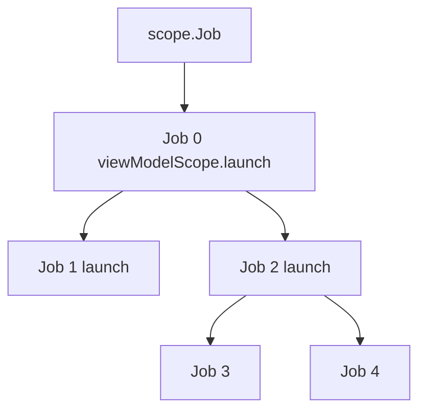

# Coroutines

> Coroutines are the single most-used Kotlin feature in modern Android. Every screen load, every background sync, every `viewModelScope.launch { ... }` rides on them. Knowing them at a *staff* level means understanding the Job tree, what happens when one branch fails, how cancellation propagates, and why `Thread.sleep` inside a coroutine is a production incident waiting to happen.

---

## Overview

A coroutine is a "lightweight thread" — a unit of work that can be **suspended** (paused without blocking the OS thread) and **resumed** later. Tens of thousands of coroutines can share a handful of OS threads.

This solves Android's two non-negotiable rules:

- You cannot do heavy work (network, DB, JSON parse) on the Main thread, or the app freezes (ANR).
- You cannot update the UI from a background thread, or the app crashes.

Pre-coroutines, you wrote callback hell or RxJava. Coroutines let you write asynchronous code that *reads sequentially*, top-to-bottom.

---

## How `suspend` Works (Mental Model + Mechanism)

### Mental model: chef in a kitchen

- **Blocking (`Thread.sleep`):** Chef puts pizza in oven, then stands frozen in front of the oven for 20 minutes. Salad doesn't get made. Need second chef (second thread).
- **Suspending (`delay`):** Chef puts pizza in oven, sets a timer (suspends), walks over to chop vegetables. Timer rings (resumes), pulls pizza. **One chef does the work of many.**

### Mechanism: state machine + Continuation

The Kotlin compiler rewrites every `suspend` function into a state machine. Each suspension point becomes a `case` label. The compiler injects a hidden `Continuation` parameter that captures local state.

```kotlin
suspend fun fetchUserAndShow() {
    println("Start")              // State 0
    val user = api.fetchUser()    // ← suspension point
    println("Name: ${user.name}") // State 1
}
```

After compilation, roughly:

```java
Object fetchUserAndShow(Continuation cont) {
    StateMachine sm = (StateMachine) cont;
    switch (sm.label) {
        case 0:
            System.out.println("Start");
            sm.label = 1;
            return api.fetchUser(sm);   // thread is returned to the pool!
        case 1:
            User user = (User) sm.result;
            System.out.println("Name: " + user.name);
            return Unit;
    }
}
```

At the suspension point, the function returns; the thread is freed. When the network call completes, the runtime calls `fetchUserAndShow(cont)` again, dispatches based on `sm.label = 1`, and jumps straight to the second half. The "stack frame" of locals lives on the heap inside `Continuation`, not on the OS thread stack.

**Key takeaway:** a suspended coroutine does *not* occupy a thread. That's why one app can have 50,000 coroutines in flight.

---

## The Four Dispatchers

A coroutine always runs on a `CoroutineDispatcher`, which decides *which thread pool* executes it. Picking the wrong one is the #1 cause of mysterious perf bugs.

| Dispatcher | Thread pool | When to use |
|---|---|---|
| `Dispatchers.Main` | Single Android UI thread | UI updates, calling `suspend` orchestrators. Never blocks; only quick work. |
| `Dispatchers.Main.immediate` | Same | Optimization: if already on Main, skip the dispatch. `viewModelScope` default. |
| `Dispatchers.IO` | Large elastic pool (default 64 threads) | Disk I/O, network, Room reads, file ops. Threads wait a lot. |
| `Dispatchers.Default` | Fixed pool = # of CPU cores | CPU-bound: JSON parsing, sorting, image transforms, crypto. |
| `Dispatchers.Unconfined` | Whatever thread resumed you | Library code only; never use in app code (post-resumption thread is undefined). |

### Why `IO` ≠ `Default` — concrete numbers

Suppose you have 10 API calls (each 500ms wait) + 10 CPU tasks (each 100ms) on a 4-core device.

**Correct** — IO on `IO`, CPU on `Default`:
- All 10 IO calls run concurrently on the IO pool (64 threads available).
- IO time: **500ms** total.
- CPU tasks then run on Default (4 threads): 3 batches × 100ms = **300ms**.
- **Total: ~800ms.**

**Wrong** — both on `Default` (4 threads):
- IO tasks monopolize the 4 threads. Batched 4 × 4 × 2 = 3 batches × 500ms = **1500ms**.
- CPU tasks blocked waiting for IO. Then 300ms.
- **Total: ~1800ms.** 2.25× slower.

The IO pool is large because IO threads spend most of their time *waiting* — the OS can schedule something else on the same physical thread. CPU work needs dedicated cores; growing the pool past `#cores` just adds context-switch overhead.

### `withContext` for thread switching

```kotlin
suspend fun fetchDocs() {           // called on Main
    val docs = withContext(Dispatchers.IO) {   // switch to IO
        api.getDocs()                          // runs on IO
    }                                          // automatically back on Main
    render(docs)                               // runs on Main
}
```

`withContext` switches the dispatcher *for the block*, suspends until it returns, then resumes on the original dispatcher. It's how you make a function **main-safe**: callers don't have to know what dispatcher to use.

### The main-safety contract

A repository function `suspend fun getUsers(): List<User>` should be main-safe — it should be callable from `Main` without freezing the UI. Internally it does its own `withContext(Dispatchers.IO)`.

**Anti-pattern:**

```kotlin
// ViewModel — BAD
viewModelScope.launch {
    val users = withContext(Dispatchers.IO) {     // ViewModel knows IO is needed
        repository.getUsers()                      // repo doesn't switch on its own
    }
    _state.value = users
}
```

**Better — repository self-contains threading:**

```kotlin
// Repository
class UserRepository(private val api: Api) {
    suspend fun getUsers(): List<User> = withContext(Dispatchers.IO) {
        api.getUsers()
    }
}

// ViewModel
viewModelScope.launch {
    _state.value = repository.getUsers()    // no Dispatcher leak into ViewModel
}
```

Now no caller anywhere thinks about threading. The repository owns its own main-safety. This is **Dispatcher injection** — and in practice you inject a `CoroutineDispatcher` rather than reference `Dispatchers.IO` directly so tests can substitute a `TestDispatcher`.

---

## `launch` vs `async` — Two Builders, Different Contracts

| | `launch` | `async` |
|---|---|---|
| Returns | `Job` | `Deferred<T>` (a `Job` that produces a result) |
| Result | None (fire-and-forget) | `.await()` to get the value |
| Exception behavior | Propagates immediately to parent | **Held inside `Deferred`** until `await()` is called |
| Use case | "Do something" (start a save, update UI) | "Compute something I need a value from" |

```kotlin
viewModelScope.launch {
    val deferredUser = async { api.getUser() }       // starts immediately
    val deferredCart = async { api.getCart() }       // starts in parallel
    render(deferredUser.await(), deferredCart.await())   // both run concurrently
}
```

This is **parallel decomposition** — run two independent things concurrently, combine.

### The `async` exception trap

```kotlin
viewModelScope.launch {
    async { throw IOException("boom") }   // ← exception held in Deferred
    // never call .await() → silently lost
}
```

Without `.await()`, the exception sits inside the Deferred forever. No crash, no log. Use `launch` if you don't need a value — exceptions propagate immediately.

---

## `CoroutineScope`, `CoroutineContext`, and the Job Tree

### Scope = lifetime owner

A `CoroutineScope` holds a `CoroutineContext`. Every coroutine launched in the scope inherits the context and adds itself as a child of the scope's `Job`. When you call `scope.cancel()`, every coroutine inside dies.

```kotlin
class Repo {
    private val scope = CoroutineScope(Job() + Dispatchers.IO)

    fun save(data: Data) {
        scope.launch { /* runs on IO */ }
    }

    fun close() {
        scope.cancel()   // every in-flight save cancels
    }
}
```

### Built-in Android scopes

| Scope | Lifetime | Default Job | Default Dispatcher |
|---|---|---|---|
| `viewModelScope` | ViewModel cleared | `SupervisorJob` | `Main.immediate` |
| `lifecycleScope` | Activity/Fragment destroyed | `SupervisorJob` | `Main.immediate` |
| `viewLifecycleOwner.lifecycleScope` | View destroyed (`onDestroyView`) | `SupervisorJob` | `Main.immediate` |
| `GlobalScope` | App process lifetime | `Job` | None enforced |

**Never use `GlobalScope` in production** — it has no lifecycle, leaks coroutines past the screen, and bypasses structured concurrency. (Reserved for `kotlinx.coroutines` internals and tests.)

### `CoroutineContext` is composable

```kotlin
val context = Job() + Dispatchers.Main + CoroutineName("Sync") + handler
val scope = CoroutineScope(context)
```

A context is a set of typed elements. The interesting ones:

- **`Job`** — controls lifecycle / cancellation hierarchy.
- **`CoroutineDispatcher`** — picks the thread pool.
- **`CoroutineName`** — name for logs/debugger.
- **`CoroutineExceptionHandler`** — last-resort uncaught exception sink.

Override per launch:

```kotlin
scope.launch(Dispatchers.Default + CoroutineName("hash")) { /* ... */ }
```

---

## Job Hierarchy and Cancellation

### Parent-child relationship

Every coroutine has a `Job`. Coroutines launched inside another coroutine become children of that parent's Job. Rules:

1. **A parent does not complete until all children complete.**
2. **Cancelling a parent cancels all children recursively.** Siblings are not affected.
3. **If a child fails, the exception propagates *up*** to the parent.



If `Job4` throws → propagates to `Job2` → propagates to `Job0`. Default Job semantics: this cancels `Job1` (sibling) too.

### `Job` vs `SupervisorJob`

The propagation rule above ruins many real cases. Example: a screen makes 3 independent API calls. If `getProfile()` fails, you don't want `getOrders()` and `getRecommendations()` to also be cancelled.

`SupervisorJob` is the same as `Job` except **a failing child does NOT cancel its siblings**.

```kotlin
viewModelScope.launch {     // viewModelScope already uses SupervisorJob at root
    // …but `coroutineScope { }` inside re-introduces strict Job semantics
    supervisorScope {
        launch { fetchProfile() }       // if this fails…
        launch { fetchOrders() }        // …these keep running
        launch { fetchRecommendations() }
    }
}
```

| Builder | Job type | Sibling failure isolated? |
|---|---|---|
| `coroutineScope { }` | `Job` | No — any failure cancels siblings |
| `supervisorScope { }` | `SupervisorJob` | Yes |
| `viewModelScope.launch { }` | inherits `SupervisorJob` from the scope's root | Yes (root-level only) |

`viewModelScope` is already `SupervisorJob` at the root, so if one *top-level* `launch` inside it fails, others survive. But if you put a `coroutineScope { ... }` inside, you're back to strict semantics for the children of that scope.

### Cancellation is cooperative

Cancellation only works if the coroutine *checks* for it. `suspend` functions in `kotlinx.coroutines` (like `delay`, `withContext`, network suspending stubs) all check `isActive` at suspension points and throw `CancellationException` when cancelled.

**Tight CPU loops do not get cancelled** unless you cooperate:

```kotlin
// BAD — runs to completion even if cancelled
viewModelScope.launch(Dispatchers.Default) {
    while (true) {
        crunchNumbers()         // pure CPU, no suspension → never sees cancel
    }
}

// GOOD — check explicitly
viewModelScope.launch(Dispatchers.Default) {
    while (true) {
        ensureActive()          // throws CancellationException if cancelled
        crunchNumbers()
    }
}

// ALSO GOOD — yield() also checks
viewModelScope.launch(Dispatchers.Default) {
    while (isActive) {
        yield()                 // suspends briefly + checks cancel
        crunchNumbers()
    }
}
```

### `NonCancellable` for cleanup

Cleanup code (close DB, flush logs) inside a `finally` block runs even on cancellation — but **further suspending calls fail immediately** because the coroutine is already cancelled.

```kotlin
try {
    doWork()
} finally {
    withContext(NonCancellable) {
        flushAnalytics()        // protected: actually completes
        closeDb()
    }
}
```

---

## Timeouts

```kotlin
withTimeout(5_000) {
    api.getProfile()
}   // throws TimeoutCancellationException after 5s

val result = withTimeoutOrNull(5_000) {
    api.getProfile()
}   // returns null if timed out, value otherwise
```

`withTimeout` cancels the inner block — relies on cooperative cancellation, so pure CPU loops also need `ensureActive()`. Prefer `withTimeoutOrNull` when "took too long" is a normal outcome (e.g., cache lookup), not an error.

---

## Exception Handling Patterns

### `try/catch` works inside a coroutine block

```kotlin
viewModelScope.launch {
    try {
        val user = repo.getUser()
        _state.value = Success(user)
    } catch (e: IOException) {
        _state.value = Error(e)
    }
}
```

Two important gotchas:

**1. Never catch `CancellationException` generically.**

```kotlin
// BAD — swallows the cancel signal
try {
    delay(5000)
} catch (e: Exception) {
    log(e)
}
```

`CancellationException` is how cancellation flows. If you swallow it, when the ViewModel dies the coroutine receives the signal and ignores it — it becomes a zombie that keeps running. Always either:

```kotlin
} catch (e: IOException) {   // catch specifics, not Exception
    log(e)
}
```

or rethrow:

```kotlin
} catch (e: Exception) {
    if (e is CancellationException) throw e
    log(e)
}
```

**2. `try/catch` around `launch` doesn't catch exceptions inside `launch`.**

```kotlin
// BAD — try/catch is around the call to `launch`, not the body
try {
    viewModelScope.launch { throw IOException() }
} catch (e: Exception) {
    // never runs — launch returns immediately
}
```

The exception happens *inside the coroutine's machinery*. It propagates up the Job tree to the scope's `CoroutineExceptionHandler` (if any) or crashes the parent.

### `CoroutineExceptionHandler`

Last-resort handler for uncaught exceptions in `launch`-style builders:

```kotlin
val handler = CoroutineExceptionHandler { _, throwable ->
    crashlytics.recordException(throwable)
}

private val scope = CoroutineScope(SupervisorJob() + Dispatchers.Main + handler)

scope.launch {
    throw IOException()    // → handler.handleException()
}
```

The handler fires only at the *top level* of a scope, after exception propagation. It does not fire for child coroutines whose exceptions propagate to a parent. It also doesn't catch exceptions in `async` (which hold their exceptions in the Deferred).

---

## Android Lifecycle Integration

### `viewModelScope` — the default

```kotlin
class CartViewModel : ViewModel() {
    fun checkout() {
        viewModelScope.launch {
            repo.checkout()
        }
    }
}
// On ViewModel.onCleared() → scope.cancel() → coroutine cancels
```

### `repeatOnLifecycle` — preferred for collecting flows

```kotlin
class CartFragment : Fragment() {
    override fun onViewCreated(view: View, savedInstanceState: Bundle?) {
        viewLifecycleOwner.lifecycleScope.launch {
            viewLifecycleOwner.repeatOnLifecycle(Lifecycle.State.STARTED) {
                viewModel.cart.collect { cart ->
                    render(cart)
                }
            }
        }
    }
}
```

`repeatOnLifecycle(STARTED)` collects the flow only while the view is STARTED, **and cancels the collect when the view stops**. When it restarts, the collect re-subscribes. This is the modern replacement for `launchWhenStarted { }` (now deprecated) — the latter only paused, never cancelled, leaking upstream work.

### Pre-`repeatOnLifecycle` (avoid)

`launchWhenCreated`, `launchWhenStarted`, `launchWhenResumed` are deprecated — they pause the coroutine but don't cancel upstream collection, leaking hot flow subscribers.

---

## `runBlocking` and `runTest`

### `runBlocking` — bridges blocking world to coroutines

```kotlin
fun main() = runBlocking {
    val data = fetchData()    // suspend call
    println(data)
}
```

Use only:
- In `main()` functions (CLI tools).
- In test setup when bridging non-coroutine code.
- Never in production Android code — it blocks the calling thread.

### `runTest` — virtual time for unit tests

```kotlin
@Test
fun cartCheckout() = runTest {
    val viewModel = CartViewModel(repo, dispatcher = StandardTestDispatcher(testScheduler))
    viewModel.checkout()
    advanceUntilIdle()      // run all pending coroutines without real waiting
    assertEquals(Success, viewModel.state.value)
}
```

`runTest` (from `kotlinx-coroutines-test`) gives you a `TestScope` with a virtual clock. `delay(60_000)` doesn't actually wait 60 seconds — `advanceTimeBy(60_000)` jumps it forward instantly. This is what makes coroutine tests fast and deterministic.

Inject a dispatcher into your ViewModel/repo so tests can substitute:

```kotlin
class CartViewModel(
    private val repo: CartRepo,
    private val ioDispatcher: CoroutineDispatcher = Dispatchers.IO,
) : ViewModel() { /* ... */ }
```

---

## Failure Modes

| Symptom | Cause | Fix |
|---|---|---|
| ANR / frozen UI inside coroutine | `Thread.sleep()` instead of `delay()` | Use `delay`; suspension only |
| Coroutine never cancels | Pure CPU loop, no `ensureActive` | Insert `ensureActive()` or `yield()` |
| Exception swallowed silently | `async { throw }` without `.await()` | Use `launch` if you don't need a value |
| `try/catch` around `launch` doesn't catch | Exception happens *inside* launch | Catch inside the lambda |
| App crashes intermittently | Caught `Exception` swallowed `CancellationException` | Catch specifics, or rethrow `CancellationException` |
| Zombie coroutine after screen close | Used `GlobalScope` instead of scoped | Always use lifecycle scopes |
| Flow keeps collecting after screen stops | Used `lifecycleScope.launch { collect }` without `repeatOnLifecycle` | Wrap in `repeatOnLifecycle(STARTED)` |
| All sibling API calls cancel on one failure | Used `coroutineScope`/`Job` | Use `supervisorScope`/`SupervisorJob` |
| Cleanup block fails mid-cleanup | Suspending call in `finally` after cancel | Wrap in `withContext(NonCancellable)` |
| Test hangs forever | Production `Dispatchers.IO` in test | Inject `TestDispatcher`; use `runTest` |
| Network request runs on Main | Repository didn't `withContext(IO)` | Make repo main-safe internally |
| 200ms parsing freezes UI | JSON parse on `Dispatchers.IO` | Move CPU work to `Dispatchers.Default` |

---

## Common Misconceptions

- **"Coroutines are just threads."** No. One thread can host hundreds of coroutines. A thread is an OS resource; a coroutine is a state machine on the heap.
- **"Coroutines make my code faster."** False. A 200ms network call still takes 200ms. They reduce *resource cost* (threads, stacks) while waiting.
- **"`suspend` runs on a background thread."** No. `suspend` is a marker that a function can suspend — it runs on whatever dispatcher the calling coroutine has.
- **"`async` always parallelizes."** Only if both `async` calls happen before any `.await()`. If you write `async { a() }.await(); async { b() }.await()`, you've sequentialized them.
- **"`Dispatchers.IO` is for everything off Main."** No. Heavy CPU work on `IO` steals threads from real IO work and slows everything down.
- **"`viewModelScope.launch { }` always survives config change."** Yes, *because* ViewModel survives. But hot Flow collection inside it without `repeatOnLifecycle` keeps running while the screen is invisible, wasting resources.

---

## Staff Engineer Lens

When reviewing a PR with coroutines, I scan for these signatures:

1. **Dispatcher leakage.** A ViewModel that writes `withContext(Dispatchers.IO)` is doing the repo's job. The repo should be main-safe.
2. **Injected dispatcher.** Production code should accept `CoroutineDispatcher` as a constructor parameter, not reference `Dispatchers.IO` directly. Required for testing.
3. **`runBlocking` in production code.** Always wrong. Block on what?
4. **`GlobalScope.launch`.** Always wrong unless you can prove it's a daemon process.
5. **`async` without `.await()`.** Either the result is used (great) or it's an exception bomb (find it).
6. **Generic `catch (e: Exception)`.** 9 times out of 10, this swallows `CancellationException`.
7. **`launchWhenStarted`** in 2025+ code. Replace with `repeatOnLifecycle`.
8. **Tests using real time.** `runBlocking { delay(5000) }` in tests is a 5-second flake waiting to happen.

---

## Probing Questions

1. Explain the difference between `Thread.sleep()` and `delay()`. What does each do to the underlying OS thread?
2. Walk through the state-machine transformation the compiler applies to a `suspend` function.
3. Three concurrent `async` calls inside a `coroutineScope` — task A throws. What happens to B and C? How do you isolate them?
4. Why is putting `withContext(Dispatchers.IO)` in a ViewModel an architectural smell?
5. What's the exact behavior difference between `viewModelScope` and `lifecycleScope`? When would you pick one over the other?
6. You have a tight CPU loop that needs to be cancellable. Two correct ways to implement it?
7. Why is a generic `catch (e: Exception)` inside a coroutine dangerous? Walk through the failure scenario.
8. Explain what `repeatOnLifecycle(STARTED)` does that plain `lifecycleScope.launch { collect }` doesn't.
9. Your test takes 30 seconds to run because of `delay(30_000)`. How do you make it run in milliseconds without changing production code?
10. Walk through the difference between `Job` and `SupervisorJob` — concretely, with a code example where it matters.
11. A coroutine's `finally` block tries to flush logs but the log write is a suspend call. The coroutine was cancelled. What happens, and how do you fix it?
12. Why do `Dispatchers.IO` and `Dispatchers.Default` use different pool sizes? Show with a 10-IO + 10-CPU workload on a 4-core device.

---

## Further Reading

- [`../android/concurrency/coroutines-under-the-hood.md`](../android/concurrency/coroutines-under-the-hood.md) — bytecode-level continuation mechanics.
- [`../android/concurrency/shared-flow-and-state-flow.md`](../android/concurrency/shared-flow-and-state-flow.md) — coroutines + reactive streams.
- [`../android/concurrency/structured-concurrency.md`](../android/architecture/structured-concurrency.md) — the contract from an Android architecture lens.
- [`null-safety.md`](null-safety.md) — `Result<T>` and idiomatic error returns.
- [`sealed-classes.md`](sealed-classes.md) — modeling UI state for coroutine-driven screens.
- [Kotlin Docs — Coroutines guide](https://kotlinlang.org/docs/coroutines-guide.html) — canonical.
- [Roman Elizarov — "Structured concurrency"](https://elizarov.medium.com/structured-concurrency-722d765aa952) — the original framing.
- [Roman Elizarov — "Coroutines design proposal"](https://github.com/Kotlin/KEEP/blob/master/proposals/coroutines.md) — the why.
- [Manuel Vivo — "Cancellation in coroutines"](https://medium.com/androiddevelopers/cancellation-in-coroutines-aa6b90163629) — cooperative cancellation deep dive.
- [Android Developers — "Coroutines on Android"](https://developer.android.com/kotlin/coroutines) — official Android guide.
