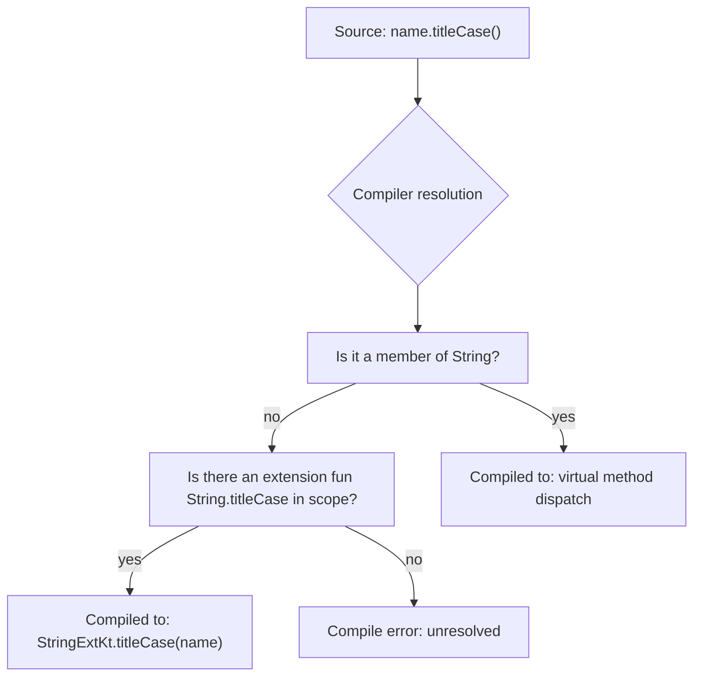

# Extensions

## Overview

An **extension function** lets you call a function on a type as if it were a member, even when you don't own the source code of that type. `"hello".titleCase()` looks like a method on `String`, but the function lives outside the `String` class entirely. Extensions are not a runtime mechanism — they don't modify the class, don't appear in reflection's member list, and don't participate in inheritance. They are pure compile-time **syntactic sugar over static functions**, dispatched statically by the *declared* type of the receiver, not its runtime type. Understanding that single fact — *static dispatch on declared type* — explains every surprising behavior of extensions, from why member functions always win to why extensions can't be overridden.

Extensions also come in three other forms: extension **properties** (computed, no backing field), extensions on **nullable receivers** (the receiver can be `null` inside the function), and **lambdas with receivers** (the basis of every Kotlin DSL). Together they are the single most-used Kotlin feature in modern Android code, accounting for the entire AndroidX KTX library and most of the Kotlin standard library.

---

## Why It Exists

In Java, when you didn't own a class and wanted to add behavior to it, you wrote a static utility:

```java
public final class StringUtils {
    public static String titleCase(String s) { ... }
    public static boolean isBlank(String s) { ... }
}

// Caller:
String t = StringUtils.titleCase(name);
```

This has three problems:

1. **Discovery is bad.** Autocomplete on `name.` doesn't show `titleCase`. You have to remember the `StringUtils` class exists.
2. **It reads backward.** `StringUtils.titleCase(name)` reads "utility acts on name." Most logic flows naturally as "name does X."
3. **Composition is ugly.** Chained transformations turn into `StringUtils.b(StringUtils.a(name))` instead of `name.a().b()`.

C# fixed this in 2007 with extension methods, and Kotlin adopted the same pattern in 1.0. The win is human-factors: code reads in subject-verb-object order, the IDE surfaces the function on `.`, and chains compose left-to-right.

The deeper architectural win, which most teams under-use, is that extensions let you **add behavior to types without modifying or subclassing them**. The Android SDK has hundreds of cluttered API classes (`View`, `Context`, `SharedPreferences`) that you can't change. Extensions let you build a clean, opinionated facade on top of them — which is exactly what Google did with AndroidX KTX (`View.isVisible`, `Bundle.bundleOf()`, `Context.getColorCompat()`).

---

## Historical Context

1. **C# 3.0 (2007).** First mainstream language to ship extension methods, motivated by LINQ — extension methods on `IEnumerable<T>` let LINQ add `Where`, `Select`, `OrderBy` to every collection type without modifying the framework.
2. **Scala implicit conversions (2003).** Earlier and more powerful — Scala let you implicitly convert one type to another, allowing methods on the converted type to appear callable on the original. Powerful but error-prone; Scala 3 replaced implicit conversions with explicit extension methods (2021) after years of debate.
3. **Kotlin 1.0 (2016).** Shipped extension functions and extension properties from day one, syntactically modeled on C# but with the addition of nullable receivers and lambdas-with-receivers (which became the basis of every Kotlin DSL).
4. **Android KTX (2018).** Google released a library of ~200 extension functions wrapping the Android SDK in idiomatic Kotlin. This was the first official Google endorsement of "extensions as API design tool" rather than just "utility shortcut."
5. **Context receivers proposal — KEEP-259 (2022, deprecated 2024).** Kotlin 1.6.20 shipped experimental support for declaring multiple receivers. Was withdrawn for a redesigned proposal called **context parameters** (KEEP-367, in flight for Kotlin 2.x), addressing usability and ambiguity issues with the original.

The arc: extensions started as syntactic sugar for utility methods, became a tool for SDK design (AndroidX KTX), and are evolving toward a primary mechanism for capability-based programming (context parameters).

---

## First Principles

### 1. Extensions are static functions, full stop

When the Kotlin compiler sees:

```kotlin
// In file: StringExt.kt, package com.example.text
fun String.titleCase(): String =
    split(" ").joinToString(" ") { it.replaceFirstChar { c -> c.uppercase() } }
```

it generates JVM bytecode equivalent to:

```java
// In class: com.example.text.StringExtKt
public final class StringExtKt {
    public static String titleCase(String $this) {
        // Implementation: $this is the String the function was "called on"
    }
}
```

The call site `name.titleCase()` is compiled to `StringExtKt.titleCase(name)`. There is no method added to `java.lang.String`, no proxy, no reflection. Just a static call. From Java, you can call it as `StringExtKt.titleCase(name)` directly.

This is the single fact that explains everything else.

### 2. Dispatch is static on the declared type, not virtual on the runtime type

```kotlin
open class Animal
class Dog : Animal()

fun Animal.speak() = "generic sound"
fun Dog.speak() = "woof"

val pet: Animal = Dog()
println(pet.speak())  // prints "generic sound" — uses Animal.speak()
```

Because the call compiles to `AnimalExtKt.speak(pet)` and `pet` is *declared* as `Animal`, the compiler picks `Animal.speak()`. The runtime type (`Dog`) is irrelevant. This is the opposite of how member function dispatch works — member functions are virtual; extensions are static.

**Implication:** Extensions are not polymorphic. If you need behavior that varies by runtime type, use member functions, sealed classes with `when`, or a strategy pattern. Don't try to "override" extensions by redeclaring them on subtypes — you'll get whichever one matches the declared type at the call site.

### 3. Member functions always win over extensions

```kotlin
class Box {
    fun greet() = "hello from member"
}

fun Box.greet() = "hello from extension"  // compiler accepts this silently

Box().greet()  // prints "hello from member"
```

If a member function and an extension have the same name and signature, the member wins. The extension is effectively dead code. Worse, the compiler issues no warning — you have to know this rule.

The rule exists for backward compatibility: if a library adds a new member function in v2, callers using an extension with the same name shouldn't silently switch behavior. The library's member wins. This is a safe default for evolution but a footgun for surprises.

### 4. Extension properties have no backing field

```kotlin
val String.lastCharOrNull: Char?
    get() = if (isEmpty()) null else this[length - 1]

// This DOESN'T compile:
val String.cached: Int = 42  // Error: extension property must have getter or be abstract
```

Extension properties are purely computed. They can't store state — there's no class to hold the field. If you need to cache a value per-instance, use a `Map<T, V>` with the receiver as the key (and accept the memory-leak risk), or use the host class as a member instead.

### 5. Extensions can have nullable receivers

```kotlin
fun String?.orEmpty(): String = this ?: ""

val name: String? = null
println(name.orEmpty())  // prints "" — no NPE, this is null inside the function
```

Inside the function, `this` is of type `String?`. You must handle null explicitly. This is how Kotlin's stdlib provides `?.orEmpty()`, `?.isNullOrBlank()`, and `?.toString()` (which prints `"null"` for null receivers — handy for debug logging).

---

## Mental Model

Think of an extension function as **a helpful friend who learned how to behave like a member of the club, without actually joining**.

- The friend can be called on with the same syntax as a club member: `member.doThing()` or `friend.doThing()` — same dot notation.
- But the friend isn't on the club's official roster. If you ask the club, "is `doThing` one of your methods?" the answer is no.
- If a real member ever takes the same name, the real member is always the one called — the friend silently steps aside.
- The friend's behavior is decided at the moment you write the introduction (compile time, declared type), not at the moment you make the call.

The "extension" word is slightly misleading — nothing is extended at runtime. A better mental name is **"sugar for a static utility that takes the receiver as its first argument."**

---

## Internal Mechanics

### Bytecode of a simple extension

```kotlin
// File: StringExt.kt
package com.example.text

fun String.shout(): String = this.uppercase() + "!"
```

Decompiled (using IntelliJ → Tools → Kotlin → Show Kotlin Bytecode → Decompile):

```java
public final class StringExtKt {
    @NotNull
    public static final String shout(@NotNull String $this$shout) {
        Intrinsics.checkNotNullParameter($this$shout, "$this$shout");
        String var10000 = $this$shout.toUpperCase(Locale.ROOT);
        return var10000 + "!";
    }
}
```

Note three things:
1. The receiver becomes the first parameter, named `$this$shout`.
2. There's a runtime null-check via `Intrinsics.checkNotNullParameter` — Kotlin enforces non-nullability for parameters even when called from Java.
3. The function is `public static final` — no virtual dispatch is possible.

### Bytecode of a nullable-receiver extension

```kotlin
fun String?.orPlaceholder(): String = this ?: "<empty>"
```

Decompiled:

```java
public static final String orPlaceholder(@Nullable String $this$orPlaceholder) {
    return $this$orPlaceholder == null ? "<empty>" : $this$orPlaceholder;
}
```

The `Intrinsics.checkNotNullParameter` call disappears because the parameter is annotated `@Nullable`. This is why nullable-receiver extensions are cheap — no runtime check on the receiver.

### Resolution rules: member vs extension vs static import

When the compiler sees `someExpression.foo(args)`, it resolves `foo` in this order:

1. **Member functions** of the declared type of `someExpression` (or any of its supertypes).
2. **Extension functions** imported into scope (via package import, local import, or being in the same file).
3. **Local functions** named `foo` that take the receiver as a parameter.

If multiple extensions match, the **most specific receiver type wins** (Dog.foo beats Animal.foo when both are imported and the declared type is Dog). If they tie, ambiguity is an error.

### Why members beat extensions

In a JVM-style language, you can't add methods to existing classes without modifying their bytecode. The compiler builds two parallel "method tables" at call sites: the real one (virtual dispatch via the JVM) and the extension one (static dispatch via name resolution). When both have a candidate, the compiler picks the real one. This rule keeps the language consistent: member calls always behave the same regardless of imports.

### Extensions in companion objects

```kotlin
class Money(val cents: Long) {
    companion object
}

fun Money.Companion.zero() = Money(0)
fun Money.Companion.fromDollars(d: Double) = Money((d * 100).toLong())

// Use:
val nothing = Money.zero()
val tip = Money.fromDollars(2.50)
```

This is how you add "static factory methods" to existing types. The companion object is itself a real object, and you're extending it. The Kotlin stdlib uses this pattern for `String.Companion.format(...)`.

---

## Architecture



The diagram shows what the *compiler* does. The runtime never sees a difference between an extension call and a regular static utility call.

---

## Production Example

### Kotlin standard library: scope functions

Almost every Kotlin scope function is implemented as an inline extension:

```kotlin
// From kotlin.kt in stdlib
public inline fun <T, R> T.let(block: (T) -> R): R = block(this)

public inline fun <T> T.apply(block: T.() -> Unit): T {
    block()
    return this
}
```

`let` is generic over any type `T` — meaning `let` is a method on *every* type in Kotlin, without modifying any of them. This is only possible because extensions are external. `apply` takes a *lambda with receiver* (`T.() -> Unit`), letting you call methods of the receiver inside the lambda without naming it.

### Android KTX: making the SDK readable

The standard Android SDK call to make a View visible is:

```kotlin
view.setVisibility(View.VISIBLE)
```

KTX adds an extension property:

```kotlin
inline var View.isVisible: Boolean
    get() = visibility == View.VISIBLE
    set(value) {
        visibility = if (value) View.VISIBLE else View.GONE
    }

// Caller writes:
view.isVisible = true
```

Three things to notice: it's an extension *property* with both `get` and `set`; it's `inline`, so there's zero call overhead; and it's `var`, demonstrating that extension properties can be writable as long as you back the setter onto state stored elsewhere (the View itself, in this case).

### Wrapping a callback API as a suspend function

A common Staff-level pattern is using `suspendCancellableCoroutine` inside an extension to convert a callback-based API into a coroutine:

```kotlin
import com.google.android.gms.location.FusedLocationProviderClient
import kotlinx.coroutines.suspendCancellableCoroutine
import kotlin.coroutines.resume
import kotlin.coroutines.resumeWithException

suspend fun FusedLocationProviderClient.awaitLastLocation(): Location? =
    suspendCancellableCoroutine { cont ->
        lastLocation
            .addOnSuccessListener { loc -> cont.resume(loc) }
            .addOnFailureListener { e -> cont.resumeWithException(e) }
        cont.invokeOnCancellation {
            // Best-effort — Google's API doesn't expose cancellation
        }
    }
```

Callers now write `client.awaitLastLocation()` inside a coroutine, and the rest of the app never sees a callback. This is the dominant style for wrapping Java SDKs in modern Android codebases.

---

## Advanced Features

### Lambdas with receivers — the DSL building block

```kotlin
class HtmlBuilder {
    private val children = mutableListOf<String>()
    fun p(text: String) { children += "<p>$text</p>" }
    fun b(text: String) { children += "<b>$text</b>" }
    fun build() = children.joinToString("")
}

fun html(block: HtmlBuilder.() -> Unit): String =
    HtmlBuilder().apply(block).build()

// Usage reads like a DSL:
val page = html {
    p("Hello")
    b("World")
}
```

The signature `HtmlBuilder.() -> Unit` says "a function that, when called, behaves as if you're inside an `HtmlBuilder`." This is how Compose, Gradle Kotlin DSL, Anko, and Ktor all build their syntax. The lambda's `this` is the `HtmlBuilder`, so you can call `p()` and `b()` without naming the builder.

### Generic extensions

```kotlin
fun <T> List<T>.secondOrNull(): T? = if (size < 2) null else this[1]
fun <T : Comparable<T>> List<T>.median(): T? = sorted().getOrNull(size / 2)
```

Generics work normally inside extensions. You can constrain the type parameter (`T : Comparable<T>` requires natural ordering). This is how stdlib's `List<T>.maxOrNull()`, `Iterable<T>.filter`, and friends work.

### Reified generic extensions (inline only)

```kotlin
inline fun <reified T> Bundle.getParcelableSafe(key: String): T? =
    if (Build.VERSION.SDK_INT >= 33) getParcelable(key, T::class.java)
    else @Suppress("DEPRECATION") getParcelable(key) as? T
```

The `reified` keyword (only available on `inline` functions) lets you use `T` as if it were a regular class at runtime. Combined with extensions, this lets you write API-version-aware helpers for the deprecated Android `Bundle.getParcelable(key)` overload.

### Operator overloading via extensions

```kotlin
operator fun BigDecimal.plus(other: Int): BigDecimal = this + other.toBigDecimal()
operator fun File.div(child: String): File = File(this, child)

// Now:
val total = bigPrice + 10
val configFile = baseDir / "config.json"
```

Most Kotlin operators (`plus`, `minus`, `times`, `div`, `get`, `set`, `compareTo`, `invoke`, `contains`) can be defined as extensions, which lets you teach math-like or path-like syntax to types you don't own.

---

## Tradeoffs

**Advantages**

- **Discoverability.** Autocomplete on `.` surfaces the function. The reader sees it without having to know which utility class it lives in.
- **Composability.** Chained operations read left-to-right (`xs.filter { … }.map { … }.first()`) instead of nested (`first(map(filter(xs, …), …))`).
- **API design.** Lets you build a clean facade over messy or third-party types without subclassing or wrapping. AndroidX KTX is the best example.
- **Zero runtime cost.** A static call is the same cost as any other static call. With `inline`, the cost is zero.

**Disadvantages**

- **Static dispatch surprises.** Programmers expecting polymorphism are confused when the wrong overload is chosen based on declared type.
- **Member-wins surprise.** Extensions can become silent dead code if a member is added later or already exists.
- **Untestable in isolation.** You cannot mock or stub an extension function. If a unit under test calls `someJavaClient.awaitLastLocation()`, you must inject the receiver or fake it; the extension itself isn't mockable.
- **Namespace pollution.** A single misplaced top-level extension on `Any` or `String` shows up in autocomplete everywhere, even in unrelated code.
- **Reading discovery is bad.** You see `name.titleCase()` but you have no immediate way to know *which file* defined `titleCase`. IDE go-to-definition fixes this, but greppability is poor.

**When not to use**

- For behavior that must vary by runtime type (use member functions or sealed `when`).
- For domain logic that must be mocked in tests (use injected dependencies).
- For functions that need state per instance (use a regular class).
- For names that might conflict with future stdlib or framework members (avoid generic verbs like `with`, `apply`, `to`, `run` on common types).

---

## Failure Modes

**Namespace pollution.** A `fun Any.log()` at the top level of a commonly-imported package shows up on every value in every file. The standard fix is to keep extensions package-private (`internal`) or file-private (`private fun`), or scope them as members of an object (`object TextHelpers { fun String.titleCase() = ... }`, callable as `with(TextHelpers) { name.titleCase() }`).

**Member-wins silent breakage.** A library adds a new method in v2 with the same name as your extension. Your extension becomes dead, the library's version runs, and the behavior changes silently. The fix is to either rename your extension or accept that overlapping names with library members is risky.

**Wrong-overload-by-declared-type bug.** You declare a variable as `Animal` but pass a `Dog` to a function expecting an extension. The Animal-receiver extension runs, not the Dog one. The fix is to either use member functions (polymorphic) or to ensure the declared type matches the runtime type at the call site.

**Mocking failure.** A unit test mocks `repository.fetchUser()` but the production code uses `repository.fetchUserWithRetry()`, an extension. The test never realizes the extension is called. The fix is to express retry as a member of an injectable interface, not as an extension on the repository.

**Hidden cost in collection extensions.** `list.filter { ... }.map { ... }.first()` allocates two intermediate lists. The fix is `list.asSequence().filter { ... }.map { ... }.first()` for large lists, but only when the chain has more than ~3 elements — for small lists the eager version is faster.

---

## Performance Considerations

- **Static call overhead** is the same as any Java static method call — effectively free after JIT inlining.
- **`inline` extensions** have zero overhead because the body is copied into the call site. Use for hot-path extensions that take lambdas (`forEach`, `let`, `apply`).
- **Non-inline extensions taking lambdas** allocate a `FunctionN` object per call. Inside a tight loop, this can dominate. The stdlib marks all such extensions `inline` for this reason.
- **Reified generic extensions** must be `inline`, so they're zero-cost at the call site but every call site duplicates the body. Keep them small (typically 5–20 lines).
- **Extension properties** are functions with `get`/`set`; they have no field-access fast path. Repeated `view.isVisible` checks in a hot frame loop are fine because the KTX implementation is `inline`, but a non-inline extension property would be a method call per access.

---

## Reliability Considerations

- **Don't put business logic in extensions** that has to be mocked in tests. Extensions can't be intercepted by Mockito or MockK. Keep extensions to pure-function utilities.
- **Avoid extensions on `Any` or `Any?`** in production code — they pollute every type and make code review hard.
- **Prefer file-private or internal extensions** for module-specific helpers. Only mark them `public` if they're truly part of the module's API.
- **Document extensions in package-level docs.** Because extensions don't show up in the receiver's KDoc, callers may miss them. AndroidX KTX puts each set of extensions in a single file per receiver to make discovery easier.

---

## Security Considerations

Extensions inherit the visibility of where they're declared. A `private fun String.foo()` is visible only in the declaring file; an `internal fun` is module-scoped. There is one subtle leak: from Java code, an `internal` extension is still callable if the caller knows the name-mangled symbol (`StringExtKt.foo$mymodule_debug(...)`). This is a compile-time boundary, not a security one — don't use `internal` as access control for security-sensitive code.

Extension functions on user-input-bearing types (`String`, `Uri`, `Intent`) are common surfaces for injection bugs. Always treat the receiver as untrusted in security-sensitive extensions.

---

## Observability

Extensions appear in stack traces by their JVM-mangled names: `StringExtKt.titleCase(StringExt.kt:12)`. If you're looking at a crash report and don't recognize the file, that's the file the extension was declared in. There's nothing special to wire up for observability — extensions log, metric, and trace like any other static function.

---

## Staff Engineer Thinking

**Treat extensions as API design surface, not just convenience.** Every public extension you declare becomes part of the module's API and can't be removed without breaking callers. Review them with the same care you give to any other public method. Many "internal utility" PRs introduce `public fun String.x() = …` that the team has to live with forever.

**Scope aggressively.** The default visibility for a new extension should be `private` (file-only) or `internal` (module-only). Only promote to `public` when there's a documented reason for callers in other modules to use it. This single rule cuts namespace pollution by 90%.

**Prefer extensions over inheritance for SDK adaptation.** When wrapping a third-party type (`OkHttpClient`, `Locale`, `Bundle`), don't subclass — extend. Subclasses can break when the parent class changes; extensions are robust to API evolution as long as the method signature stays compatible.

**Don't ship `fun Any.toJson()` or `fun String.toEmailOrNull()` casually.** "Convert anything to JSON" is a domain decision (which serializer? which date format?). Pin the serializer in a concrete type or interface. "Parse email" sounds harmless but ten years from now your team will have eight different `toEmailOrNull` extensions in different modules each with different validation rules.

**Watch for the member-wins evolution trap.** If you extend a third-party type, treat your extension as overridable by the library author. When upgrading dependencies, search for extension names that may collide with new members. A CI lint that flags extensions on common stdlib/framework types is cheap and prevents the silent-behavior-change bug.

**Use lambdas-with-receivers to build configuration DSLs.** Anywhere you have a "build a complex object" pattern, a receiver-lambda DSL is cleaner than a fluent builder. The Gradle Kotlin DSL, Ktor routing, and Compose are existence proofs that the pattern scales.

---

## Common Misconceptions

**"Extensions modify the class."** They don't. The class is untouched; the function lives in a separate static utility. Reflection on the receiver type won't find it.

**"Extensions override member functions."** Member functions always win. Even when the extension is more specific, the member is called.

**"Extensions are polymorphic."** They're statically dispatched on the declared type. The runtime type is ignored. This is the opposite of member function dispatch.

**"Extension properties can be `lateinit` or hold cached values."** No — there's no backing field. Extension properties are computed every time. To cache, store the cache externally (e.g., a `Map<Receiver, Value>` keyed by identity).

**"Adding more extensions makes the code easier to read."** Past a certain point, extensions hide the call graph and make it harder to find where logic lives. Use them deliberately, not reflexively.

**"`inline` is required for any extension."** Only for extensions that take lambdas in hot paths or use reified generics. Most extensions don't need it.

**"An extension on `String?` is automatically null-safe."** It's *invocation-safe* (you can call it on null), but inside the function the receiver is null. You still have to handle that case.

---

## Probing Questions

1. Decompile `fun String.shout(): String = uppercase() + "!"` into Java. Where does the receiver go in the generated bytecode?
2. You declare `fun Animal.speak()` and `fun Dog.speak()`. You call `speak()` on a variable declared `val a: Animal = Dog()`. Which runs, and why?
3. A class has `fun greet() = "member"`. A file in scope has `fun MyClass.greet() = "extension"`. Which is called and why does the compiler not warn?
4. Why can extension properties not have backing fields, and what are two strategies to "fake" cached state with an extension property?
5. Explain why `fun Any.log() = println(this)` is a code smell in a public module.
6. What does the `reified` keyword require of the function it's declared on, and why?
7. You have a lambda parameter `block: HtmlBuilder.() -> Unit`. Inside the lambda body, what does `this` refer to and how is the syntax different from `block: (HtmlBuilder) -> Unit`?
8. From Java code, how do you call `fun String.titleCase()` declared in file `StringExt.kt`?
9. Why is `list.asSequence().map { ... }.filter { ... }.first()` sometimes slower than `list.map { ... }.filter { ... }.first()` despite avoiding intermediate allocations?
10. You write a unit test for a function that internally calls `okHttpClient.awaitResponse()`, an extension wrapping the callback API. Mockito can't stub the extension. How do you make the function testable without giving up the extension syntax?

---

## Further Reading

In this repository:

- [`functions.md`](functions.md) — function types, lambdas, higher-order functions; extensions build on top.
- [`inline-functions.md`](../compiler-features/inline-functions.md) — how `inline` interacts with extensions to give zero call overhead.
- [`reified-types.md`](../compiler-features/reified-types.md) — reified generics, only available on inline functions, used heavily in inline extensions.
- [`delegation.md`](delegation.md) — class delegation `by` complements extensions as an "add behavior without inheritance" tool.
- [`null-safety.md`](null-safety.md) — nullable receivers depend on platform null safety.
- [`jvm-interop.md`](../runtime-and-jvm/jvm-interop.md) — how extensions are exposed to Java callers, name mangling rules.

External:

- Jake Wharton, *"Kotlin's Hidden Costs"* (2017 talk, KotlinConf) — analysis of when extensions allocate and when they don't.
- Roman Elizarov, *"Designing APIs in Kotlin"* (KotlinConf 2019) — official guidance on extensions vs members vs top-level functions.
- *Effective Kotlin* by Marcin Moskała — Items 45–48 cover extension design and pitfalls in depth.
- Kotlin Language Documentation: [Extensions](https://kotlinlang.org/docs/extensions.html) — the canonical reference, including resolution rules.
- KEEP-367: [Context parameters proposal](https://github.com/Kotlin/KEEP/blob/context-parameters/proposals/context-parameters.md) — the next-generation replacement for context receivers.
- Android KTX [source on AndroidX](https://android.googlesource.com/platform/frameworks/support/+/refs/heads/androidx-main/core/core-ktx/) — read the actual `View`, `Context`, `Bundle` extensions Google ships.
