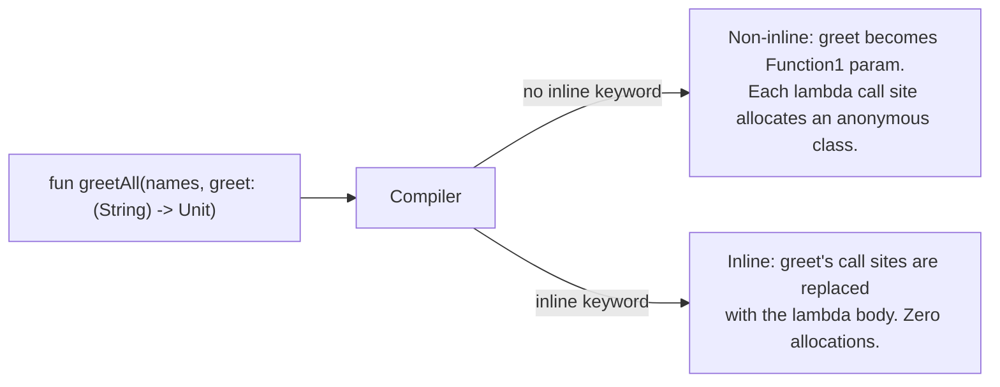

# Functions

## Overview

In Kotlin, a **function is a first-class value**. You can declare it at the top of a file (no class required), store it in a variable, pass it as an argument, return it from another function, and write it inline as a lambda. This single design choice — treating functions the way most languages treat numbers — is what makes Kotlin's standard library, coroutines, Flow, and Compose look the way they do. Every `forEach { ... }`, every `launch { ... }`, every `Button(onClick = { ... })` is a function being passed as an argument.

This file covers what a function actually *is* at the JVM level (a generated `Function0`/`Function1`/`FunctionN` instance for lambdas, a static method for top-level `fun`), the full taxonomy of function declarations (top-level, member, local, anonymous, lambda, function reference, function type), and the architectural decisions a Staff engineer makes when designing a function-first API: when to take a lambda vs an interface, when to mark `inline`, when to use a *function type* vs a *single-abstract-method interface*, and how function references compose for testable code.

---

## Why It Exists

Java methods are tied to classes. To pass behavior, you had to wrap a method inside an anonymous class implementing a single-method interface (`Runnable`, `Comparator`, `OnClickListener`). The result was syntactic sludge — to attach a click handler, you wrote five lines for one line of logic.

```java
// Java pre-8
button.setOnClickListener(new View.OnClickListener() {
    @Override
    public void onClick(View v) {
        submit();
    }
});
```

Java 8 added lambdas as a special compile-time conversion to *functional interfaces*, but the model is "lambda is sugar for an anonymous class implementing a single-method interface" — the function is always represented as an object of a specific interface type.

Kotlin took the opposite path. Functions are values with a structural type — `(Int, String) -> Boolean` is the type of any function from `(Int, String)` to `Boolean`, regardless of what interface backs it. You don't pick an interface; you write a function type. The conversion to a Java interface happens only at the JVM boundary, transparently.

The win is composability: function values can be combined, partially applied, returned from factories, stored in maps keyed by event type, swapped at runtime, and tested by injecting fake functions. The cost is some allocation overhead — every lambda you pass creates a small `Function` instance — which Kotlin's `inline` keyword exists to eliminate when needed.

---

## Historical Context

1. **Lambda calculus (1930s).** Alonzo Church's foundational model of computation: functions are values, and computation is function application. Every modern functional language traces back here.
2. **Lisp (1958).** First-class functions in a practical language. `funcall` lets you invoke a value as a function.
3. **SML, OCaml, Haskell (1980s–1990s).** ML-family languages with full type inference and first-class functions; the direct ancestors of Kotlin's lambda syntax and currying patterns.
4. **C# 2.0 (2005).** Delegates and anonymous methods.
5. **Java 8 (2014).** Lambdas as syntactic sugar for SAM interfaces. Functions remained second-class — you couldn't have a "function type" without an interface to back it.
6. **Kotlin 1.0 (2016).** True function types (`(Int) -> String`), first-class functions at all scopes, lambdas with receivers, inline functions to eliminate lambda allocation.
7. **Kotlin 1.4 (2020).** Functional interfaces (`fun interface`) — Kotlin's own SAM conversion for interop with Java-style APIs.
8. **Kotlin coroutines (2018, stable).** Built entirely on lambdas (`launch { ... }`, `flow { emit(...) }`), with `inline` and `suspend` working together to keep the syntax cheap.

The arc: from "functions are second-class wrapped in interfaces" (Java) to "functions are values with structural types" (Kotlin), with Compose and Coroutines as the payoff.

---

## First Principles

### 1. The four ways to declare a function

```kotlin
// 1. Top-level
fun greet(name: String): String = "Hello, $name"

// 2. Member function
class Greeter {
    fun greet(name: String) = "Hello, $name"
}

// 3. Local function (declared inside another function)
fun process() {
    fun helper(x: Int) = x * 2
    println(helper(5))
}

// 4. Lambda (anonymous function value)
val greet: (String) -> String = { name -> "Hello, $name" }
```

Top-level and member functions are *declarations*. Local functions are declarations scoped to an enclosing function (used to capture local state cleanly). Lambdas are *values* — they have a type, can be assigned, passed around, and returned.

### 2. Function types

A function type names a function's signature:

```kotlin
val onClick: () -> Unit                 // takes nothing, returns nothing
val transform: (String) -> Int           // takes String, returns Int
val combine: (Int, Int) -> Int           // takes two Ints, returns Int
val callback: (Result) -> Unit           // takes Result, returns nothing
val builder: StringBuilder.() -> Unit    // lambda with receiver — see below
```

`Unit` is Kotlin's `void` — every function returns something, and the "returns nothing" function returns a singleton called `Unit`. `() -> Unit` is the most common type for callbacks.

### 3. Lambdas and trailing-lambda syntax

A lambda is `{ params -> body }`. If the parameter list is one item, you can use the implicit name `it`:

```kotlin
val square: (Int) -> Int = { x -> x * x }
val squareTerse: (Int) -> Int = { it * it }

listOf(1, 2, 3).map { it * it }  // -> [1, 4, 9]
```

If a function's last parameter is a function, you can write the lambda outside the parentheses (the **trailing lambda**):

```kotlin
fun retry(times: Int, block: () -> Unit) { ... }

retry(times = 3) {
    sendRequest()
}
```

If the function takes only the lambda, you can drop the parentheses entirely:

```kotlin
synchronized(lock) { mutate() }
```

This is why Kotlin DSLs look the way they do.

### 4. Function references — pass by name

To pass an existing function as a value, use `::`:

```kotlin
fun isEven(n: Int) = n % 2 == 0

val evens = listOf(1, 2, 3, 4).filter(::isEven)  // -> [2, 4]
```

For member functions:

```kotlin
val printer: (String) -> Unit = System.out::println
val asString: (Int) -> String = Int::toString
```

Function references are cheaper than lambdas — they're equivalent to passing a `Function` instance backed by a real named method, with no captured scope.

### 5. Higher-order functions

A function that takes a function as a parameter or returns a function is *higher-order*.

```kotlin
fun retry(times: Int, block: () -> Boolean): Boolean {
    repeat(times) {
        if (block()) return true
    }
    return false
}

retry(times = 3) { tryConnect() }
```

The entire Kotlin stdlib collection API (`map`, `filter`, `fold`, `reduce`, `flatMap`, `groupBy`, `partition`, `forEach`) is higher-order functions on `Iterable<T>`.

### 6. Default and named arguments

```kotlin
fun connect(
    host: String,
    port: Int = 80,
    useTls: Boolean = false,
    timeoutMs: Long = 30_000
) { ... }

// All valid:
connect("api.example.com")
connect("api.example.com", port = 443, useTls = true)
connect(host = "api.example.com", timeoutMs = 5_000)
```

Default arguments eliminate the need for builder patterns and constructor overloads in 95% of cases. Named arguments make call sites self-documenting and let you skip middle parameters.

### 7. Variadic functions: `vararg`

```kotlin
fun joinAll(separator: String, vararg parts: String): String =
    parts.joinToString(separator)

joinAll(", ", "a", "b", "c")  // -> "a, b, c"

// Spreading an existing array:
val xs = arrayOf("a", "b", "c")
joinAll(", ", *xs)
```

Only one `vararg` per function, and it's typically the last parameter. The `*` spread operator passes an existing array's elements.

---

## Mental Model

Think of a function value as **a small package containing instructions plus the variables captured from the surrounding scope** (a *closure*).

When you write:

```kotlin
fun makeCounter(start: Int): () -> Int {
    var count = start
    return { count++ }
}

val counter = makeCounter(10)
counter()  // 10
counter()  // 11
```

the returned function "remembers" `count` — it's stored inside the function value's hidden state. Each call mutates the captured variable. This is how state hoisting in Compose works (`onClick = { state++ }`) and how callbacks remember context.

Compared to Java's "lambda is an anonymous class implementing an interface," Kotlin's model is "lambda is a small object whose type is a function type, with a captured scope." The JVM still needs an interface under the hood, but the language pretends you're working with a typed function value.

---

## Internal Mechanics

### What a lambda compiles to

```kotlin
fun greetAll(names: List<String>, greet: (String) -> Unit) {
    for (n in names) greet(n)
}

fun main() {
    val prefix = "Hello, "
    greetAll(listOf("Ana", "Ben")) { name ->
        println("$prefix$name")
    }
}
```

Decompiled:

```java
public static void greetAll(List<String> names, Function1<String, Unit> greet) {
    for (String n : names) greet.invoke(n);
}

public static void main() {
    final String prefix = "Hello, ";
    greetAll(Arrays.asList("Ana", "Ben"), new Function1<String, Unit>() {
        @Override public Unit invoke(String name) {
            System.out.println(prefix + name);
            return Unit.INSTANCE;
        }
    });
}
```

Three observations:
1. **A function type becomes a `FunctionN` interface.** `(String) -> Unit` is `Function1<String, Unit>` — the `1` is the arity.
2. **A lambda is an anonymous class.** Per call site, a class is generated implementing the matching `FunctionN`. The `invoke` method holds the body.
3. **Captured variables become fields.** `prefix` is captured by reference and stored in the anonymous class instance. Every call to `greetAll` allocates a new instance.

This per-call allocation is what `inline` eliminates.

### What `inline` does

```kotlin
inline fun greetAll(names: List<String>, greet: (String) -> Unit) {
    for (n in names) greet(n)
}

fun main() {
    val prefix = "Hello, "
    greetAll(listOf("Ana", "Ben")) { name -> println("$prefix$name") }
}
```

Decompiled `main`:

```java
public static void main() {
    String prefix = "Hello, ";
    List<String> names = Arrays.asList("Ana", "Ben");
    for (String n : names) {
        System.out.println(prefix + n);  // body of greetAll AND body of lambda, inlined
    }
}
```

The function call disappears, the lambda allocation disappears, and the loop runs over a flat sequence of instructions. This is what makes `forEach`, `let`, `apply`, `synchronized`, `measureTime`, and `repeat` zero-cost in idiomatic Kotlin code.

The cost is bytecode duplication — every call site embeds a copy of the inline function's body. Keep inline functions small (under ~30 instructions); don't inline a 100-line function.

### Function references vs lambdas at the bytecode level

```kotlin
fun isEven(n: Int) = n % 2 == 0

list.filter(::isEven)         // function reference
list.filter { isEven(it) }    // wrapper lambda
```

The function reference compiles to a *single* generated class that implements `Function1<Int, Boolean>` and calls `isEven`. The class is cached — every use of `::isEven` references the same singleton.

The wrapper lambda compiles to a new anonymous class per call site, also implementing `Function1<Int, Boolean>`. Functionally identical, but the reference is cheaper.

When the function reference is to a method on an instance (`obj::method`), the reference does need to capture `obj`, so it allocates per usage.

### Suspending functions are just functions with a continuation parameter

```kotlin
suspend fun fetchUser(id: Long): User { ... }
```

Compiles to:

```java
public static Object fetchUser(long id, Continuation<? super User> $cont)
```

A `suspend` function is a normal function whose last parameter is a `Continuation` — Kotlin's mechanism for storing where the function should resume after suspension. Function types for suspending lambdas are `suspend (T) -> R`, which compile to `Function2<T, Continuation<R>, Object>` (arity bumped by 1 for the continuation). See [`coroutines.md`](../coroutines-and-flow/coroutines.md) for the full state machine model.

---

## Architecture



The compiler's view: with `inline`, the function type is erased at the call site; without it, it survives to runtime as a `FunctionN` instance.

---

## Production Example

### Higher-order functions in the Kotlin stdlib

Almost every collection operation is a higher-order function:

```kotlin
// kotlin/collections/_Collections.kt (simplified)
public inline fun <T> Iterable<T>.filter(predicate: (T) -> Boolean): List<T> {
    val result = ArrayList<T>()
    for (element in this) if (predicate(element)) result.add(element)
    return result
}

public inline fun <T, R> Iterable<T>.map(transform: (T) -> R): List<R> {
    val result = ArrayList<R>()
    for (item in this) result.add(transform(item))
    return result
}

public inline fun <T> Iterable<T>.forEach(action: (T) -> Unit) {
    for (element in this) action(element)
}
```

All marked `inline`, so a chain like `xs.filter { it > 0 }.map { it * 2 }.forEach { println(it) }` compiles to three flat loops with no lambda allocations.

### Compose: callbacks as composable parameters

```kotlin
@Composable
fun PrimaryButton(
    onClick: () -> Unit,
    text: String,
    enabled: Boolean = true
) {
    Button(onClick = onClick, enabled = enabled) {
        Text(text)
    }
}

// Caller:
PrimaryButton(
    onClick = { viewModel.submit() },
    text = "Submit"
)
```

The lambda is captured into the Composer's slot table and re-invoked on subsequent compositions. Compose recomposition relies on lambda *identity* — when `onClick` is structurally the same closure (capturing the same values), Compose can skip recomposing the child. See [`recomposition-and-state.md`](../../android/compose/recomposition-and-state.md) for the lambda-stability story.

### Strategy pattern as a function

The traditional Strategy pattern in Java uses an interface:

```java
public interface DiscountStrategy {
    BigDecimal apply(BigDecimal price);
}
```

In Kotlin, the strategy is just a function type:

```kotlin
typealias DiscountStrategy = (BigDecimal) -> BigDecimal

val tenPercentOff: DiscountStrategy = { it * 0.9.toBigDecimal() }
val noDiscount: DiscountStrategy = { it }

fun checkout(price: BigDecimal, strategy: DiscountStrategy) =
    strategy(price)
```

No interface, no implementation classes, no factories. Just functions. See [`../patterns/strategy.md`](../../patterns/strategy.md) for when to prefer functions vs interfaces.

---

## Android Example

### Click handlers

```kotlin
button.setOnClickListener { view ->
    viewModel.onSubmit()
}
```

Because `View.OnClickListener` is a single-abstract-method interface, Kotlin performs **SAM conversion** at the call site: the lambda is wrapped in an anonymous `OnClickListener` automatically. This is the same SAM conversion Java 8 has, plus the syntactic sugar of allowing the lambda outside the parentheses.

### Coroutines

```kotlin
viewModelScope.launch {
    val data = repository.fetch()
    _state.value = data
}
```

`launch` takes a `suspend CoroutineScope.() -> Unit` — a suspending lambda with `CoroutineScope` as the receiver. Inside the lambda, `this` is the scope, you can call other suspend functions, and on cancellation the lambda's continuation is invalidated.

### `fun interface` for legacy interop

When you need a function type but a Java caller needs an interface name:

```kotlin
fun interface RetryDecider {
    fun shouldRetry(attempt: Int, error: Throwable): Boolean
}

// Kotlin callers can pass a lambda:
val client = HttpClient(retryDecider = RetryDecider { attempt, _ ->
    attempt < 3
})

// Java callers see a real interface:
// HttpClient(new RetryDecider() { public boolean shouldRetry(...) { ... } })
```

`fun interface` (Kotlin 1.4+) declares a SAM interface that participates in SAM conversion in Kotlin as well as Java. Use it for cross-language APIs; for pure-Kotlin APIs, plain function types are simpler.

---

## Advanced Features

### Lambdas with receivers

A lambda whose `this` is bound to an extra parameter:

```kotlin
fun buildHtml(block: StringBuilder.() -> Unit): String {
    val sb = StringBuilder()
    sb.block()
    return sb.toString()
}

val page = buildHtml {
    append("<html>")  // 'this' is the StringBuilder
    append("<body>Hello</body>")
    append("</html>")
}
```

This is the foundation of every Kotlin DSL — Gradle build scripts, Compose UIs, Ktor routing, Anko layouts.

### Scope functions

The stdlib ships five scope functions, all implemented as inline extensions:

| Function | Receiver type | Returns | Common use |
|---|---|---|---|
| `let` | argument `it` | block result | null-check + transform |
| `run` | `this` | block result | initialize an object and return derived value |
| `with` | `this` (non-extension) | block result | group calls on existing object |
| `apply` | `this` | the receiver | configure mutable object, return it |
| `also` | argument `it` | the receiver | side effects + return original |

```kotlin
val user = User().apply {
    name = "Ana"
    age = 30
}                                    // returns the User

val length = name?.let { it.length } // null-safe transform

val message = StringBuilder().run {
    append("Hello, ")
    append("World")
    toString()                        // returns the built String
}

data.also { log("Got data: $it") }   // log and pass through
```

The choice between them is style + intent — there's no semantic difference beyond *what `this`/`it` is* and *what's returned*.

### Tail-recursive functions

```kotlin
tailrec fun factorial(n: Long, acc: Long = 1): Long =
    if (n <= 1) acc else factorial(n - 1, acc * n)
```

`tailrec` instructs the compiler to convert the recursion into a loop, avoiding stack growth. The recursive call must be the last operation in the function (otherwise the compiler emits a warning and falls back to normal recursion).

### Local functions for cleanup

```kotlin
fun process(input: String): String {
    fun normalize(s: String) = s.trim().lowercase()
    fun validate(s: String) = s.matches(Regex("[a-z]+"))

    val cleaned = normalize(input)
    require(validate(cleaned)) { "Invalid input" }
    return cleaned
}
```

Local functions can access the enclosing function's locals (forming closures), making them ideal for breaking up a long function without exposing helpers to the rest of the file.

### Operator functions

Reserved names like `plus`, `times`, `compareTo`, `get`, `set`, `invoke`, `iterator`, `contains` can be marked `operator` to enable operator syntax:

```kotlin
data class Vec(val x: Double, val y: Double) {
    operator fun plus(other: Vec) = Vec(x + other.x, y + other.y)
    operator fun times(scalar: Double) = Vec(x * scalar, y * scalar)
}

val v = Vec(1.0, 2.0) + Vec(3.0, 4.0)  // Vec(4.0, 6.0)
val scaled = v * 2.0                    // Vec(8.0, 12.0)
```

`operator fun invoke` is the most powerful — it makes any object callable like a function: `myObject(args)`. The basis of "function-as-a-class" patterns.

---

## Tradeoffs

**Advantages**

- **Composability.** Functions compose into pipelines (`filter`, `map`, `reduce`) without sacrificing performance when `inline`'d.
- **Less boilerplate.** No anonymous class declarations, no SAM interfaces for every callback.
- **Function references are testable.** Inject `validate: (String) -> Boolean`; pass a real implementation in production and a fake one in tests.
- **DSL support.** Lambdas with receivers let you build syntactic DSLs (Gradle, Compose) with no metaprogramming.

**Disadvantages**

- **Lambda allocation.** Without `inline`, each lambda passed allocates a `FunctionN` instance. In tight loops this matters.
- **Captured variables become heap state.** A `count` captured by a lambda becomes a `Ref.IntRef` field on the lambda class. This can extend object lifetimes unexpectedly.
- **Stack traces are obscured.** Anonymous lambda classes appear as `MyClass$myFun$1.invoke(MyClass.kt:42)` in stack traces. Less clear than named methods.
- **`inline` increases bytecode size.** Each call site duplicates the body. Large inline functions bloat the APK.

**When not to use higher-order functions**

- When the behavior must be substitutable at runtime by external configuration (use an interface and dependency injection).
- When the function would be called millions of times per second and even a function-pointer call is too expensive — but this almost never matters in Android, where the JIT handles function dispatch efficiently after warmup.
- For complex multi-method protocols (e.g., a stream consumer that needs `onNext`, `onError`, `onComplete`) — use an interface instead.

---

## Failure Modes

**Lambda allocation in hot path.** A `forEach` loop with a non-inline higher-order function allocates a lambda instance per outer iteration. The fix is to mark the function `inline`, or convert to a `for` loop. The stdlib's `forEach` is already inline; the trap is custom helpers.

**Captured variable lifetime extension.** A `ViewModel` captures `this` inside a lambda passed to a long-lived scope (`GlobalScope`); the ViewModel can't be garbage collected. The fix is to use lifecycle-aware scopes (`viewModelScope`) and avoid capturing references that should be short-lived.

**`inline` non-local return surprises.** Returning from inside a lambda passed to an inline function returns from the enclosing *function*, not just the lambda. This can be surprising; `crossinline` forbids non-local return when undesired.

```kotlin
fun process(list: List<Int>) {
    list.forEach {
        if (it < 0) return  // returns from process(), not just forEach!
        println(it)
    }
    println("Done")  // not reached if a negative is found
}
```

**`fun interface` SAM ambiguity.** When a function takes both a `fun interface` and a lambda parameter, Kotlin may not be able to pick one at the call site. The compiler error is usually clear, but it surprises people first time.

**Function references on Java methods.** Some Java methods can't be referenced cleanly because of generic erasure or vararg semantics. The fix is usually an explicit lambda wrapper.

---

## Performance Considerations

- **Inline a hot-path higher-order function.** `inline` eliminates lambda allocation entirely. Use it for any function whose lambda is called >100x per second.
- **Don't inline a 200-line function.** Bytecode duplication explodes. Inline keeps lambdas cheap, but the function body itself is duplicated at every call site.
- **Use `noinline` for lambda parameters you don't immediately invoke.** If you store the lambda in a field or pass it to another non-inline function, marking it `noinline` keeps the inlining tractable.
- **Function references are usually faster than equivalent lambdas.** A single cached singleton instance vs a new allocation per call site. Compiler often optimizes both equally, but the reference form is the safer default.
- **`tailrec` avoids stack growth.** For algorithms naturally expressed recursively (parsing, tree walks), `tailrec` is faster and safer than direct recursion.
- **Default arguments compile to dispatch methods.** A function with five default arguments and one optional override emits a synthetic helper that calls the main version with appropriate defaults. Negligible cost, but visible in profilers.

---

## Reliability Considerations

- **Prefer function references in public APIs.** They're greppable (`::login` is searchable), traceable, and have stable stack traces.
- **Lambdas in coroutine scopes can leak.** A `launch { ... }` lambda captures everything in scope. If the lambda is long-lived, those captures stay alive. Audit captures in `GlobalScope.launch { ... }` calls.
- **Use `fun interface` for behaviors with named semantics.** A `Predicate` reads more clearly than a `(T) -> Boolean` in API docs, even though they're functionally identical.
- **Don't pass `() -> Unit` if you also need cancellation, errors, or progress.** Use a coroutine or a typed interface. A single function value can't model multi-shot semantics.

---

## Security Considerations

Function values can capture sensitive references (auth tokens, credentials, decryption keys). A lambda stored in a long-lived collection (e.g., an event listener list) extends those references' lifetime indefinitely. Audit captures inside lambdas that handle PII or secrets.

User-supplied function values (e.g., a script engine that takes user input as code) are a major attack surface. Kotlin scripting (`.kts`) is not sandboxed by default — never `eval` user input.

---

## Observability

Lambdas appear in stack traces as `EnclosingClass$enclosingFun$1.invoke()`. The `$1` is the order of declaration in the file. If you need readable traces, prefer named functions and pass them as references rather than inline lambdas.

For Compose, lambda identity affects recomposition skipping. Tools like the Compose Compiler Reports flag unstable lambda captures that defeat skipping. See [`recomposition-and-state.md`](../../android/compose/recomposition-and-state.md) for details.

---

## Staff Engineer Thinking

**Use function types over interfaces for single-callback APIs.** A `(T) -> Unit` is clearer and simpler than a `Listener` interface. Switch to `fun interface` only when Java interop or stable wire names matter.

**Inline `forEach`-style helpers, not domain logic.** `inline` is a performance tool; using it for clarity (or worse, to enable non-local returns) is a smell. If you're tempted to `inline` a 500-line function, refactor first.

**Audit your closures.** Every lambda captures a slice of scope. In long-lived lambdas (coroutine scopes, event listeners, Compose remember blocks), capturing the wrong reference creates leaks. Code review for `viewModelScope.launch { ... }` should ask: "does this lambda hold onto something that should outlive it?"

**Prefer function composition to deep inheritance.** A `(Input) -> Intermediate` composed with `(Intermediate) -> Output` is easier to test, swap, and reason about than a hierarchy of abstract classes. The strategy pattern in Kotlin is "pass a function."

**Don't write helper interfaces when a function will do.** Java teams often write `interface ResultTransformer { Result transform(Input i); }` as a pattern habit. In Kotlin, this is `(Input) -> Result`. Push back on PRs introducing single-method interfaces unless there's a Java consumer.

**Watch for lambda-stability anti-patterns in Compose.** Inline lambdas with mutable captures defeat recomposition skipping. Tools like the Compose Compiler Reports catch this; CI should fail on unexpected `unstable` lambdas in hot Composables.

---

## Common Misconceptions

**"Lambdas are free."** Each non-inline lambda allocates a `FunctionN` object. In tight loops this matters; for occasional calls (button clicks), it's negligible.

**"`inline` means faster always."** Inlining is a tradeoff: zero call overhead, but bytecode duplication. For a function called once per second, inlining is wasteful.

**"A function type is an interface."** It compiles to a `FunctionN` interface on the JVM, but the language treats it as a structural type. Two functions with the same signature are interchangeable.

**"`Unit` is the same as `void`."** Logically yes, but `Unit` is a real singleton type — you can write `val u: Unit = Unit`. Functions returning `Unit` actually return the singleton; the JVM elides this at the bytecode level.

**"You can't pass a top-level function as a value."** You can: `::myFunction` produces a function reference. Same for member functions on an instance: `obj::method`.

**"Capturing a `var` in a lambda is fine."** The captured `var` is wrapped in a `Ref` object so the lambda can mutate it. This can change object lifetimes and surprise developers expecting value semantics.

**"`fun interface` is the same as a function type."** Almost: `fun interface` gives the type a name and lets Java callers see a clean interface. Use it when interop matters.

---

## Probing Questions

1. Compile `fun greet(name: String) = "Hello, $name"` to bytecode. Which class is it in, and what's the signature?
2. Why does `list.forEach { return }` exit the enclosing function instead of just the lambda? How would you exit only the lambda?
3. What's the difference between `(Int) -> String` and `fun interface IntToString { fun convert(n: Int): String }`? When would you choose each?
4. A lambda passed to a non-inline function captures a local `var i = 0`. What is `i` represented as inside the generated lambda class?
5. Explain why `inline fun foo(noinline block: () -> Unit)` would be useful.
6. You see `obj::method` in code. What's the runtime cost of that expression — is a new object allocated each time?
7. What does `tailrec` require of the recursive call, and what happens if it can't be applied?
8. In Compose, why does `Button(onClick = { viewModel.click() })` sometimes defeat recomposition skipping? How do you keep it stable?
9. What does the function type `String.(Int) -> Boolean` mean, and how does it differ from `(String, Int) -> Boolean`?
10. You have `fun fetch(callback: (Result) -> Unit)`. Five years later you need to add progress reporting. How would you evolve the API without breaking existing callers?

---

## Further Reading

In this repository:

- [`extensions.md`](extensions.md) — extension functions, including extension lambdas with receivers.
- [`inline-functions.md`](../compiler-features/inline-functions.md) — `inline`, `crossinline`, `noinline`, reified generics, performance tradeoffs.
- [`coroutines.md`](../coroutines-and-flow/coroutines.md) — suspend functions are functions with a Continuation parameter.
- [`null-safety.md`](null-safety.md) — function types can be nullable: `((Int) -> String)?`.
- [`bytecode.md`](../runtime-and-jvm/bytecode.md) — how Kotlin functions and lambdas appear in compiled JVM bytecode.
- [`../patterns/strategy.md`](../../patterns/strategy.md) — when a function value replaces an interface-based Strategy.

External:

- Roman Elizarov, *"Designing APIs with Kotlin"* (KotlinConf 2019) — guidance on function types vs interfaces.
- Jake Wharton, *"Kotlin's Hidden Costs Part 1: Function Types"* (2017 blog post) — measured allocation costs of non-inline lambdas.
- Kotlin Documentation: [Higher-order functions and lambdas](https://kotlinlang.org/docs/lambdas.html) — canonical reference.
- Kotlin Documentation: [Inline functions](https://kotlinlang.org/docs/inline-functions.html) — when to inline and what crossinline/noinline mean.
- *Effective Kotlin* by Marcin Moskała — Items 19–25 on functional programming idioms.
- KEEP-110: [Functional interfaces (`fun interface`)](https://github.com/Kotlin/KEEP/blob/master/proposals/fun-interfaces.md) — the proposal document.
