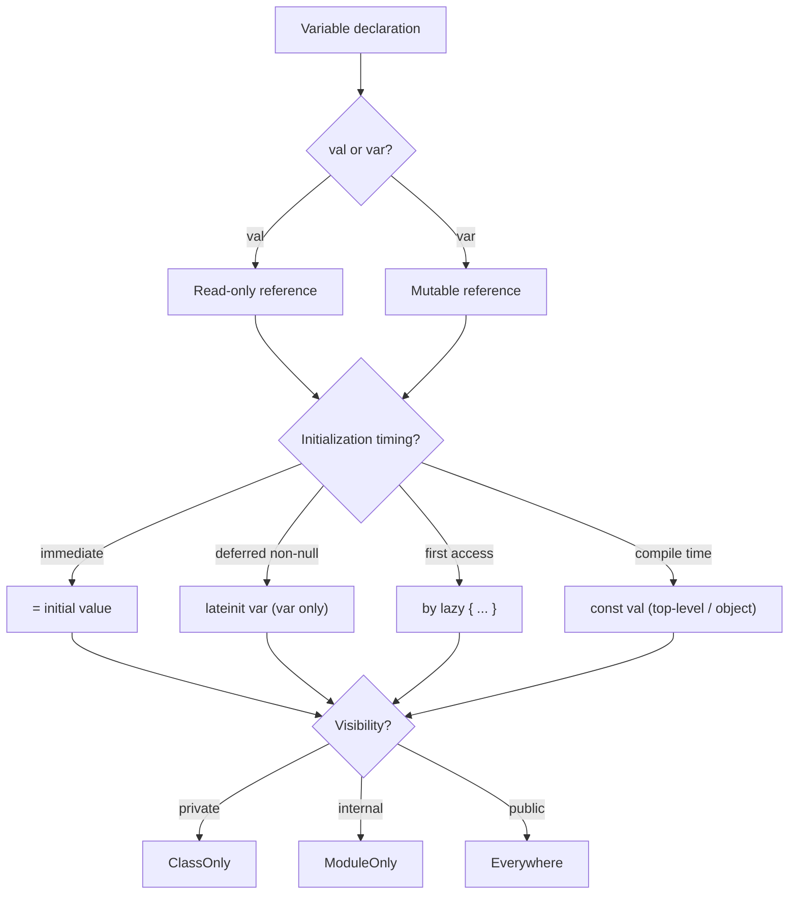

# Variables

## Overview

A **variable** in Kotlin is a named binding to a value, with three crucial axes that don't exist in Java in the same way: **mutability** (`val` vs `var`), **initialization timing** (immediate, `lateinit`, `lazy`, delegated), and **scope** (top-level, class property, local). What looks like the simplest topic in the language is actually the foundation of Kotlin's safety story — `val` doesn't mean "immutable," it means "the reference can't be reassigned," and conflating those two leads to a class of bugs that only show up under concurrency.

This file covers all four kinds of bindings (`val`, `var`, `const val`, `lateinit var`), how each one compiles to JVM bytecode (fields, getters, setters, lazy delegates), the difference between **read-only** and **immutable** as a semantic distinction, the backing-property pattern that protects mutable state from external mutation, how captured variables in lambdas become heap state, and Staff-level patterns for designing data classes and state holders where the choice between `val` and `var` is itself an architectural decision.

---

## Why It Exists

Java has one kind of variable: mutable, by default. To get immutability you write `final`, and you write it everywhere because the default is wrong for most use cases:

```java
final String name = "Ana";        // immutable reference
final List<String> tags = new ArrayList<>();  // immutable reference, mutable contents
```

Two problems:

1. **The wrong default is mutable.** Most local variables are assigned once. Forcing developers to type `final` every time they want safe behavior creates friction.
2. **`final` is one-dimensional.** `final List<String>` says "the reference doesn't change" but says nothing about the list contents. Java has no way to express "fully immutable" without a third-party type (`Collections.unmodifiableList`, Guava's `ImmutableList`, Java 9's `List.of`).

Kotlin's design: flip the default. Use `val` for read-only bindings (the common case) and `var` only when reassignment is needed. Keep the type-system orthogonal: `val xs: List<Int>` doesn't promise immutability — it promises the reference can't be reassigned, AND that `xs` is declared as the read-only interface `List<Int>` rather than `MutableList<Int>`. To get full immutability, both must apply.

The reward: concurrency-safe code by default. A `val name: String` is safe to share across coroutines; a `val xs: List<Int>` is safe as long as the underlying implementation is also immutable (which it is for `listOf(...)`).

---

## Historical Context

1. **ML, OCaml, Haskell (1970s–1990s).** Immutable bindings by default; `let` introduces a single-assignment variable. Influenced functional language design.
2. **C (1972).** `const` modifier (added later) for non-modifiable variables — but C developers conventionally treat all locals as mutable.
3. **Java (1995).** `final` keyword for non-reassignable variables. Used inconsistently; project styles vary widely on whether to mark everything `final` or only what must be.
4. **Scala (2003).** `val` and `var` distinction at the language level (the source of Kotlin's syntax). Read-only as default.
5. **C# 6.0 (2015).** Read-only auto-properties (`public string Name { get; }`), making "immutable after construction" idiomatic.
6. **Kotlin 1.0 (2016).** `val`/`var` as the foundational distinction; `lateinit var` for deferred initialization; `const val` for compile-time constants.
7. **Kotlin 1.7 (2022).** Improved smart-cast and contracts for `lateinit` properties.

The arc: from "default mutable" (Java, C) to "default read-only" (Scala, Kotlin), with Kotlin specifically choosing the shortest possible keywords to make the right default also the most ergonomic.

---

## First Principles

### 1. `val` vs `var`: the reference, not the value

```kotlin
val name: String = "Ana"
name = "Ben"  // error: val cannot be reassigned

var age: Int = 30
age = 31      // ok
```

`val` means *single assignment*. The reference is bound once and can't be re-bound.

The reference being immutable says nothing about the *value*:

```kotlin
val tags: MutableList<String> = mutableListOf("kotlin")
tags.add("android")  // ok — we're mutating the contents, not reassigning tags
tags = mutableListOf()  // error — reassignment forbidden
```

This is the single most common source of confusion. To get **value-level** immutability, use immutable types (`List<T>` over `MutableList<T>`, `Map<K, V>` over `MutableMap<K, V>`), or use `kotlinx.collections.immutable` for guaranteed-immutable variants.

### 2. `const val` is for compile-time constants

```kotlin
const val MAX_SIZE = 1024
const val APP_VERSION = "1.2.3"
```

Only allowed on `object`, `companion object`, or top-level. Only allowed for primitive types or `String`. The value is inlined at every use site at compile time, like a Java `public static final` constant.

```kotlin
class Config {
    val maxSize: Int = 1024            // computed at instance construction; getter call site
    companion object {
        const val MAX_SIZE = 1024      // inlined as the literal 1024 at every call site
    }
}
```

Use `const val` for genuinely constant values (sizes, defaults, server URLs in builds). Use `val` for values that *happen to never change* but are computed at runtime (a hash, a derived field, an injected dependency).

### 3. `lateinit var`: deferred initialization with no nullable type

```kotlin
class MyActivity : Activity() {
    lateinit var viewModel: MyViewModel

    override fun onCreate(savedInstanceState: Bundle?) {
        super.onCreate(savedInstanceState)
        viewModel = ViewModelProvider(this)[MyViewModel::class.java]
    }
}
```

`lateinit` says "this is non-null after initialization, but I'll initialize it later." It avoids the `viewModel: MyViewModel?` declaration that would otherwise force null-handling everywhere.

Restrictions:
- Only on `var` (not `val`).
- Only on non-nullable types (no `Int?`, no `String?`).
- Only on object references — not primitives (`Int`, `Long`, `Boolean`).
- Not allowed for top-level properties (must be inside a class).
- Not allowed for `val` because the compiler can't know the val was set.

If you access `lateinit var` before initializing it:

```kotlin
val name = viewModel.userName  // throws UninitializedPropertyAccessException
```

Use `::viewModel.isInitialized` to check safely.

### 4. `by lazy`: thread-safe deferred computation

```kotlin
class HeavyService {
    val database: Database by lazy {
        println("Initializing database...")
        Database.connect(url, credentials)
    }
}
```

The block runs the first time `database` is accessed. The result is cached. Subsequent accesses return the cached value with no re-execution.

Three thread-safety modes:

```kotlin
val a: T by lazy(LazyThreadSafetyMode.SYNCHRONIZED) { compute() }     // default: locked, safe across threads
val b: T by lazy(LazyThreadSafetyMode.PUBLICATION) { compute() }      // block may run multiple times across threads; first published value wins
val c: T by lazy(LazyThreadSafetyMode.NONE) { compute() }             // no synchronization; assumes single-threaded access
```

For single-threaded code (Android UI thread, for example), `LazyThreadSafetyMode.NONE` is fastest. For most other cases, the default `SYNCHRONIZED` is safest.

### 5. Top-level, class-level, local

A variable's *scope* affects how it's compiled and when it's initialized:

```kotlin
// Top-level (file-level)
val CONSTANTS = listOf(1, 2, 3)        // initialized when the file's class is loaded

// Class property
class Counter {
    var count: Int = 0                  // initialized per instance, when constructor runs
}

// Local variable
fun doWork() {
    val temp = computeSomething()       // initialized when execution reaches this line
}
```

Top-level `val`s are compiled to private static fields with public getters (or, for `const val`, inlined constants). Class properties are instance fields with generated getters/setters. Local variables live on the call stack (or, if captured by a lambda, in a heap-allocated closure object).

---

## Mental Model

Think of variable declaration as **answering two questions**:

1. **Will this binding be reassigned?** If no → `val`. If yes → `var`.
2. **Does the value need to be fully immutable, or just the reference?** Reference only → use mutable or read-only types as fits. Full immutability → use only immutable types (`List`, `Map`, `Set`, immutable data classes).

Then, three orthogonal axes:

- **Initialization timing.** Immediate at declaration? Use direct assignment. After construction (e.g., DI)? Use `lateinit var`. On first access? Use `by lazy { ... }`. Compile-time constant? Use `const val`.
- **Visibility.** `public` (default), `internal` (module), `protected` (subclass), `private` (file/class). For state that must not be mutated externally, combine `private var` with a `public val` exposing a read-only projection.
- **Scope.** Top-level, class, function-local, closure-captured. Each affects lifetime and threading.

The pattern: pick the most restrictive option that works. `val` first, narrow to `var` if needed. `private` first, widen to `internal` if needed. Local first, hoist to class only if shared.

---

## Internal Mechanics

### `val` and `var` properties compile to fields + accessors

```kotlin
class User {
    val id: Long = 0L
    var name: String = ""
}
```

Bytecode (decompiled):

```java
public final class User {
    private final long id = 0L;
    @NotNull private String name = "";

    public final long getId() { return this.id; }
    @NotNull public final String getName() { return this.name; }
    public final void setName(@NotNull String value) {
        Intrinsics.checkNotNullParameter(value, "value");
        this.name = value;
    }
}
```

Each property generates a private field and one (for `val`) or two (for `var`) accessor methods. Kotlin callers write `user.id` — the compiler rewrites that to `user.getId()`.

### `const val` is inlined

```kotlin
object Config {
    const val MAX_RETRIES = 3
}

fun shouldRetry(attempt: Int) = attempt < Config.MAX_RETRIES
```

Compiled `shouldRetry`:

```java
public static boolean shouldRetry(int attempt) {
    return attempt < 3;  // the literal 3, not a field lookup
}
```

The value is substituted at the use site. Even reflection sees the field as a constant.

### `lateinit var` is a `var` with a null-check intrinsic

```kotlin
class A {
    lateinit var s: String

    fun useIt() = s.length
}
```

Bytecode:

```java
public final class A {
    @NotNull private String s;

    @NotNull public final String getS() {
        String var10000 = this.s;
        if (var10000 == null) {
            Intrinsics.throwUninitializedPropertyAccessException("s");
        }
        return var10000;
    }

    public final void setS(@NotNull String value) {
        this.s = value;
    }

    public final int useIt() {
        return this.getS().length();
    }
}
```

The field is just `null` until set. Every read calls the getter, which throws if still null.

### `by lazy` uses a delegate

```kotlin
val service: Service by lazy { Service() }
```

Compiled:

```java
public final class MyClass {
    @NotNull private final Lazy service$delegate = LazyKt.lazy(() -> new Service());

    @NotNull public final Service getService() {
        return (Service) this.service$delegate.getValue();
    }
}
```

The `Lazy<T>` interface stores either an uninitialized sentinel or the computed value. `getValue()` synchronizes (in SYNCHRONIZED mode), runs the block on first call, caches, and returns.

### Captured variables in lambdas become `Ref` objects

```kotlin
fun makeCounter(): () -> Int {
    var count = 0
    return { count++ }
}
```

`count` is captured by the returned lambda. The bytecode wraps `count` in a `Ref.IntRef`:

```java
public static Function0<Integer> makeCounter() {
    final Ref.IntRef count = new Ref.IntRef();  // count.element = 0
    return new Function0<Integer>() {
        public Integer invoke() {
            int result = count.element;
            count.element++;
            return result;
        }
    };
}
```

The lambda holds a reference to the `Ref.IntRef`, so the integer survives past the enclosing function returning. Same trick for `var name: String` — captured as `Ref.ObjectRef<String>`.

If you capture a `val` of an object type, no `Ref` is needed — the reference itself is captured directly. If you capture a `var` primitive or any `var`, the `Ref` wrapper is generated.

This is why captures of `var`s have subtle performance and GC characteristics.

### Initialization order: top-level files

```kotlin
val A = computeA()
val B = computeB()
val C = A + B
```

Top-level `val`s are initialized in declaration order, in a single `<clinit>` block when the file's `*Kt` class is first loaded. If `computeA()` throws, `B` and `C` never get values — the class itself fails to load.

For circular references between top-level vals, use `by lazy` to defer one side:

```kotlin
val users by lazy { fetchUsers() }
val sessions by lazy { users.flatMap { it.sessions } }
```

---

## Architecture



The diagram shows the decision tree for declaring a variable. Most variables land in `val` + immediate + `private`.

---

## Production Example

### Backing property pattern for state holders

The dominant Kotlin pattern for state holders (ViewModels, repositories, services) exposes a *read-only projection* of mutable internal state:

```kotlin
class CounterViewModel : ViewModel() {
    private val _state = MutableStateFlow(0)            // internal mutable
    val state: StateFlow<Int> = _state.asStateFlow()    // public read-only projection

    fun increment() { _state.value++ }
}
```

Three things happen:

1. `_state` is `private val` — the *reference* can't be reassigned, but `MutableStateFlow.value` can be set via its own setter.
2. `state` is `public val` — exposes the same underlying flow, but as the `StateFlow<Int>` read-only interface. Callers can collect from it but can't set its value.
3. External callers must go through `increment()` (or other intent functions) to mutate. This enforces unidirectional data flow.

The `_` prefix is a convention from Effective Kotlin for "private companion to a public version of this property."

### Configuration with `const val`

```kotlin
object NetworkConfig {
    const val BASE_URL = "https://api.example.com"
    const val TIMEOUT_MS = 30_000L
    const val MAX_RETRIES = 3
}

// Usage:
val connection = HttpClient.connect(NetworkConfig.BASE_URL)
```

All three values are inlined at every call site. Reflection on `NetworkConfig` won't even show them as ordinary fields — they appear as constants. Refactoring (renaming `BASE_URL`) requires recompiling every dependent file.

### Lazy database initialization

```kotlin
object AppDatabase {
    val instance: Database by lazy {
        Room.databaseBuilder(appContext, AppDatabase::class.java, "app.db")
            .addMigrations(MIGRATION_1_2, MIGRATION_2_3)
            .fallbackToDestructiveMigration()
            .build()
    }
}
```

The database isn't built until first access. App startup is faster; the cost is paid lazily when a feature actually needs the DB. The default SYNCHRONIZED mode makes the lazy block safe to call from multiple threads.

---

## Android Example

### `lateinit` for view-model injection

```kotlin
@AndroidEntryPoint
class HomeFragment : Fragment() {
    @Inject lateinit var imageLoader: ImageLoader

    override fun onViewCreated(view: View, savedInstanceState: Bundle?) {
        super.onViewCreated(view, savedInstanceState)
        imageLoader.load(view.findViewById(R.id.avatar))
    }
}
```

Hilt sets `imageLoader` in the generated `Fragment_HiltModules$KeyModule_BindUseInstance` code before `onViewCreated` runs. Without `lateinit`, the property would need to be nullable (`var imageLoader: ImageLoader? = null`) and every use would need null-handling.

### Backing property for UI state

```kotlin
class HomeViewModel : ViewModel() {
    private val _uiState = MutableStateFlow(HomeUiState())
    val uiState: StateFlow<HomeUiState> = _uiState.asStateFlow()

    fun refresh() {
        viewModelScope.launch {
            _uiState.update { it.copy(isLoading = true) }
            val data = repository.fetchData()
            _uiState.update { it.copy(isLoading = false, items = data) }
        }
    }
}
```

The composable observes `uiState` and never sees `_uiState`. Mutation is funneled through `refresh()` — the View can't bypass the contract.

### `companion object` constants for SDK keys

```kotlin
object FirebaseEvent {
    const val SIGN_UP = "sign_up"
    const val PURCHASE = "purchase"
    const val SCREEN_VIEW = "screen_view"
}

Firebase.analytics.logEvent(FirebaseEvent.SIGN_UP, params)
```

Inlined constants prevent typos in event names. Renaming them requires touching every call site, which is the right level of friction for renaming an analytics event.

---

## Tradeoffs

**`val` advantages**

- Single-assignment is easier to reason about — you know the reference can't change after initialization.
- Concurrency-safe for the binding itself (the *value* may still need synchronization).
- The compiler can perform smart casts more aggressively on `val` — once you check `if (x != null)`, the compiler knows `x` is non-null in the branch because nothing can reassign it.
- Lazy delegation works only on `val`.

**`val` disadvantages**

- For naturally mutable state (a counter, an accumulator), wrapping in something like `MutableStateFlow` adds ceremony.
- Easy to think "val means immutable" and ship a `val list: MutableList<T>` that gets mutated externally.

**`var` advantages**

- Direct for naturally mutable state.
- No backing-property pattern needed for internal use.

**`var` disadvantages**

- Smart-cast doesn't apply across function calls (the compiler can't prove the `var` wasn't reassigned by another thread/function).
- Encourages mutation-based code patterns that are harder to test and reason about under concurrency.

**`const val`**

- Pro: zero runtime overhead, usable in annotations.
- Con: changing the value is a binary-incompatible change for callers — every caller must recompile.

**`lateinit var`**

- Pro: no nullable type pollution; clean access syntax.
- Con: runtime check on every access (small cost); throws if accessed early; can't be `val`; can't be primitive.

**`by lazy`**

- Pro: deferred initialization; thread-safe by default; no nullable type.
- Con: small overhead per access (synchronization, even after init in SYNCHRONIZED mode); not usable on `var`; the block can't be cancelled or reset.

---

## Failure Modes

**Mutable contents leaking through `val`.** A class exposes `val tags: MutableList<String>` — callers mutate the list externally, breaking invariants. Mitigation: expose `List<String>` (read-only interface), or use `toList()` to copy on read.

**`lateinit` accessed before initialization.** A test runs without going through Hilt's injection; `lateinit var imageLoader` is null; first access throws. Mitigation: use `::imageLoader.isInitialized` in defensive code, or restructure tests to inject manually.

**`by lazy` blocking the main thread.** A `val db by lazy { Room.databaseBuilder(...).build() }` is first accessed on the UI thread during a frame; the build takes 200ms; ANR. Mitigation: trigger lazy initialization off-main during startup, or use a coroutine + `Dispatchers.IO`.

**Captured `var` extending object lifetime.** A short-lived counter is captured by a long-lived lambda; the `Ref.IntRef` lives as long as the lambda; if the lambda is held by a global handler, the counter never GCs. Mitigation: prefer capturing `val`s when possible; audit lambdas in long-lived containers.

**`const val` accidentally treated as runtime configuration.** A team adds `const val FEATURE_FLAG = true` thinking they can toggle at runtime; the constant is inlined at compile time; flipping it requires rebuilding and redeploying. Mitigation: use a real config source (Remote Config, BuildConfig fields, DataStore) for runtime-changeable values.

**Top-level `val` circular dependency.** `val A = B + 1` and `val B = A * 2` at top level can deadlock or NPE during class loading. Mitigation: use `by lazy` to break the cycle.

**Smart cast unavailable on `var`.** Code like `if (state != null) { state.use() }` fails to compile if `state` is a `var` property the compiler can't prove won't be reassigned. Mitigation: copy to a local val: `val s = state; if (s != null) s.use()`.

---

## Performance Considerations

- **Property access is a method call.** `user.name` is `user.getName()`. JIT inlines after warmup, so usually free, but visible in profilers for hot paths.
- **`@JvmField` skips the getter.** Useful for hot read paths from Java; loses encapsulation.
- **`const val` is zero-cost.** Inlined as a literal.
- **`lateinit` adds one null-check per read.** Negligible.
- **`by lazy` SYNCHRONIZED mode synchronizes on every read after init.** Use `LazyThreadSafetyMode.NONE` for single-threaded access (UI thread) for free reads.
- **Captured `var`s incur `Ref` allocation.** Each closure that captures a mutable variable allocates a `Ref` wrapper. In tight loops, avoid capturing `var`s.
- **Top-level `val`s share one `<clinit>`-time initialization.** Expensive computations there delay class loading for the entire file's first use.

---

## Reliability Considerations

- **Prefer `val` by default; introduce `var` only when reassignment is required.** This single discipline eliminates most mutation-induced concurrency bugs.
- **Avoid `lateinit` in shared concurrent state.** Two threads racing on `lateinit var` may both see a partial initialization. For shared state, prefer `by lazy` (which synchronizes) or eager initialization.
- **Use immutable collection types (`List`, `Map`, `Set`) for `val` properties.** Don't expose `MutableList<T>` even as a `val` — callers can mutate it. Defensive `toList()` copies on read are cheap insurance.
- **Don't `val` a mutable singleton.** A `val cache: MutableMap<K, V>` is a shared mutable singleton — every reader and writer race on it. Wrap in a synchronized type, a `ConcurrentMap`, or a `MutableStateFlow`.

---

## Security Considerations

- **`@JvmField` on tokens or keys exposes mutable state to reflection.** `@JvmField var authToken: String?` lets any caller bypass setter validation. Use a private `var` with a controlled setter.
- **`const val` baked-in secrets persist in APK.** A `const val API_KEY = "secret"` is in the DEX file forever. Don't store secrets as constants; use the Android Keystore or a server-issued token.
- **`lateinit` properties don't auto-clear on logout.** A `lateinit var session: Session` holds the reference until the holder dies or it's reassigned. For sensitive data, explicitly clear (`session = Session.empty()`) on logout, or use a `Session?` with explicit null.
- **Captured `var`s in lambdas extend secret lifetimes.** A lambda capturing a `var token` keeps the token alive as long as the lambda is reachable. Audit captures involving credentials.

---

## Observability

- **Property access doesn't log by default.** Wrap with a `Delegates.observable` if you need to log writes:

  ```kotlin
  var state: AppState by Delegates.observable(Initial) { _, old, new ->
      Log.d("state", "$old -> $new")
  }
  ```

- **`lateinit` failures throw `UninitializedPropertyAccessException`.** Recognize this in crash logs as "you used something before initializing it." Add `::prop.isInitialized` checks if defensiveness is warranted.
- **Lazy init timing in profilers.** A `by lazy` block runs the first time it's read; if it's expensive and the read happens on a frame, you see a spike. Trace it with `Trace.beginSection`.

---

## Staff Engineer Thinking

**Default `val`, default `private`, default immutable.** This three-rule discipline eliminates most mutation bugs. Promote to `var`, `internal`/`public`, or mutable types only with explicit justification.

**Audit `val` properties of mutable collection types.** `val items: MutableList<Item>` is a common code smell — the reference is read-only but the contents are wide-open. Either change the type or make access controlled.

**Don't reach for `lateinit var` reflexively.** Many uses of `lateinit` reveal a design issue: the dependency should be injected via constructor, not assigned after construction. `lateinit` is appropriate where the framework owns initialization (Activity views, Hilt-injected fields), not where you could just take a constructor parameter.

**Use the backing property pattern for any mutable state exposed across module boundaries.** `private val _state` + `val state: StateFlow<T>` is the prevailing pattern. It separates "who can mutate" from "who can read."

**Treat `const val` as part of the public ABI.** Renaming, changing values, or removing them is a binary-incompatible change. Keep them stable; never use them for runtime configuration.

**Watch for `var` in shared state.** A `var` property accessible from multiple coroutines is a race condition waiting to happen. Use `MutableStateFlow`, `AtomicReference`, or a coroutine-bounded actor instead.

**Prefer constructor-injected `val` over `lateinit var`.** Constructor injection makes dependencies visible at construction time; `lateinit` defers and obscures them.

---

## Common Misconceptions

**"`val` means immutable."** It means "read-only reference." The value may still be mutable. Use immutable types alongside `val` for full immutability.

**"`const val` and `val` are the same."** `const val` is a compile-time inlined constant; only allowed on `object` / top-level / `companion object`; only for primitives and `String`. `val` is a runtime read-only property; allowed anywhere.

**"`lateinit var` works on `val`."** No — `val` must be initialized at declaration or in the constructor. `lateinit` only works on `var`.

**"`by lazy` is free after the first access."** With `LazyThreadSafetyMode.SYNCHRONIZED` (the default), each access acquires a lock to check if initialized. For UI-thread-only code, use `LazyThreadSafetyMode.NONE`.

**"Captured variables are pass-by-value."** Captured `val`s of objects share the reference. Captured `var`s are wrapped in a `Ref` and shared by reference too. Captured local primitives in `var`s share via the `Ref`.

**"Top-level `val` initialization is lazy by default."** It's eager at class load time. Use `by lazy` to defer.

**"Properties are direct field access."** They're getter/setter method calls (unless `@JvmField`). The JIT usually inlines, but the level of indirection matters in some cases.

**"`val` properties can't have side effects in their getter."** A computed `val` with a custom getter can do anything every time it's read. `val now: Long get() = System.currentTimeMillis()` returns a new value each call.

---

## Probing Questions

1. Why does `val list: MutableList<Int>; list.add(5)` compile, when `val` means read-only?
2. What's the difference between `val timeoutMs: Long = 30_000` and `const val TIMEOUT_MS = 30_000L`? When does each matter?
3. A `lateinit var name: String` is accessed before initialization. What exception is thrown? How do you check safely?
4. Explain why `lateinit` cannot be used on `Int` or `Boolean`.
5. A `by lazy` block makes a network call. Is the call deduplicated across threads with the default thread-safety mode? Why or why not?
6. You capture `var counter = 0` in a lambda. Decompile and explain what's in the lambda's generated class.
7. Why does `if (myVar != null) myVar.length` fail to smart-cast when `myVar` is a `var` property?
8. You have a circular initialization between two top-level `val`s. How does the JVM behave at class loading? How do you fix it?
9. Explain the backing property pattern and why teams use it for state holders.
10. A `const val APP_VERSION = "1.0.0"` is referenced by 50 modules. You change it to `"1.0.1"`. Which modules need to be recompiled?

---

## Further Reading

In this repository:

- [`delegation.md`](delegation.md) — `by lazy`, `Delegates.observable`, `Delegates.notNull`, and custom property delegates.
- [`null-safety.md`](null-safety.md) — `lateinit` as alternative to nullable types.
- [`memory-model.md`](../runtime-and-jvm/memory-model.md) — how field reads, writes, and captures interact with the JVM memory model.
- [`bytecode.md`](../runtime-and-jvm/bytecode.md) — how `val`/`var`/`const val`/`lateinit` compile to JVM fields and getters.
- [`jvm-interop.md`](../runtime-and-jvm/jvm-interop.md) — how Kotlin properties appear to Java callers; `@JvmField`.
- [`../engineering-fundamentals/immutability.md`](../../engineering-fundamentals/immutability.md) — the principle behind preferring `val`.

External:

- Kotlin Documentation: [Properties](https://kotlinlang.org/docs/properties.html) — canonical reference for `val`, `var`, custom getters, late-initialized properties.
- Kotlin Documentation: [Delegated properties](https://kotlinlang.org/docs/delegated-properties.html) — `by lazy`, observable delegates.
- Roman Elizarov, *"Immutability we can afford"* (KotlinConf 2018) — design rationale for `val`/`var` and concurrency implications.
- *Effective Kotlin* by Marcin Moskała — Items 1–5 cover mutability and Kotlin's safety story.
- *Kotlin in Action* by Dmitry Jemerov & Svetlana Isakova — Chapter 4 on classes, objects, and properties.
- KEEP-184: [Improved smart casts for properties](https://github.com/Kotlin/KEEP/blob/master/proposals/improved-smartcasts.md) — discussion of why smart-cast on `var` is limited.
