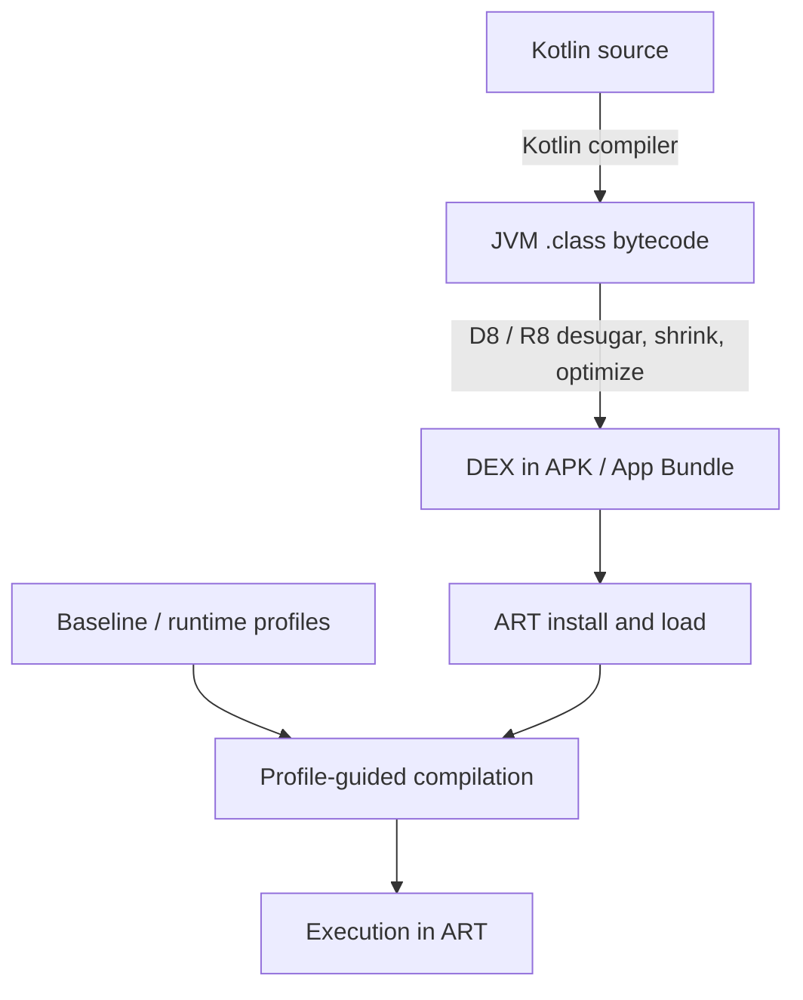

# Kotlin: Bytecode and Decompilation

> Real `javap -c` output, the JVM stack model, what Kotlin compiler tricks look like in instructions, and how to read R8-mapped stack traces back to source.

---

## 1. The Compilation Pipeline



Kotlin first becomes JVM bytecode, Android build tools transform it into DEX, and ART combines interpretation, JIT, and profile-guided compilation according to device and install state.

You read **Java bytecode** (not DEX) for almost all Kotlin reasoning. DEX is the device-format conversion. The compiler tricks happen at `kotlinc` time; nothing about Kotlin's design is DEX-specific.

---

## 2. The JVM Stack Machine

The JVM is a stack machine, not a register machine. Every operation either:

- Pushes a value onto the operand stack.
- Pops one or more values and replaces them with a result.
- Reads/writes a local variable slot (numbered 0, 1, 2...).

```
fun add(a: Int, b: Int): Int = a + b
```

Compiles to:

```
public static int add(int, int);
  Code:
     0: iload_0       // push the int in local slot 0 (a)
     1: iload_1       // push the int in local slot 1 (b)
     2: iadd          // pop two ints, push their sum
     3: ireturn       // pop int and return it
```

Two local slots are taken by parameters. Three instructions do the work. No registers; just a stack.

The mnemonic prefix tells you the type: `i` int, `l` long, `f` float, `d` double, `a` reference. So `aload_0` pushes the reference in slot 0, `iload_0` pushes the int in slot 0.

---

## 3. Tools To Read Bytecode

| Tool | What it shows | When |
|---|---|---|
| `javap -c` | Method bytecode | First instinct |
| `javap -c -v` | Constant pool, attributes, stack-map frames | Deep dive |
| `javap -p -c` | Private members too | Reading optimized code |
| Android Studio: Tools → Kotlin → Show Kotlin Bytecode | Same as `javap` in the IDE | Quick check |
| Decompile button (Android Studio / IntelliJ) | Converts bytecode back to Java source | Understanding *what* Kotlin does |
| ASM (org.objectweb.asm) | Programmatic | Build-time analysis, custom transformers |

```bash
# Compile a Kotlin file
kotlinc Foo.kt -d Foo.jar

# Disassemble
javap -c -p -classpath Foo.jar FooKt
```

> **Show Kotlin Bytecode** vs **Decompile**: the first shows the actual JVM bytecode (the `iload_0` lines); the second runs it back through a decompiler (typically Fernflower) to recover Java-ish source. Use both. Bytecode shows truth; decompiled Java shows intent.

---

## 4. Constant Pool

Every `.class` file has a constant pool: strings, class names, method references, all numbered. Bytecode instructions reference these by index.

```
Constant pool:
   #1 = Methodref     #2.#3   // java/lang/Object."<init>":()V
   #2 = Class         #4      // java/lang/Object
   #3 = NameAndType   #5:#6   // "<init>":()V
   #4 = Utf8          java/lang/Object
   #5 = Utf8          <init>
   #6 = Utf8          ()V
   #7 = String        #8      // "Hello"
   #8 = Utf8          Hello
```

`ldc #7` pushes the string "Hello" — `ldc` ("load constant") references the constant-pool slot.

`javap -v` prints the pool. Useful when chasing down "what method is this calling?" — the descriptor `(Ljava/lang/String;)V` decodes as "takes a `String`, returns `void`."

---

## 5. Bytecode For Common Kotlin Constructs

### Property access

```kotlin
class User(val name: String) {
    fun greeting() = "Hi $name"
}
```

```
public final java.lang.String getName();
  Code:
     0: aload_0                    // push this
     1: getfield     #2 // Field name:Ljava/lang/String;
     4: areturn

public final java.lang.String greeting();
  Code:
     0: new          #3 // class java/lang/StringBuilder
     3: dup
     4: invokespecial #4 // Method java/lang/StringBuilder."<init>":()V
     7: ldc          #5 // String "Hi "
     9: invokevirtual #6 // Method java/lang/StringBuilder.append:(Ljava/lang/String;)Ljava/lang/StringBuilder;
    12: aload_0
    13: getfield     #2 // Field name:Ljava/lang/String;
    16: invokevirtual #6 // Method java/lang/StringBuilder.append:(Ljava/lang/String;)Ljava/lang/StringBuilder;
    19: invokevirtual #8 // Method java/lang/StringBuilder.toString:()Ljava/lang/String;
    22: areturn
```

Two observations:
1. `val name` becomes a **field** plus a getter method. Code inside `User` reads the field directly (`getfield`); code in other classes calls `getName()`.
2. This listing is from `kotlinc` 2.4.21 with its default JVM target (1.8, class-file version 52), where the string template lowers to a `StringBuilder` chain. With `-jvm-target 9` or higher (Android builds typically target 11 or 17), the same template compiles to one `invokedynamic` `makeConcatWithConstants` call, which D8 then desugars for older devices. Inspect the bytecode produced by the build you are tuning rather than assuming one lowering.

### Null safety

```kotlin
fun length(s: String?): Int = s?.length ?: 0
```

```
public static final int length(java.lang.String);
  Code:
     0: aload_0
     1: dup
     2: ifnull        11              // if s == null, jump to 11
     5: invokevirtual #12 // Method java/lang/String.length:()I
     8: goto          13
    11: pop                            // discard the null
    12: iconst_0                       // push 0
    13: ireturn
```

The `?.` becomes a simple `ifnull` branch. No reflection, no overhead. The Elvis (`?:`) becomes the fallback at offsets 11–12.

### `data class`

```kotlin
data class User(val name: String, val age: Int)
```

Generates accessors, `component1` / `component2`, `copy` (plus its default-argument helper), `equals`, `hashCode`, and `toString` for this two-property data class. Look at `equals`:

```
public boolean equals(java.lang.Object);
  Code:
     0: aload_0
     1: aload_1
     2: if_acmpne     7                        // different reference? keep checking
     5: iconst_1
     6: ireturn                                // same reference: true
     7: aload_1
     8: instanceof    #2 // class User
    11: ifne          16
    14: iconst_0
    15: ireturn                                // not a User: false
    16: aload_1
    17: checkcast     #2 // class User
    20: astore_2
    21: aload_0
    22: getfield      #21 // Field name:Ljava/lang/String;
    25: aload_2
    26: getfield      #21 // Field name:Ljava/lang/String;
    29: invokestatic  #79 // Method kotlin/jvm/internal/Intrinsics.areEqual
    32: ifne          37
    35: iconst_0
    36: ireturn
    37: aload_0
    38: getfield      #25 // Field age:I
    41: aload_2
    42: getfield      #25 // Field age:I
    45: if_icmpeq     50                       // primitive int compare
    48: iconst_0
    49: ireturn
    50: iconst_1
    51: ireturn
```

Every primary-constructor property participates in generated equality. Properties declared only in the class body do not. With 10 primary-constructor properties, the comparison includes all 10. This is why "10 fields × 5,000 data classes" inflates `classes.dex`.

### `lateinit var`

```kotlin
class A {
    lateinit var name: String
}
```

```
public final java.lang.String getName();
  Code:
     0: aload_0
     1: getfield      #17 // Field name:Ljava/lang/String;
     4: dup
     5: ifnull        9
     8: areturn
     9: pop
    10: ldc           #18 // String name
    12: invokestatic  #24 // Method kotlin/jvm/internal/Intrinsics.throwUninitializedPropertyAccessException:(Ljava/lang/String;)V
    15: aconst_null                        // unreachable: the call above always throws
    16: areturn
```

If the field is null, the intrinsic throws `UninitializedPropertyAccessException`. The cost over a plain `String?` is the extra `ifnull/throw` block per access.

### Coroutines

```kotlin
suspend fun fetch(): String {
    delay(1000)
    return "done"
}
```

The compiler rewrites this into a state machine. The signature changes (extra `Continuation` parameter), and the method becomes a `switch` over the saved state:

```
public static final java.lang.Object fetch(kotlin.coroutines.Continuation<? super java.lang.String>);
  Code:
     0: aload_0
     1: instanceof    #20 // class FetchKt$fetch$1          // resuming an existing state machine?
     4: ifeq          36
     ...                                                     // (reuse it, or allocate a new FetchKt$fetch$1 at 36)
    50: invokestatic  #39 // Method kotlin/coroutines/intrinsics/IntrinsicsKt.getCOROUTINE_SUSPENDED:()Ljava/lang/Object;
    53: astore_3                                             // keep the sentinel
    54: aload_2
    55: getfield      #24 // Field FetchKt$fetch$1.label:I  // saved state lives on the continuation object
    58: tableswitch   { 0: 80, 1: 103, default: 112 }        // jump to state 0 or state 1
    ...
    89: iconst_1
    90: putfield      #24 // Field FetchKt$fetch$1.label:I  // next state = 1
    93: invokestatic  #53 // Method kotlinx/coroutines/DelayKt.delay:(JLkotlin/coroutines/Continuation;)Ljava/lang/Object;
    96: dup
    97: aload_3
    98: if_acmpne     108                                   // not suspended: continue
   101: aload_3
   102: areturn                                              // suspend! return COROUTINE_SUSPENDED
```

The `delay(1000)` call either returns immediately (and execution continues) or returns the `COROUTINE_SUSPENDED` sentinel, in which case the function unwinds back to its caller without finishing. A separate generated class (`FetchKt$fetch$1`) holds the saved state.

This is why coroutines are not threads. The "suspended" state is an object on the heap + a label int; resuming = re-entering the method with the saved continuation.

---

## 6. Inlining Bytecode Evidence

For `inline` functions, see `inline-functions.md` for full evidence. The short version:

```kotlin
inline fun doMath(op: (Int, Int) -> Int): Int = op(5, 10)

fun calc() = doMath { x, y -> x + y }
```

With `inline`, this direct lambda body can be copied into `calc()`, removing the function-object call at that site. Without inlining, Kotlin 2.0+ links the lambda through `invokedynamic` by default (`-Xlambdas=class` restores generated lambda classes); this non-capturing lambda can be reused rather than allocated on every call. Inspect the selected compiler target before counting allocations.

---

## 7. R8 / ProGuard Bytecode Transformations

R8 (the default Android shrinker) does several things visible in bytecode:

1. **Renaming.** `com.example.User` becomes `a.b.c`. Class name + field names shortened.
2. **Inlining.** Trivial methods become inlined into callers.
3. **Dead-code elimination.** Unused classes/methods stripped.
4. **Class merging.** Sealed hierarchies sometimes flattened.

```
// Before R8
public final class com.example.UserRepository {
    public final getUser(Ljava/lang/String;)Lcom/example/User;
}

// After R8
public final class a.b.c {
    public final a(Ljava/lang/String;)La/b/d;
}
```

The mapping file (`mapping.txt`) records the rename:

```
com.example.UserRepository -> a.b.c:
    com.example.User getUser(java.lang.String) -> a
com.example.User -> a.b.d:
    java.lang.String name -> a
```

Crash reports show `a.b.c.a(...)`. Upload `mapping.txt` to Crashlytics/Sentry and the symbolicator reverses it. Note that R8 mapping complexities arise when inlining and coroutine state machines are involved; a single frame in the mapped trace might represent multiple logical source frames, requiring careful symbolication to reconstruct the true execution path.

---

## 8. Reading An Obfuscated Stack Trace

```
java.lang.NullPointerException
  at a.b.c.a(SourceFile:42)
  at d.e.f.b(SourceFile:18)
```

With `mapping.txt`:

```
com.example.UserRepository -> a.b.c:
    com.example.User getUser(java.lang.String) -> a
com.example.MainActivity -> d.e.f:
    void onCreate(android.os.Bundle) -> b
```

Re-symbolicated:

```
java.lang.NullPointerException
  at com.example.UserRepository.getUser(SourceFile:42)
  at com.example.MainActivity.onCreate(SourceFile:18)
```

Tools: `retrace` (R8 CLI), Crashlytics/Sentry auto-upload mapping during build, manual via `mapping.txt` + the `proguard-retrace` jar.

---

## 9. DEX Specifics (Briefly)

DEX uses a different instruction set and file format, not merely a different encoding of JVM instructions. JVM bytecode is stack-based; DEX is register-based. `iadd` (JVM) ≈ `add-int` (DEX); `aload_0` ≈ `move-object v0, p0`.

To read DEX:

```bash
# Disassemble a .dex
$ANDROID_HOME/build-tools/35.0.0/dexdump -d classes.dex

# Or with baksmali (smali syntax)
java -jar baksmali.jar disassemble classes.dex -o smali_out/
```

Use JVM bytecode to inspect Kotlin lowering, then inspect DEX or runtime evidence when investigating D8/R8 transformations or ART performance. Important optimizations also happen during shrinking, DEX generation, and runtime compilation.

---

## 10. Practical Workflow: Investigating "Why Is This Slow?"

```kotlin
// Suspect: this loop in a hot scroll path
list.map { it.title }.filter { it.startsWith("X") }.firstOrNull()
```

Investigation:

1. Open `Tools → Kotlin → Show Kotlin Bytecode`.
2. Inspect the inlined collection loops: eager `map` and `filter` build two intermediate lists; terminal `firstOrNull` reads the first result and creates no third list.
3. Check the resulting allocations rather than expecting three literal `Iterable` calls in bytecode.
4. Compare with `asSequence().map { }.filter { }.firstOrNull()`, which processes lazily and can stop after the first match, while introducing sequence/iterator machinery.
5. Benchmark the actual workload. Fewer intermediate lists do not by themselves prove faster scrolling.

The cycle: bytecode → understand cost → refactor → re-check bytecode → measure.

---

## 11. Common Pitfalls

- **Trusting decompiled Java for performance reasoning.** Decompiled is best-effort source; bytecode is truth.
- **Reading bytecode without `-c` flag.** `javap` alone shows method signatures only.
- **Ignoring the constant pool.** Many "what does this call?" questions answered by reading the pool.
- **Confusing `invokevirtual` (instance dispatch) with `invokestatic` (no `this`) and `invokeinterface` (interface dispatch).**
- **Forgetting `getter` overhead.** `user.name` ≠ field read; it's a method call.
- **Believing reflection on Kotlin properties just works after R8.** Names mangled; need keep rules.
- **Skipping the mapping file.** Production stack traces unreadable without it.
- **Counting decompiled Java lines as APK cost.** Bytecode line count + constant pool size is closer to truth.

---

## 12. Further Reading

- [JVM Specification — Chapter 6: Instructions](https://docs.oracle.com/javase/specs/jvms/se21/html/jvms-6.html) — official mnemonic reference.
- [`javap` man page](https://docs.oracle.com/en/java/javase/21/docs/specs/man/javap.html) — disassembler options.
- [ASM library](https://asm.ow2.io/) — programmatic bytecode manipulation.
- [Android Developers — R8 mapping files](https://developer.android.com/tools/retrace) — symbolication.
- [Kotlin under the hood](https://kotlinlang.org/docs/) — official docs, look for "Kotlin/JVM" sections.

---

> **In short:** the JVM is a stack machine; `javap -c` shows the truth; Kotlin's compiler magic (data classes, suspend, inline) leaves visible fingerprints in bytecode; R8 transforms class names + inlines + DCE; mapping files reverse the obfuscation. Read bytecode first, decompiled Java second, intent third.

### Official verification references

- [Primary documentation or owning implementation](https://developer.android.com/topic/performance/app-optimization/enable-app-optimization)
- [Primary documentation or owning implementation](https://kotlinlang.org/api/core/kotlin-stdlib/kotlin.collections/first-or-null.html)
- [Primary documentation or owning implementation](https://kotlinlang.org/docs/data-classes.html)
- [Primary documentation or owning implementation](https://kotlinlang.org/docs/inline-functions.html)
- [Primary documentation or owning implementation](https://kotlinlang.org/docs/properties.html)
- [Primary documentation or owning implementation](https://kotlinlang.org/docs/sequences.html)
- [Primary documentation or owning implementation](https://source.android.com/docs/core/runtime/dalvik-bytecode)
