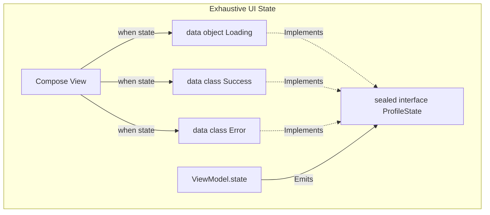

# Sealed Classes and Interfaces

## Overview

A `sealed class` (or `sealed interface`) is an extension of standard inheritance that restricts who can subclass it. When you declare a class as sealed, you are telling the compiler: "I am defining every possible subclass right here, right now. No one else, anywhere in this module, can ever inherit from this class."

This creates an "Algebraic Data Type" (ADT). It allows you to represent restricted class hierarchies where a value can have one of the types from a limited, known set, but cannot have any other type.

## Why It Matters

Sealed classes are the ultimate tool for [Making Invalid States Impossible](../principles/make-invalid-states-impossible.md). 

In traditional Java/Kotlin, if you return an `interface Result`, the caller has no idea how many implementations of `Result` exist in the universe. They have to guess. If you return a `sealed interface Result` with two subclasses (`Success` and `Error`), the caller knows with 100% mathematical certainty that those are the *only* two possibilities. The compiler can then force the caller to handle both cases, eliminating the risk of unhandled edge cases crashing the app.

## Historical Context

In Java, representing a fixed set of states was done using `Enums`. However, Enums are limited: every constant in an Enum is an exact duplicate of the others. You cannot attach a `String` to an `Error` enum and a `User` object to a `Success` enum. 
Java developers used complex Visitor patterns to simulate sealed classes. Kotlin introduced sealed classes natively to bridge the gap: they act like "Enums on steroids," where each subclass can have its own distinct properties and behavior.

## First Principles

1.  **Exhaustiveness:** The compiler knows all possible subclasses at compile-time. If you use a `when` statement, the compiler forces you to handle all of them. No `else` branch is needed.
2.  **State vs. Type:** Enums represent different *states* of the exact same type. Sealed classes represent entirely different *types* that share a common boundary.
3.  **Module Restriction:** All direct subclasses of a sealed class must be declared in the same compilation unit (package/module) as the sealed class itself.

## Mental Model

Think of a coin flip.
- **Normal Interface:** You flip a coin. It lands on Heads, Tails, or maybe it turns into a bird and flies away. The compiler has no idea what could happen.
- **Enum:** You flip a coin. It must be Heads or Tails. Both are identical pieces of metal with different engravings.
- **Sealed Class:** You open a mystery box. The rules state the box *must* contain either a `Puppy` (which has a `bark()` method) or a `Bomb` (which has a `timer` property). They are completely different objects, but the rules guarantee you will never find a `Snake`.

## Internal Mechanics

### 1. The Compiler Check (Exhaustiveness)

```kotlin
sealed interface NetworkResult {
    data class Success(val json: String) : NetworkResult
    data class Error(val code: Int) : NetworkResult
}

fun handleResult(result: NetworkResult) {
    // If you forget 'Error', the code WILL NOT COMPILE.
    // Notice there is no 'else ->' branch required!
    when (result) {
        is NetworkResult.Success -> showData(result.json)
        is NetworkResult.Error -> showError(result.code)
    }
}
```
If another developer adds `data object Loading : NetworkResult` to the sealed interface 6 months later, the compiler will instantly break the build at `handleResult()`, forcing the developer to handle the new `Loading` state before the app can be shipped. This is the definition of scaling safely.

### 2. Sealed Interface vs Sealed Class

- Use `sealed interface` when you only need to group types together (polymorphism) and don't need to share state or implementation details. This is the most common use case (e.g., UI States).
- Use `sealed class` when you need to share common state (properties) or protected functions across all subclasses.

```kotlin
// Sealed Class sharing state
sealed class UiEvent(val timestamp: Long = System.currentTimeMillis()) {
    class Click(val buttonId: String) : UiEvent()
    class Swipe(val direction: String) : UiEvent()
}
```

## Architecture



## Production Example

**Jetpack Compose & UDF**

Sealed classes are the backbone of Unidirectional Data Flow in Compose.

```kotlin
// The entire screen can only exist in one of these 3 states.
sealed interface ScreenState {
    data object Loading : ScreenState
    data class Content(val user: User) : ScreenState
    data class Error(val message: String) : ScreenState
}

@Composable
fun ProfileScreen(state: ScreenState) {
    // The compiler guarantees we don't accidentally draw a blank screen.
    when (state) {
        is ScreenState.Loading -> CircularProgressIndicator()
        is ScreenState.Content -> Text("Hello ${state.user.name}")
        is ScreenState.Error -> ErrorBanner(state.message)
    }
}
```

## Tradeoffs

**Advantages**
- **Compile-Time Safety:** Eliminates unhandled state bugs.
- **Readability:** Provides a crystal-clear API contract.
- **Smart Casting:** Inside the `is NetworkResult.Success` block, the compiler automatically smart-casts the variable, allowing you to access `result.json` directly.

**Disadvantages**
- **Refactoring Blast Radius:** If you add a new subclass to a widely used sealed class, you break the build in 50 different files. (This is a feature, not a bug, but it slows down rapid prototyping).
- **Serialization:** Reflection-based JSON parsers (Gson) cannot natively deserialize a JSON payload into a Sealed Class because they don't know *which* subclass to instantiate. You must write custom polymorphic adapters, or use `Kotlinx.Serialization` which handles it via `@Polymorphic` annotations.
- **Library Evolution:** If you are building a public SDK, using a sealed class prevents your clients from extending it. If they *need* to add a custom state, you've painted them into a corner.

## Failure Modes

- **The Useless `else` Branch:**
  ```kotlin
  when (result) {
      is Success -> ...
      is Error -> ...
      else -> throw Exception("Unknown") // BAD!
  }
  ```
  *(Fix: Never use `else` with sealed classes unless you are intentionally ignoring specific states. Adding `else` destroys the compiler's exhaustiveness check. If a new state is added, the compiler will silently route it to the `else` branch instead of failing the build).*
- **Data Object vs Data Class:** Using `data class Loading()` instead of `data object Loading`. If a state holds no data, it should be an `object` (a Singleton). Creating a new instance of a data-less class every time causes unnecessary garbage collection.
- **Leaking Domain into UI:**
  ```kotlin
  sealed interface Result {
      data class Success(val dbEntity: RoomDatabaseEntity) : Result
  }
  ```
  *(Fix: Sealed classes should map cleanly to the layer they reside in. Do not pass a sealed class containing a raw database entity directly into Jetpack Compose. Map it to a UI-specific sealed class first).*

## Staff Engineer Thinking

When reviewing code, a Staff engineer hunts for Enums and Booleans:

1.  **Can this Enum be a Sealed Class?** If I see `enum class Status { SUCCESS, ERROR }` combined with `val errorMsg: String?`, I immediately ask for a refactor. The nullability of `errorMsg` is tied to the `ERROR` state, but the compiler doesn't know that. A sealed class enforces the relationship.
2.  **Is this a Boolean Trap?** If I see `data class State(val isLoading: Boolean, val data: User?)`, I know there is a bug waiting to happen. The state where `isLoading = true` and `data != null` is a paradox. I will mandate a sealed class.
3.  **Are we breaking exhaustiveness?** I actively search PRs for `when (sealedClass) { ... else -> }`. If I find one, I require a comment justifying why the safety net is being bypassed.

## Common Misconceptions

- **"Sealed classes are just Enums."** No. Every instance of an Enum is the exact same class. Subclasses of a sealed class can have completely different properties, methods, and even inherit from other interfaces.
- **"I can only define subclasses inside the sealed class."** False. You can define them outside the sealed class body, as long as they are in the same package and compilation unit.

## Probing Questions

1.  What is the primary difference between an `enum class` and a `sealed interface` in Kotlin?
2.  How does the compiler's "Exhaustiveness Check" eliminate the need for an `else` branch in a `when` statement?
3.  Why is adding an `else` branch to a sealed class `when` statement considered a dangerous anti-pattern?
4.  What is the difference between `sealed class` and `sealed interface`? When would you use one over the other?
5.  Explain how Sealed Classes are used to build Unidirectional Data Flow (UDF) in Jetpack Compose.
6.  Why does a JSON parsing library (like Gson) struggle to deserialize a payload into a Sealed Class without custom configuration?
7.  What is the architectural difference between using `data class` and `data object` when defining the subclasses of a sealed class?
8.  How do Sealed Classes directly implement the "Make Invalid States Impossible" engineering principle?
9.  If you are writing a public library (SDK), why might you hesitate to expose a `sealed interface` as the return type for an API?
10. Describe a scenario where a deep inheritance hierarchy (using `open class`) should be refactored into a flat `sealed class` structure.

## Further Reading

- [`make-invalid-states-impossible.md`](../principles/make-invalid-states-impossible.md) — The philosophical underpinning of sealed classes.
- [`data-classes.md`](data-classes.md) — The structures most commonly used as the subclasses.
- [`../patterns/state.md`](../patterns/state.md) — The architectural pattern that relies on sealed classes.
