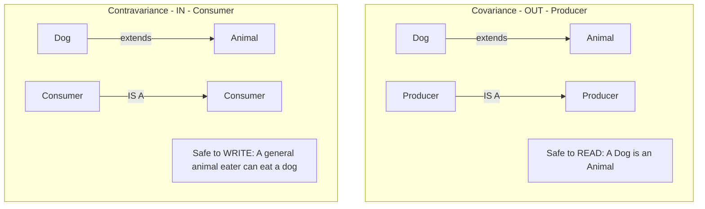

# Variance (Covariance and Contravariance)

## Overview

Variance is the most notoriously difficult concept in Kotlin's type system. It answers a single, deceptively simple question: **If `Dog` is a subtype of `Animal`, is `List<Dog>` a subtype of `List<Animal>`?**

In Kotlin, by default, the answer is **NO**. `List<Dog>` and `List<Animal>` have absolutely no relationship to each other. This default behavior is called **Invariance**.

To create a relationship, you must use Variance modifiers: `out` (Covariance) or `in` (Contravariance).

## Why It Matters

Without variance, you cannot write reusable generic APIs. 

Imagine you write a function to print the names of animals: `fun printNames(animals: List<Animal>)`. 
If you create a `val dogs: List<Dog>`, and try to pass it into that function, the compiler will throw an error! The compiler says `List<Dog>` is not a `List<Animal>`. This feels completely illogical to a human. Variance is the mathematical syntax required to explain to the compiler *why* and *when* it is safe to treat a collection of Dogs as a collection of Animals.

## Historical Context

In Java, arrays were Covariant by default. A `Dog[]` was considered a subtype of `Animal[]`. This was a catastrophic design flaw. It allowed this code to compile:

```java
// Java Array Catastrophe
Dog[] dogs = new Dog[10];
Animal[] animals = dogs; // Allowed because arrays are covariant in Java
animals[0] = new Cat();  // Allowed because a Cat is an Animal

// CRASH! At runtime, the JVM realizes you just shoved a Cat into an array 
// physically allocated for Dogs. ArrayStoreException.
```

When Java introduced Generics (`List<T>`), they learned from this mistake. They made Generics **Invariant** (no relationship). But this made APIs rigid. To fix *that*, they added Wildcards (`? extends Animal` and `? super Dog`). Kotlin replaced Java's confusing wildcards with declaration-site variance using the `in` and `out` keywords.

## First Principles

1.  **Invariance (Default):** `<T>`. No relationship. A `Box<Dog>` is NOT a `Box<Animal>`.
2.  **Covariance (`out`):** `<out T>`. The relationship is preserved in the same direction. If `Dog` extends `Animal`, then `Producer<Dog>` extends `Producer<Animal>`. You can only *read* (produce) `T`. You can never *write* to it.
3.  **Contravariance (`in`):** `<in T>`. The relationship is reversed. If `Dog` extends `Animal`, then `Consumer<Animal>` extends `Consumer<Dog>`. You can only *write* (consume) `T`. You can never *read* from it.

## Mental Model

Think of a Vending Machine (Producer) and a Trash Can (Consumer).

- **Covariance (`out`):** You need a machine that produces Snacks. I offer you a Vending Machine that produces *only* Doritos (a subtype of Snack). Is this acceptable? Yes! A Doritos machine is a perfectly valid Snack machine. You will only ever take things *out* of it.
- **Contravariance (`in`):** You need a trash can to throw away a broken Laptop. I offer you a giant Dumpster designed to accept *any* type of Electronic Waste (a supertype of Laptop). Is this acceptable? Yes! A general E-Waste dumpster is a perfectly valid place to throw a Laptop. You will only ever put things *in* to it.

## Internal Mechanics

The entire concept of Variance exists to prevent the "Cat in the Dog Array" runtime crash. The compiler enforces safety by restricting whether a generic class is allowed to have `T` in the "in" position (function arguments) or the "out" position (function return types).

### 1. Covariance (`out T`)

If you declare `<out T>`, the compiler promises it will never let you pass `T` as an argument to any function in that class.

```kotlin
// The 'out' modifier makes it Covariant.
interface Producer<out T> {
    fun produce(): T // OK! Returning T (out position)
    
    // COMPILER ERROR! Cannot have T in the "in" position.
    // fun consume(item: T) 
}

val dogProducer: Producer<Dog> = object : Producer<Dog> {
    override fun produce() = Dog()
}

// Because we used 'out', this assignment is now VALID!
val animalProducer: Producer<Animal> = dogProducer 

// It is mathematically safe. If we ask 'animalProducer' to produce(), 
// it gives us a Dog, which is a valid Animal. We cannot shove a Cat into it 
// because the consume() function is banned by the compiler.
```

### 2. Contravariance (`in T`)

If you declare `<in T>`, the compiler promises it will never let you return `T` from any function in that class.

```kotlin
// The 'in' modifier makes it Contravariant.
interface Consumer<in T> {
    fun consume(item: T) // OK! Taking T as argument (in position)
    
    // COMPILER ERROR! Cannot have T in the "out" position.
    // fun produce(): T
}

val animalConsumer: Consumer<Animal> = object : Consumer<Animal> {
    override fun consume(item: Animal) = println("Ate an animal")
}

// Because we used 'in', this assignment is VALID (in reverse)!
val dogConsumer: Consumer<Dog> = animalConsumer

// It is mathematically safe. If we pass a Dog to 'dogConsumer', 
// the underlying 'animalConsumer' is perfectly capable of eating it.
```

## Architecture



## Production Example

**Why `List` vs `MutableList` is brilliant**

In Kotlin, the standard `List<T>` interface is read-only. Look at its actual source code:

```kotlin
// Kotlin standard library source code
public interface List<out E> : Collection<E> {
    public operator fun get(index: Int): E
}
```
Because it is `<out E>`, `List` is covariant. You CAN pass a `List<Dog>` to a function expecting a `List<Animal>`. It is safe because you can't add a Cat to a read-only list.

Now look at `MutableList<T>`:

```kotlin
// Kotlin standard library source code
public interface MutableList<E> : List<E>, MutableCollection<E> {
    public fun add(element: E): Boolean
}
```
It does NOT have the `out` modifier. It is **Invariant**. You CANNOT pass a `MutableList<Dog>` to a function expecting a `MutableList<Animal>`. If the compiler allowed it, the function could `add(Cat())`, crashing the app.

Kotlin's split between read-only and mutable collections was entirely designed to leverage Covariance safely.

## Tradeoffs

**Advantages**
- **Type Safety:** Completely eliminates the Java ArrayStoreException catastrophe.
- **Flexible APIs:** Without `out`, you could never pass a `List<String>` to a function that prints a `List<Any>`, which would make the language incredibly frustrating to use.

**Disadvantages**
- **Brain Melt:** Contravariance (`in`) is famously difficult for developers to wrap their heads around, because the inheritance hierarchy runs backwards (`Consumer<Animal>` is a subtype of `Consumer<Dog>`).
- **Use-Site Variance:** Sometimes you don't control the class definition (e.g., it's a 3rd party Java library), so you can't put `out` on the class itself. You have to use "Use-Site Variance" at the function parameter level: `fun copy(from: Array<out Animal>, to: Array<in Animal>)`. This makes function signatures very noisy.

## Failure Modes

- **The `@UnsafeVariance` Hack:**
  Sometimes, a class is covariant (`out T`), but it *needs* to use `T` in an "in" position for a specific, safe reason (like an `indexOf(item: T)` function on a read-only list). 
  ```kotlin
  interface List<out E> {
      // The compiler will yell at you here because E is in the 'in' position.
      // You can silence the compiler with an annotation:
      fun contains(element: @UnsafeVariance E): Boolean
  }
  ```
  *(Fix: Never use `@UnsafeVariance` in your own application code. It is meant exclusively for the authors of the Kotlin Standard Library who can mathematically prove their specific edge case is safe).*
- **Confusing `in/out` with Scope:** Thinking `out` means data going out to the network, or `in` means data coming into the database. *(Fix: It purely refers to the direction data flows in and out of the **Generic Class/Interface**).*

## Staff Engineer Thinking

When reviewing generic architectures, a Staff engineer focuses on the `in/out` boundaries:

1.  **Is this generic class a pure data holder?** If a generic class `ViewState<T>` only holds data and has no mutator functions, it *must* be declared as `ViewState<out T>`. If the developer forgets the `out` modifier, they have unnecessarily restricted the reusability of the class.
2.  **Are we using Contravariance correctly for Callbacks?** If we define an interface `interface OnClickListener<T>`, and it has a single function `fun onClick(item: T)`, it is a Consumer. It *must* be declared as `interface OnClickListener<in T>`. This allows us to pass a generic `OnClickListener<Any>` to a button that expects an `OnClickListener<User>`.
3.  **The PECS Mnemonic:** I teach junior developers the Java mnemonic: **P**roducer **E**xtends (Kotlin `out`), **C**onsumer **S**uper (Kotlin `in`). If an object produces T, use `out`. If it consumes T, use `in`.

## Common Misconceptions

- **"Covariance means the types are equal."** No. Covariance means the inheritance relationship of the generic wrappers is *the same* as the inheritance relationship of the inner types.
- **"I should always use `out` just to be safe."** If you use `out`, the compiler will completely ban you from writing any function that accepts `T` as a parameter. It makes the class permanently read-only regarding `T`. Use it only when appropriate.

## Probing Questions

1.  What is "Invariance," and why is it the default behavior for Generics in Kotlin?
2.  Explain the fundamental problem Java faced with covariant Arrays that caused the `ArrayStoreException`.
3.  How does the `out` modifier prevent the "Cat in the Dog Array" problem?
4.  Why is the standard `List<T>` interface in Kotlin able to be Covariant (`out T`), but `MutableList<T>` must be Invariant?
5.  Explain "Contravariance" (`in T`) using the Vending Machine / Dumpster mental model.
6.  Why is a `Consumer<Animal>` mathematically a perfectly safe substitute for a `Consumer<Dog>`?
7.  What does the `@UnsafeVariance` annotation do, and why should application developers avoid it?
8.  If you write a class `class EventLogger<T>`, and its only method is `fun log(event: T)`, should you use `in`, `out`, or nothing?
9.  What is "Use-Site Variance," and when are you forced to use it instead of Declaration-Site Variance?
10. Describe the PECS mnemonic (Producer Extends, Consumer Super) and how it maps to Kotlin's `in` and `out` keywords.

## Further Reading

- [`generics.md`](generics.md) — The fundamental rules of Type Erasure that necessitate variance.
- [Kotlin Docs: Variance](https://kotlinlang.org/docs/generics.html#variance)
