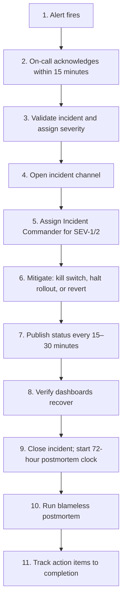

# Leadership: Incident Response & On-Call

> When the app crashes for 500K users on Black Friday, panic ensues. The Staff engineer's job is to impose order on chaos: **mitigate first, root-cause later**. The discipline is calm allocation of roles, time-boxed actions, blameless analysis afterward. The hero who singlehandedly fires the rollback at 3 AM is a *bug*, not a leader — leaders build the systems where on-call doesn't need heroes.

---

## On-Call Philosophy

On-call is the system's pain feedback loop. Teams that build flaky software feel it at 3 AM. Teams that build resilient software don't get paged. The Staff engineer's long-term job is to *reduce the pages*, not to be the strongest fighter.

**Mitigation > Resolution.** When PagerDuty fires, the goal is to stop the bleeding *now*, not to write a clever fix. The root-cause fix happens at 10 AM Monday with rested engineers.

**Blameless > Punitive.** When a junior engineer breaks production, the team writes a post-mortem analyzing the systemic failure (CI didn't catch it; staged rollout was bypassed; runbook didn't exist) — not screaming at the junior.

**Runbooks > Memory.** Anything an on-call engineer needs to do at 3 AM should be in a runbook they can read while groggy. If you found yourself paging because you remembered an obscure mitigation, write it down.

---

## The Incident Lifecycle



---

## Severity Levels (Example Matrix)

| Severity | Criteria | Response time | Who's woken |
|---|---|---|---|
| **SEV-1** | App is broken for > 10% of DAU; or money/safety/legal impact | 5 min | On-call + IC + EM |
| **SEV-2** | Significant feature broken; or 1-10% of DAU affected | 15 min | On-call + EM (info) |
| **SEV-3** | Edge-case bug; minor data quality issue | Next business day | On-call only |
| **SEV-4** | Cosmetic; non-blocking | Backlog | None |

The matrix is the team's contract with themselves. *Adhere to it.* Calling everything SEV-1 burns out the on-call rotation; calling nothing SEV-1 lets real incidents grow before they're addressed.

---

## The Incident Commander (IC) Role

For SEV-1/2, somebody must coordinate. That person is the IC. The IC:

- **Does not** look at code.
- **Does not** query logs.
- **Does** coordinate the humans.

Their tools:

- Assign clear ownership: "Sarah, investigate the API gateway logs and report back in 10 min. John, prepare the rollback binary and have it ready in 20 min."
- Enforce communication discipline: "Use the #incident-247 channel; threads for investigations; main channel for status."
- Communicate up: status updates to the EM/Director/VP every 15-30 min, so they don't interrupt the engineers fixing the problem.
- Run the timeline: keep a running log in the channel of what happened when. Post-mortem author will thank you.
- Make call-the-shot decisions: "We're going to halt the rollout now and investigate; OK?"

An IC who tries to *also* debug the issue becomes a bottleneck. The IC's discipline is to coordinate, not to fix.

For your first SEV-1 as IC, follow the [Google SRE IC Playbook](https://sre.google/workbook/incident-response/) verbatim. After three, you'll have a feel for it.

---

## Mitigation Toolbox (Mobile Specifics)

| Symptom | Mitigation |
|---|---|
| New release crashing | Halt rollout via Play Console / Triple-T (see [`../release-engineering/staged-rollouts.md`](../release-engineering/staged-rollouts.md)) |
| Specific feature broken | Flip kill switch via flag service (see [`../release-engineering/kill-switches.md`](../release-engineering/kill-switches.md)) |
| BFF endpoint failing | Coordinate with backend on-call to roll back their deploy |
| Crash spike on specific OEM | Cohort-specific kill switch via flag variant |
| Payment provider issue | Switch to fallback PSP via remote config |
| Cert pin failure (post-rotation) | Emergency app update via In-App Updates; pin-disable flag if it exists |
| ANR spike | Investigate; likely a synchronous main-thread call in new release; halt + investigate |
| Network call storm overwhelming BFF | Client-side rate limiter via remote config |
| Data corruption from a bug | Halt rollout; investigate scope; potentially write a one-time cleanup migration |

The mobile-specific gotcha: **users on the bad version cannot be force-updated quickly**. Halting the rollout stops *new* installs of the bad version; existing affected users stay broken until the kill switch + hotfix lands. *Always* pair "halt rollout" with "flip the feature kill switch" if the offending feature is isolable.

---

## Incident Communication Templates

### Initial customer-facing notice (within 15 min)

> We're investigating reports of [symptom] affecting [scope]. We'll post an update within 30 minutes. Thanks for your patience.

Short. No speculation about cause. No promises about fix timing.

### Update (every 30 min during active incident)

> Status update on [issue]: [what we've done so far]. [What we're doing next.] Next update at [time].

### Resolution

> The issue affecting [scope] has been resolved as of [time]. Root cause was [one sentence, factual]. We'll publish a full post-mortem within [N days].

### Internal status (every 15-30 min in the incident channel)

> Status (HH:MM): [current state]. [What's happening now]. [Blockers/unknowns]. Next update at [time].

Cadence beats content. Stakeholders not in the channel need predictable updates so they don't ping you for status (which interrupts the fix).

---

## The Blameless Post-Mortem (COE)

Within 72 hours of resolution, write the post-mortem. Structure:

```markdown
# Post-Mortem: <One-line summary>

**Date:** YYYY-MM-DD
**Severity:** SEV-X
**Duration:** HH:MM (from first impact to mitigation)
**Author:** <IC>
**Reviewers:** <on-call, EM, Director if SEV-1>

## Summary
2-3 sentences. What happened, who was affected, how it was resolved.

## Impact
- Users affected: <number / percentage>
- Duration of impact: <time>
- Business impact: <revenue loss / engagement drop / data loss>

## Timeline
| Time (UTC) | Event |
|---|---|
| HH:MM | Bad release v4.2.1 rolled out to 10% |
| HH:MM | Crashlytics shows crash spike; auto-halt fires |
| HH:MM | On-call paged |
| HH:MM | Incident channel opened |
| HH:MM | Root cause identified: NullPointerException in payment flow |
| HH:MM | Feature kill switch flipped |
| HH:MM | Mitigation verified; crash rate returned to baseline |

## Root Cause Analysis (5 Whys)
1. Why did the app crash? Because of a NullPointerException in CheckoutViewModel.
2. Why was the data null? Because the backend returned null for shipping_address.
3. Why did the app crash on null? Because the Retrofit model declared shipping_address as non-null String.
4. Why did the client/server schemas diverge? Because we don't have a contract testing pipeline.
5. **Root cause:** No automated contract testing between client and server.

## What Went Well
- Auto-halt at 99% crash-free fired within 15 min.
- IC handoff was clean; communication discipline held.
- Kill switch flipped in < 5 min once root cause was identified.

## What Didn't Go Well
- The bug should have been caught in pre-launch testing.
- Crash dashboards lagged 8 min behind reality.
- Runbook for "halt rollout via Play Console" was out of date.

## Action Items
| Action | Owner | Due | Status |
|---|---|---|---|
| Add OpenAPI contract testing in CI | @alice | 2026-07-15 | Open |
| Update halt-rollout runbook | @bob | 2026-06-30 | Open |
| Investigate Crashlytics lag with vendor | @carol | 2026-07-10 | Open |

## Lessons
- One-paragraph reflection. What does the team now believe that it didn't believe before?
```

### What makes the post-mortem blameless

- **Replace "Bob made a mistake" with "the system allowed Bob to make a mistake without catching it."** Bob is a human; humans make mistakes. The system should have safety rails.
- **Use passive voice for actions you'd otherwise blame.** "The change was merged" rather than "Bob merged the change." This forces focus on the system, not the person.
- **Action items address the system, not the person.** "Add contract testing" not "tell Bob to be more careful."
- **The IC's job is to ensure the meeting stays focused on the system.** If anyone says "if Bob had just...", redirect: "What property of the system should have prevented this regardless of who made the change?"

---

## On-Call Hygiene

### Alert pruning (the Staff engineer's job)

If on-call pages 10 times a week for things that don't need human intervention, the rotation is *broken*. Engineers ignore the pager. The next real incident gets missed.

The Staff engineer audits alerts quarterly:

- Alerts that fire and auto-resolve in < 5 min: delete or downgrade to a dashboard.
- Alerts with no runbook: write the runbook or delete the alert.
- Alerts that the team has muted: investigate why; either fix or delete.
- Alerts that fire on weekends but are addressed Monday: downgrade to non-paging.

Healthy on-call: 2-3 actionable pages per shift, each with a clear runbook.

### Rotation discipline

- **Primary + Secondary.** Two people per shift; secondary fills in if primary is unreachable.
- **Time-zone-aware.** Engineers should be on-call in their own waking hours where possible.
- **Burnout watch.** Anyone on > 1 SEV-1 per week for 3 weeks in a row is at burnout risk; rotate them off.
- **Compensation.** Off-hours pages should be compensated (TOIL, monetary, or both). Otherwise the rotation breeds resentment.

### Knowledge transfer

- Every shift starts with a 5-min handover (what happened in the last shift; what's still in flight).
- Runbooks updated after every incident.
- New joiners shadow for 2 shifts before being primary.

---

## Anti-Patterns

- **The Hero Complex.** A Staff engineer who always single-handedly fixes the SEV-1 at 3 AM. Looks heroic; is actually a single point of failure who is hoarding the knowledge. Build playbooks instead.
- **The Blame Game.** Post-mortems that name and shame. Engineers hide future incidents.
- **Speculation in customer-facing comms.** "We think it's a database issue" — turns out it isn't; you've now misled customers and have to retract.
- **Burying the IC role.** Without an IC, SEV-1s become free-for-alls. Decide who's IC in the first 5 min, even if it's "me."
- **Tangential debugging during an incident.** "Hmm, while I'm here, let me also fix this other bug I noticed." NO. Mitigate the incident; come back to the other bug.
- **Skipping the post-mortem because "it was minor."** The 5-min SEV-2 you had this week may be the prelude to next week's SEV-1. Lessons compound.
- **Treating post-mortem action items as optional.** If they're not tracked to completion, the team will hit the same issue again. Track every action item in a single board; review monthly.
- **Auto-halt with no Slack alert.** Crash-gating halts the rollout silently; nobody notices for hours. Always wire the auto-halt to alert a channel.
- **Manual escalations during an incident.** "I'll text the VP." Use the on-call escalation chain in PagerDuty. The chain accounts for time zones, vacations, and backups.

---

## Probing Questions

1. What's the difference between Mitigation and Resolution? Why is the distinction critical?
2. What does an Incident Commander do — and crucially, what do they NOT do?
3. Why are blameless post-mortems essential? What does a punitive post-mortem produce?
4. How do you decide what's a SEV-1 vs SEV-2? Why is over-classifying as bad as under-classifying?
5. Walk through the 5 Whys for a crash you'd actually expect in a banking app.
6. The on-call rotation has 10 pages per week. What's your audit plan?
7. The CEO joins the incident channel and starts asking technical questions. How do you handle it?
8. A junior pushed a bad config and caused the incident. How do you write the post-mortem?

---

## Further Reading

- [`escalation-and-decision-making.md`](escalation-and-decision-making.md) — escalation in incident context.
- [`../release-engineering/staged-rollouts.md`](../release-engineering/staged-rollouts.md) — halt-the-rollout mechanics.
- [`../release-engineering/kill-switches.md`](../release-engineering/kill-switches.md) — feature-level mitigation.
- [`../release-engineering/crash-rate-gating.md`](../release-engineering/crash-rate-gating.md) — auto-halt on regression.
- [Google SRE Book — Chapter 14 (Managing Incidents)](https://sre.google/sre-book/managing-incidents/) — canonical.
- [Google SRE Workbook — Incident Response](https://sre.google/workbook/incident-response/) — practical patterns.
- [Atlassian Incident Handbook](https://www.atlassian.com/incident-management/handbook) — runbook templates.
- [PagerDuty Incident Response](https://response.pagerduty.com/) — comprehensive open-source playbook.
