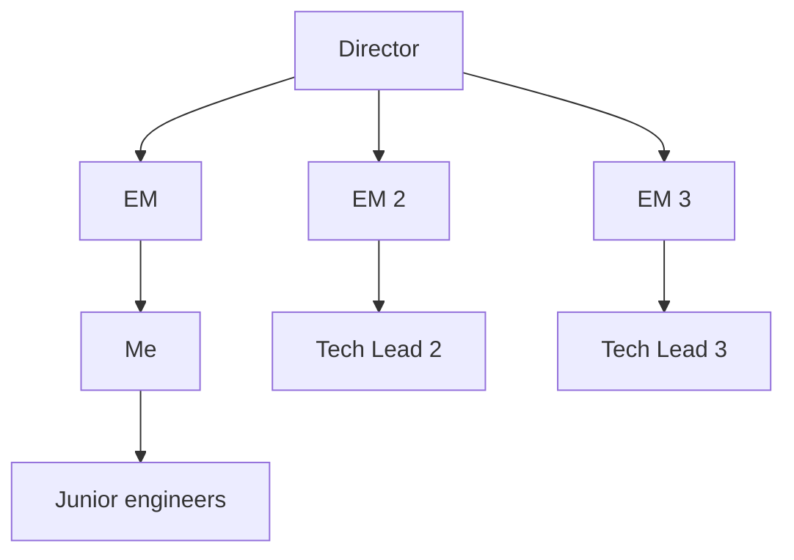

# Leadership: Influence Without Authority

> A Staff engineer can't fire anyone. Can't deny PTO. Can't allocate budget. Yet things have to get done across teams whose managers don't report to them. The currency is *influence*: demonstrated judgment, sponsored mentees, owned-and-fixed problems, written artifacts that become the team's reality. Influence compounds with every right call; vanishes with every wrong one.

---

## Why Influence Matters

Most Staff-level work crosses team boundaries. A Staff engineer wants:

- The backend team to adopt a particular API contract format.
- The iOS team to align on shared schema definitions.
- The platform team to prioritize a build tool upgrade.
- The growth team to delay a launch by a week to fix a critical bug.

None of these can be commanded. The Staff engineer asks; the asked party agrees (or doesn't). Influence is *the conversion rate* on those asks.

A Staff engineer with high influence: peers nod and execute when asked. A Staff engineer with low influence: peers nod, then privately deprioritize.

---

## The Currencies Of Influence

### 1. Demonstrated technical judgment

Every load-bearing decision you make right (or wrong) accumulates. After 18 months of consistently correct architectural calls, peers default to your judgment on hard problems.

This is the *primary* currency. You can be the friendliest person in the office and the best mentor; if your technical calls are routinely wrong, your influence will be capped.

**How to build it:**
- Pick fights you can win. Don't make ambiguous calls publicly; make decisive calls on questions where you have clear data.
- Show your reasoning. RFCs make your thinking visible; reviewers can audit; correct calls become reputation.
- Take responsibility when wrong. "I was wrong about X; here's what I learned" builds *more* credibility than never being wrong.

### 2. Owning problems no one owns

The org has dozens of broken things nobody owns. Pick one; fix it; document it. You've now earned permission to propose fixes for adjacent problems.

This is how scope expands. See [`../career/scope-and-ambiguity.md`](../career/scope-and-ambiguity.md).

### 3. Sponsored mentees who succeed

When the engineers you sponsor get promoted, you accumulate credit. When you publicly credit others for their wins, they reciprocate when you need help. When you stay late helping a junior debug, that junior becomes a Senior who advocates for your RFCs in 3 years.

See [`technical-mentorship.md`](technical-mentorship.md).

### 4. Written artifacts the org relies on

The engineer who wrote the architecture doc *is* the architect. The engineer who wrote the runbook *is* the on-call lead. The engineer who wrote the hiring rubric *defines* the team's bar.

Writing converts your opinion into the team's reality. Years later, your influence persists in the documents people still consult.

### 5. Trust earned in 1:1 relationships

A Staff engineer maintains light-touch relationships with 20-50 peers across the org: tech leads of adjacent teams, EMs you don't report to, the iOS Staff, key Product Managers, the Director above your EM. These aren't friendships; they're *working relationships* that let you ask for things informally.

How they're built: a monthly coffee, an offer to help on something hard, public credit when their team does well, *not* asking for favors until you've given several.

---

## The Influence Map

Lara Hogan's tool: take 30 minutes to literally draw who you need influence with and where you stand today.

For each box, ask:

- **Who's the person?** (specific name)
- **How often do I interact with them?** (weekly / monthly / never)
- **What's the quality of our relationship?** (strong / professional / strained / unknown)
- **Do I have a working relationship I can draw on if I need to ask for something?**

The blank spots are your assignment. If you've never had a 1:1 with the iOS Staff engineer and they're the person you'll need to align with on the next cross-platform RFC, schedule that coffee now — not after you need them.

---

## The Influence Bank Account

Treat influence like a bank account. You can deposit (do favors, publicly credit, help on hard problems) and withdraw (ask for prioritization, push for architectural changes, escalate).

**A staff engineer who only withdraws goes bankrupt.** Make 5 deposits for every withdrawal.

### Deposit patterns

- Help a peer prepare for a hard interview.
- Catch a bug in a peer team's code review and explain it constructively.
- Publicly credit a junior for an insight.
- Spend 30 min explaining your team's pattern to an EM struggling with their team's similar problem.
- Send a quick "this was useful, thanks" note when someone shares a good doc.
- Pull a peer into a high-visibility decision they otherwise wouldn't be in.

### Withdrawal patterns

- "I need you to prioritize this API change for our launch."
- "Can your team adopt our schema format?"
- "I think we should escalate this disagreement to the Director."
- "Will you spend a week helping me think through this architecture?"

If you find yourself doing 5 withdrawals in a row with no deposits, you're spending faster than you're earning.

---

## How To Ask For Things

The mechanics matter.

### Bad ask (low conversion)

> "Can your team prioritize the API contract change for our launch?"

Why it fails: vague urgency, no specifics, asks for prioritization (which the EM controls).

### Good ask

> "I'd like to align on the API contract for the new payment flow. Our launch is on July 15; the contract change is small (1 endpoint, additive). If your team can review the contract by July 1, we can finish the client side by July 10. Here's the contract: [link]. Is there an engineer on your team who could be the primary reviewer?"

Why it works: specific timeline, scope, artifact ready, names what you need, makes it easy to say yes.

### Better ask (when the relationship is solid)

> "Quick favor — could you take a look at this API contract this week? Need it before July 1 to keep our launch on track."

Conciseness signals you respect their time. The relationship makes the longer context unnecessary.

---

## The "Help Me Help You" Move

When you want a peer team to do something, give them the easiest possible path:

- **Pre-draft the artifact.** Don't ask the iOS team to "design the contract together" if you can draft it yourself and ask for review.
- **Volunteer the meeting time.** "Are you free Thursday 2-3 to talk?" beats "let's find a time."
- **Front-load the diff.** If you want them to adopt a pattern, write the first migration PR for one of their files; they merge it; precedent set.
- **Offer to do the writing.** "I'll write the joint RFC; you review and sign off."

This is leverage. They get the outcome with 10% of the work; you get the alignment.

---

## Influencing Engineers Outside Your Team

The hardest influence to build. You don't have day-to-day visibility; they don't know you well.

### Patterns that work

- **Be useful first.** Show up in their team's design review with a thoughtful comment. Reference their work in your own RFC ("borrowing the pattern from the X team's recent migration").
- **Build the relationship before you need it.** A 30-min coffee with the iOS Staff six months before the cross-platform RFC is gold; the same coffee a week before is suspicious.
- **Find shared problems.** "Hey, I noticed both of our teams hit issue X. Want to coordinate?" Shared interest accelerates trust.
- **Show up to all-hands and shared meetings.** Be visible. Faces gain trust; ghosts don't.

### Patterns that fail

- **Cold-emailing a request with no relationship.** "Hi, I'm <name>, please prioritize Y." Reads as entitled.
- **Going to their EM first.** Skipping the engineer creates immediate distrust.
- **Selling your priority as universal.** "Everyone agrees X is important." If everyone did, you wouldn't need to ask.

---

## Influencing Up

Your EM, Director, VP. Different motion than peer influence.

### The EM (your manager)

- Share context proactively. Don't make them ask.
- Help them succeed in *their* role. Your win is partly their win, but only if you make it legible.
- Tell them what you're worried about, even if you don't have a fix yet.
- Trust them with confidential context unless you've been burned.

### The Director / VP (2-3 levels up)

- Communicate via your EM by default; skip-level only at agreed cadence.
- When you do interact, be crisp. Short docs. Clear asks.
- Translate engineering work into business outcomes. They don't care about Kotlin coroutines; they care about the metric that moved.
- Show up at the all-hands; ask one good question. Don't disappear into the engineering bubble.

### Common mistake

Pretending you don't influence up. Every Staff engineer influences their EM/Director/VP whether or not they intend to. Your silence is itself a signal ("things are fine"). Your absence from strategic discussions is itself a signal ("not interested in scope at that level").

The choice is whether to influence intentionally or accidentally.

---

## Influencing Down (Juniors and Peers Less Senior)

You're the model. They're watching how you handle disagreement, how you write RFCs, how you respond to failure.

- **Public praise; private criticism.** Always.
- **Take their ideas seriously.** Even ones that won't work. The act of being heard converts a junior into an advocate.
- **Show your work.** A junior who watches you struggle through a hard problem learns more than from any lecture.
- **Sponsor visible opportunities.** "Have Priya present this at all-hands instead of me." Costs you nothing; means everything to her.

---

## Anti-Patterns

- **Influence by title alone.** "I'm Staff, so this is what we're doing." Earns compliance, not alignment. The team executes badly because no one bought in.
- **Withdrawal-only.** Always asking for things; never giving. Goes bankrupt in 6 months.
- **The hot-and-cold relationship.** Intense friendship when you need them; ghosting when you don't. Peers notice.
- **Triangulation.** "Did Bob actually agree to this?" — fishing for political allies. Burns trust if discovered (and it's always discovered).
- **The "everyone agrees" lie.** Claiming organizational support you don't have. Once exposed, your credibility is gone for a year.
- **Public criticism.** Calling out a peer's bad RFC in a wide channel. Spent capital with everyone watching.
- **The volunteer-then-resent pattern.** Volunteering to take on cross-team work, then resenting it because "no one's helping me." If you volunteered, you signed up.
- **Refusing to play politics.** "I just want to code." Other people are making the decisions that affect you. You can engage or you can complain.
- **The high-energy-low-substance peer.** Friendly in 1:1; never delivers. Influence depends on competence, not warmth.

---

## Probing Questions

1. Why is influence the dominant currency for a Staff engineer, more than authority?
2. Give a concrete example of how you've earned influence in the past 6 months. How did you spend any of it?
3. Walk through the Influence Map exercise for your current team and adjacent teams. Where are the gaps?
4. The iOS Staff disagrees with your RFC. You don't know each other well. How do you build the relationship to resolve it?
5. Your VP doesn't see the urgency of a technical issue you care about. How do you change their mind?
6. A peer asks you for a favor that costs you a day; you don't see immediate reciprocation. Do you do it?
7. What's the failure mode of a Staff engineer who's all "deposits" and no "withdrawals" — never asks for anything?
8. How do you ask for something from a peer engineer when you have no existing relationship?

---

## Answer Key

1. **Why is influence the dominant currency for a Staff engineer, more than authority?**
   A Staff engineer doesn't have direct managerial authority. To drive cross-team initiatives, they must rely entirely on influence to persuade others to align and execute.
2. **Give a concrete example of how you've earned influence in the past 6 months. How did you spend any of it?**
   (Self-reflection) Example: Earning influence by volunteering to debug a critical issue for a peer team (deposit), and spending it later by asking their Tech Lead to adopt a new shared API schema (withdrawal).
3. **Walk through the Influence Map exercise for your current team and adjacent teams. Where are the gaps?**
   (Self-reflection) The exercise maps relationships with key peers and leaders to identify missing connections. Gaps usually exist with Staff engineers on sister platforms or Directors two levels up.
4. **The iOS Staff disagrees with your RFC. You don't know each other well. How do you build the relationship to resolve it?**
   Stop pushing the RFC directly. Schedule a 1:1 coffee to understand their context, find shared problems, and make small deposits before asking them to align on the broader technical decision.
5. **Your VP doesn't see the urgency of a technical issue you care about. How do you change their mind?**
   Translate the engineering problem into business outcomes. Explain the issue in terms of impacted metrics, lost revenue, or delayed product velocity, keeping the message crisp.
6. **A peer asks you for a favor that costs you a day; you don't see immediate reciprocation. Do you do it?**
   Yes, if you can afford the time. Doing favors builds relational capital (deposits) that you can withdraw from later when you need alignment on a cross-team initiative.
7. **What's the failure mode of a Staff engineer who's all "deposits" and no "withdrawals" — never asks for anything?**
   They become well-liked but ineffective. By never using their earned capital to push for architectural changes or prioritize technical debt, they fail to drive the org-wide impact expected of a Staff engineer.
8. **How do you ask for something from a peer engineer when you have no existing relationship?**
   Pre-draft the work and offer to do the heavy lifting. Provide a specific, low-friction request (e.g., reviewing a PR you wrote for their repo) rather than demanding they do the work.

## Further Reading

- [`technical-mentorship.md`](technical-mentorship.md) — the sponsorship dimension.
- [`escalation-and-decision-making.md`](escalation-and-decision-making.md) — when influence isn't enough.
- [`running-a-design-review.md`](running-a-design-review.md) — where influence converts to alignment.
- [`../career/technical-leadership.md`](../career/technical-leadership.md) — the broader leadership context.
- [Lara Hogan — Influence and managing up resources](https://larahogan.me/resources/influence-manage-up/) — practical influence exercises and reading.
- [Lara Hogan — "Managing Up"](https://larahogan.me/blog/) — the upward dimension.
- [Tanya Reilly — "The Staff Engineer's Path"](https://www.oreilly.com/library/view/the-staff-engineers/9781098118723/) — extensive treatment of influence.
- [Will Larson — "Staff Engineer"](https://staffeng.com/book) — interviews on building influence.
