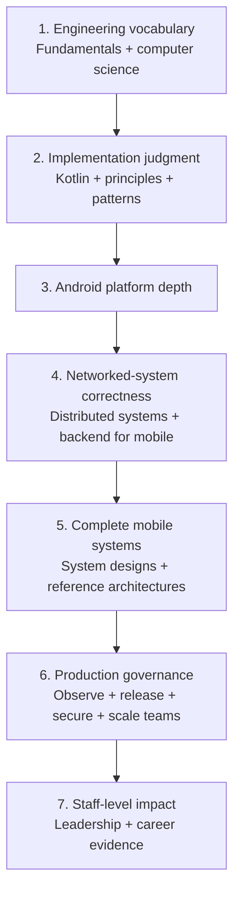

# Learning Paths

This repository has two navigation layers:

1. **Whole-repository sequence:** use Path 0 when you want a complete beginner-to-Staff curriculum.
2. **Folder sequence:** when Path 0 sends you to a knowledge tree, open its parent `.md` file and follow the numbered **Guided Reading Sequence**. Read links top to bottom unless a step is explicitly marked optional.

The other paths are shorter role- or goal-specific routes for readers who already know their gaps.

The complete curriculum moves from shared vocabulary to implementation, platform depth, distributed correctness, whole-system design, production operation, and finally organizational leverage. The numbered phases below are the source of truth for the detailed order.

---

## Path 0: Complete Curriculum for New Learners

Use this if you are unsure where to begin. Do not open random topic files from the directory tree. Each phase has one parent index; that index owns the detailed order inside its folder.

### Phase 1 — Engineering vocabulary

1. [Engineering Fundamentals](engineering-fundamentals.md) — complexity, latency, asynchrony, state, queues, serialization, time, backpressure, and failure.
2. [Computer Science](computer-science.md) — data structures and algorithms after you understand the shared complexity vocabulary.

**Exit check:** explain how data shape, latency goals, queueing, and failure behavior influence a design before naming an Android library.

### Phase 2 — Language and implementation judgment

3. [Kotlin](kotlin.md) — language core, type system, compiler features, coroutines/Flow, and runtime behavior.
4. [Principles](principles.md) — the heuristics used to review designs.
5. [Patterns](patterns.md) — implementation and resilience patterns; study these after the underlying mechanics so pattern names do not replace reasoning.

**Exit check:** model state with Kotlin types, choose a concurrency boundary, and explain why a pattern reduces rather than hides complexity.

### Phase 3 — Android platform depth

6. [Android](android.md) — follow its phases from lifecycle and architecture through Compose, concurrency, data, platform APIs, performance, testing, build tooling, and internals.

**Exit check:** trace a feature across UI state, lifecycle/process death, persistence, background work, networking, performance, security, testing, and release constraints.

### Phase 4 — Networked-system correctness

7. [Distributed Systems](distributed-systems.md) — consistency, idempotency, delivery, conflict handling, replication, and logs.
8. [Backend for Mobile](backend-for-mobile.md) — turn those guarantees into mobile API, transport, compatibility, rate-limit, and real-time contracts.

**Exit check:** describe retry safety, offline conflict behavior, backward compatibility, and the user-visible effect of an unavailable backend.

### Phase 5 — Design complete mobile systems

9. [Mobile System Design](mobile-system-design.md) — begin with its framework, then mechanisms, worked problems, and platform/SDK designs.
10. [Reference Architectures](reference-architectures.md) — read complete blueprints only after the component-level design topics.

**Exit check:** produce an end-to-end design with requirements, APIs, state, offline behavior, failure recovery, observability, security, and rollout.

### Phase 6 — Operate and govern production

11. [Observability](observability.md) — signals, SLIs/SLOs, alerting, and dashboards.
12. [Release Engineering](release-engineering.md) — signing, CI/CD, compatibility, rollout, and recovery controls.
13. [Security](security.md) — minimization, authentication, storage, keys, transport, and attestation.
14. [Platform Engineering](platform-engineering.md) — scale safe defaults and developer workflows across teams.

**Exit check:** define how a release is measured, halted, recovered, secured, and made repeatable across an organization.

### Phase 7 — Staff-level organizational impact

15. [Leadership](leadership.md) — incidents, reviews, influence, mentorship, and escalation.
16. [Career](career.md) — scope, ambiguity, technical strategy, written decisions, and promotion evidence.

**Exit check:** make a cross-team decision legible, create leverage beyond your own code, and show durable organizational impact.

### How to use checkpoints

- If you can answer a phase's exit check with a concrete production example, skim its fundamentals and spend time on weak topics.
- If you cannot, follow the parent index exactly rather than jumping to advanced files.
- Complete probing questions before opening the answer key. Use official sources in Further Reading to verify fast-moving behavior.

---

## Path 1: Mobile System Design Sprint

Use this when you need to design mobile systems under interview or architecture-review pressure.

1. **Start with the framework:** [Mobile System Design Framework](mobile-system-design/design-framework.md)
2. **Learn the mobile/backend contract:** [API Design for Mobile](backend-for-mobile/api-design-for-mobile.md), [Transport Protocols](backend-for-mobile/transport-protocols.md), and [Versioning & Backward Compatibility](mobile-system-design/versioning-and-backward-compatibility.md)
3. **Study the hard mobile constraints:** [Offline Sync](mobile-system-design/offline-sync.md), [Pagination](mobile-system-design/pagination.md), [Image Loading](mobile-system-design/image-loading.md), [Push Notifications](mobile-system-design/push-notifications.md), and [On-Device AI](mobile-system-design/on-device-ai.md)
4. **Practice full designs:** [Ride-Hailing](mobile-system-design/ride-hailing.md), [Chat / Messaging](mobile-system-design/chat-messaging.md), [News Feed](mobile-system-design/news-feed.md), [Payment Flow](mobile-system-design/payment-flow.md), and [Play Billing: IAP & Subscriptions](mobile-system-design/play-billing-and-subscriptions.md)
5. **Read the blueprints:** [Reference Architectures](reference-architectures.md) shows how the same tradeoffs become buildable systems.

**Checkpoint** — you're ready to move on when you can answer these without reopening the files:

1. Why must an idempotency key be generated on the client *before* the first attempt, and survive process death — what breaks if the server generates it?
2. A client receives an SDUI component type it doesn't recognize. Walk through what renders, and who decided that.
3. Play reports a subscription `ON_HOLD`. What should the app show, and why is routing the user to the resubscribe paywall a double-charge bug?
4. Two offline devices edit the same entity. Where does the merge run, what wins, and what does the user see on the loser?

---

## Path 2: Senior to Staff Track

Use this when you are already a strong Senior engineer and want to understand Staff-level scope, leverage, and decision quality.

1. **Calibrate the level change:** [Senior to Staff Progression](career/senior-to-staff-progression.md) and [Scope and Ambiguity](career/scope-and-ambiguity.md)
2. **Build leverage:** [Internal Developer Platforms](platform-engineering/internal-developer-platforms.md), [Build Graph Scaling](platform-engineering/build-graph-scaling.md), [Design Systems Architecture](platform-engineering/design-systems-architecture.md), [Server-Driven UI](mobile-system-design/server-driven-ui.md), and [Custom Lint Rules & Static Analysis](platform-engineering/custom-lint-and-static-analysis.md)
3. **Lead through documents and reviews:** [Writing Technical Documents (RFCs)](career/writing-rfcs.md), [Running a Design Review](leadership/running-a-design-review.md), and [Escalation & Decision Making](leadership/escalation-and-decision-making.md)
4. **Operate production systems:** [Incident Response & On-Call](leadership/incident-response-on-call.md), [SLOs](observability/slos.md), [Alerting](observability/alerting.md), and [Release Strategy](release-engineering/release-strategy.md)
5. **Make risk visible:** [Security & Privacy](mobile-system-design/security-and-privacy.md), [Privacy, GDPR & Data Residency](security/privacy-gdpr-data-residency.md), [Privacy Sandbox: Rise, Retirement & What Replaces It](security/privacy-sandbox.md), and [Kill Switches](release-engineering/kill-switches.md)

**Checkpoint** — you're ready to move on when you can answer these without reopening the files:

1. Why does a lint rule outleverage a design-review comment, and what rollout sequence gets it to `error` severity without a baseline revolt?
2. Privacy Sandbox died while scoped storage shipped. What structural difference between the two migrations predicted both outcomes?
3. Your crash SLO burns during a 10% staged rollout. Talk through halt vs hotfix vs kill switch — and what information decides between them.
4. What did the last RFC you wrote deliberately *not* decide — and did the document say so explicitly?

---

## Path 3: Android Performance and Internals Deep Dive

Use this when you want to become the person who can explain crashes, freezes, memory pressure, startup regressions, and battery drain.

1. **Understand the runtime:** [ART & Dalvik](android/os-internals/art-and-dalvik.md), [Zygote](android/os-internals/the-zygote.md), [Binder](android/os-internals/the-binder.md), and [ActivityManager & Process Lifecycle](android/os-internals/activitymanager-process-lifecycle.md)
2. **Master concurrency:** [Coroutines](kotlin/coroutines-and-flow/coroutines.md), [Coroutines Under the Hood](android/concurrency/coroutines-under-the-hood.md), [SharedFlow & StateFlow](android/concurrency/shared-flow-and-state-flow.md), and [Threads & Looper](android/concurrency/threads-and-looper.md)
3. **Measure UI performance:** [Jank](android/performance/jank.md), [Rendering](android/performance/rendering.md), [Compose Performance Tooling](android/compose/compose-performance-tooling.md), and [Macrobenchmark & Perfetto](android/performance/macrobenchmark-and-perfetto.md)
4. **Control resource pressure:** [Memory Management & Leaks](android/performance/memory-management-and-leaks.md), [Native Memory & Bitmaps](android/performance/native-memory-bitmaps.md), [Battery & Power Profiling](android/performance/battery-power-profiling.md), and [Network Radio Wakeups](android/performance/network-radio-wakeups.md)
5. **Close the loop with observability:** [Crash Monitoring](android/observability/crash-monitoring.md), [Mobile APM & RUM](android/observability/mobile-apm-and-rum.md), [SLIs](observability/slis.md), [SLOs](observability/slos.md), and [Dashboards](observability/dashboards.md)

**Checkpoint** — you're ready to move on when you can answer these without reopening the files:

1. Trace one tap from your UI process into a system service and back: which threads, which Binder pools, and where can it block?
2. A composable recomposes although none of *your* state changed. Give two mechanisms that explain it, and how Strong Skipping changes the answer.
3. Cold start regressed 20% with no app release. Name three plausible causes and the telemetry that separates them.
4. Why do playback rebuffer ratio and app startup time each need alerts that fire independently of release monitoring?

---

## Path 4: Foundations First

Use this when you want the mental model underneath Android, Kotlin, distributed systems, and Staff-level architecture.

1. **Learn complexity and data structures:** [Complexity Analysis](engineering-fundamentals/complexity-analysis.md), [Arrays and Strings](computer-science/arrays-and-strings.md), [Hashing](computer-science/hashing.md), [Trees](computer-science/trees.md), and [Graphs](computer-science/graphs.md)
2. **Practice algorithmic patterns:** [Sorting and Searching](computer-science/sorting-and-searching.md), [Recursion and Backtracking](computer-science/recursion-backtracking.md), [Dynamic Programming](computer-science/dynamic-programming.md), and [Greedy Algorithms and Intervals](computer-science/greedy-and-intervals.md)
3. **Build system intuition:** [State Machines](engineering-fundamentals/state-machines.md), [Queues](engineering-fundamentals/queues.md), [Backpressure](engineering-fundamentals/backpressure.md), [Fault Tolerance](engineering-fundamentals/fault-tolerance.md), and [Time & Clocks](engineering-fundamentals/time-and-clocks.md)
4. **Connect to distributed reality:** [Idempotency](distributed-systems/idempotency.md), [Delivery Semantics](distributed-systems/delivery-semantics.md), [Consistency Models](distributed-systems/consistency-models.md), and [Mobile Client Consistency Contracts](distributed-systems/mobile-client-consistency-contracts.md)
5. **Finish with principles:** [Principles](principles.md) turns the mechanics into judgment.

**Checkpoint** — you're ready to move on when you can answer these without reopening the files:

1. Your producer outruns your consumer. When is dropping data the *correct* backpressure strategy, and when is it a bug?
2. Why is exactly-once delivery impossible across a network, and what combination of primitives do we build instead?
3. Model a payment submission as a state machine: which transitions are safe to retry, and which state makes retry a double charge?
4. Your offline-first app claims "eventual consistency." What does the user actually observe during the "eventual" window, and where is that promise written down?
