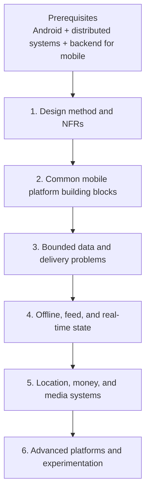

# Mobile System Design

## Purpose

This tree teaches a repeatable design method, the reusable mobile platforms that complete systems depend on, and worked problems that exercise the method under different constraints.

## Why It Matters

Design is a Staff-level leverage point. Good mobile design turns a vague prompt into requirements, estimates, APIs, state, architecture, failure recovery, observability, security, compatibility, and rollout—while respecting that installed clients cannot be rolled back like servers.

## What This Folder Helps You Do

- Run a mobile system-design interview or architecture review with a repeatable structure.
- Recognize mobile-specific constraints: lifecycle, offline behavior, battery, storage, app versions, permissions, and device variance.
- Design reusable platforms and SDKs for authentication, analytics, telemetry, flags, experiments, deep links, notifications, and startup.
- Practice complete systems including sync, feeds, chat, payments, location, media, search, and collaboration.

## Guided Reading Sequence

Prerequisites: the Android core through concurrency/data/networking, plus [Distributed Systems](distributed-systems.md) through delivery semantics and [Backend for Mobile](backend-for-mobile.md). Read each phase top to bottom; later problems assume earlier mechanisms.

The path starts with a repeatable design method, then introduces reusable mechanisms before combining them in stateful, regulated, and organization-scale systems. Each later phase assumes the contracts and failure vocabulary established earlier.

### Phase 1 — The design method and non-functional requirements

1. [Design Framework](mobile-system-design/design-framework.md) — requirements → estimation → API/data → architecture → deep dive.
2. [Non-Functional Requirements](mobile-system-design/non-functional-requirements.md)
3. [Performance](mobile-system-design/performance.md)
4. [Accessibility](mobile-system-design/accessibility.md)
5. [Localization & Internationalization](mobile-system-design/localization-and-internationalization.md)
6. [Security & Privacy](mobile-system-design/security-and-privacy.md)
7. [Versioning & Backward Compatibility](mobile-system-design/versioning-and-backward-compatibility.md)

**Checkpoint:** take an unfamiliar prompt and produce scoped requirements, measurable NFRs, rough estimates, API boundaries, failure modes, and rollout questions before selecting libraries.

### Phase 2 — Common mobile platform building blocks

1. [App Startup](mobile-system-design/app-startup.md)
2. [Authentication](mobile-system-design/authentication.md)
3. [Deep Links & Universal Links](mobile-system-design/deep-links-and-universal-links.md)
4. [Push Notifications](mobile-system-design/push-notifications.md)
5. [Feature Flags & Remote Config](mobile-system-design/feature-flags-and-remote-config.md)
6. [Telemetry SDK](mobile-system-design/telemetry-sdk.md)
7. [Analytics SDK](mobile-system-design/analytics-sdk.md)

**Checkpoint:** define initialization order, identity/session ownership, routing, remote control, event contracts, privacy, and offline buffering for a mobile platform layer.

### Phase 3 — Bounded data and delivery problems

1. [Image Loading](mobile-system-design/image-loading.md)
2. [File Downloader](mobile-system-design/file-downloader.md)
3. [Caching Library](mobile-system-design/caching-library.md)
4. [Pagination](mobile-system-design/pagination.md)
5. [Typeahead / Autocomplete Search](mobile-system-design/typeahead-autocomplete-search.md)
6. [Search](mobile-system-design/search.md)
7. [Notification System](mobile-system-design/notification-system.md)

**Checkpoint:** explain cache keys, freshness, cancellation, deduplication, pagination consistency, resumability, delivery semantics, and resource limits.

### Phase 4 — Offline, feed, and real-time state

1. [Offline Sync](mobile-system-design/offline-sync.md)
2. [News Feed](mobile-system-design/news-feed.md)
3. [Chat / Messaging](mobile-system-design/chat-messaging.md)
4. [Collaborative Editing](mobile-system-design/collaborative-editing.md)

**Checkpoint:** specify the source of truth, outbox/idempotency contract, conflict policy, ordering, reconnection, and user-visible convergence behavior.

### Phase 5 — Location, money, and media systems

1. [Google Maps / Location System](mobile-system-design/google-maps-location-system.md)
2. [Ride-Hailing](mobile-system-design/ride-hailing.md)
3. [Payment Flow](mobile-system-design/payment-flow.md)
4. [Play Billing: IAP & Subscriptions](mobile-system-design/play-billing-and-subscriptions.md)
5. [Stock Trading App](mobile-system-design/stock-trading-app.md)
6. [YouTube / Video Streaming](mobile-system-design/youtube-video-streaming.md)

**Checkpoint:** handle stale location, trip/order state, double-submit prevention, entitlement truth, market-data timeliness, playback QoE, and regulatory/security boundaries.

### Phase 6 — Advanced platform and experimentation design

1. [A/B Testing Infrastructure](mobile-system-design/a-b-testing-infrastructure.md)
2. [Experimentation Platform](mobile-system-design/experimentation-platform.md)
3. [Server-Driven UI](mobile-system-design/server-driven-ui.md)
4. [On-Device AI](mobile-system-design/on-device-ai.md)

**Checkpoint:** define assignment consistency, metrics and guardrails, unknown-schema fallback, model/device capability, privacy, rollback, and organizational ownership.

## Required Shape of Every Design

Every worked design should cover functional and non-functional requirements, estimates, APIs, data/state, architecture, failure modes, observability, security/privacy, compatibility, and rollout.

Lifecycle, background work, battery, threading, storage, and memory mechanics remain canonically owned by [Android](android.md). Release synthesis belongs in [Release Engineering](release-engineering.md).

## Continue the Complete Curriculum

Read [Reference Architectures](reference-architectures.md) next to see component decisions assembled into full product blueprints. Then continue to [Observability](observability.md), [Release Engineering](release-engineering.md), and [Security](security.md).
