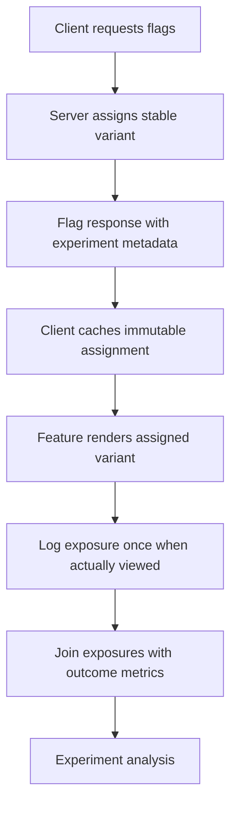
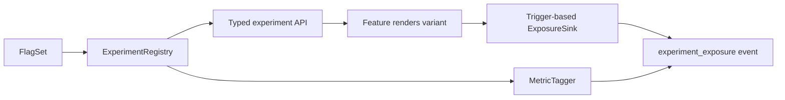

# A/B Testing Infrastructure

> A 45-60 minute mobile system-design walkthrough for the *mobile client side* of an A/B testing system: variant assignment, exposure logging, metric capture, statistical pitfalls to avoid on mobile. Built on top of flags (`feature-flags-and-remote-config.md`); a richer platform is the next file (`experimentation-platform.md`).

---

## 1. Gathering Requirements (~5 min)

> **Interviewer:** "Design A/B testing infrastructure for an Android app."
> **Candidate:** "The interesting client problems are: consistent variant assignment per user, exposure logging that powers the analysis, and capturing the right metrics with the right context. I'll deep-dive assignment + exposure."

### Functional Requirements
- **Assign each user to a variant** (control, A, B...) for each experiment.
- **Stable assignment** — same user, same variant, across sessions.
- **Trigger-based exposure logging** — fire when the user actually sees the variant.
- **Metric tagging** — link analytics events to experiments.
- **Holdouts** — opt-out a slice of users from all experiments.

### Non-Functional Requirements
- **Consistent across devices** for the same user.
- **No PII leakage** in assignment or exposure.
- **Doesn't slow startup**.
- **Survives offline** — defaults to control if unknown.
- **Auditable** — exposure events form the truth for analysis.

### Out of Scope
- Statistical analysis (server / dashboard team)
- Multi-armed bandits (see `experimentation-platform.md`)
- Server-side experiment definition UI
- Interleaving / ranking experiments (specialist)
- Power calculation tools

---

## 2. Clarifying Questions (~3 min)

| Question | Why it matters |
|---|---|
| Server-evaluated or client-evaluated? | Network round-trip vs cold-start latency |
| Sticky bucketing scope (user, device, session)? | Assignment policy |
| Hold-out group needed? | Always-control slice |
| Concurrent experiments per user? | Layer / namespace design |
| Sample-ratio mismatch (SRM) detection? | Analysis side, but client must log accurately |
| Cross-platform parity? | Same user on iOS sees same variant |
| Min sample size considerations? | Affects rollout speed but not architecture |

> **Candidate:** "Server-evaluated primary, sticky by user id, 5% holdout, layered experiments, cross-platform parity, no SRM detection client-side (server does it)."

---

## 3. High-Level Diagram (~10 min)



Assignment, exposure, and outcome are distinct events: analysis is valid only when a stable assignment is joined to an exposure that actually occurred and a metric defined before the experiment.

**Components:**
- **`ExperimentRegistry`** — typed accessors per experiment.
- **`ExposureSink`** — debounced per-session logger.
- **`MetricTagger`** — adds active experiments to every analytics event.
- **Holdout status** — returned by the server; keeps a deterministic slice out of all experiments.

---

## 4. API Contract

### Flag response (variant-aware)

```json
GET /v1/flags?...
{
  "killedExperiments": ["exp_old_banner_v1"],   // read live; overrides any pinned assignment
  "flags": {
    "ab_checkout_color": { "type": "variant", "value": "B",
                            "experimentId": "exp_checkout_color_v3",
                            "configVersion": 4,
                            "isInExperiment": true, "isHoldout": false }
  }
}
```

### Exposure event (sent through analytics SDK)

```json
{
  "event": "experiment_exposure",
  "experimentId": "exp_checkout_color_v3",
  "variant": "B",
  "configVersion": 4,
  "isInExperiment": true,
  "ts": ...
}
```

### Other analytics events (auto-tagged with active variants)

```json
{
  "event": "purchase_completed",
  "props": { "amount": 4999 },
  "experiments": {
    "exp_checkout_color_v3": "B",
    "exp_button_size_v2": "control"
  }
}
```

---

## 5. Mobile App Architecture

### Module structure

```
:lib:experiments
    experiments-api     ← Experiment, Variant, typed accessors
    experiments-core    ← ExposureSink, MetricTagger, assignment snapshot
:lib:flags              ← (dependency)
:lib:analytics          ← (dependency, for event piping)
```

### Layered diagram



The typed registry prevents raw-key drift, and trigger-based exposure logging avoids counting users who were assigned but never reached the experiment surface.

### Key class signatures

```kotlin
open class Experiment<T : Variant>(
    val id: String,
    val flagKey: String,
    val default: T,
    private val variants: List<T>,
) {
    val evaluation: StateFlow<Evaluation<T>>          // identity, assignment and kill switch; no side effects
    fun recordExposure(evaluation: Evaluation<T>)     // call where the arms first differ
}

object Experiments {
    val checkoutColor = variantExperiment(
        id = "exp_checkout_color_v3",
        flagKey = "ab_checkout_color",
        default = CheckoutColor.Control,
        values = CheckoutColor.entries
    )
}

class ExposureSink {
    fun log(assignment: Assignment, sessionId: String)
}
```

---

## 6. Local Storage

Flag values come from `feature-flags-and-remote-config.md`'s DataStore snapshot. Experiments add one small store: an assignment snapshot per `evaluationId`. A background flag refresh updates it only for new experiments, so an ordinary allocation change can't move a user who is already in one. A kill switch is the exception: it's read live and overrides the snapshot, which stays stored for analysis.

For exposure deduplication within a session:

```kotlin
class SessionExposureCache {
    private val emitted = ConcurrentHashMap.newKeySet<String>()
    fun shouldEmit(evaluationId: String, experimentId: String, variant: String, sessionId: String): Boolean =
        emitted.add("$evaluationId|$experimentId|$variant|$sessionId")
}
```

In-memory only — sessions are short-lived.

---

## 7. Deep Dive: Assignment + Exposure (~15 min)

> *I'd pick this as the deep dive because correct assignment + correct exposure is what makes the experiment trustworthy. Get either wrong and the analysis is garbage even if the math is fine.*

### Assignment

Assignment happens server-side (in `/v1/flags` response), and the response says whether the user is enrolled. The client just consumes it. A missing assignment isn't an error to repair: the server may have omitted it because the user is ineligible or the experiment is off. So the safe result is control, outside the experiment, with no exposure.

```kotlin
data class Assignment(
    val experimentId: String, val variant: String,
    val isInExperiment: Boolean, val isHoldout: Boolean,
    val configVersion: Int,
    val evaluationId: String,    // the user or anonymous ID this was assigned to
)

sealed interface Evaluation<out T>
object Loading : Evaluation<Nothing>                                   // this identity's snapshot isn't read yet
data class Enrolled<T>(val variant: T, val assignment: Assignment) : Evaluation<T>
data class NotEnrolled<T>(val variant: T) : Evaluation<T>              // a real answer: holdout, ineligible, killed or offline
```

Client-side bucketing is only valid if the client holds the same complete, versioned rules as the server, including eligibility and allocation. This design doesn't ship those, so there is no client fallback bucket.

**Stability has to be stored, not derived.** A hash of `(experimentId, userId)` is stable only while the variant list stays the same. `hash % variants.size` reassigns about two-thirds of users when two variants become three. So an experiment's definition is frozen once it starts. A changed definition is a new experiment version, or the server keeps sticky assignments with a stated migration.

### Holdout

A "holdout" excludes a deterministic slice (e.g., 5%) from all experiments. The server computes it and returns `isHoldout`, so server-side decisions such as ranking respect it too, and the client never has to work it out.

The server hashes a versioned key (`holdout|v3|$userId`), so the same users aren't held out forever. Each version has a planned end date. For holdout users, evaluation returns `NotEnrolled(default)`. They're never logged as in any experiment and their events are never tagged. The holdout exists so the team has a control group for long-term feature stacking effects.

### Evaluation and exposure logging

```kotlin
class ExperimentImpl<T : Variant>(...) {
    // Pure read: safe for prefetch, branching and a composition that never commits.
    // Recomputes when the identity, its stored assignment or the live kill list changes.
    val evaluation: StateFlow<Evaluation<T>> =
        combine(identity.evaluationId, assignments.snapshot, flags.killedExperiments) { evaluationId, snapshot, killed ->
            val a = snapshot?.takeIf { it.evaluationId == evaluationId }?.pinned?.get(flagKey)
            when {
                snapshot?.evaluationId != evaluationId -> Loading    // includes just after an account switch
                killed == null -> Loading                            // kill list not read yet
                id !in killed && a != null && a.isInExperiment && !a.isHoldout -> Enrolled(pickVariant(a), a)
                else -> NotEnrolled(default)
            }
        }.stateIn(appScope, SharingStarted.Eagerly, Loading)

    // Call where the experience first differs between arms, including for control.
    fun recordExposure(evaluation: Evaluation<T>) {
        if (evaluation is Enrolled) exposureSink.log(evaluation.assignment, sessionId())
    }
}

@Composable
fun CheckoutButton(experiment: ExperimentImpl<CheckoutColor>) {
    val evaluation by experiment.evaluation.collectAsStateWithLifecycle()
    LaunchedEffect(evaluation) { experiment.recordExposure(evaluation) }   // runs only after commit
    when (val e = evaluation) {
        Loading -> PayButtonPlaceholder()    // never show control and then switch
        is Enrolled -> PayButton(color = e.variant.color)
        is NotEnrolled -> PayButton(color = e.variant.color)
    }
}

class ExposureSink @Inject constructor(
    private val analytics: AnalyticsClient,
    private val cache: SessionExposureCache,
) {
    fun log(a: Assignment, sessionId: String) {
        if (!cache.shouldEmit(a.evaluationId, a.experimentId, a.variant, sessionId)) return
        analytics.track(AnalyticsEvent(
            name = "experiment_exposure",
            properties = mapOf(
                "experimentId" to a.experimentId,
                "variant" to a.variant,
                "configVersion" to a.configVersion,
                "isInExperiment" to true
            ),
            category = Category.PRODUCT    // same consent as the outcomes it's joined to
        ))
    }
}
```

The screen observes one immutable evaluation, so what it renders and what it logs always match. A login, a late first assignment or a kill switch updates both. `Loading` is separate from `NotEnrolled` because they mean different things: treating a slow local read as "not enrolled" would show an enrolled user control, unlogged, before switching to treatment. The read is a small local file, so the wait is brief; a surface that can't wait reads the snapshot before its first frame. A killed experiment renders the default and logs no more treatment exposures. The stored assignment stays, so analysis can stop at the kill time.

> **Why at the trigger, not on read?** A read may be for prefetch or a branch the user never sees, and a Compose composition can be abandoned. If the user never sees the variant (e.g., the experiment is on a screen they never visit), they shouldn't count as exposed. Control logs at the same point, so both arms are counted by the same rule; if a trigger needs a treatment-only condition, control logs the counterfactual: whether it would have seen the change.

> **Consent and loss.** Exposure uses the same consent category as the outcomes, because if diagnostic consent or overflow trimming removed exposures but kept purchases, loss would correlate with usage and bias results. Whether experiments may run on users without product consent is an explicit decision, and those users are left out of both sides. Treat a lost exposure as data loss to measure, not as correct exclusion.

### Metric tagging

Events can carry active variants for debugging:

```kotlin
class ExperimentMetricInterceptor @Inject constructor(
    private val activeExperiments: () -> Map<String, String>
) : EventInterceptor {
    override suspend fun intercept(event: AnalyticsEvent, ctx: EventContext): AnalyticsEvent {
        return event.copy(
            properties = event.properties + mapOf("experiments" to activeExperiments())
        )
    }
}
```

`activeExperiments()` returns `Map<experimentId, variant>` for experiments the user has been exposed to in the current session.

> **Note:** tags are not the analysis join. A user who sees the variant on Monday and buys on Tuesday without revisiting that screen has an untagged purchase. Analysis joins outcomes on the server by user and first exposure time, and keeps events from the first exposure onward. Holdout users are never tagged.

### Layered experiments

To run many concurrent experiments, group them into "layers". Within a layer, each user gets at most one experiment (mutually exclusive). Across layers, assignments are independent, but effects can still interact, so overlapping surfaces need review.

The server hashes users into a fixed number of buckets and allocates ranges to experiments, so a new experiment takes free buckets and moves nobody. `hash % experiments.size` can't do this: going from four experiments to five would move about four-fifths of users mid-flight.

```kotlin
// Server side
fun layerBucket(layerId: String, userId: String): Int =
    Hashing.sha256().hashString("layer|$layerId|$userId", Charsets.UTF_8).asLong().mod(1_000L).toInt()

data class LayerAllocation(val experimentId: String, val buckets: IntRange)   // frozen while it runs
```

The client doesn't evaluate layers. It reads the result in the assignment.

### Failure modes

| What breaks | Behavior |
|---|---|
| Server didn't include variant | Control, not enrolled, no exposure |
| User in holdout | Always control; no exposure; no tags |
| `userId` not yet known (pre-login) | Assign to `anonId`. At login, the server keeps an already-exposed assignment for that experiment, or the analysis excludes the crossover. Either way, the choice is stated up front |
| Two experiments contradict | Same layer, so they're mutually exclusive; document the interaction |
| User saw the variant but the exposure was lost | Biased data, not correct exclusion. Measure delivery loss and watch SRM |
| Getter read but variant never shown | No exposure, because reads don't log |
| Variant changes between sessions | Stored snapshot and frozen definitions prevent it |
| Treatment is harmful | Live kill list overrides the snapshot; the UI switches to the default on the next flag update |

---

## 8. Trade-offs

### Assignment site

| Option | Pros | Cons | Verdict |
|---|---|---|---|
| **Server-evaluated** | Central, consistent, can adapt | Network round-trip | Pick this |
| Client-evaluated | Offline-safe | Needs the complete, versioned rules on the client; drift between platforms | Only with a shared rules engine |
| Hybrid (server primary, client fallback) | Works offline for new experiments | Unsafe unless the client has those same rules | Skip here; offline gets control |

### Bucketing key

| Option | Verdict |
|---|---|
| **User id (sticky cross-device)** | Pick — cross-platform parity |
| Device id | Bad — users switch devices |
| Anon id (pre-login) | Pick for unauthenticated state; migrate on login |
| Session id | Bad — flips every session |

### Exposure model

| Option | Pros | Cons | Verdict |
|---|---|---|---|
| **At the trigger point** | Accurate "was exposed" set for both arms | Caller must place it; lint or a wrapper composable helps | Pick this |
| On every read | Hard to forget | Prefetch, branching and abandoned compositions count as exposure | Skip |
| Eager (log on fetch) | Simpler | Counts users who never saw it | Skip |

### Concurrent experiments

| Option | Verdict |
|---|---|
| **Layered (one experiment per user in a layer)** | Pick — mutually exclusive within a layer; interactions across layers still need review |
| Unlayered (independent buckets) | OK if experiments don't interact |
| Single-experiment-at-a-time | Slow rollout |

### Holdout

| Option | Verdict |
|---|---|
| **5% holdout per layer / global** | Pick — measures aggregate effect of experimentation |
| No holdout | Loses ability to measure cumulative drift |
| 50% holdout | Slows experimentation; sample-size-limited |

---

## 9. Major Concerns

- **Don't break stickiness.** Same user → same variant. If you change the assignment algorithm, you re-randomize everyone and old experiments become invalid.
- **Exposure at the trigger.** Log where the experience first differs, for both arms. Logging on fetch or read inflates exposure counts with users who never saw the variant.
- **Default = control.** When the network fails or the flag is missing, return control. Never return a treatment by accident.
- **Privacy.** No PII in `experimentId` or variant names. They show up in logs and dashboards.
- **Cross-platform parity.** iOS, Android, web should agree for the same user. Server-side evaluation enforces this.
- **Sample ratio mismatch.** The server runs a chi-square test on **unique users** per arm against the configured split. Microsoft uses p < 0.0005 to limit false alarms. Event counts won't do: if treatment increases sessions, per-session exposures look like an SRM. A real cause is a difference between arms, such as treatment crashing before its exposure sends, or a filter that removes more users from one arm. A platform filter that hits both arms equally doesn't cause one. The client must log honestly.
- **Holdout management.** Document who's in the holdout. Don't auto-exclude critical paths (like login).
- **Long-tail experiments.** Decide on a sunset policy. Old experiments stuck in "control vs B" forever pollute every event.
- **Session correctness.** Use `ProcessLifecycleOwner` for session boundaries (not Activity callbacks).

---

## 10. Follow-up Questions

> **Q: How do you handle a user who upgrades the app mid-experiment?**
> Assignment is by user, not app version, so upgrading alone changes nothing. A new variant is a different matter: changing the variant count reshuffles a modulo hash, so it needs a new experiment version, or stored assignments with a defined migration. Old clients that can't render a variant must be excluded by the server.

> **Q: An experiment is wrong and shipping bad behavior — how to kill it?**
> Add it to `killedExperiments`. Clients apply it on their next flag update with a live-apply policy, and it overrides pinned assignments, so enrolled users stop seeing the treatment too. Simply changing the flag's value wouldn't reach them, by design. Keep stored assignments for analysis, and stop the analysis at the kill time. An offline client keeps its last-known list until it reconnects.

> **Q: How do you avoid "experiment fatigue" in analytics?**
> Auto-tagging adds only *active* experiments to events (those the user was exposed to). Experiments cleaned up after launch removed from active set automatically.

> **Q: How do you debug "why am I in variant B"?**
> Debug overlay shows: `userId`, all active experiments + variants, holdout status, source (server / fallback / default). Optionally a developer override.

> **Q: How is the assignment algorithm tested?**
> Property-based tests: same `(experimentId, userId)` → same variant 100% of the time. Different `userId`s → balanced distribution, using fixed seeds so a 5% chi-square check doesn't fail one run in twenty by chance. Also test that adding a layer allocation moves nobody in a running experiment.

> **Q: How do you measure exposure events themselves are trustworthy?**
> Compare unique exposed users per arm to the expected split (SRM), and watch per-arm delivery loss: assignments served against exposures received. Exposure counts far above flag fetches are normal, since a cached assignment serves many sessions.

---

## 11. Out of Scope (defended)

- **Statistical analysis** — server / data team.
- **Multi-armed bandits** — see `experimentation-platform.md`.
- **Server admin UI** — non-mobile.
- **Power calculation** — separate tooling.
- **Reverse experiments / sequential analysis** — analysis-side methodology.

---

## 12. Further Reading

- [GrowthBook documentation](https://docs.growthbook.io/) — open-source experimentation implementation reference.
- [Statsig documentation](https://docs.statsig.com/welcome) — current experimentation and feature-gating entry point.
- [Microsoft — Diagnosing sample ratio mismatch](https://www.microsoft.com/en-us/research/articles/diagnosing-sample-ratio-mismatch-in-a-b-testing/) — what SRM tests and what causes it.
- [Microsoft — Post-experiment patterns](https://www.microsoft.com/en-us/research/articles/patterns-of-trustworthy-experimentation-post-experiment-stage/) — triggered analysis and counterfactual logging.
- [Google — Overlapping Experiment Infrastructure](https://research.google/pubs/overlapping-experiment-infrastructure-more-better-faster-experimentation/) — layers and fixed buckets.
- [GrowthBook — Sticky bucketing](https://docs.growthbook.io/app/sticky-bucketing) — what moves users, and how to prevent it.

---

> **Closing in the interview:** "I anchored on assignment + exposure because that's the contract with the analyst. Happy to dig into layered experiments, sample-ratio detection, or how holdouts interact with launches next."
