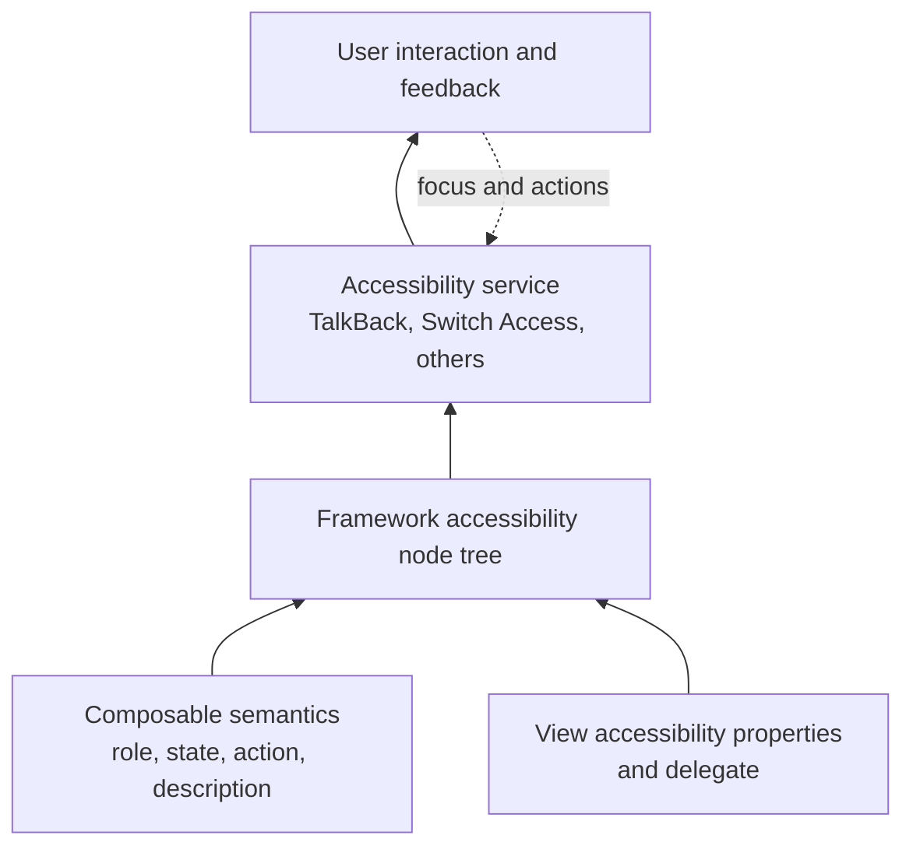

# Accessibility (a11y) for Android

> A 45-60 minute mobile system-design walkthrough for the accessibility posture of an Android app: TalkBack semantics, touch targets, text scaling, color contrast, motion reduction. Less of an "interview problem" and more of a horizontal concern that's tested in any of the other files.

---

## 1. Gathering Requirements (~5 min)

> **Interviewer:** "Walk me through how you'd make this app accessible."
> **Candidate:** "Accessibility has three axes: sensory (screen reader, contrast), motor (touch targets, focus), and cognitive (clear copy, predictable nav). I'll cover all three with checkpoints, then deep-dive Compose semantics + TalkBack."

### Functional Requirements (what to support)
- **Screen reader** (TalkBack) — every interactive element has a meaningful label.
- **Large text** — UI doesn't break at 200% font scale.
- **High contrast** — text passes WCAG AA 4.5:1.
- **Touch targets** ≥ 48 dp.
- **Reduce motion** — animations honour the system setting.
- **Captions** for media.

### Non-Functional Requirements
- **No regression** — a11y tested in CI.
- **Compliant** with WCAG 2.2 AA where reasonable.
- **Localized** — labels translate.
- **Inclusive** — designed with disabled users, not for them.

### Out of Scope
- Switch / external input devices (specialist)
- Braille displays (handled by TalkBack)
- AT/Voice Access deep customisation
- Legal compliance audits (separate)
- Hearing aid integration (system-level)

---

## 2. Clarifying Questions (~3 min)

| Question | Why it matters |
|---|---|
| Compose-first or View-first? | API surface (`Modifier.semantics` vs `contentDescription`) |
| Target WCAG level (A / AA / AAA)? | Contrast + text-resize standards |
| Markets with strong a11y laws (US, EU)? | Legal exposure |
| Audio/video content frequency? | Caption strategy |
| Custom views in use? | Manual `AccessibilityDelegate` |
| Animation-heavy product? | Reduce motion integration |
| Localized to RTL languages? | TalkBack reading order verification |

> **Candidate:** "Compose-first, WCAG AA target, US/EU markets, mix of static + media content, no custom canvas views, reduce-motion respected, en/es/ar/he locales."

---

## 3. The a11y Stack on Android



The service does not infer product meaning from pixels: Views and composables must expose accurate roles, state, descriptions, and actions through the framework semantics tree.

Validated against: [Principles for improving app accessibility](https://developer.android.com/guide/topics/ui/accessibility/principles).

---

## 4. Compose Semantics

```kotlin
// Good
Icon(
    imageVector = Icons.Default.Favorite,
    contentDescription = "Like this post",   // not "heart icon"
    modifier = Modifier.size(48.dp).clickable { onLike() }
)

// Better: combine semantics
Row(
    modifier = Modifier
        .semantics(mergeDescendants = true) {
            contentDescription = "Sam, 4 minutes ago. Has 3 unread messages."
            role = Role.Button
        }
        .clickable { openChat() }
) {
    Avatar(user = sam)
    Column { Text(sam.name); Text("4 min ago") }
    UnreadBadge(count = 3)
}
```

`mergeDescendants = true` collapses children into one announcement — TalkBack speaks the row as one element, not five.

---

## 5. Touch Targets

```kotlin
IconButton(onClick = { ... }, modifier = Modifier.size(48.dp)) {
    Icon(Icons.Default.MoreVert, contentDescription = "More options")
}
```

`IconButton` defaults to 48 dp touch target even if the icon is 24 dp. Don't override smaller.

For dense lists (e.g., chat input toolbar), use `Modifier.minimumInteractiveComponentSize()`.

---

## 6. Text Scaling

```kotlin
// Use sp for text, dp for everything else
Text("Hello", style = TextStyle(fontSize = 16.sp))    // scales with system

// Test at 200% font scale
// adb shell settings put system font_scale 2.0
```

Layouts must handle:
- Wrapping (don't truncate)
- Larger button heights
- Multi-line headings

`SubcomposeLayout` and `BoxWithConstraints` let layouts adapt to actual measured size.

---

## 7. Color Contrast

| Foreground / Background | Min ratio (WCAG AA) |
|---|---|
| Body text on background | 4.5 : 1 |
| Large text (18 pt+) on background | 3 : 1 |
| Icons + UI components | 3 : 1 |

Tools: **Accessibility Scanner** (Android), **Stark** (Figma), **WebAIM contrast checker**.

Design tokens enforce contrast:

```kotlin
object AppTheme {
    val Colors = ColorScheme(
        primary = Color(0xFF1A56DB),         // 7.1:1 on white
        onPrimary = Color.White,
        background = Color.White,
        onBackground = Color(0xFF111827),    // 16.9:1 on white
        // ...
    )
}
```

---

## 8. Motion & Animation

```kotlin
val reduceMotion = LocalAccessibilityManager.current.isReduceMotionEnabled

AnimatedVisibility(
    visible = expanded,
    enter = if (reduceMotion) EnterTransition.None else slideInVertically(),
    exit  = if (reduceMotion) ExitTransition.None else slideOutVertically(),
) { ... }
```

Audit:
- Spring/decay animations have no skip
- Auto-playing video has pause
- Parallax / flash effects respect reduce-motion

---

## 9. Forms

```kotlin
TextField(
    value = email, onValueChange = { email = it },
    label = { Text("Email") },                  // associates label
    isError = emailError != null,
    supportingText = { emailError?.let { Text(it) } },
    modifier = Modifier.semantics {
        if (emailError != null) error(emailError)
    }
)
```

TalkBack announces: "Email, edit box, [content], error: must be a valid email."

---

## 10. Media Captions

```kotlin
val player = remember { ExoPlayer.Builder(context).build() }
val mediaItem = MediaItem.Builder()
    .setUri(videoUri)
    .setSubtitleConfigurations(listOf(
        SubtitleConfiguration.Builder(captionsUri)
            .setMimeType(MimeTypes.TEXT_VTT).setLanguage("en")
            .setSelectionFlags(C.SELECTION_FLAG_DEFAULT).build()
    ))
    .build()
```

Honour system caption settings: font size, color, edge style. Media3 picks these up automatically when subtitle tracks are present.

---

## 11. Testing

### Manual

- Enable TalkBack: Settings → Accessibility → TalkBack.
- Navigate every screen with swipe-right (next element).
- Verify nothing unreachable, nothing un-named.
- Toggle reduce-motion and large text; verify layouts.

### Automated

```kotlin
@Test
fun feedScreen_hasContentDescriptions() {
    composeRule.setContent { FeedScreen() }
    composeRule.onAllNodesWithRole(Role.Button).assertAll(hasContentDescription())
}
```

Espresso has `AccessibilityChecks.enable()` which runs checks on every interaction. Compose's `composeRule` integrates similarly via `accessibility-test-framework`.

CI gate: Accessibility Scanner via `ATF` (Accessibility Test Framework).

---

## 12. Cross-Cutting Patterns

### Headings + landmarks

```kotlin
Text("Recent activity", modifier = Modifier.semantics { heading() }, style = ...)
```

TalkBack lets users navigate by heading. Mark them.

### Live regions

```kotlin
Text(unreadCount.toString(),
    modifier = Modifier.semantics { liveRegion = LiveRegionMode.Polite })
```

Announced when value changes without focus moving.

### Custom actions

```kotlin
Modifier.semantics {
    customActions = listOf(
        CustomAccessibilityAction("Delete") { onDelete(); true },
        CustomAccessibilityAction("Archive") { onArchive(); true },
    )
}
```

Replaces swipe-to-delete gestures for screen reader users.

### Container semantics

For a list cell that's clickable, the cell itself owns the click (not nested children). One announce, one action.

---

## 13. Common Misses

| Miss | Fix |
|---|---|
| Icon-only button with no description | Add `contentDescription` |
| Tiny touch target | `Modifier.size(48.dp)` |
| `Image` with `null` description but it's not decorative | Add a real description |
| Tab-order wrong in custom layouts | `Modifier.semantics { traversalIndex }` |
| Color-only error state | Add icon + supporting text |
| Animation that can't be paused | Honour reduce-motion |
| Toast as primary feedback | Use accessible `Snackbar` |
| Custom slider without semantics | `Modifier.semantics { stateDescription = ... }` |
| Form labels not associated | Use `TextField(label = ...)` |
| Tooltip-only labels | Tooltip is fine; label must also exist |

---

## 14. Further Reading

- [Android Developers — Accessibility overview](https://developer.android.com/guide/topics/ui/accessibility) — official.
- [Material Design — Accessibility](https://m3.material.io/foundations/accessible-design) — patterns and tokens.
- [WCAG 2.2 quick reference](https://www.w3.org/WAI/WCAG22/quickref/) — standard.
- [Compose Semantics docs](https://developer.android.com/jetpack/compose/semantics) — Compose-native a11y.
- [Accessibility Scanner](https://play.google.com/store/apps/details?id=com.google.android.apps.accessibility.auditor) — automated audits.

---

> **In short:** a11y is a non-negotiable. Bake into design tokens (contrast), into Compose primitives (semantics), into CI (accessibility checks), and into review (manual TalkBack pass). Every feature in this folder should pass its own a11y pass before shipping.
