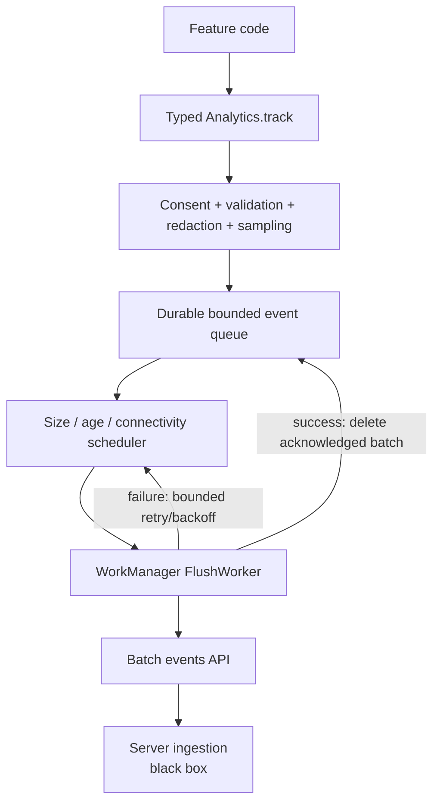
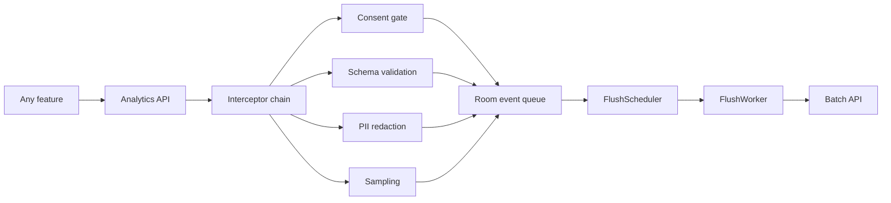

# Analytics SDK (Product Events)

> A 45-60 minute mobile system-design walkthrough for an in-house product-analytics SDK on Android: event API, batching, durable queue, network flush, privacy controls. (Crash/perf telemetry is the next file, `telemetry-sdk.md`.)

---

## 1. Gathering Requirements (~5 min)

> **Interviewer:** "Design an analytics SDK like Mixpanel or in-house."
> **Candidate:** "The architectural problem is durable buffering: events from many features, written to disk fast, batched to the network, never lost on crash. I'll deep-dive the write → buffer → flush pipeline."

### Functional Requirements
- **Track event** with name + properties.
- **User identification** (login, logout, alias).
- **Auto-context**: app version, OS, device, locale.
- **Batched flush** to backend (size + time triggers).
- **Survives process death and offline**.

### Non-Functional Requirements
- **Don't block callers** — `track()` returns in microseconds.
- **Don't lose events** under crash / kill / network loss.
- **Bounded memory + disk** — drop or dedupe at limits.
- **Privacy-aware** — respect consent, no PII leakage.
- **Battery-conscious** — bundle, don't tag every event with a wake.

### Out of Scope
- Crash reporting / performance traces (see `telemetry-sdk.md`)
- Server-side ingestion pipeline (Kafka, Snowflake)
- Real-time dashboards / query layer
- A/B exposure tracking (see `a-b-testing-infrastructure.md`)
- Marketing attribution SDK (Branch, AppsFlyer)

---

## 2. Clarifying Questions (~3 min)

| Question | Why it matters |
|---|---|
| Volume per user per day? | Buffer + batch sizing |
| Synchronous or fire-and-forget API? | API shape |
| Schema enforcement (typed events)? | Codegen vs free-form map |
| Consent model (GDPR / CCPA)? | Consent gate, event drop rules |
| Multi-tenant (one app, many products)? | Endpoint routing |
| Real-time or near-real-time? | Flush cadence |
| Android API floor? | `WorkManager` features |

> **Candidate:** "1-5K events/user/day, fire-and-forget, typed events via codegen, GDPR opt-in for marketing events only, single tenant, near-real-time (~30s flush), Android 9+."

---

## 3. High-Level Diagram (~10 min)



Analytics is a durable, privacy-gated delivery pipeline: feature code emits typed intent, policy determines whether data may enter the queue, and only acknowledged batches are deleted.

**Components:**
- **`Analytics`** — public facade.
- **`EventInterceptor`** — sampling, consent gate, PII redaction.
- **`EventQueue`** — Room-backed durable buffer.
- **`FlushScheduler`** — decides when to enqueue work.
- **`FlushWorker`** — `@HiltWorker` that POSTs batches.

---

## 4. API Contract

### Public API

```kotlin
object Analytics {
    fun init(context: Context, config: AnalyticsConfig)
    fun track(event: AnalyticsEvent)
    fun identify(userId: String, traits: Map<String, Any> = emptyMap())
    fun alias(newId: String, previousId: String)
    fun reset()                          // signs out
    fun setConsent(consent: Consent)
    fun flush()                          // forces immediate flush
}

data class AnalyticsEvent(
    val name: String,
    val properties: Map<String, Any> = emptyMap(),
    val category: Category = Category.PRODUCT,
)

enum class Category { PRODUCT, MARKETING, DIAGNOSTIC }

data class Consent(val product: Boolean, val marketing: Boolean, val diagnostic: Boolean)
```

### Wire format (server)

```json
POST /v1/events
{
  "events": [
    { "name": "screen_view", "props": {"screen": "home"},
      "context": {"appVer": "4.12.1", "os": "Android 14", "device": "Pixel 7"},
      "userId": "u_42", "anonId": "a_abc", "ts": 1750000000123,
      "sessionId": "s_111", "category": "product" }
  ],
  "sentAt": 1750000005000
}
```

---

## 5. Mobile App Architecture

### Module structure

```
:lib:analytics
    analytics-api          ← Analytics, AnalyticsEvent, Consent
    analytics-core         ← interceptor, queue, scheduler, worker
    analytics-codegen      ← optional: KSP to generate typed events
```

### Layered diagram



Feature modules depend on a small typed API; the SDK centralizes governance and delivery so consent, schema, privacy, and retry behavior cannot drift independently across teams.

### Key class signatures

```kotlin
internal interface EventInterceptor {
    suspend fun intercept(event: AnalyticsEvent, context: EventContext): AnalyticsEvent?  // null = drop
}

internal class EventQueue @Inject constructor(private val dao: EventDao) {
    suspend fun enqueue(event: EventEntity)
    suspend fun takeBatch(limit: Int = 100): List<EventEntity>
    suspend fun delete(ids: List<Long>)
    suspend fun count(): Int
    suspend fun trimIfOverBudget(max: Int = 20_000)
}
```

---

## 6. Local Storage

```kotlin
@Entity(tableName = "events", indices = [Index("ts")])
data class EventEntity(
    @PrimaryKey(autoGenerate = true) val id: Long = 0,
    val name: String, val propertiesJson: String,
    val contextJson: String, val category: Int,
    val userId: String?, val anonId: String,
    val sessionId: String, val ts: Long
)
```

> **Probing Q:** "Why Room and not just files?" Room gives us atomic transactions for batch take/delete (essential to avoid duplicate sends after worker restart). Files would mean inventing locking.

---

## 7. Deep Dive: Write → Buffer → Flush (~15 min)

> *I'd pick this as the deep dive because durability under crashes is the core promise. Get the buffer wrong and you lose data; get the flush wrong and you spam the server.*

### `track()` — fire and forget

```kotlin
object Analytics {
    private lateinit var queue: EventQueue
    private lateinit var interceptors: List<EventInterceptor>
    private lateinit var scope: CoroutineScope

    fun track(event: AnalyticsEvent) {
        scope.launch {
            val ctx = currentEventContext()
            var processed: AnalyticsEvent? = event
            for (i in interceptors) {
                processed = i.intercept(processed!!, ctx) ?: return@launch
            }
            queue.enqueue(processed.toEntity(ctx))
            scheduler.onEventEnqueued()
        }
    }
}
```

`scope` is a `SupervisorJob` + `Dispatchers.IO`. The caller's coroutine is never blocked.

### Interceptors

```kotlin
class ConsentInterceptor(private val consentSource: () -> Consent) : EventInterceptor {
    override suspend fun intercept(event: AnalyticsEvent, ctx: EventContext): AnalyticsEvent? {
        val c = consentSource()
        return when (event.category) {
            Category.MARKETING -> if (c.marketing) event else null
            Category.PRODUCT -> if (c.product) event else null
            Category.DIAGNOSTIC -> if (c.diagnostic) event else null
        }
    }
}

class PiiRedactionInterceptor : EventInterceptor {
    private val sensitiveKeys = setOf("email", "phone", "ssn", "cardNumber")
    override suspend fun intercept(event: AnalyticsEvent, ctx: EventContext): AnalyticsEvent =
        event.copy(properties = event.properties.mapValues { (k, v) ->
            if (k.lowercase() in sensitiveKeys) "<redacted>" else v
        })
}

class SamplingInterceptor(private val rate: Float = 1.0f) : EventInterceptor {
    override suspend fun intercept(event: AnalyticsEvent, ctx: EventContext): AnalyticsEvent? =
        if (Random.nextFloat() < rate) event else null
}
```

### Scheduler

```kotlin
class FlushScheduler @Inject constructor(
    private val workManager: WorkManager,
    private val queue: EventQueue,
) {
    private val pendingFlush = MutableStateFlow(false)

    suspend fun onEventEnqueued() {
        val count = queue.count()
        if (count >= BATCH_THRESHOLD || ageOldestSeconds() > MAX_AGE) {
            triggerFlushNow()
        } else if (!pendingFlush.value) {
            schedulePeriodicFlush()
        }
        if (count > MAX_QUEUE) queue.trimIfOverBudget()
    }

    private fun triggerFlushNow() {
        workManager.enqueueUniqueWork(
            "analytics-flush", ExistingWorkPolicy.KEEP,
            OneTimeWorkRequestBuilder<FlushWorker>()
                .setConstraints(Constraints.Builder().setRequiredNetworkType(NetworkType.CONNECTED).build())
                .setExpedited(OutOfQuotaPolicy.RUN_AS_NON_EXPEDITED_WORK_REQUEST)
                .build()
        )
    }
}
```

### Worker

```kotlin
@HiltWorker
class FlushWorker @AssistedInject constructor(
    @Assisted ctx: Context, @Assisted params: WorkerParameters,
    private val queue: EventQueue,
    private val api: AnalyticsApi,
) : CoroutineWorker(ctx, params) {

    override suspend fun doWork(): Result {
        val batch = queue.takeBatch(limit = BATCH_SIZE)
        if (batch.isEmpty()) return Result.success()
        return try {
            api.upload(EventBatch(events = batch.toWire(), sentAt = clock.now()))
            queue.delete(batch.map { it.id })
            if (queue.count() > 0) Result.success().also { triggerFollowUp() } else Result.success()
        } catch (t: IOException) {
            Result.retry()         // network error
        } catch (t: HttpException) {
            if (t.code() in 400..499) {
                queue.delete(batch.map { it.id })   // drop bad events; don't loop
                Result.success()
            } else Result.retry()
        }
    }
}
```

### At-least-once semantics

If the worker uploads, then dies before deleting, the events get re-sent on retry. Server dedupes via `(anonId, sessionId, ts, name)` or a client-generated event UUID. We accept this tradeoff: at-least-once is easier than exactly-once and the server-side dedup is straightforward.

### Bounded queue

```kotlin
suspend fun trimIfOverBudget(max: Int) {
    val excess = count() - max
    if (excess > 0) {
        // Drop oldest *low-priority* (DIAGNOSTIC) first
        dao.deleteOldestByCategory(Category.DIAGNOSTIC.ordinal, excess)
        // If still over, drop oldest PRODUCT
        // Never drop MARKETING (often paid attribution)
    }
}
```

### Session lifecycle

A "session" begins when the app opens and ends after 30s of background. `sessionId` regenerates on a new session. Session start/end events are auto-emitted.

```kotlin
class SessionTracker(private val processLifecycleOwner: ProcessLifecycleOwner) {
    private var sessionId: String? = null
    private var lastBackgroundedAt: Long = 0

    init {
        processLifecycleOwner.lifecycle.addObserver(object : DefaultLifecycleObserver {
            override fun onStart(owner: LifecycleOwner) {
                if (sessionId == null || clock.now() - lastBackgroundedAt > 30_000) {
                    sessionId = UUID.randomUUID().toString()
                    Analytics.track(AnalyticsEvent("session_start"))
                }
            }
            override fun onStop(owner: LifecycleOwner) {
                lastBackgroundedAt = clock.now()
                Analytics.flush()                     // flush before background to ensure delivery
            }
        })
    }
}
```

### Failure modes

| What breaks | Behavior |
|---|---|
| Process killed mid-track | Room write is durable; event survives |
| Network drop during flush | Worker retries; events stay in queue |
| Server returns 400 | Drop batch (won't succeed on retry) |
| Queue grows unbounded (e.g., user offline for weeks) | Trim by category preference |
| Schema mismatch (server rejects field) | Drop offender; log; emit `analytics_schema_error` event |
| Multiple workers race | `enqueueUniqueWork` with KEEP prevents concurrent flushes |

---

## 8. Trade-offs

### Buffer

| Option | Pros | Cons | Verdict |
|---|---|---|---|
| **Room queue** | Durable, transactional, queryable | Slightly heavier than files | Pick this |
| File-per-event | Simple | No atomic batch take/delete | Skip |
| In-memory only | Fast | Loses on crash | Skip |
| MMKV / shared prefs | Fast key-value | Not queue-shaped | Skip |

### Flush trigger

| Trigger | When |
|---|---|
| **Batch size ≥ 100** | High activity |
| **Oldest event age > 30 s** | Slow activity |
| **App backgrounded** | Capture session end |
| **Manual `flush()`** | After critical events |
| **Periodic 30 min fallback** | Stuck queue |

### Sampling

| Option | Verdict |
|---|---|
| **Per-event rate** | Pick — flexible |
| Per-user rate (1% of users get full) | Use for high-cost events |
| Server-side downsampling | Wastes mobile bandwidth |

### Schema enforcement

| Option | Verdict |
|---|---|
| **Codegen typed events** (KSP) | Pick — compile-time safety |
| Free-form `Map<String, Any>` | Easy but error-prone |
| Server-side validation only | Bad: events drop silently |

### Privacy

| Option | Pick |
|---|---|
| Consent gate per category | Yes |
| PII redaction interceptor | Yes |
| Local opt-out flag | Yes |
| User can delete pending events | Yes (`reset()`) |

---

## 9. Major Concerns

- **Performance.** `track()` returns in microseconds. All work on `Dispatchers.IO`. Never block main.
- **Crash safety.** Room write is atomic. Worst case lose the in-flight (untracked) event.
- **Memory.** Queue size capped; trim oldest on overflow.
- **Battery.** Bundle aggressively. No per-event network call.
- **Privacy.** Consent-gated; PII redacted; user can `reset()` to drop pending + clear identity.
- **Compliance.** Honour `Do Not Track` system signals where relevant. Provide a "delete my data" path that propagates to server.
- **At-least-once.** Server dedup is required; client can't guarantee exactly-once across crashes.
- **Session correctness.** Use `ProcessLifecycleOwner` not Activity callbacks. Activities lie under config change.
- **Testing.** Inject fake `EventQueue`, fake API, fake `Clock`. Assert: enqueue → batch → delete cycle.

---

## 10. Follow-up Questions

> **Q: User signs out — what happens to pending events?**
> `reset()` flushes the queue if online, clears identity, generates new `anonId`. Server links the events to the previous user via `userId` already stamped on each event.

> **Q: What's the largest event payload to allow?**
> Server-defined; typically 32 KB. Client-side, fail-fast on `track()` if properties exceed; drop with a `analytics_oversize_dropped` diagnostic.

> **Q: How is identity stitched across sessions?**
> Each event has both `anonId` (device-scoped) and `userId` (when logged in). Server stitches by `userId` when present; falls back to `anonId` for anonymous activity, which `alias()` reconciles on sign-in.

> **Q: What about debug builds?**
> Don't send to production endpoint. Use a `DebugSink` interceptor that logs instead of enqueueing in debug.

> **Q: How would you handle Flutter / React Native?**
> Expose the same `Analytics` facade through platform channels. The SDK is Kotlin; bridges just adapt the API.

> **Q: How do you keep schemas in sync server-side?**
> Schema registry. Client codegen reads it; server validates against it. Compile-time guarantees on the client.

---

## 11. Out of Scope (defended)

- **Crash / perf telemetry** — see `telemetry-sdk.md`.
- **A/B exposure tracking** — see `a-b-testing-infrastructure.md`.
- **Server ingestion** — Kafka topics, schema registry, warehouse loads.
- **Real-time dashboards** — analytics consumer, not SDK.
- **Marketing attribution** — Branch / AppsFlyer; integrate via interceptor.

---

## 12. Further Reading

- [Segment Analytics Android SDK](https://github.com/segmentio/analytics-kotlin) — open-source reference architecture.
- [Mixpanel Android — design](https://docs.mixpanel.com/docs/tracking/reference/android) — events, identities, sessions.
- [Android Developers — WorkManager](https://developer.android.com/topic/libraries/architecture/workmanager) — expedited + constraints.
- [GDPR for mobile apps](https://gdpr.eu/) — consent management.
- [OpenTelemetry — spans + events](https://opentelemetry.io/) — adjacent: distributed traces.

---

> **Closing in the interview:** "I anchored on the durable buffer + flush pipeline because it's the SDK's core promise. Happy to dig into schema enforcement, the codegen story, or the cross-platform bridge next."
