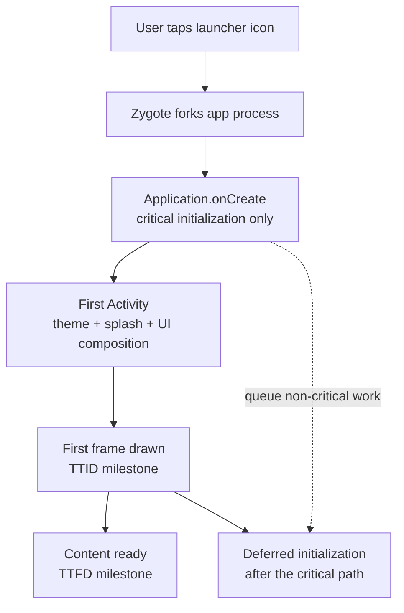

# App Startup (Cold-Start Optimisation)

> A 45-60 minute mobile system-design walkthrough for cold-start optimization on Android: what happens between app icon tap and first interactive frame, where time goes, and how to claw it back.

---

## 1. Gathering Requirements (~5 min)

> **Interviewer:** "How do you keep app cold start fast?"
> **Candidate:** "Start is composed of: process launch → Application.onCreate → first Activity → first frame. I'll map the budgets, walk through the levers, and deep-dive deferred initialization."

### Functional Requirements
- **TTID** (Time To Initial Display) < 1.5s on mid-tier.
- **TTFD** (Time To Full Display) < 2.5s on mid-tier.
- **Deferred work**: non-critical SDKs init after first frame.
- **Splash screen** uses the SplashScreen API (no white flash).
- **Measurable** in production and CI.

### Non-Functional Requirements
- **No regression**: CI gates new init paths.
- **Tier-aware**: budgets relaxed on low-tier.
- **Observable**: real-user telemetry breaks down each phase.
- **Reproducible**: Macrobenchmark in CI.
- **Maintainable**: ownership for each init step.

### Out of Scope
- Hot start / warm start (already fast)
- App size optimisation (separate)
- Memory at cold start (covered in `performance.md`)
- Background work optimisation (`performance.md`)
- iOS launch optimisation

---

## 2. Clarifying Questions (~3 min)

| Question | Why it matters |
|---|---|
| Current TTID/TTFD distribution? | Where to focus |
| Device-tier split? | Where the slow users are |
| What SDKs run in `Application.onCreate`? | Init audit target |
| Splash screen requirements? | Branded vs system |
| Cold start frequency vs warm? | Whether to optimise process boot or just first frame |
| Baseline profiles in place? | Quick win available |
| Multidex needed? | Pre-Android 5 only |

> **Candidate:** "Median cold start currently 2.3s; targeting < 1.5s mid-tier; ~12 SDKs in `Application.onCreate`; branded splash; baseline profile not yet shipped."

---

## 3. High-Level Diagram (~10 min)



Treat startup as a critical path with separate milestones: initialize only what must exist before the first frame, then schedule non-critical work without blocking TTID or content readiness.

Validated against: [App startup time](https://developer.android.com/topic/performance/vitals/launch-time).

**Phases to budget separately:**
- **Cold launch path** (zygote → process start) — minimal control.
- **`Application.onCreate`** — fully in our control.
- **First Activity to first frame** — Theme + Compose / View tree.
- **First frame to interactive** — async data loading.

---

## 4. Budgets

These are example targets for this design, not platform guarantees. Android vitals flags cold starts of 5 s or longer as excessive and measures startup as TTID ([Android vitals startup time](https://developer.android.com/google/play/vitals/launch-time)).

| Phase | Mid-tier budget |
|---|---|
| Process start (Android) | ~150-300 ms |
| `Application.onCreate` | < 300 ms |
| Activity create + first frame | < 400 ms |
| **TTID (launch → first frame)** | **≈ 1.0 s, < 1.5 s at worst** |
| First frame → content ready | < 600 ms |
| **TTFD (launch → fully drawn)** | **< 2.5 s** |

---

## 5. Mobile App Architecture

### `Application.onCreate` discipline

```kotlin
@HiltAndroidApp
class App : Application() {
    @Inject lateinit var crash: Crashlytics
    @Inject lateinit var flags: FlagsRepository
    @Inject @ApplicationScope lateinit var appScope: CoroutineScope

    override fun onCreate() {
        super.onCreate()
        // Critical only — must be done before first frame
        crash.install()
        appScope.launch { flags.bootstrap() } // disk snapshot, then async refresh
        // Manifest-registered App Startup initializers have already run.
    }
}
```

### App Startup for startup dependencies

```xml
<!-- AndroidManifest.xml -->
<provider
    android:name="androidx.startup.InitializationProvider"
    android:authorities="${applicationId}.androidx-startup"
    android:exported="false"
    tools:node="merge">
    <meta-data
        android:name="com.app.analytics.AnalyticsInitializer"
        android:value="androidx.startup" />
</provider>
```

```kotlin
class AnalyticsInitializer : Initializer<Analytics> {
    override fun create(context: Context): Analytics {
        return Analytics.also { it.init(context, AnalyticsConfig(...)) }
    }
    override fun dependencies(): List<Class<out Initializer<*>>> = emptyList()
}
```

Manifest-registered App Startup initializers run during process startup, before `Application.onCreate`. The library consolidates startup providers and orders dependencies; registration alone does not defer or parallelize initialization. To defer analytics, override its merged manifest entry with `tools:node="remove"`, then call `AppInitializer.getInstance(context).initializeComponent(AnalyticsInitializer::class.java)` when needed. Simply deleting an entry from the app manifest does not remove one contributed by a library. See the [App Startup guide](https://developer.android.com/topic/libraries/app-startup).

### Splash screen (SplashScreen API)

```kotlin
class MainActivity : ComponentActivity() {
    override fun onCreate(savedInstanceState: Bundle?) {
        val splash = installSplashScreen()
        super.onCreate(savedInstanceState)
        splash.setKeepOnScreenCondition {
            vm.initState.value == InitState.Pending
        }
        setContent { App() }
    }
}
```

The system splash is drawn during the cold-start window — no white flash, no manual splash Activity.

### First frame to interactive

```kotlin
@Composable
fun FeedScreen(vm: FeedViewModel = hiltViewModel()) {
    val state by vm.state.collectAsStateWithLifecycle()
    when (val s = state) {
        Loading -> FeedSkeleton()       // first paint
        is Ready -> FeedList(s.items)
        is Error -> ErrorState(...)
    }
    ReportDrawnWhen { state is Ready }   // TTFD signal
}
```

`ReportDrawnWhen` (Activity Compose) calls `reportFullyDrawn()` once the condition is true. That defines TTFD for the system log, Perfetto, and Macrobenchmark; Android vitals' startup metric is TTID.

---

## 6. Local Storage

Cold-start telemetry flows through the telemetry SDK as a `cold_start` event with breakdown by phase:

```json
{
  "type": "cold_start",
  "processStartMs": 187,
  "appOnCreateMs": 240,
  "firstActivityMs": 365,
  "firstFrameMs": 612,
  "reportDrawnMs": 1480
}
```

---

## 7. Deep Dive: Deferred Initialization + Baseline Profile (~15 min)

> *I'd pick this as the deep dive because it tests which work really belongs on the cold path and whether a baseline profile improves the paths that remain.*

### Audit `Application.onCreate`

```
1. List every SDK init line in onCreate.
2. For each: classify as
   - CRITICAL (must be before first frame): crash reporter, flag bootstrap, Hilt graph
   - DEFERRABLE (can be after first frame): analytics, perf monitor, ads SDK, feature SDKs
   - LAZY (init on first use): rare paths
3. Disable automatic discovery for DEFERRABLE initializers with a manifest merge removal; call them when needed.
4. Move LAZY to `lazy { }` or first-call init.
```

Common offenders:
- Image loader SDK (move to lazy)
- Analytics SDK (disable automatic discovery, then initialize when needed)
- A/B testing SDK (can be flag-bootstrapped earlier and stays lightweight)
- 3rd-party SDKs (Facebook, Branch, Mixpanel) — defer or lazy
- Logger / OkHttp (`lazy { }` is fine)

### App Startup initializer

```kotlin
class AnalyticsInitializer : Initializer<Analytics> {
    override fun create(context: Context): Analytics {
        return Analytics.also { it.init(context, ...) }
    }
    override fun dependencies(): List<Class<out Initializer<*>>> = emptyList()
}
```

With the manifest entry above, `InitializationProvider` runs analytics during startup. To defer it, add this removal rule to the app manifest and initialize it explicitly later:

```xml
<provider
    android:name="androidx.startup.InitializationProvider"
    android:authorities="${applicationId}.androidx-startup"
    tools:node="merge">
    <meta-data
        android:name="com.app.analytics.AnalyticsInitializer"
        tools:node="remove" />
</provider>
```

If an eager initializer lists analytics in `dependencies()`, App Startup still discovers it at startup; remove that dependency too before treating analytics as deferred.

### Lazy init for first-use SDKs

```kotlin
@Singleton
class FeatureSdk @Inject constructor(@ApplicationContext private val context: Context) {
    private val client by lazy { ThirdPartyClient.init(context, config) }

    fun doWork() = client.execute()
}
```

Until something calls `doWork`, the SDK never touches disk or threads. Cold start budget preserved.

### Baseline profile

```kotlin
class BaselineProfileGenerator {
    @get:Rule val rule = BaselineProfileRule()

    @Test
    fun generate() = rule.collect(packageName = "com.app") {
        pressHome()
        startActivityAndWait()
        device.wait(Until.hasObject(By.text("Feed")), 3_000)
        device.findObject(By.text("Feed")).click()
        device.wait(Until.hasObject(By.text("Latest")), 3_000)
        // scroll the feed briefly
    }
}
```

The generated profile is packaged with the app so ART can compile covered paths ahead of time. Measure TTID on representative devices; the improvement depends on profile coverage and other startup work.

### Macrobenchmark gate

```kotlin
@LargeTest
class StartupBenchmark {
    @get:Rule val rule = MacrobenchmarkRule()

    @Test
    fun startup() = rule.measureRepeated(
        packageName = "com.app",
        metrics = listOf(StartupTimingMetric()),
        compilationMode = CompilationMode.Partial(BaselineProfileMode.Require),
        iterations = 10,
        startupMode = StartupMode.COLD,
    ) {
        pressHome()
        startActivityAndWait()
    }
}
```

CI runs this on a known device (or Firebase Test Lab) and fails the build if cold start regresses past the threshold.

### Window background pre-draw

```xml
<!-- styles.xml -->
<style name="Theme.App.Starting" parent="Theme.SplashScreen">
    <item name="windowSplashScreenBackground">@color/brand_bg</item>
    <item name="windowSplashScreenAnimatedIcon">@drawable/splash_icon</item>
    <item name="postSplashScreenTheme">@style/Theme.App</item>
</style>
```

The system pre-draws this from manifest before `Application.onCreate` runs — instant visual feedback, even if process startup is slow.

### Compose first-frame composition

- Avoid `LaunchedEffect(Unit) { /* fetch */ }` that drives loading state from cold; start the load from the ViewModel, which is created when the screen first composes.
- Use `Modifier.layoutId` + `SubcomposeLayout` only when truly needed.
- Don't `remember { computeExpensiveThing() }` at the top of a screen — move to ViewModel.

### Network during cold start

**Don't block first frame on network.** Show skeleton, fetch in parallel, hydrate. If you must block (e.g., flag fetch), parallelise with first frame and apply at frame 2.

### Failure modes

| What breaks | Behavior |
|---|---|
| Hilt graph grows; cold start regresses | Per-Initializer Macrobenchmark; isolate the culprit |
| SDK init blocks startup | Remove automatic discovery if safe; initialize at the point of use |
| Baseline profile stale | Regenerate on major UI changes |
| Splash screen flashes | Use SplashScreen API, not a custom splash Activity |
| Crash reporter init fails | App still launches; crash data lost until next launch |
| Flags fetch slow | Disk-cached values used; UI doesn't block |

---

## 8. Trade-offs

### Init strategy

| Option | When | Verdict |
|---|---|---|
| **Automatic App Startup initializers** | Components required during process startup | Use for eager dependencies |
| Manual App Startup initialization | Components that can wait until needed | Use after disabling automatic discovery |
| `lazy { }` first-use | Truly rare SDKs | Use for non-critical paths |
| `Application.onCreate` direct | Critical only (crash, Hilt) | Last resort |
| Vendor-owned `ContentProvider` | SDK initializes before `Application.onCreate` | Check vendor support before disabling it |

### Splash screen

| Option | Verdict |
|---|---|
| **`SplashScreen` API** | Pick — system-managed, no flash |
| Custom Activity | Adds an activity transition; flashy |
| Window background only | OK if you don't need a logo |
| 3rd party splash library | Don't |

### CI vs production measurement

| Source | Pros | Cons |
|---|---|---|
| **Macrobenchmark in CI** | Reproducible; gates PRs | Lab-only |
| **Android Vitals** | Real-user; aggregate | Coarse phases |
| **In-app telemetry** | Per-phase, real-user | More code |

### Baseline profile

| Option | Verdict |
|---|---|
| **Ship baseline-prof.txt** | Pick — large win, low cost |
| Rely on ART JIT only | Slow first-few launches |
| Cloud Profiles (Play) | Aggregated automatically from real usage; arrive hours to days after a release, so Baseline Profiles cover the gap |

### Multidex

| Option | Verdict |
|---|---|
| **Not needed** (Android 5+) | Pick — almost everyone |
| Legacy multidex | Only for Android 4.4 and below |

---

## 9. Major Concerns

- **Critical path discipline.** Every line in `Application.onCreate` runs on every cold start. Audit ruthlessly.
- **Don't block first frame.** Skeleton over spinner; render layout structure even when data isn't ready.
- **Check provider work.** Automatically discovered initializers add to the startup path even when they are absent from `Application.onCreate`.
- **Baseline profile must reflect real usage.** Generate from real flows; stale profiles waste compute.
- **Splash misuse.** Don't use a splash Activity to hide slow start. Fix the start.
- **Measurement matters.** Both lab (Macrobenchmark) and real (Vitals) are needed. Lab catches regressions; real measures user impact.
- **Cold vs hot.** Optimising cold doesn't help warm. Both matter; cold is harder.
- **Process death.** A user backgrounded for hours sees a cold start, not hot. Common in our actual user base.

---

## 10. Follow-up Questions

> **Q: What's the single biggest cold-start win you can do today?**
> Ship a baseline profile for measured hot paths, then compare cold-start TTID on representative devices. Keep auditing initialization; a profile cannot remove unnecessary startup work.

> **Q: How do you decide what's "critical" vs "deferred"?**
> Critical = needed before first frame draws (Hilt graph, crash reporter, flag snapshot). Everything else defers. If you're unsure, defer; if you missed something, it'll surface on the first interaction.

> **Q: Compose vs Views for cold start?**
> Compose's first composition has overhead. Modern Compose (1.6+) + baseline profile narrows this. Views are slightly faster at cold but lose elsewhere. The tradeoff favors Compose for any non-trivial app.

> **Q: How do you measure the impact of each init?**
> Wrap each Initializer in a trace span. Compare cumulative duration across builds. Macrobenchmark validates net impact on TTID.

> **Q: A vendor SDK is slow in `Application.onCreate` — what do you do?**
> Check whether the SDK supports lazy initialization. If its provider can safely be disabled, use `tools:node="remove"` in the app manifest so the merged provider is removed, then initialize the SDK when needed; confirm the vendor's supported setup first.

> **Q: Why does cold start vary so much between users?**
> Device CPU + thermals, foreground/background memory state, ART optimisation level (post-install AOT), system load. Use p95, not avg.

---

## 11. Out of Scope (defended)

- **APK size** — separate optimisation (R8, AAB, dynamic delivery).
- **Memory at start** — `performance.md`.
- **Hot start** — already fast; don't over-optimise.
- **iOS launch** — different platform.
- **Specific bug fixes** — slow init in a feature is a bug, not architecture.

---

## 12. Further Reading

- [Android Developers — App startup time](https://developer.android.com/topic/performance/vitals/launch-time) — official guide.
- [AppStartup library](https://developer.android.com/topic/libraries/app-startup) — `Initializer` API.
- [SplashScreen API](https://developer.android.com/develop/ui/views/launch/splash-screen) — modern splash.
- [Baseline Profiles](https://developer.android.com/topic/performance/baselineprofiles/overview) — AOT compilation.
- [Macrobenchmark](https://developer.android.com/topic/performance/benchmarking/macrobenchmark-overview) — CI startup measurement.

---

> **Closing in the interview:** "I anchored on deferred init + baseline profile because that's where the biggest wins live. Happy to dig into Compose first-frame composition, splash transitions, or the multi-process startup pattern next."
