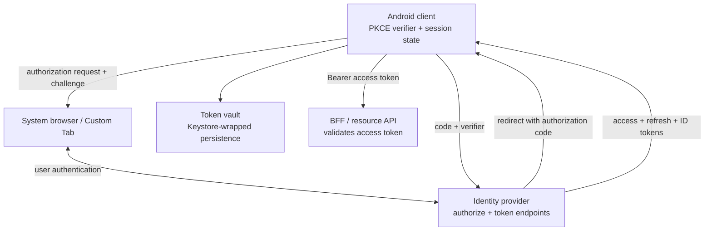
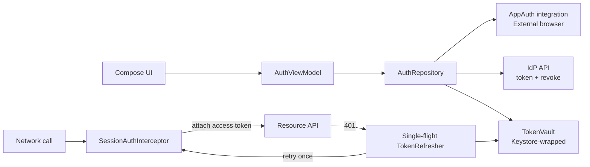

# Authentication (OAuth 2.0 + OIDC + Token Storage)

> A 45-60 minute mobile system-design walkthrough for the authentication subsystem of an Android app. The IdP and token-issuance internals are black boxes — the bulk of this file is what the *client* does: OAuth Authorization Code + PKCE, token storage, silent refresh, and biometric re-auth.

---

## 1. Gathering Requirements (~5 min)

> **Interviewer:** "Design authentication for a mobile app."
> **Candidate:** "The interesting mobile decisions are: Authorization Code + PKCE (not implicit), secure token storage, silent refresh under bad networks, and re-auth without bouncing the user. I'll deep-dive the token lifecycle."

### Functional Requirements
- **Sign in through the browser-hosted IdP** with email/password, social (Google, Apple), magic link, or **Passkeys (WebAuthn/FIDO2)** for phishing-resistant passwordless auth.
- **Persistent session** across app restarts.
- **Silent refresh** of access tokens before expiry.
- **Sign out** that revokes tokens server-side.
- **Re-authenticate** (biometric or password) for sensitive actions.

### Non-Functional Requirements
- **Persisted tokens follow the storage threat model** (direct Keystore-backed envelope when encryption at rest is required; legacy wrappers have a migration plan).
- **No password through the app** (all interactive methods, including first-party email, stay in the browser-hosted IdP).
- **Resilient to clock skew** (refresh treats `exp` as advisory; server is the truth).
- **Sign-out within seconds**, even offline (clear local).
- **No PII in logs**.

### Out of Scope
- Account creation / KYC
- Password reset UX (handled by OAuth `/forgot` redirect)
- Multi-factor enrollment flow (handled by IdP)
- Identity provider design (we treat Auth0/Cognito/Keycloak as a black box)
- Native Credential Manager passkey integration and app-owned WebAuthn relying-party endpoints
- Enterprise SSO (SAML) — out of mobile scope

---

## 2. Clarifying Questions (~3 min)

| Question | Why it matters |
|---|---|
| IdP (Auth0, Cognito, custom)? | OIDC discovery URL, scopes, refresh token rotation policy |
| First-party email or only federated? | Which methods the browser-hosted IdP must offer |
| Tokens (JWT or opaque)? | Local introspection vs. always-server |
| Access token lifetime? | Silent-refresh cadence |
| Refresh token rotation (one-time)? | Race conditions on concurrent refresh |
| Biometric tier (Class-3)? | Whether to bind a Keystore key with `setUserAuthenticationRequired` |
| Multi-account on one device? | Token vault scoping |
| Compliance (HIPAA, banking)? | Tighter idle timeouts, mandatory biometric |

> **Candidate:** "Auth0 IdP, federated + email, JWT access tokens (15 min), rotating refresh tokens (30-day), Class-3 biometric for re-auth, single account per device, Android 9+."

---

## 3. High-Level Diagram (~10 min)



The browser owns interactive authentication, PKCE binds the returned code to the initiating app instance, and the resource API trusts only a validated access token—not the fact that the client displayed a login screen.

Passkeys stay inside this browser-hosted IdP boundary. The IdP sends the WebAuthn challenge, the browser invokes the platform passkey provider, and the IdP verifies the signed assertion, RP ID, origin, and replay controls before continuing the OAuth flow. The Android app never handles WebAuthn challenge/assertion JSON; after successful passkey authentication it receives the same authorization-code redirect as every other IdP method. A native Credential Manager flow would require app-owned challenge and assertion endpoints plus relying-party verification and is a separate design.

**Components on device:**
- **AppAuth integration** — launches the IdP authorization in an external browser and owns the pending attempt/result lifecycle.
- **`TokenVault`** — encrypted at rest (Keystore-wrapped).
- **`TokenRefresher`** — single-flight refresh coroutine.
- **`SessionAuthInterceptor`** — adds `Authorization: Bearer …` and handles 401s.
- **`SignOutOrchestrator`** — local invalidation + session cleanup/navigation + bounded server revocation.

---

## 4. API Contract

### Authorization Code + PKCE

```
1. App generates verifier (random 64-char base64url) + challenge (SHA-256 of verifier)
2. App opens Chrome Custom Tab:
     /authorize?response_type=code&client_id=…&redirect_uri=…
                &code_challenge=…&code_challenge_method=S256
                &scope=openid+profile+offline_access&state=…
3. User authenticates in browser (including any IdP-owned passkey ceremony); IdP redirects to:
     https://auth.example.com/callback?code=…&state=…   (verified App Link)
4. App exchanges code for tokens:
     POST /token { grant_type=authorization_code, code, code_verifier, client_id, redirect_uri }
   → { access_token, id_token, refresh_token, expires_in }
```

### Refresh

```http
POST /token
grant_type=refresh_token&refresh_token=…&client_id=…

200 OK
{ "access_token": "…", "refresh_token": "…(new, rotated)", "expires_in": 900 }
```

### Resource API (every request)

```http
GET /v1/me
Authorization: Bearer eyJhbG…
```

### Revoke

```http
POST /revoke
token=…&token_type_hint=refresh_token
```

---

## 5. Mobile App Architecture

### Module structure

```
:app
:feature:auth          ← login/landing screens
:core:auth             ← TokenVault, TokenRefresher, SessionAuthInterceptor
:core:secure           ← Keystore, BiometricPrompt helpers
:core:network          ← OkHttp + Retrofit with SessionAuthInterceptor wired
:data:user
```

### Layered diagram



Interactive login and silent refresh share one repository and vault, while the network layer centralizes token attachment and permits only one refresh operation for concurrent 401 responses.

Validated against: [OAuth 2.0 for native apps (RFC 8252)](https://www.rfc-editor.org/rfc/rfc8252) and [OAuth 2.0 PKCE (RFC 7636)](https://www.rfc-editor.org/rfc/rfc7636).

### Key class signatures

A login creates one vault, refresher and authenticated client, including a re-login to the same account. Operations retain that session's objects. Logout permanently invalidates the old vault before another login is published; no refresh, biometric callback or old operation may save into the new session.

```kotlin
// App-defined storage contract, not an Android/Keystore API.
interface TokenVault {
    suspend fun load(): Tokens?
    suspend fun replaceIfCurrent(expected: Tokens, replacement: Tokens): Tokens?
    suspend fun invalidateIfCurrent(expected: Tokens): Boolean
    suspend fun invalidate(): Tokens? // Atomically ends this session and returns its last tokens.
    suspend fun lastReauthAt(): Long
    suspend fun recordReauthIfActive(at: Long): Boolean
}

interface TokenRefresher {
    suspend fun freshAccessToken(): String
    suspend fun refreshNow(failedAccessToken: String): Tokens
}
```

`replaceIfCurrent` and invalidation must share one atomic storage boundary: compare-and-save cannot be implemented as separate `load` and `save` calls. Once invalidated, a vault returns no tokens and rejects every replacement. Re-auth timestamps are separate session metadata, so recording a biometric result cannot overwrite a concurrent token rotation. The [session-store example](../android/networking-and-security/retrofit-and-okhttp.md#production-example) demonstrates the process-local boundary; durable storage must preserve the same guarantees, including preventing a late encrypted-file write after logout.

---

## 6. Local Storage (Token vault)

Tokens should stay in memory when possible. If persistence is required, store a versioned ciphertext envelope protected by a direct Android Keystore key; treat `EncryptedSharedPreferences` as legacy migration input.

```kotlin
data class Tokens(
    val accessToken: String,
    val refreshToken: String,
    val idToken: String?,
    val accessExpiresAt: Long,
    val obtainedAt: Long,
) {
    override fun toString(): String = "Tokens([redacted])"
}
```

Persist only through the session vault's atomic operations, using a versioned `IV + ciphertext` envelope in private storage. The encryption primitives and migration rules live in [Secure Storage on Android](../security/secure-storage-on-android.md). Encryption does not serialize writers or establish session ownership. A generated data-class `toString()` would expose credentials, so this example redacts it; do not log properties or serialize tokens into diagnostics either.

> **Probing Q:** "Why not Room?" Room is useful only if the token data needs relational queries. Storage shape and encryption key custody are separate decisions.

---

## 7. Deep Dive: Token Lifecycle (~15 min)

> *I'd pick this as the deep dive because it covers: PKCE login, silent refresh under concurrency, 401 retry, rotation race, and the biometric gate — most of the auth bugs that ship to prod.*

### Login (Authorization Code + PKCE)

Use a maintained native OAuth/OIDC library such as [AppAuth-Android](https://github.com/openid/AppAuth-Android), with an external browser and its completion/cancellation flow. The request core below uses AppAuth; it is not a complete Activity or process-restoration implementation.

```kotlin
fun authorizationRequest(
    configuration: AuthorizationServiceConfiguration,
    clientId: String,
    registeredRedirect: Uri,
): AuthorizationRequest = AuthorizationRequest.Builder(
    configuration, clientId, ResponseTypeValues.CODE, registeredRedirect,
).setScope("openid profile offline_access").build()
```

AppAuth generates state and PKCE values for this request. Persist one bounded pending attempt before browser launch using its documented request serialization and result flow. The application owns expiry, cancellation and recovery after process recreation; a raw suspended Activity continuation is not durable login state.

For both successful and error callbacks, validate the exact registered scheme/host/path, issuer and pending attempt, including state. Apply the same checks on cold launch and `onNewIntent`, consume the attempt once, and reject duplicate, expired, cancelled or superseded results. Exchange only against the configured issuer's token endpoint. For OIDC, apply the library's ID-token/nonce validation and the provider's documented requirements. Admit tokens only while that attempt remains current, so an old callback cannot restore a cancelled login or replace a newer account.

Prefer the registered verified App Link `https://auth.example.com/callback` when the provider supports it (RFC 8252 §7.2). Domain verification does not replace callback validation. A private-use scheme such as `com.example.app:/oauth2redirect` can be intercepted and still needs PKCE and exact response validation (RFC 8252 §7.1). See the [canonical login integration contract](../security/auth-on-mobile.md#2-oauth-20-authorization-code--pkce-the-login).

### Single-flight refresh

The dangerous bug: two requests both see expired tokens, both refresh, the first refresh rotates the refresh token, the second fails with `invalid_grant`. Solution: single-flight — serialize refreshes and refresh only if the vault still holds the token that failed.

```kotlin
class NotSignedIn : IOException("Session ended")

// Dedicated token-endpoint adapter: bounded I/O, no automatic refresh retry,
// no authenticated resource client, no body logging. Null means ONLY a
// confirmed terminal credential rejection (for example invalid_grant).
interface RefreshApi {
    suspend fun refreshOrNull(refreshToken: String): RefreshResponse?
}

data class RefreshResponse(
    val accessToken: String,
    val refreshToken: String?, // OAuth permits omission: retain the old refresh token then.
    val expiresInSec: Long,
)

class DefaultTokenRefresher(
    private val vault: TokenVault,
    private val api: RefreshApi,
    private val nowMillis: () -> Long,
) : TokenRefresher {
    private val mutex = Mutex()

    override suspend fun freshAccessToken(): String {
        val current = vault.load() ?: throw NotSignedIn()
        if (current.accessExpiresAt - nowMillis() > 60_000) return current.accessToken
        return refreshNow(current.accessToken).accessToken
    }

    override suspend fun refreshNow(failedAccessToken: String): Tokens {
        currentCoroutineContext().ensureActive()
        val result = mutex.withLock {
            currentCoroutineContext().ensureActive()
            val current = vault.load() ?: throw NotSignedIn()
            if (current.accessToken != failedAccessToken) return@withLock current
            // Once rotation starts, finish its bounded I/O and atomic commit.
            withContext(NonCancellable) {
                val response = api.refreshOrNull(current.refreshToken)
                if (response == null) {
                    vault.invalidateIfCurrent(current)
                    throw NotSignedIn()
                }
                val replacement = current.copy(
                    accessToken = response.accessToken,
                    refreshToken = response.refreshToken ?: current.refreshToken,
                    accessExpiresAt = nowMillis() + response.expiresInSec * 1000,
                    obtainedAt = nowMillis(),
                )
                vault.replaceIfCurrent(current, replacement) ?: throw NotSignedIn()
            }
        }
        currentCoroutineContext().ensureActive()
        return result
    }
}
```

The caller owns this suspending operation; there is no hidden `appScope.async` job. A waiter can cancel while acquiring the mutex. Once it owns a refresh, cancellation waits for the bounded rotation/commit, then reaches the caller. Other waiters read the updated pair rather than refreshing again. A terminal rejection invalidates that session so queued callers stop; transient transport/server failures propagate as `IOException` and preserve its tokens. Later callers can retry under a bounded backoff policy, rather than treating network loss as logout.

The adapter must enforce real network timeouts independently of caller cancellation, validate the token response, and map only a confirmed credential rejection to `null`. Durable commit failure, a lost response or process death during rotation cannot be made atomic with the IdP: recovery depends on its rotation/reuse policy and may require re-login. A mutex and `NonCancellable` protect neither process death nor a second process.

### OkHttp interceptor

```kotlin
class SessionAuthInterceptor(
    private val vault: TokenVault,
    private val refresher: TokenRefresher,
    private val apiOrigin: HttpUrl,
) : Interceptor {
    override fun intercept(chain: Interceptor.Chain): Response {
        val request = chain.request()
        if (!request.url.sameOriginAs(apiOrigin)) throw IOException("Outside session API origin")
        val token = runBlocking { refresher.freshAccessToken() }
        val response = chain.proceed(request.newBuilder()
            .header("Authorization", "Bearer $token").build())
        // This example permits a single auth follow-up for bodyless reads only.
        if (response.code != 401 || request.method !in setOf("GET", "HEAD") ||
            request.body != null || chain.call().isCanceled()) return response
        response.close()
        val refreshed = runBlocking { refresher.refreshNow(token).accessToken }
        if (chain.call().isCanceled() || runBlocking { vault.load()?.accessToken } != refreshed) {
            throw IOException("Call canceled or session ended")
        }
        return chain.proceed(request.newBuilder()
            .header("Authorization", "Bearer $refreshed").build())
    }
}
```

Use the HTTPS scheme/host/port predicate from [Retrofit and OkHttp](../android/networking-and-security/retrofit-and-okhttp.md#internal-mechanics). Build this client with redirects disabled, no second authenticator, and a total call deadline. Public and IdP requests use separate clients; there is no caller-supplied `X-No-Auth` bypass. A second 401, a write, or a request body returns without replay. A terminal refresh rejection ends the captured session and fails this call with `NotSignedIn` (`IOException`); transient refresh failure also fails the call but leaves the session active.

`runBlocking` is the explicit synchronous OkHttp bridge. `execute()` runs interceptors on its calling thread; `enqueue()` uses the dispatcher. Never call `execute()` on main, and do not assume a Retrofit API choice moves all work off main. Canceling an OkHttp call does not automatically cancel arbitrary blocking coroutine work, so the adapter's independent bound is necessary. A request already sent can still finish after logout: cancel old-session calls and reject their results in UI and persistence using the captured session identity.

### Biometric re-auth (sensitive actions)

A local prompt or `lastReauthAt` timestamp can gate UI, but cannot authorize a server-side transfer or password change. For a product that requires biometric-bound proof, use an enrolled Keystore key with the appropriate per-use authentication policy and a `BiometricPrompt.CryptoObject`; a prompt result alone is not cryptographic action binding.

The server issues a fresh challenge bound to the authenticated session, action ID, endpoint and canonical parameters. The client signs those bytes after authentication and submits the proof. The backend verifies the enrolled key and binding and atomically consumes the challenge with authorization/durable operation creation; uncertain retries return the recorded outcome. A server-issued recent-auth grant, if supported, needs server-enforced scope, expiry and replay policy rather than a client clock decision.

Use the [canonical step-up contract](../security/auth-on-mobile.md#6-biometric-step-up) and [key enrollment guidance](../security/attestation.md) for implementation. Cancellation, no enrollment, invalidated keys and account changes fail closed or enter a separately authenticated recovery flow. Do not fall back to an unverified local timestamp or log proof material.

### Sign out

Invalidate the captured session locally **before** suspending for revocation. The session manager serializes this transition with login/account switch and prevents old cleanup from unpublishing a newer session. Cancel that session's calls and work, clear only its namespaced data, and navigate to login only if it is still the displayed session. Do not run an old operation's `db.clearAllTables()` against a new account's database.

Then attempt bounded server revocation using the captured refresh token on the dedicated IdP client. Re-throw `CancellationException`; report transient revocation failure without restoring the local session. Local invalidation is not proof of server revocation, especially if rotation was already in flight. Reliable account-wide logout requires the IdP/backend's session-revocation contract; a failed best-effort request cannot promise it.

### Failure modes

| What breaks | Behavior |
|---|---|
| Refresh returns 400 `invalid_grant` | Expired, revoked or otherwise invalid grant; end only the captured login session |
| Network down during refresh | Retain session; report transient failure, and retry only within worker/UI backoff policy |
| Clock skew (device 10 min off) | `exp` is advisory; server is truth; 401 triggers refresh |
| Concurrent refresh from 2 threads | Single-flight `Mutex`; refresh only if the vault still holds the failed token |
| Process killed mid-refresh | Outcome may be ambiguous after rotation; follow the IdP recovery policy or re-login |
| User signs out on another device | Depends on IdP revocation policy; a confirmed `invalid_grant` ends this local session |
| Biometric not enrolled | Fall back to password re-prompt |

---

## 8. Trade-offs

### OAuth flow

| Option | Pros | Cons | Verdict |
|---|---|---|---|
| **Authorization Code + PKCE** | Industry standard, secure, federated | Browser handoff | Pick this |
| Implicit | Simpler | Leaks tokens in URL; SHOULD NOT be used (RFC 9700 §2.1.2) | Skip |
| Resource Owner Password | Direct password capture | Defeats OAuth; MUST NOT be used (RFC 9700 §2.4) | Never |
| Device Code | TV/console | Bad mobile UX | Skip |

### Token storage

| Option | Verdict |
|---|---|
| **Token vault** | Direct Android Keystore key + versioned ciphertext in private storage |
| DataStore + Tink-wrapped serializer | Acceptable; more code |
| Plain SharedPreferences | Don't — plaintext on disk |
| Keystore-wrapped per-token AES-GCM | Strongest; complex; warranted for banking |

### Refresh strategy

| Option | Verdict |
|---|---|
| **Pre-emptive refresh at `exp - N`** | Pick — avoids a failed request in the common case |
| Refresh on 401 (lazy) | Keep as the safety net (clock skew, revocation) |
| Periodic background refresh | Wastes battery; users may not return |

### Browser tab

| Option | Verdict |
|---|---|
| **External browser via AppAuth** | Pick — prefer a compatible browser with Custom Tabs; other supported browsers remain valid |
| WebView | Don't — the host app can read credentials and cookies (RFC 8252 §8.12), and there is no SSO with the browser |
| Standalone external browser | Supported fallback; browser choice and cookie/SSO behavior depend on the selected browser |

### Biometric

| Option | Verdict |
|---|---|
| **BiometricPrompt + AndroidX-Biometric** | Pick — Class-3 strong where available |
| `FingerprintManager` | Deprecated |
| No biometric | Acceptable below threshold; never for sensitive money |

---

## 9. Major Concerns

- **PKCE always.** Even if the IdP supports public clients without PKCE, do it. Defense against authorization-code interception.
- **Refresh token rotation.** Use IdPs that rotate on each refresh; treat rotation race with single-flight.
- **Token exfiltration.** Never log tokens. Strip from headers in any error reporting.
- **Biometric binding.** For high-stakes apps, bind a Keystore-resident key with `setUserAuthenticationRequired(true)` so the access token decryption requires biometric.
- **Clock skew.** Don't trust the device clock for `exp` enforcement. Use it as a hint; 401 is the truth.
- **Sign-out hygiene.** Invalidate the captured login before network revocation; cancel and clear its calls, work and namespaced data. Browser SSO cookies require a separate IdP logout flow; an app cannot promise to clear the browser cookie jar.
- **Multi-account.** If supported, bind a fresh vault/client to each login session, including re-login to the same account; namespace account data and reject retired-session results.
- **Backups.** Exclude token-vault ciphertext and metadata from cloud backup/device transfer, or deliberately disable backup when product requirements allow it.
- **Phishing.** Keep IdP login in an external browser, preferably a compatible Custom Tab through AppAuth. Do not use an embedded WebView; Chrome and Custom Tabs are not mandatory.

---

## 10. Follow-up Questions

> **Q: User opens 3 tabs and they all 401 at the same time — what happens?**
> Single-flight: the first caller takes the `Mutex` and refreshes. The other two wait for the lock, see that the vault no longer holds the token that failed, and return the new one. Only one POST `/token` happens. All three can retry bodyless reads with the new access token. Writes require an explicit replay-safety contract; this interceptor returns their 401 without replay.

> **Q: Refresh token is revoked or no longer usable — what's the UX?**
> A confirmed `invalid_grant` ends the captured login session. Clear only that session and route to login if it is still current. Another device's login does not necessarily revoke this grant; the IdP's policy decides. Transient failures retain the session.

> **Q: How is silent re-auth handled if the user has been offline for days?**
> Refresh succeeds when network returns. If the refresh token expired (e.g., 30 days idle), they re-login through the browser.

> **Q: Why not store the access token in memory only?**
> That is the stricter option: keep the short-lived access token in memory and persist only the refresh token, paying one refresh call after process death. This design persists both in the Keystore-backed vault so a relaunched app can call the API immediately; the access token's short lifetime and server-side revocation limit the extra exposure.

> **Q: How is the redirect deep link secured?**
> The redirect uses `https://auth.example.com/callback` with App Links + Digital Asset Links, plus exact callback/issuer/state validation and single-use pending-attempt handling. Prefer a verified domain, but do not treat routing alone as authorization. PKCE binds the code exchange to the initiating client.

> **Q: How do you test the auth flow?**
> OkHttp `MockWebServer` for IdP endpoints. Fake `TokenVault` with in-memory map. Espresso/Compose UI tests against the fake. Manual real-IdP smoke test on each release.

---

## 11. Out of Scope (defended)

- **Account creation / KYC** — separate flow, often vendor-specific (Persona, Stripe Identity).
- **Multi-factor enrollment** — handled by IdP; client only handles challenge.
- **Federated SSO (SAML)** — enterprise; usually mobile uses OIDC.
- **Anti-bot / CAPTCHA** — embedded in IdP screens.
- **Cross-device session sync** — IdP feature.

---

## 12. Further Reading

- [OAuth 2.0 for Native Apps (RFC 8252)](https://www.rfc-editor.org/rfc/rfc8252) — canonical mobile guidance.
- [OAuth 2.0 PKCE (RFC 7636)](https://www.rfc-editor.org/rfc/rfc7636) — PKCE spec.
- [OAuth 2.0 Security Best Current Practice (RFC 9700)](https://www.rfc-editor.org/rfc/rfc9700) — why implicit and password grants are out.
- [AppAuth for Android](https://github.com/openid/AppAuth-Android) — reference OIDC + PKCE client library.
- [Android Developers — Android Keystore](https://developer.android.com/privacy-and-security/keystore) — current key-custody primitive.
- [Android Developers — Biometric authentication](https://developer.android.com/identity/sign-in/biometric-auth) — Class-3 prompts.
- [OAuth 2.0, RFC 6749 §5.2 and §6](https://www.rfc-editor.org/rfc/rfc6749) — terminal grant errors and optional refresh-token replacement.
- [Kotlin Mutex cancellation](https://kotlinlang.org/api/kotlinx.coroutines/kotlinx-coroutines-core/kotlinx.coroutines.sync/-mutex/lock.html) and [NonCancellable](https://kotlinlang.org/api/kotlinx.coroutines/kotlinx-coroutines-core/kotlinx.coroutines/-non-cancellable/) — cancelable waiters and bounded commit protection.
- [OkHttp Call contract (official source)](https://raw.githubusercontent.com/square/okhttp/master/okhttp/src/commonJvmAndroid/kotlin/okhttp3/Call.kt) — synchronous execution, enqueue and cancellation.
- [OAuth token revocation, RFC 7009](https://www.rfc-editor.org/rfc/rfc7009) — server-side revocation and its limits.

---

> **Closing in the interview:** "Token lifecycle was the deep dive because every bug lives in refresh races and 401 handling. Happy to go into App Links verification, biometric binding, or how the sign-out tag cascade works next."
