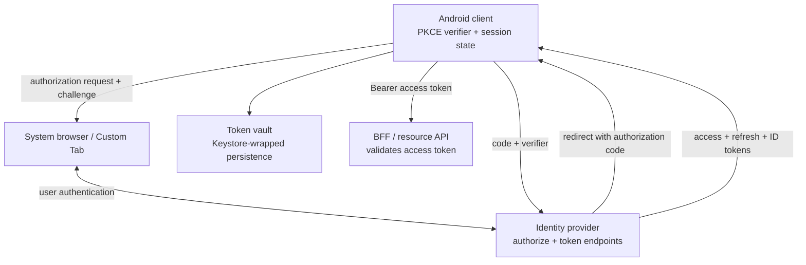
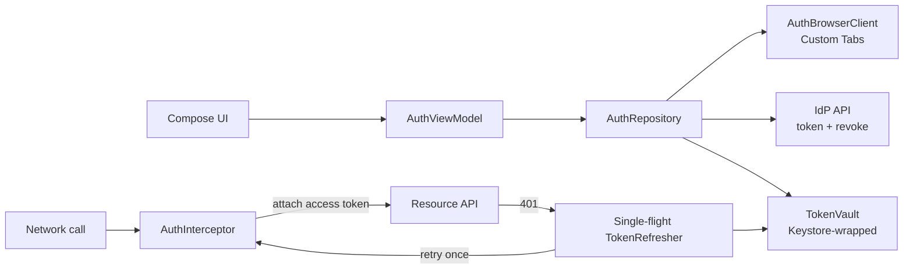

# Authentication (OAuth 2.0 + OIDC + Token Storage)

> A 45-60 minute mobile system-design walkthrough for the authentication subsystem of an Android app. The IdP and token-issuance internals are black boxes — the bulk of this file is what the *client* does: OAuth Authorization Code + PKCE, token storage, silent refresh, and biometric re-auth.

---

## 1. Gathering Requirements (~5 min)

> **Interviewer:** "Design authentication for a mobile app."
> **Candidate:** "The interesting mobile decisions are: Authorization Code + PKCE (not implicit), secure token storage, silent refresh under bad networks, and re-auth without bouncing the user. I'll deep-dive the token lifecycle."

### Functional Requirements
- **Sign in through the browser-hosted IdP** with email/password, social (Google, Apple), magic link, or **Passkeys (WebAuthn/FIDO2)** for phishing-resistant passwordless auth.
- **Persistent session** across app restarts.
- **Silent refresh** of access tokens before expiry.
- **Sign out** that revokes tokens server-side.
- **Re-authenticate** (biometric or password) for sensitive actions.

### Non-Functional Requirements
- **Persisted tokens follow the storage threat model** (direct Keystore-backed envelope when encryption at rest is required; legacy wrappers have a migration plan).
- **No password through the app** (all interactive methods, including first-party email, stay in the browser-hosted IdP).
- **Resilient to clock skew** (refresh treats `exp` as advisory; server is the truth).
- **Sign-out within seconds**, even offline (clear local).
- **No PII in logs**.

### Out of Scope
- Account creation / KYC
- Password reset UX (handled by OAuth `/forgot` redirect)
- Multi-factor enrollment flow (handled by IdP)
- Identity provider design (we treat Auth0/Cognito/Keycloak as a black box)
- Native Credential Manager passkey integration and app-owned WebAuthn relying-party endpoints
- Enterprise SSO (SAML) — out of mobile scope

---

## 2. Clarifying Questions (~3 min)

| Question | Why it matters |
|---|---|
| IdP (Auth0, Cognito, custom)? | OIDC discovery URL, scopes, refresh token rotation policy |
| First-party email or only federated? | Which methods the browser-hosted IdP must offer |
| Tokens (JWT or opaque)? | Local introspection vs. always-server |
| Access token lifetime? | Silent-refresh cadence |
| Refresh token rotation (one-time)? | Race conditions on concurrent refresh |
| Biometric tier (Class-3)? | Whether to bind a Keystore key with `setUserAuthenticationRequired` |
| Multi-account on one device? | Token vault scoping |
| Compliance (HIPAA, banking)? | Tighter idle timeouts, mandatory biometric |

> **Candidate:** "Auth0 IdP, federated + email, JWT access tokens (15 min), rotating refresh tokens (30-day), Class-3 biometric for re-auth, single account per device, Android 9+."

---

## 3. High-Level Diagram (~10 min)



The browser owns interactive authentication, PKCE binds the returned code to the initiating app instance, and the resource API trusts only a validated access token—not the fact that the client displayed a login screen.

Passkeys stay inside this browser-hosted IdP boundary. The IdP sends the WebAuthn challenge, the browser invokes the platform passkey provider, and the IdP verifies the signed assertion, RP ID, origin, and replay controls before continuing the OAuth flow. The Android app never handles WebAuthn challenge/assertion JSON; after successful passkey authentication it receives the same authorization-code redirect as every other IdP method. A native Credential Manager flow would require app-owned challenge and assertion endpoints plus relying-party verification and is a separate design.

**Components on device:**
- **`AuthBrowserClient`** — Chrome Custom Tabs for the IdP redirect.
- **`TokenVault`** — encrypted at rest (Keystore-wrapped).
- **`TokenRefresher`** — single-flight refresh coroutine.
- **`AuthInterceptor`** — adds `Authorization: Bearer …` and handles 401s.
- **`SignOutOrchestrator`** — server revoke + local clear + nav reset.

---

## 4. API Contract

### Authorization Code + PKCE

```
1. App generates verifier (random 64-char base64url) + challenge (SHA-256 of verifier)
2. App opens Chrome Custom Tab:
     /authorize?response_type=code&client_id=…&redirect_uri=…
                &code_challenge=…&code_challenge_method=S256
                &scope=openid+profile+offline_access&state=…
3. User authenticates in browser (including any IdP-owned passkey ceremony); IdP redirects to:
     myapp://auth/callback?code=…&state=…
4. App exchanges code for tokens:
     POST /token { grant_type=authorization_code, code, code_verifier, client_id, redirect_uri }
   → { access_token, id_token, refresh_token, expires_in }
```

### Refresh

```http
POST /token
grant_type=refresh_token&refresh_token=…&client_id=…

200 OK
{ "access_token": "…", "refresh_token": "…(new, rotated)", "expires_in": 900 }
```

### Resource API (every request)

```http
GET /v1/me
Authorization: Bearer eyJhbG…
```

### Revoke

```http
POST /revoke
token=…&token_type_hint=refresh_token
```

---

## 5. Mobile App Architecture

### Module structure

```
:app
:feature:auth          ← login/landing screens
:core:auth             ← TokenVault, TokenRefresher, AuthInterceptor
:core:secure           ← Keystore, BiometricPrompt helpers
:core:network          ← OkHttp + Retrofit with AuthInterceptor wired
:data:user
```

### Layered diagram



Interactive login and silent refresh share one repository and vault, while the network layer centralizes token attachment and permits only one refresh operation for concurrent 401 responses.

Validated against: [OAuth 2.0 for native apps (RFC 8252)](https://www.rfc-editor.org/rfc/rfc8252) and [OAuth 2.0 PKCE (RFC 7636)](https://www.rfc-editor.org/rfc/rfc7636).

### Key class signatures

```kotlin
interface TokenVault {
    suspend fun save(tokens: Tokens)
    suspend fun load(): Tokens?
    suspend fun clear()
}

interface TokenRefresher {
    suspend fun freshAccessToken(): String   // single-flight; returns valid token or throws
    suspend fun refreshNow(): Tokens         // forces refresh
}

class AuthInterceptor(private val refresher: TokenRefresher) : Interceptor {
    override fun intercept(chain: Chain): Response { ... }
}
```

---

## 6. Local Storage (Token vault)

Tokens should stay in memory when possible. If persistence is required, store a versioned ciphertext envelope protected by a direct Android Keystore key; treat `EncryptedSharedPreferences` as legacy migration input.

```kotlin
data class Tokens(
    val accessToken: String,
    val refreshToken: String,
    val idToken: String?,
    val accessExpiresAt: Long,
    val obtainedAt: Long
)

class TokenVault(
    private val aead: AndroidKeystoreAead,
    private val store: PrivateCiphertextStore,
) {
    suspend fun save(tokens: Tokens) =
        store.write(aead.encrypt(json.encodeToString(tokens).encodeToByteArray()))

    suspend fun load(): Tokens? = store.read()?.let { encrypted ->
        json.decodeFromString(aead.decrypt(encrypted).decodeToString())
    }
}
```

`PrivateCiphertextStore` owns a versioned `IV + ciphertext` representation; the direct Keystore implementation and migration rules live in [Secure Storage on Android](../security/secure-storage-on-android.md).

> **Probing Q:** "Why not Room?" Room is useful only if the token data needs relational queries. Storage shape and encryption key custody are separate decisions.

---

## 7. Deep Dive: Token Lifecycle (~15 min)

> *I'd pick this as the deep dive because it covers: PKCE login, silent refresh under concurrency, 401 retry, rotation race, and the biometric gate — most of the auth bugs that ship to prod.*

### Login (Authorization Code + PKCE)

```kotlin
class AuthBrowserClient @Inject constructor(...) {
    suspend fun login(): Tokens = suspendCancellableCoroutine { cont ->
        val verifier = generatePkceVerifier()
        val challenge = sha256Base64Url(verifier)
        val state = SecureRandom().nextBytes(16).base64Url()
        verifierStore.put(state, verifier)
        val authUri = Uri.parse(idp.authorizeEndpoint).buildUpon()
            .appendQueryParameter("response_type", "code")
            .appendQueryParameter("client_id", clientId)
            .appendQueryParameter("redirect_uri", REDIRECT_URI)
            .appendQueryParameter("code_challenge", challenge)
            .appendQueryParameter("code_challenge_method", "S256")
            .appendQueryParameter("scope", "openid profile offline_access")
            .appendQueryParameter("state", state)
            .build()
        CustomTabsIntent.Builder().build().launchUrl(activity, authUri)
        // Callback resumes via redirect handling Activity
    }
}
```

The redirect lands in an `AppLink`-registered Activity (myapp://auth/callback) which extracts `code`, validates `state`, exchanges for tokens, and resumes the suspended coroutine.

### Single-flight refresh

The dangerous bug: two requests both see expired tokens, both refresh, the first refresh rotates the refresh token, the second fails with `invalid_grant`. Solution: single-flight.

```kotlin
class DefaultTokenRefresher @Inject constructor(
    private val vault: TokenVault,
    private val api: IdpApi,
) : TokenRefresher {
    private val mutex = Mutex()
    private var inFlight: Deferred<Tokens>? = null

    override suspend fun freshAccessToken(): String {
        val current = vault.load() ?: throw NotSignedIn
        if (current.accessExpiresAt - clock.now() > REFRESH_THRESHOLD_MS) {
            return current.accessToken
        }
        return refreshNow().accessToken
    }

    override suspend fun refreshNow(): Tokens = mutex.withLock {
        inFlight?.let { return it.await() }
        val deferred = scope.async {
            val current = vault.load() ?: throw NotSignedIn
            val resp = api.refresh(current.refreshToken)
            val newTokens = current.copy(
                accessToken = resp.accessToken,
                refreshToken = resp.refreshToken,
                accessExpiresAt = clock.now() + resp.expiresInSec * 1000,
                obtainedAt = clock.now()
            )
            vault.save(newTokens)
            newTokens
        }
        inFlight = deferred
        try { deferred.await() } finally { inFlight = null }
    }
}
```

### OkHttp interceptor

```kotlin
class AuthInterceptor(private val refresher: TokenRefresher) : Interceptor {
    override fun intercept(chain: Chain): Response {
        val originalReq = chain.request()
        if (originalReq.header("X-No-Auth") != null) return chain.proceed(originalReq)

        val token = runBlocking { refresher.freshAccessToken() }
        var response = chain.proceed(originalReq.newBuilder()
            .header("Authorization", "Bearer $token").build())

        if (response.code == 401) {
            response.close()
            val refreshed = runBlocking { refresher.refreshNow().accessToken }
            response = chain.proceed(originalReq.newBuilder()
                .header("Authorization", "Bearer $refreshed").build())
        }
        return response
    }
}
```

> `runBlocking` inside an interceptor is acceptable here because the OkHttp dispatcher thread is allowed to block. We don't run on main.

### Biometric re-auth (sensitive actions)

For sensitive actions (large transfer, password change), require biometric *and* recent re-auth:

```kotlin
suspend fun guardSensitiveAction(activity: FragmentActivity): Boolean {
    val lastReauth = vault.load()?.lastReauthAt ?: 0
    if (clock.now() - lastReauth < 5.minutes.inWholeMilliseconds) return true
    val ok = biometric.require(activity, "Confirm it's you")
    if (ok is BiometricResult.Ok) {
        vault.save(vault.load()!!.copy(lastReauthAt = clock.now()))
        return true
    }
    return false
}
```

### Sign out

```kotlin
suspend fun signOut() {
    val tokens = vault.load() ?: return
    runCatching { api.revoke(tokens.refreshToken) }   // server-side revoke; ignore failure
    vault.clear()
    workManager.cancelAllWorkByTag("user-scoped")
    db.clearAllTables()
    navigator.replaceWithLogin()
}
```

### Failure modes

| What breaks | Behavior |
|---|---|
| Refresh returns 400 `invalid_grant` | Refresh token revoked or rotated by another device; force sign-out |
| Network down during refresh | `Result.retry()` for workers; UI shows session-expired only after grace period |
| Clock skew (device 10 min off) | `exp` is advisory; server is truth; 401 triggers refresh |
| Concurrent refresh from 2 threads | Single-flight `Mutex` + `Deferred` |
| Process killed mid-refresh | New process re-attempts on next API call |
| User signs out on another device | Refresh returns `invalid_grant` → force local sign-out |
| Biometric not enrolled | Fall back to password re-prompt |

---

## 8. Trade-offs

### OAuth flow

| Option | Pros | Cons | Verdict |
|---|---|---|---|
| **Authorization Code + PKCE** | Industry standard, secure, federated | Browser handoff | Pick this |
| Implicit | Simpler | Deprecated, leaks tokens in URL | Skip |
| Resource Owner Password | Direct password capture | Defeats OAuth, increases scope | Only first-party with strong reasons |
| Device Code | TV/console | Bad mobile UX | Skip |

### Token storage

| Option | Verdict |
|---|---|
| **Token vault** | Direct Android Keystore key + versioned ciphertext in private storage |
| DataStore + Tink-wrapped serializer | Acceptable; more code |
| Plain SharedPreferences | Don't — plaintext on disk |
| Keystore-wrapped per-token AES-GCM | Strongest; complex; warranted for banking |

### Refresh strategy

| Option | Verdict |
|---|---|
| **Refresh on 401** (lazy) | Pick — minimal traffic |
| Pre-emptive refresh at `exp - N` | Combine with lazy as safety net |
| Periodic background refresh | Wastes battery; users may not return |

### Browser tab

| Option | Verdict |
|---|---|
| **Chrome Custom Tabs** | Pick — shared cookies, OS-style |
| WebView | Don't — leaks user agent, no shared session |
| External Chrome | OK but loses styling control |

### Biometric

| Option | Verdict |
|---|---|
| **BiometricPrompt + AndroidX-Biometric** | Pick — Class-3 strong where available |
| `FingerprintManager` | Deprecated |
| No biometric | Acceptable below threshold; never for sensitive money |

---

## 9. Major Concerns

- **PKCE always.** Even if the IdP supports public clients without PKCE, do it. Defense against authorization-code interception.
- **Refresh token rotation.** Use IdPs that rotate on each refresh; treat rotation race with single-flight.
- **Token exfiltration.** Never log tokens. Strip from headers in any error reporting.
- **Biometric binding.** For high-stakes apps, bind a Keystore-resident key with `setUserAuthenticationRequired(true)` so the access token decryption requires biometric.
- **Clock skew.** Don't trust the device clock for `exp` enforcement. Use it as a hint; 401 is the truth.
- **Sign-out hygiene.** Clear Room, the token vault, work, and cookies. Cancel `WorkManager` tags by user.
- **Multi-account.** If supported, namespace the vault by account id; never mix tokens.
- **Backups.** Exclude token-vault ciphertext and metadata from cloud backup/device transfer, or deliberately disable backup when product requirements allow it.
- **Phishing.** Don't render IdP UI in WebView. Custom Tabs only.

---

## 10. Follow-up Questions

> **Q: User opens 3 tabs and they all 401 at the same time — what happens?**
> Single-flight: the first one's refresh becomes the `Deferred`. The other two `await()` it. Only one POST `/token` happens. All three retry the original request with the new access token.

> **Q: Refresh token rotated by another device — what's the UX?**
> Local refresh returns `invalid_grant`. We treat that as "session ended", clear local, and route to login with a friendly message. Not an error toast.

> **Q: How is silent re-auth handled if the user has been offline for days?**
> Refresh succeeds when network returns. If the refresh token expired (e.g., 30 days idle), they re-login through the browser.

> **Q: Why not store the access token in memory only?**
> Access tokens survive process death. Memory-only means a relaunched app would force a network round trip before any request. With Keystore-wrapped storage, the cost is decrypt-once on first use.

> **Q: How is the redirect deep link secured?**
> The redirect uses `https://yourdomain/auth/callback` with App Links + Digital Asset Links — verified domain, not interceptable by a malicious app installed alongside. PKCE is a second layer of defense.

> **Q: How do you test the auth flow?**
> WebMock for IdP endpoints. Fake `TokenVault` with in-memory map. Espresso/Compose UI tests against the fake. Manual real-IdP smoke test on each release.

---

## 11. Out of Scope (defended)

- **Account creation / KYC** — separate flow, often vendor-specific (Persona, Stripe Identity).
- **Multi-factor enrollment** — handled by IdP; client only handles challenge.
- **Federated SSO (SAML)** — enterprise; usually mobile uses OIDC.
- **Anti-bot / CAPTCHA** — embedded in IdP screens.
- **Cross-device session sync** — IdP feature.

---

## 12. Further Reading

- [OAuth 2.0 for Native Apps (RFC 8252)](https://www.rfc-editor.org/rfc/rfc8252) — canonical mobile guidance.
- [OAuth 2.0 PKCE (RFC 7636)](https://www.rfc-editor.org/rfc/rfc7636) — PKCE spec.
- [AppAuth for Android](https://github.com/openid/AppAuth-Android) — reference OIDC + PKCE client library.
- [Android Developers — Android Keystore](https://developer.android.com/privacy-and-security/keystore) — current key-custody primitive.
- [Android Developers — Biometric authentication](https://developer.android.com/training/sign-in/biometric-auth) — Class-3 prompts.

---

> **Closing in the interview:** "Token lifecycle was the deep dive because every bug lives in refresh races and 401 handling. Happy to go into App Links verification, biometric binding, or how the sign-out tag cascade works next."
