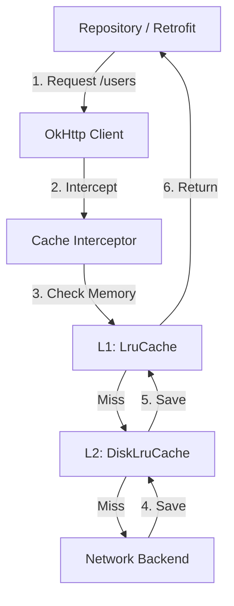

# System Design: Caching Library

## The Prompt

*"Design a generic caching library for Android. It must cache HTTP JSON responses to disk so the app works offline. It must automatically expire stale data, prevent OutOfMemory errors, and be thread-safe when 5 different background Coroutines try to read/write the same cache key simultaneously."*

## 1. Requirements & Clarification (RADIO Framework)

### Functional Requirements
- Store and retrieve key-value pairs (String -> JSON).
- Configure TTL (Time-To-Live) for automatic data expiration.
- Memory caching (L1) and Disk caching (L2).

### Non-Functional Requirements (NFRs)
- **Thread Safety (Priority 0):** If Coroutine A is writing to key "user_99" and Coroutine B tries to read "user_99" at the exact same millisecond, the app must not crash with a `ConcurrentModificationException`.
- **Memory Footprint:** The Memory Cache must never trigger an OOM.
- **Disk I/O:** Reading from the Disk Cache must never freeze the UI thread.

## 2. High-Level Architecture (The Interceptor Pattern)

A Junior engineer implements caching by writing `if (db.hasData()) return db.getData() else fetchNetwork()` in every single ViewModel.
A Staff engineer builds caching as an **OkHttp Interceptor**, completely decoupling it from the business logic.



## 3. Data Model & Components

### 1. The L1 Memory Cache (LruCache)
We use the Android `LruCache` class. It manages eviction automatically.
```kotlin
// Maximum 10 Megabytes of JSON in RAM
val maxMemory = (Runtime.getRuntime().maxMemory() / 1024).toInt()
val cacheSize = maxMemory / 8 // 1/8th of available RAM

val memoryCache = object : LruCache<String, String>(cacheSize) {
    override fun sizeOf(key: String, value: String): Int {
        // Measure size in bytes, not item count
        return value.toByteArray(Charsets.UTF_8).size / 1024
    }
}
```

### 2. The L2 Disk Cache (DiskLruCache)
We use Jake Wharton's `DiskLruCache` (or OkHttp's built-in `Cache`).
```kotlin
// Maximum 50 Megabytes on Disk
val diskCache = Cache(context.cacheDir, 50L * 1024L * 1024L)
```

### 3. The Threading Mutex
To solve the concurrency problem, we must lock specific keys, not the whole database.
```kotlin
// A map of Mutexes per key
val mutexMap = ConcurrentHashMap<String, Mutex>()
```

## 4. The Core Flows (Deep Dive)

### Flow 1: HTTP Cache-Control (The Standard Way)
*Interviewer:* "How do you tell the cache that a specific JSON response is valid for 5 minutes, but another response is valid for 1 year?"

**Staff Answer:**
"I will not invent a custom TTL system. I will rely on standard **HTTP Cache-Control Headers**.
When the backend sends the JSON, it includes the header: `Cache-Control: max-age=300` (5 minutes).
OkHttp's built-in caching engine automatically reads this header. If the mobile app requests the same URL within 5 minutes, OkHttp intercepts the request, blocks the network call, and returns the JSON directly from the local Disk Cache. If 5 minutes have passed, OkHttp automatically fires the network request to fetch fresh data. The backend dictates the TTL, not the mobile client."

### Flow 2: Offline Fallback (Stale-While-Revalidate)
*Interviewer:* "The user opens the app in Airplane mode. The `max-age` of the JSON was 5 minutes, and it has been 6 minutes. The data is officially 'stale'. OkHttp will try to fetch the network, fail, and throw an Exception. The app shows a blank screen. How do you show the stale data instead?"

**Staff Answer:**
"I will configure the `Cache-Control` header with `stale-if-error` or write a custom **Offline Interceptor**.
```kotlin
class OfflineCacheInterceptor(val context: Context) : Interceptor {
    override fun intercept(chain: Interceptor.Chain): Response {
        var request = chain.request()
        if (!hasNetwork(context)) {
            // Force OkHttp to read from cache, even if the data is 7 days stale
            val cacheControl = CacheControl.Builder()
                .maxStale(7, TimeUnit.DAYS)
                .build()
            request = request.newBuilder().cacheControl(cacheControl).build()
        }
        return chain.proceed(request)
    }
}
```
If there is no network, this Interceptor modifies the outgoing request to explicitly accept highly stale data. The app displays the 6-minute-old JSON instead of a crash."

### Flow 3: The Cache Stampede (Concurrency)
*Interviewer:* "The user opens the 'Dashboard' screen. The Dashboard contains 5 different widgets. All 5 widgets simultaneously request `GET /user/profile`. The cache is empty. Your app fires 5 identical HTTP requests to the backend at the exact same millisecond. Fix it."

**Staff Answer:**
"This is the **Cache Stampede** (or Thundering Herd) problem.
To fix this, I must implement **Request De-duplication** using Kotlin Coroutine `Mutex` locking per-key.
1. Widget 1 requests `/user/profile`.
2. The caching library checks `mutexMap["/user/profile"]`. It doesn't exist, so it creates a `Mutex` and locks it.
3. Widget 1 proceeds to fetch from the network.
4. Widgets 2, 3, 4, and 5 request `/user/profile`.
5. They encounter the locked `Mutex`. They are suspended (they wait).
6. Widget 1 finishes the network request and writes the JSON to the Memory Cache. Widget 1 releases the `Mutex`.
7. Widgets 2, 3, 4, and 5 immediately resume. They check the Memory Cache again. The data is now there! They return the cached data.
Only ONE network request is fired, saving backend resources and mobile battery."

## 5. Failure Modes & Bottlenecks

### Bottleneck: Disk I/O Blocking the Main Thread
A junior developer checks the Disk Cache synchronously:
```kotlin
fun getUser(): User {
    return diskCache.get("user") ?: api.fetchUser()
}
```
If the UI thread calls this, the app freezes for 50ms while flash storage is read.
*(Fix: The caching library API must *force* asynchronous access, e.g., returning a `suspend` function or a `Flow`. Disk cache lookups must strictly happen on `Dispatchers.IO`).*

### Bottleneck: PII Leakage (Security)
*Interviewer:* "Your app caches the `GET /bank/balance` response to disk. The user logs out. The user sells their phone. The new owner roots the phone, opens the DiskCache directory, and reads the previous owner's bank balance. Why?"

**Staff Answer:**
"The Disk Cache writes raw plaintext bytes to the file system. 
**The Fix:**
1. **Clear on Logout:** The `AuthManager` must explicitly call `okHttpClient.cache?.evictAll()` the moment the user taps Logout.
2. **No-Store:** The backend must explicitly send `Cache-Control: no-store` for highly sensitive endpoints (like Bank Balances). This mathematically prevents OkHttp from ever writing the JSON to disk, forcing it to only ever exist in volatile RAM."

## 6. Staff Engineer Thinking: Invalidation is Hard

The famous quote: *"There are only two hard things in Computer Science: cache invalidation and naming things."*

A Staff Engineer minimizes cache invalidation logic on the mobile client. If you try to manually delete cache keys (e.g., `cache.remove("user_profile")` when the user updates their name), you will eventually create a bug where stale data persists forever. 
Instead, lean entirely on the HTTP protocol (`ETag`, `Last-Modified`, and `max-age`). Let the backend tell the mobile app exactly when data should die.

## 7. Probing Questions (For Practice)

1.  Explain why building a caching layer using OkHttp Interceptors is architecturally superior to placing caching logic inside a ViewModel or Repository.
2.  Describe the "Cache Stampede" problem and walk through exactly how a Kotlin `Mutex` (locked per-URL) prevents it.
3.  Why must an `LruCache` sizing function measure the size of the objects in Bytes, rather than simply limiting the cache to a specific number of items (e.g., 100 items)?
4.  Explain the HTTP `Cache-Control: max-age` header. How does this allow the backend to control the mobile application's cache expiration?
5.  What is the "Stale-While-Revalidate" pattern? How can an Offline Interceptor force the app to display expired data when the cellular network drops?
6.  Describe the security vulnerability of caching Personally Identifiable Information (PII) to disk, and how the `Cache-Control: no-store` header prevents it.
7.  Why is it critical that all reads from a `DiskLruCache` happen on a background thread (e.g., `Dispatchers.IO`), and what happens if this rule is violated?
8.  Explain why a Staff Engineer prefers to rely on HTTP standard headers (`ETag`, `Last-Modified`) rather than writing custom cache invalidation logic on the Android client.
9.  If two independent coroutines attempt to read the exact same file from the Disk Cache simultaneously, what OS-level mechanism prevents a crash or corrupted read?
10. Walk through the architecture of a Two-Tier Cache (L1 Memory + L2 Disk). Why is the L1 Memory cache necessary if we already have a fast SSD Disk Cache?

## Further Reading

- [`caching.md`](../engineering-fundamentals/caching.md) — The fundamental principles of caching, LRU, and TTls.
- [`retrofit-and-okhttp.md`](../android/networking-and-security/retrofit-and-okhttp.md) — How to implement Interceptors in OkHttp.
- [`security-and-privacy.md`](../mobile-system-design/security-and-privacy.md) — The dangers of storing PII in plaintext on disk.
