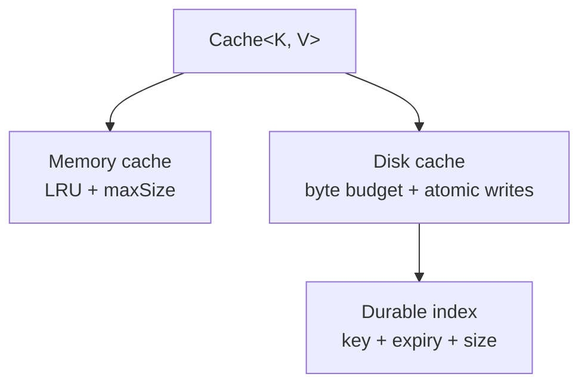
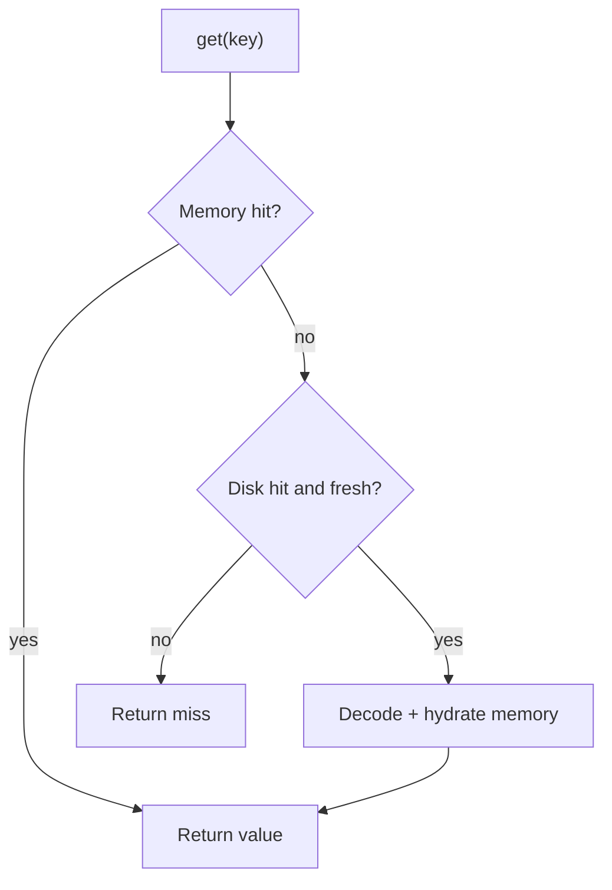
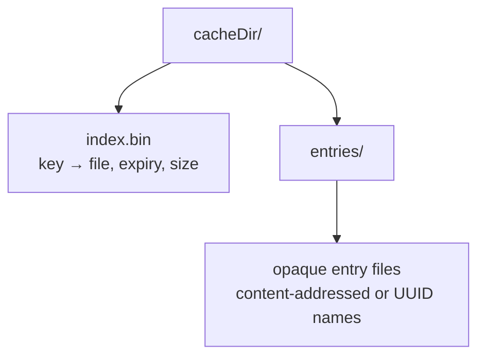

# Caching Library

> A 45-60 minute mobile system-design walkthrough for designing a generic in-process caching library on Android. Think `LruCache` + disk fallback + invalidation: the kind of building block image loaders, network layers, and feature flag systems use underneath.

---

## 1. Gathering Requirements (~5 min)

> **Interviewer:** "Design a caching library for a mobile app."
> **Candidate:** "Lots of products use a tiered memory + disk cache. The interesting tradeoffs are eviction policy, atomic disk writes, and how clients invalidate. I'll deep-dive the read/write path with both tiers."

### Functional Requirements
- **Two-tier**: in-memory + on-disk.
- **Generic types** via `Cache<K, V>` with a pluggable serializer.
- **TTL**: a cache-wide default with a per-call override; expired reads return `null`.
- **Manual invalidate** by key and by predicate.
- **Bounded** by size (memory) and bytes (disk).

### Non-Functional Requirements
- **Thread-safe** (concurrent read/write).
- **Bounded** memory + disk; deterministic eviction.
- **Atomic disk writes** (no torn files on crash).
- **Trivial to test** — in-memory variant + fake clock.
- **No reflection at runtime** for performance.

### Out of Scope
- Distributed / cross-process cache (use `ContentProvider` if needed)
- Encryption at rest (delegate to consumer — they can wrap the serializer)
- Push-driven invalidation (server-driven; caller's problem)
- HTTP cache semantics (handled by OkHttp)

---

## 2. Clarifying Questions (~3 min)

| Question | Why it matters |
|---|---|
| What's the dominant access pattern (read-heavy, write-heavy)? | Eviction policy tradeoff |
| Median value size? | Disk format choice; memory budget |
| Acceptable cold read latency? | Sync vs async disk reads |
| Need observability (hit rate)? | Built-in metrics counter |
| Will it be used from multiple processes? | Lock model |
| Android API floor? | AndroidX `LruCache` has no such constraint here; `DiskLruCache` (archived Jake Wharton repository, or own) |
| Value types primitive or POJO? | Serializer interface |

> **Candidate:** "Assume single-process, read-heavy (~10:1), avg value 1-50 KB, sync API with coroutine wrappers, single-process, Android 9+."

---

## 3. High-Level Diagram (~10 min)



The public cache coordinates two independently bounded tiers: memory optimizes latency, while disk requires atomic data and index updates to remain recoverable.

**Layers (named for context):**
- **`Cache<K, V>`** — public API; orchestrates memory + disk; handles TTL.
- **`MemoryCache`** — `LruCache`-backed, hot tier.
- **`DiskCache`** — atomic writes, an index for O(1) lookup, byte-budget eviction.
- **`Serializer<V>`** — converts to/from `ByteArray` (default: `kotlinx.serialization`).
- **`Clock`** — injectable for tests.

---

## 4. API Contract

```kotlin
interface Cache<K : Any, V : Any> {
    suspend fun get(key: K): V?
    suspend fun put(key: K, value: V)                  // uses the builder's default TTL
    suspend fun put(key: K, value: V, ttl: Duration)   // per-call override; Duration.INFINITE never expires
    suspend fun invalidate(key: K)
    suspend fun invalidateWhere(predicate: (K) -> Boolean)
    suspend fun clear()
    val stats: StateFlow<CacheStats>
}

data class CacheStats(
    val hits: Long, val misses: Long, val evictions: Long,
    val memoryBytes: Long, val diskBytes: Long,
)

interface Serializer<V> {
    fun serialize(value: V): ByteArray                 // writes the versioned envelope
    fun deserializeOrNull(bytes: ByteArray): V?        // null for an unsupported version or undecodable payload
}
```

The default TTL lives in the builder, so it can't be a default parameter value on the interface: an override always uses the base method's default and can't declare its own. Two overloads keep the choice explicit. If the builder sets no TTL, entries don't expire.

### Builder

```kotlin
val cache = CacheBuilder<String, User>()
    .memorySize(maxEntries = 200)
    .diskSize(maxBytes = 50 * MB)
    .diskDir(context.cacheDir.resolve("user-cache"))
    .serializer(KotlinSerializer(User.serializer()))
    .ttl(default = 1.hours)
    .clock(SystemClock)
    .build()
```

---

## 5. Mobile App Architecture

### Module structure

```
:lib:cache
    cache-api          ← Cache interface, models
    cache-memory       ← MemoryCache impl
    cache-disk         ← DiskCache impl
    cache-default      ← composed Cache<K, V>
```

> Splitting the impls lets callers swap in a memory-only variant for tests without pulling the disk dependency.

### Layered diagram



Reads move from the cheapest tier to the durable tier; a disk hit repopulates memory, while expiry is treated as a miss rather than returning silently stale data.

---

## 6. Local Storage (Disk format)

Each entry is one file in the cache dir:



The index owns lookup and eviction metadata; opaque entry filenames avoid leaking raw keys. An entry file and the index are written atomically but separately, so recovery must ignore orphan files and index rows whose file is missing.

`index.bin` is rewritten atomically on flush. Entry files are written `.tmp` → `fsync` → `rename` for atomicity.

```kotlin
internal data class IndexRow(val key: String, val file: String,
                              val expiresAt: Long, val sizeBytes: Long,
                              val lastAccessedAt: Long)
```

> **Probing Q:** "Why not use Room?" Because the value is opaque bytes. Room is for queryable structured data. A bytes cache is simpler as files + an index.

---

## 7. Deep Dive: Read/Write Path with Two Tiers (~15 min)

> *I'd pick this as the deep dive because it covers the core orchestration: hit/miss propagation, eviction, atomic disk I/O, and TTL — the bits that decide whether the library is reliable.*

### Get path

```kotlin
override suspend fun get(key: K): V? {
    val stringKey = key.toString()
    memory.get(stringKey)?.let { cached ->
        if (cached.notExpired(clock)) { stats.recordHit(); return cached.value }
        synchronized(stateLock) {               // expired; leave a newer put alone
            if (memory.get(stringKey) === cached) memory.remove(stringKey)
        }
    }
    val reply = CompletableDeferred<MemoryEntry<V>?>()
    val seen = synchronized(stateLock) {        // the read's queue position and `seen` must match
        diskOps.trySend(DiskOp.Read(stringKey, reply))
        mutations
    }
    val entry = reply.await() ?: run {
        stats.recordMiss(); return null
    }
    synchronized(stateLock) {
        if (mutations == seen) memory.put(stringKey, entry)   // promote only if nothing changed
    }
    stats.recordHit()
    return entry.value
}
```

### Put path

```kotlin
override suspend fun put(key: K, value: V) = put(key, value, defaultTtl)

override suspend fun put(key: K, value: V, ttl: Duration) {
    val stringKey = key.toString()
    val expiresAt = if (ttl == Duration.INFINITE) Long.MAX_VALUE
                    else clock.now() + ttl.inWholeMilliseconds
    val entry = MemoryEntry(value, expiresAt)
    synchronized(stateLock) {                       // memory and queue order must agree
        mutations++
        memory.put(stringKey, entry)
        diskOps.trySend(DiskOp.Write(stringKey, entry))
    }
}

override suspend fun invalidate(key: K) {
    val stringKey = key.toString()
    val done = CompletableDeferred<Unit>()
    synchronized(stateLock) {
        mutations++
        memory.remove(stringKey)
        diskOps.trySend(DiskOp.Remove(stringKey, done))
    }
    done.await()                                    // the old value can't return after a restart
}
```

> Disk write happens off the caller's coroutine. Reads see the value immediately via memory. If the process dies before a queued write runs, we lose that cache entry — that's *acceptable* for a cache. A lost invalidate isn't, because the removed value would come back, so `invalidate` waits for the disk. `invalidateWhere` and `clear` follow the same path: count the mutation, change memory, queue one operation, wait for it.

### Disk queue

```kotlin
private sealed interface DiskOp<out V> {
    class Read<V>(val key: String, val reply: CompletableDeferred<MemoryEntry<V>?>) : DiskOp<V>
    class Write<V>(val key: String, val entry: MemoryEntry<V>) : DiskOp<V>
    class Remove(val key: String, val done: CompletableDeferred<Unit>) : DiskOp<Nothing>
}

private val stateLock = Any()                       // never held across a suspension or disk I/O
private var mutations = 0L                          // guarded by stateLock
private val diskOps = Channel<DiskOp<V>>(Channel.UNLIMITED)

init { diskScope.launch { for (op in diskOps) runDiskOp(op) } }   // one consumer; lives as long as the cache

private fun runDiskOp(op: DiskOp<V>) {
    try {
        when (op) {
            is DiskOp.Read -> op.reply.complete(readFresh(op.key))
            is DiskOp.Write -> {
                val bytes = serializer.serialize(op.entry.value)
                disk.put(op.key, DiskEntry(bytes, op.entry.expiresAt))
                disk.evictIfOverBudget()
            }
            is DiskOp.Remove -> { disk.remove(op.key); op.done.complete(Unit) }
        }
    } catch (e: Exception) {                        // one failure must not stop the queue
        when (op) {
            is DiskOp.Read -> op.reply.complete(null)
            is DiskOp.Write -> disk.forget(op.key)  // drop the index row: a later cold read must not get the old value
            is DiskOp.Remove -> op.done.completeExceptionally(e)
        }
    }
}

private fun readFresh(key: String): MemoryEntry<V>? {
    val stored = disk.get(key) ?: return null
    val value = if (stored.isExpired(clock)) null
                else serializer.deserializeOrNull(stored.payload)
    if (value == null) { disk.remove(key); return null }   // expired or unsupported: same queue slot as the read
    return MemoryEntry(value, stored.expiresAt)
}
```

Every disk operation runs in the order it was queued, which closes these races:

| Race | Without the rule | What happens now |
|---|---|---|
| A `get` reads an old value, then a `put` lands before promotion | The old value overwrites the new one in memory | `mutations` changed, so promotion is skipped |
| A `get` reads an old value, then `invalidate` runs | The removed value returns to memory | Same: promotion is skipped |
| A `get` finds an expired or unsupported entry while a `put` is queued | The removal deletes the newer write | The removal shares the read's queue slot, so the write always lands after it or was already read as fresh |
| `put` then `invalidate`, or two `put`s | The disk ends on an older state | The disk applies them in the order memory did |
| A `put` is evicted from memory before its disk write runs | A cold read returns the old value | The cold read queues behind the write and gets the new value |

### Atomic disk write

```kotlin
internal fun writeAtomic(file: File, bytes: ByteArray) {
    val tmp = File(file.parentFile, "${file.name}.tmp")
    tmp.outputStream().use { it.write(bytes); it.fd.sync() }
    if (!tmp.renameTo(file)) error("rename failed")
}
```

### Eviction policies

| Tier | Policy | Why |
|---|---|---|
| Memory | LRU (LinkedHashMap accessOrder) | `LruCache` is built-in; predictable |
| Disk | Byte-budget LRU via index `lastAccessedAt` | Simple, deterministic; FIFO is too crude |

### TTL handling

- Entries carry `expiresAt` absolute timestamp.
- Checked on every read; expired entries removed lazily (cheap), inside the queued read on disk.
- No background sweeper — adds wakeups for no benefit.

### Concurrency

- `MemoryCache` is `LruCache` (synchronized).
- `stateLock` keeps each memory change, its `mutations` count and its queue position together. It never covers disk work, so memory hits stay fast and don't take it.
- `DiskCache` has one consumer, a coroutine reading a FIFO channel, so one operation touches it at a time; waiting callers suspend rather than block a thread.
- Disk work runs on a coroutine dispatcher, off the caller's thread.
- `mutations` is one counter for the whole cache, on purpose. A write to another key can skip a promotion, which costs one more disk read later and never a wrong value. A per-key version would need its own bounded map.
- Two costs to name: a cold read waits behind queued writes, and the unlimited queue holds a write burst's values outside the memory budget until the disk catches up. If bursts matter, coalesce queued writes per key.

---

## 8. Trade-offs

### Memory tier impl

| Option | Pros | Cons | Verdict |
|---|---|---|---|
| **AndroidX `LruCache`** | Built-in, mature | Synchronized (lock contention) | Pick this |
| Caffeine | Best policies (TinyLfu) | JVM-heavy; KMP unfriendly | Skip for mobile |
| Custom LinkedHashMap | Total control | Reinvents `LruCache` | Skip |

### Disk tier impl

| Option | Pros | Cons | Verdict |
|---|---|---|---|
| **File per entry + index** | Simple, debuggable | Many small files (FS inode pressure) | Pick this |
| `DiskLruCache` (JW) | Proven design; OkHttp keeps its own copy | Repository archived, key constraints | Acceptable |
| SQLite blob table | Atomic, transactional | Schema overhead for bytes | Skip |
| MMKV (Tencent) | Fast, mmap-based | Native lib; key-value only | Niche |

### Serializer

| Option | Pros | Cons | Verdict |
|---|---|---|---|
| **`kotlinx.serialization`** | Code-gen, KMP, fast | Caller must annotate | Pick (default) |
| Moshi/Gson | Familiar | Reflection or codegen, JVM only | Acceptable |
| Custom | Total control | Caller-burden | Always allowed via interface |

### Async model

| Option | Pros | Cons | Verdict |
|---|---|---|---|
| **`suspend` API** | Coroutine-native, structured concurrency | Caller must scope | Pick this |
| `Flow<V>` for reactive | Live updates | Overhead for one-shot reads | Use only for `stats` |
| Callbacks | Old habits | Manual cancellation | Skip |

---

## 9. Major Concerns

- **Crash safety.** Atomic rename for entries. Index rewrite is `tmp + rename`. Lose at most the writes still queued.
- **OOM risk.** Memory tier uses `LruCache` with a *count* budget; size budget if values are large/heterogeneous. Don't unbound the memory tier.
- **Disk pressure.** Byte budget (e.g., 50 MB). Evict from oldest `lastAccessedAt`. Compact index on threshold.
- **Cold start.** Don't load the index on app launch synchronously. Lazy-load on first cache touch.
- **Serializer drift.** Versioned envelope: `{ "v": 2, "payload": ... }`. Unknown version or undecodable payload → `deserializeOrNull` returns `null`, the entry is removed and the read is a cache miss (don't crash). The default serializer catches `IllegalArgumentException`, the parent of kotlinx.serialization's `SerializationException`, so failed validation in a class is covered too.
- **Privacy.** Caller is responsible for not putting sensitive values; if required, offer a reviewed serializer that emits a versioned ciphertext envelope backed by a platform Keystore key.
- **Testing.** Inject `Clock`; use `MemoryCache` only in tests; assert hit rates. Use a fake disk that pauses a read to force each race in the table above, and assert both tiers end on the newest state. Also cover the default and per-call TTL, an unsupported envelope, and a failed disk write.
- **Observability.** `CacheStats` `StateFlow` exposes hits/misses/evictions. Caller wires into telemetry SDK.

---

## 10. Follow-up Questions

> **Q: How do you handle a write while a read is in flight for the same key?**
> A read that fires after the `put` gets the newer value: from memory, or, if the entry has been evicted, from a disk read queued behind the write. A cold read already in flight may return the old value, since it overlaps the write, but it can't promote it: `mutations` changed, so it leaves the newer memory entry in place.

> **Q: What about multi-process access?**
> Out of scope. If needed: switch the disk index to a `ContentProvider`-fronted SQLite table, or use MMKV with file locks. Don't bolt cross-process onto a single-process design.

> **Q: How do you avoid stampedes (many threads fetching the same missing key)?**
> Out of the library's scope, but recommend caller pattern: `coalesce` via a `Map<K, Deferred<V>>` so only one fetch happens per key. Optional helper utility ships in `cache-default`.

> **Q: TTL precision?**
> Millisecond. We don't try to wake at expiry — entries expire lazily on read. Background sweeper would burn battery; not worth it.

> **Q: How big should defaults be?**
> Memory: 1/8 of `Runtime.maxMemory()` if values are bitmaps; smaller (200 entries) for POJOs. Disk: 50 MB. Always overridable.

> **Q: How would Coil's image cache compare?**
> Coil uses the same shape — an in-memory cache of bitmaps + disk bytes — but with bitmap-aware eviction (`sizeOf` per bitmap) and the Coil `MemoryCache.Builder().maxSizePercent(context, 0.25)` helper. Same architecture, image-specialised.

---

## 11. Out of Scope (defended)

- **Cross-process** — adds lock/IPC complexity; few apps need it.
- **Encryption at rest** — caller can wrap the serializer.
- **Distributed cache** — that's a server problem.
- **Push invalidation** — caller's domain event.
- **HTTP semantics** (`Cache-Control`, `Vary`, conditional requests) — OkHttp's cache exists for this.

---

## 12. Further Reading

- [weeeBox/mobile-system-design — caching-library](https://github.com/weeeBox/mobile-system-design/blob/master/exercises/caching-library.md) — reference format.
- [Android Developers — LruCache](https://developer.android.com/reference/kotlin/androidx/collection/LruCache) — canonical in-memory cache.
- [Jake Wharton — DiskLruCache](https://github.com/JakeWharton/DiskLruCache) — reference for the atomic-rename disk pattern.
- [Coil 3 — MemoryCache and DiskCache](https://coil-kt.github.io/coil/image_loaders/) — image-loader take on the same shape.
- [TinyLFU paper (Einziger, Friedman, Manes)](https://arxiv.org/abs/1512.00727) — the admission policy behind Caffeine, for when LRU isn't enough.

---

> **Closing in the interview:** "I anchored on the get/put orchestration because the rest of the library is just policy. Happy to dig into stampede coalescing, the index rewrite scheme, or an MMKV variant next."
